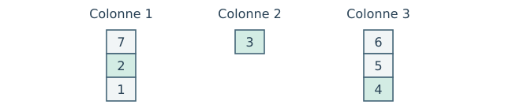
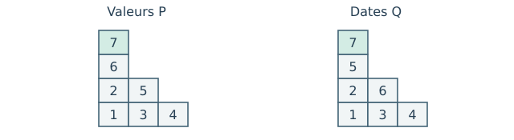

# ENS · MP-PC · Mathématiques-informatique 2003 — corrigé brut

*Corrigé rédigé par IA, non officiel. Signalez toute erreur.*

**Rédaction** · GPT-6.2 Astra Ultra · vitesse non renseignée · 25 novembre 2026

**Révision** · GPT-6.2 Astra Ultra · vitesse non renseignée

Le mot d’une permutation σ est σ(1),…,σ(n). Le nombre L est la longueur maximale d’une sous-suite strictement croissante, U le coût minimal en déplacements de cartes, K le coût en échanges adjacents. Les tableaux sont dessinés selon la convention française.

La réussite et les tableaux emploient deux ordres différents. Pour la permutation de sept cartes du sujet, les indices de lecture imposent l’ordre d’une sous-suite. Dans un tableau de Young, les lignes se lisent de gauche à droite et les colonnes de bas en haut. [Fac-similé du sujet](https://banques-ecoles.fr/cms/wp-content/data/filiere-mp/annales-de-la-banque-i/session-2003/sujet-ecrit-2003-info_mathematiques_informatique.pdf) · [Rapport du jury](https://banques-ecoles.fr/cms/wp-content/data/filiere-mp/rapports-des-jurys-de-la-banque-i/session-2003/rapport-2003-i_ecrit_mathematiques_informatique.pdf) · [Sommaire](https://banques-ecoles.fr/cms/filiere-mp/les-annales-et-rapports-des-jurys/)

## Partie 1 · Mélange et réussite

### Question 1.1 · Longueur de mot

L’inverse d’un déplacement élémentaire est le déplacement inverse. Inverser puis retourner l’ordre d’une décomposition minimale donne $U(\sigma^{-1})\le U(\sigma)$, puis l’égalité en appliquant l’inégalité à $\sigma^{-1}$. Concaténer des décompositions minimales de $\sigma,\tau$ donne $U(\sigma\tau)\le U(\sigma)+U(\tau)$.

### Question 1.2 · Coût d’une transposition

Si $|i-j|=1$, la transposition est un déplacement et coûte un. Si $i<j-1$, un déplacement de support $\{i,\ldots,j\}$ est un cycle de longueur au moins trois, donc ne peut être la transposition $(i,j)$. Deux déplacements suffisent, en plaçant d’abord la carte de rang $i$ après celle de rang $j$, puis la carte initialement en $j$ au rang $i$. Ainsi le coût vaut deux.

### Question 1.3 · Distance et plus longue sous-suite

Un déplacement ne change pas l’ordre relatif des $n-1$ cartes qu’il n’affecte pas. En retirant éventuellement la carte déplacée d’une sous-suite maximale, on obtient une sous-suite de l’autre paquet de longueur au moins $L-1$. La réversibilité donne la borne en valeur absolue. Partant de $L(e)=n$, il faut au moins $n-L(\sigma)$ déplacements. Inversement, garder fixes les cartes d’une sous-suite croissante maximale et parcourir les autres par valeurs croissantes, chacune étant replacée immédiatement après sa précédente valeur si celle-ci est déjà fixée, ou avant la première carte fixée de valeur supérieure. De manière uniforme, insérer chaque carte devant la plus petite carte déjà fixée de valeur supérieure, ou en dernière position s’il n’en existe pas. Les cartes fixées restent dans l’ordre et une carte de plus est fixée à chaque tour. D’où $U(\sigma)=n-L(\sigma)$.

### Question 1.4 · Nombre de colonnes

Les cartes du bas des colonnes restent rangées par ordre croissant puisque chaque carte remplace la première valeur supérieure ou s’ajoute à droite. Dans une même colonne, les numéros décroissent avec le temps. Une sous-suite croissante utilise donc au plus une carte par colonne. Réciproquement, une carte posée en colonne $j>1$ possède à cet instant à sa gauche une carte de bas de colonne plus petite et déjà lue, placée en colonne $j-1$. En suivant ces prédécesseurs, toute carte de colonne $j$ termine une sous-suite croissante de longueur $j$. Le nombre final de colonnes égale $L$.

### Question 1.5 · Reconstruire une sous-suite maximale

Maintenir les indices des cartes du bas dans un tableau de colonnes. Pour la carte de rang $t$, trouver par dichotomie la première colonne dont le bas est plus grand, ou créer la colonne suivante. Avant remplacement, enregistrer pour $t$ l’indice du bas de la colonne précédente, ou un marqueur vide en première colonne. En fin de lecture, remonter depuis le bas de la dernière colonne par ces indices et inverser la liste. La preuve de 1.4 garantit longueur et croissance. Coût $O(n\log n)$, espace $O(n)$. Pour l’exemple, les valeurs $2,3,4$ sont aux indices $2,3,7$.

Dans le jeu imprimé, les dernières cartes du bas forment la liste $1,3,4$. La carte 1 est apparue au rang 5 et la carte 3 au rang 3. Ce triplet ne peut donc pas être renvoyé comme sous-suite. Les prédécesseurs de la carte 4 au rang 7 ramènent à la carte 3 au rang 3, puis à la carte 2 au rang 2.

### Question 1.6 · Inversions

Une transposition adjacente change le statut de la seule paire échangée et laisse celui de toutes les autres paires inchangé. Elle modifie le nombre d’inversions de $\pm1$, donc $K\ge\operatorname{Inv}$. Tant que le mot n’est pas trié, il existe une descente adjacente. L’échanger diminue d’un le nombre d’inversions. Arrivé à zéro, le mot est trié. La réversibilité donne $K=\operatorname{Inv}$.

### Question 1.7 · Algorithme K-Mélange

Avant le tour $i$, les valeurs $i+1,\ldots,n$ occupent déjà leur position définitive et le compteur plus le nombre d’inversions du mot courant vaut le nombre d’inversions initial. La valeur $i$ est en $k\le i$. En la glissant de $k$ à $i$, elle dépasse $i-k$ valeurs toutes plus petites, supprimant exactement $i-k$ inversions. L’incrément compense cette perte et fixe une position supplémentaire. À la fin, le mot vaut l’identité. Le compteur est le $K$ cherché. La variante compte les valeurs déplacées par ce tri particulier. Pour $(2,3,1)$, elle déplace $3$ puis $2$ et retourne deux, alors que mettre $1$ en tête suffit, donc $U=1$.

## Partie 2 · Tableaux de Young

### Question 2.1 · Dénombrer les partitions

Soit $P(s,m)$ le nombre de partitions de $s$ à parts au plus $m$. Poser $P(0,m)=1$, $P(s,0)=0$ pour $s>0$. Si $m>s$, utiliser $P(s,s)$. Sinon $P(s,m)=P(s,m-1)+P(s-m,m)$ suivant qu’une part $m$ est absente ou qu’on en retire une. Renvoyer $P(n,n)$. La somme $s+m$ décroît sur chaque appel récursif non terminal. La mémoïsation donne $O(n^2)$ additions.

### Question 2.2 · Longueur de la première ligne

À l’insertion de $x$, la ligne du bas remplace sa première valeur strictement supérieure par $x$, ou ajoute $x$ à droite si aucune valeur ne le dépasse. C’est exactement la mise à jour du vecteur des bas de colonnes de la réussite. Les opérations de remontée ultérieures ne touchent plus cette ligne. Par récurrence, sa longueur est le nombre de colonnes de 1.4, soit $L(\sigma)$.

### Question 2.3 · Lecture miroir

Écrivons $\ell_x$ et $c_x$ pour les insertions en ligne et en colonne. Dans le tableau vide, $\ell_x(\varnothing)=c_x(\varnothing)$. Pour une liste $x_1,\ldots,x_n$, on peut ainsi remplacer l’insertion la plus intérieure par son analogue en colonne, puis la faire passer à travers toutes les insertions en ligne grâce à la commutation admise. Recommencer sur le mot restant donne
$$
\ell_{x_n}\cdots\ell_{x_1}(\varnothing)=c_{x_1}\cdots c_{x_n}(\varnothing).
$$
Or transposer échange ligne et colonne. Le membre de droite est donc le transposé de l’insertion du mot miroir. Ainsi $P(\bar\sigma)=P(\sigma)^T$. Une sous-suite décroissante de $\sigma$ est une sous-suite croissante du mot miroir lue à rebours. Sa longueur maximale est donc la hauteur de la première colonne de $P(\sigma)$.

### Question 2.4 · Un carré de cartes

Pour un tableau de $n^2$ cases, sa largeur $w$ et sa hauteur $h$ vérifient $wh\ge n^2$, donc $\max(w,h)\ge n$. Ainsi $\min(U(\sigma),U(\bar\sigma))=n^2-\max(w,h)\le n(n-1)$. Prendre $n$ blocs décroissants de $n$ valeurs consécutives, avec toutes les valeurs du bloc suivant plus grandes. Un choix croissant prend au plus un terme par bloc et atteint $n$. Un choix décroissant reste dans un seul bloc et atteint aussi $n$. Les deux coûts valent donc $n(n-1)$.

### Question 2.5 · Bijection de Robinson–Schensted

Le tableau $Q$ inscrit la date dans chaque nouvelle case extérieure de $P$. Toute case à sa gauche ou au-dessous est déjà présente, donc $Q$ est standard. Pour inverser, localiser $n$ dans $Q$, enlever cette case dans les deux tableaux et garder sa valeur $y$ dans $P$. Dans la rangée juste inférieure, remplacer par $y$ la plus grande valeur strictement plus petite que $y$, puis descendre avec la valeur remplacée. Répéter jusqu’à la sortie de la rangée du bas : la valeur sortie était $\sigma(n)$. Si la case retirée est déjà en bas, sa valeur sort directement.

La case choisie est un coin. Au premier pas de descente la case juste en dessous contient une valeur plus petite. Aux pas suivants, la colonne de choix se déplace faiblement vers la droite et l’entrée située en dessous de l’ancienne valeur en est encore plus petite. L’existence est donc assurée. La valeur replacée est plus grande que l’ancienne et plus petite que la suivante à droite. Au-dessus, si une case existe, sa valeur est plus grande, par l’ordre avant la suppression au premier pas, puis parce que la case modifiée dans la rangée supérieure a reçu une valeur encore plus grande à gauche ou dans la même colonne. L’ordre du tableau est ainsi préservé. Réinsérer la valeur sortie reprend à chaque rangée la même case, première valeur supérieure, car toutes celles de gauche sont plus petites que la valeur délogée. Les opérations sont réciproques. En itérant sur $n-1,\ldots,1$, tout couple de même forme redonne une permutation unique.

Il y a $d_\lambda^2$ couples de forme $\lambda$. Par 2.2,
$$
\#\{\sigma:L(\sigma)=k\}=\sum_{\lambda\vdash n,\ \lambda_1=k}d_\lambda^2,
\qquad n!=\sum_{\lambda\vdash n}d_\lambda^2.
$$

Pour vérifier concrètement l’inversion de la figure, lire les lignes depuis le bas. Les lignes de $P$ valent $(1,3,4),(2,5),(6),(7)$ et celles de $Q$ valent $(1,3,4),(2,6),(5),(7)$. La date 7 désigne la case du sommet. La remontée inverse descend avec $7$, puis $6$, puis $5$, et ressort avec $4$ dans la ligne du bas. Cette dernière carte correspond bien à $\sigma(7)$.

### Question 2.6 · Involutions

Par le résultat admis de Schützenberger, inverser la permutation échange $P$ et $Q$. La bijection implique $\sigma^2=e$ si et seulement si $P=Q$. Il y a donc $\sum_{\lambda\vdash n}d_\lambda$ involutions. Une involution à $j$ transpositions choisit $2j$ points et les partage en paires non ordonnées. Cela donne $\binom n{2j}(2j)!/(2^j j!)$. Ainsi le même total vaut $\sum_{j=0}^{\lfloor n/2\rfloor}n!/(2^j j!(n-2j)!)$.

## Partie 3 · Représentations du groupe symétrique

### Question 3.1 · Dimension un

Toutes les transpositions sont conjuguées et une représentation dans $\mathbb C^*$ prend la même valeur sur des conjugués. Leur valeur commune a carré un, donc vaut $1$ ou $-1$. Elles engendrent le groupe. Dans le premier cas on a la représentation triviale. Dans le second on obtient la signature, qui existe par exemple comme déterminant de la matrice de permutation. Elles sont distinctes pour $n\ge2$.

### Question 3.2 · Réduction complète

Posons $h(u,v)=\sum_\sigma (\Psi(\sigma)u\mid\Psi(\sigma)v)$. C’est une forme hermitienne sesquilinéaire et positive définie, puisque le terme de l’identité est strictement positif pour $u=v\ne0$. Par réindexation à droite, elle est invariante. Si $F$ est stable, $F^{\perp_h}$ aussi car $h(\Psi(\sigma)u,f)=h(u,\Psi(\sigma^{-1})f)$. On décompose $E=F\oplus F^{\perp_h}$. Par récurrence sur la dimension, décomposer chaque facteur réductible jusqu’à n’avoir que des restrictions irréductibles.

### Question 3.3 · Hyperplan de somme nulle

Les permutations préservent la somme des coordonnées, donc $H$ est stable, propre et non nul pour $n\ge2$, et $S$ est réductible. Pour $0\ne x\in H$, les coordonnées ne sont pas toutes égales. Choisir $i,j$ avec $x_i\ne x_j$. Dans l’espace engendré par son orbite,
$$
x-S((i,j))x=(x_i-x_j)(e_i-e_j).
$$
Cet espace est stable. En permutant les indices on obtient tous les $e_p-e_q$, qui engendrent $H$. Ainsi l’orbite engendre $H$, en particulier sous l’hypothèse plus forte de coordonnées deux à deux distinctes. Tout sous-espace stable non nul de $H$ contient pareille orbite et vaut $H$. La restriction est irréductible.

### Question 3.4 · Petits degrés

Pour $S_3$, la triviale et la signature ont dimension un, et $H$ est irréductible de dimension deux. Dans la base $(e_1-e_2,e_2-e_3)$, les images des générateurs $(12),(23)$ sont
$$
A=\begin{pmatrix}-1&1\\0&1\end{pmatrix},\qquad B=\begin{pmatrix}1&0\\1&-1\end{pmatrix}.
$$
Les six matrices sont $I,A,B,AB,BA,ABA$, pour $e,(12),(23),(123),(132),(13)$ respectivement. Ici $AB=\left(\begin{smallmatrix}0&-1\\1&-1\end{smallmatrix}\right)$, $BA=\left(\begin{smallmatrix}-1&1\\-1&0\end{smallmatrix}\right)$ et $ABA=\left(\begin{smallmatrix}0&-1\\-1&0\end{smallmatrix}\right)$. Les trois partitions de 3 épuisent la liste par le théorème admis.

Pour $(n-1,1)$, choisir la valeur de l’unique case de la deuxième rangée parmi $2,\ldots,n$ détermine tout le tableau. Donc $d_{(n-1,1)}=n-1$. Pour calculer les autres valeurs, ôter la case de $n$ donne $d_\lambda=\sum_{\mu}d_\mu$, où $\mu$ parcourt les formes obtenues en retirant un coin, avec $d_\varnothing=1$.

Au degré quatre, les couples (forme, dimension) sont $(4):1$, $(3,1):3$, $(2,2):2$, $(2,1,1):3$ et $(1^4):1$.

Au degré cinq, on obtient $(5):1$, $(4,1):4$, $(3,2):5$, $(3,1,1):6$, $(2,2,1):5$, $(2,1,1,1):4$ et $(1^5):1$.

Il y a donc cinq et sept classes respectivement.

Un contrôle des dimensions consiste à sommer leurs carrés. Au degré quatre, $1+9+4+9+1=24$. Au degré cinq, $1+16+25+36+25+16+1=120$. Ces deux totaux concordent avec le nombre de permutations établi à la question 2.5.
