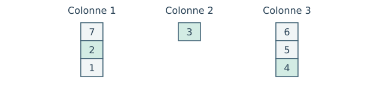
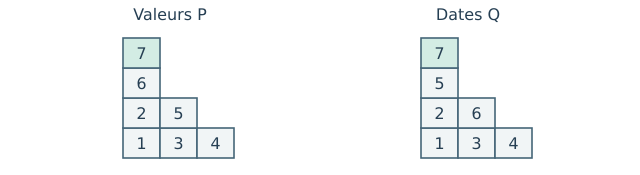

# ENS · MP-PC · Mathématiques-informatique 2003 — corrigé guidé

*Corrigé rédigé par IA, non officiel. Signalez toute erreur.*

**Rédaction** · GPT-6.2 Astra Ultra · vitesse non renseignée · 25 novembre 2026

**Révision** · GPT-6.2 Astra Ultra · vitesse non renseignée

Le tri par piles détermine la longueur d’une sous-suite croissante. L’insertion de Robinson–Schensted conserve en plus l’histoire de la permutation. Les formes de ses tableaux serviront enfin à compter des représentations.

La réussite et les tableaux emploient deux ordres différents. Pour la permutation de sept cartes du sujet, les indices de lecture imposent l’ordre d’une sous-suite. Dans un tableau de Young, les lignes se lisent de gauche à droite et les colonnes de bas en haut. [Fac-similé du sujet](https://banques-ecoles.fr/cms/wp-content/data/filiere-mp/annales-de-la-banque-i/session-2003/sujet-ecrit-2003-info_mathematiques_informatique.pdf) · [Rapport du jury](https://banques-ecoles.fr/cms/wp-content/data/filiere-mp/rapports-des-jurys-de-la-banque-i/session-2003/rapport-2003-i_ecrit_mathematiques_informatique.pdf) · [Sommaire](https://banques-ecoles.fr/cms/filiere-mp/les-annales-et-rapports-des-jurys/)

## Partie 1 · Mélange et réussite

### Question 1.1 · Longueur de mot

Un scénario de mélange se défait en remontant ses mouvements du dernier au premier. Les deux sens ont donc le même coût minimal. Pour un produit, juxtaposer deux scénarios optimaux donne un scénario possible et donc une majoration du minimum.

### Question 1.2 · Coût d’une transposition

Des voisins s’échangent en déplaçant une seule carte. Pour des positions non voisines, un déplacement isolé change aussi les positions intermédiaires. Il faut donc au moins deux gestes. Avancer une extrémité jusqu’à l’autre, puis ramener l’autre carte à la place libérée restitue l’ordre des cartes intermédiaires.

### Question 1.3 · Distance et plus longue sous-suite

Le retrait d’une seule carte fait perdre au plus une place dans une sous-suite. On ne peut donc combler un déficit de $n-L$ en moins de $n-L$ gestes. Pour atteindre la borne, marquer une sous-suite maximale. Déplacer une carte non marquée juste avant sa prochaine valeur supérieure dans la liste des marquées, ou à la fin si elle est plus grande que toutes. La marquer à son tour. L’ordre relatif des marquées est toujours croissant et les non-marquées seront replacées plus tard. Chaque carte initialement non marquée coûte au plus un geste.

### Question 1.4 · Nombre de colonnes

Chercher deux bornes indépendantes. Dans chaque pile la lecture chronologique décroît, donc un choix croissant ne peut visiter deux fois la même pile. Pour construire un choix aussi long que le nombre de piles, remonter depuis la dernière en mémorisant sa voisine de gauche au moment de chaque pose. Cette voisine est antérieure et plus petite. Les cartes du bas à la fin ne sont pas nécessairement elles-mêmes dans l’ordre des temps.

### Question 1.5 · Reconstruire une sous-suite maximale

La réussite calcule une longueur mais les cartes les plus récentes des colonnes n’ont pas forcément coexisté. Lors de chaque pose, accrocher un pointeur vers la carte qui termine alors la colonne de gauche. À la fin, partir d’une carte de la dernière colonne, suivre les pointeurs jusqu’à la première et retourner ce chemin. Chaque lien remonte à la fois dans le temps et vers une valeur plus petite. Le tableau des dernières valeurs étant trié, la recherche coûte un logarithme par carte.

Dans le jeu imprimé, les dernières cartes du bas forment la liste $1,3,4$. La carte 1 est apparue au rang 5 et la carte 3 au rang 3. Ce triplet ne peut donc pas être renvoyé comme sous-suite. Les prédécesseurs de la carte 4 au rang 7 ramènent à la carte 3 au rang 3, puis à la carte 2 au rang 2.

### Question 1.6 · Inversions

Pour voir la borne inférieure, suivre une seule opération, qui crée ou annule exactement une inversion. Pour l’atteindre, toujours choisir deux voisins dans le mauvais ordre. Leur échange fait descendre le compteur et n’introduit aucune nouvelle inversion. Le compteur nul caractérise l’identité.

### Question 1.7 · Algorithme K-Mélange

Le suffixe déjà traité sert de frontière. Au tour $i$, la plus grande carte restante est déplacée tout à droite de la zone non triée. Chacun des voisins franchis est plus petit et enlève une inversion. Incrémenter de la distance franchie préserve la somme compteur plus inversions restantes. À la sortie cette dernière quantité résiduelle est nulle. Incrémenter d’une unité au lieu de la distance donne bien un nombre de déplacements, mais ce scénario peut être trop long. Le paquet $2,3,1$ en est un exemple.

## Partie 2 · Tableaux de Young

### Question 2.1 · Dénombrer les partitions

Classer les partitions par présence de la plus grande taille autorisée. Sans cette taille, abaisser la borne d’une unité. Avec cette taille, retirer une part et garder la même borne puisque d’autres parts égales peuvent subsister. Compter une partition de la somme zéro et aucune partition d’une somme positive sans taille autorisée. Cela évite de compter les différents ordres d’une même partition.

### Question 2.2 · Longueur de la première ligne

Ignorer provisoirement ce qui monte dans les rangées supérieures. La première rangée conserve la même liste ordonnée de valeurs terminales que la réussite, car les deux méthodes choisissent la première valeur trop grande. En partant de la même liste vide, elles coïncident après chaque carte.

### Question 2.3 · Lecture miroir

Une insertion seule dans le vide ne distingue pas les deux directions. Transformer la toute première insertion en insertion par colonne et la commuter jusqu’à l’extérieur de la composition. Le même argument s’applique à l’insertion suivante, encore en première position au moment de sa conversion. On obtient exactement les insertions en colonne dans l’ordre renversé. La transposition du tableau les reconvertit en insertions en ligne. Retourner une permutation change aussi décroissance en croissance, d’où l’interprétation de la hauteur.

### Question 2.4 · Un carré de cartes

Le rectangle qui entoure le tableau ne peut contenir $n^2$ cases si ses deux côtés sont inférieurs à $n$. Une des longueurs monotones atteint donc $n$, ce qui donne la borne sur le meilleur des deux mélanges. Pour atteindre l’égalité, écrire $n,\ldots,1$, puis $2n,\ldots,n+1$ et ainsi de suite. Les blocs obligent une croissance longue à passer d’un bloc à l’autre et une décroissance à rester dans un même bloc.

### Question 2.5 · Bijection de Robinson–Schensted

Le deuxième tableau sert de journal : le plus grand numéro révèle où s’est terminée la dernière insertion. Retirer ce coin dans $Q$ et reprendre la valeur du même coin dans $P$. Pour refaire un chemin de déplacement en sens contraire, descendre d’une rangée et sélectionner la dernière entrée plus petite que la valeur portée. Échanger les deux. Quand il n’y a plus de rangée au-dessous, la valeur en main est la dernière carte du mot.

Pourquoi ce choix fonctionne-t-il sur tout couple de tableaux ? Sous la case d’où l’on vient il existe une valeur inférieure, donc la recherche peut aboutir dans la même colonne ou plus à droite. Les entrées à droite de sa cible dépassent la valeur portée et celles à gauche restent plus petites. La colonne respecte aussi l’ordre : en dessous les entrées étaient plus petites encore, et au-dessus, la case éventuelle est à la même colonne ou plus à droite que le précédent remplacement qui a reçu une valeur supérieure. Une insertion directe reprend donc ces mêmes cases dans l’autre sens. La procédure est réversible et peut être répétée jusqu’au vide. La suite des cartes reconstituée contient exactement les valeurs initiales de $P$, chacune une fois.

Pour une forme donnée, les choix de $P$ et $Q$ sont indépendants et chacun a $d_\lambda$ possibilités. La largeur de la forme impose $L(\sigma)$. Additionner les carrés des effectifs sur les formes de largeur $k$ donne le premier nombre cherché, et sur toutes les formes donne $n!$.

Pour vérifier concrètement l’inversion de la figure, lire les lignes depuis le bas. Les lignes de $P$ valent $(1,3,4),(2,5),(6),(7)$ et celles de $Q$ valent $(1,3,4),(2,6),(5),(7)$. La date 7 désigne la case du sommet. La remontée inverse descend avec $7$, puis $6$, puis $5$, et ressort avec $4$ dans la ligne du bas. Cette dernière carte correspond bien à $\sigma(7)$.

### Question 2.6 · Involutions

Un couple inchangé quand on échange les tableaux est déterminé par un seul tableau. Compter ces couples donne le nombre d’involutions. Pour compter directement les mêmes permutations, lister les points échangés deux par deux. Diviser par deux pour l’ordre dans chaque couple et par la factorielle du nombre de couples pour leur ordre entre eux. Tous les autres points sont fixes.

## Partie 3 · Représentations du groupe symétrique

### Question 3.1 · Dimension un

Une seule transposition détermine les images de toutes les autres car les coordonnées se renomment par conjugaison. Dans une cible commutative ces images sont donc égales. Une transposition étant d’ordre deux, il ne reste que deux choix. Le caractère constant et la signature réalisent ces deux choix.

### Question 3.2 · Réduction complète

Moyenner le produit scalaire initial sur toutes les actions du groupe. La symétrie hermitienne et la sesquilinéarité passent à la somme. Le terme de l’identité interdit à un vecteur non nul d’avoir une norme nulle. Le groupe agit désormais par isométries, car multiplier tous les indices par un élément les permute. L’orthogonal d’un sous-espace stable est alors stable, ce qui donne un complément invariant. Chaque découpage diminue strictement les dimensions et finit.

### Question 3.3 · Hyperplan de somme nulle

L’action ne fait que réordonner les coordonnées et garde donc leur somme. Pour produire des vecteurs simples dans un espace stable, soustraire un vecteur à son image par une transposition de deux coordonnées distinctes. Le résultat isole leur différence canonique. Ses images fournissent ensuite toutes les différences. Elles engendrent l’hyperplan de somme nulle. Même dans un sous-espace stable où certains coefficients coïncident, un vecteur non nul de cet hyperplan possède au moins une paire de coefficients distincts, ce qui suffit.

### Question 3.4 · Petits degrés

Pour trois lettres, les deux caractères et la restriction à l’hyperplan de somme nulle ont les dimensions prescrites par les trois formes possibles. Calculer l’action sur $u=e_1-e_2$, $v=e_2-e_3$. L’échange de 1 et 2 envoie $(u,v)$ sur $(-u,u+v)$, celui de 2 et 3 sur $(u+v,-v)$. Leurs matrices en colonnes sont $A=\left(\begin{smallmatrix}-1&1\\0&1\end{smallmatrix}\right)$ et $B=\left(\begin{smallmatrix}1&0\\1&-1\end{smallmatrix}\right)$. Pour les trois autres éléments non triviaux, les colonnes de $AB$ sont $(0,1),(-1,-1)$, celles de $BA$ sont $(-1,-1),(1,0)$ et celles de $ABA$ sont $(0,-1),(-1,0)$. Avec l’identité, cela donne toutes les matrices.

Pour obtenir $n-1$ tableaux, prendre une rangée de $n-1$ cases et une seule case au-dessus. Le numéro de cette case peut être n’importe quel entier sauf un, puis l’ordre de la rangée du bas est forcé. Pour les petits degrés, compter récursivement les places autorisées du plus grand numéro, toujours un coin extérieur. Dans l’ordre décroissant lexicographique des partitions, on obtient en degré quatre les cinq dimensions $1,3,2,3,1$. En degré cinq, les sept dimensions sont $1,4,5,6,5,4,1$. Pour vérifier, les sommes des carrés donnent respectivement $24$ et $120$.

Un contrôle des dimensions consiste à sommer leurs carrés. Au degré quatre, $1+9+4+9+1=24$. Au degré cinq, $1+16+25+36+25+16+1=120$. Ces deux totaux concordent avec le nombre de permutations établi à la question 2.5.
