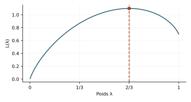

# ENS Paris et Cachan — Mathématiques MP 2003 · Corrigé guidé

*Corrigé rédigé par IA, non officiel. Signalez toute erreur.*

**Rédaction** · GPT-6.2 Astra Ultra · vitesse non renseignée

**Révision** · GPT-6.2 Astra Ultra · vitesse non renseignée

Le sujet relie la convexité aux entropies de Shannon et de Rényi. La caractérisation axiomatique et l’étude des densités conduisent à une borne sur l’entropie de leur convolution. Les logarithmes sont naturels.

L’épreuve commune Paris–Cachan dure quatre heures. La notice du jury donne les coefficients 4 à Paris et 5 à Cachan. [Sujet officiel](https://banques-ecoles.fr/cms/wp-content/data/filiere-mp/annales-de-la-banque-mp/session-2003/sujet-2003-ecrit-mp_mathematiques_cachan_paris.pdf) · [Rapport du jury](https://banques-ecoles.fr/cms/wp-content/data/filiere-mp/rapports-des-jurys-de-la-banque-mp/rapport-de-jury-session-2003/rapport-2003-mp_ecrit_mathematiques_cachan_paris.pdf)

## I. Convexité et moyennes

### Question I.1

> [!INDICATION]
> Paramétrer le segment entre les deux points pour éviter de distinguer leur ordre.

#### Solution

La formule de Taylor avec reste intégral appliquée à $t\mapsto\varphi(x+t(y-x))$ donne
$$\varphi(y)-\varphi(x)-(y-x)\varphi'(x)=(y-x)^2\int_0^1(1-t)\varphi''(x+t(y-x))\,dt\ge0.$$
La tangente reste sous le graphe sur tout l’intervalle.

### Question I.2

> [!INDICATION]
> Choisir la tangente au point moyen et sommer les inégalités.

#### Solution

Posons $m=\sum_i a_ix_i\in I$. En multipliant I.1 pour $x=m,y=x_i$ par $a_i$ puis en sommant, le terme affine supplémentaire vaut $\varphi'(m)\sum_i a_i(x_i-m)=0$. Ainsi $\varphi(m)\le\sum_i a_i\varphi(x_i)$.

### Question I.3

> [!INDICATION]
> Remplacer la somme pondérée par une intégrale contre la densité.

#### Solution

Le nombre $m=\int_a^b gf$ est compris entre le minimum et le maximum de $g$ puisque $f\ge0$ et $\int f=1$. Il appartient donc à $I$. Multiplions $\varphi(g(t))\ge\varphi(m)+(g(t)-m)\varphi'(m)$ par $f(t)$ puis intégrons. Le dernier terme s’annule et $\varphi(\int gf)\le\int(\varphi\circ g)f$.

## II. Entropie discrète et caractérisation de Shannon

### Question II.1

> [!INDICATION]
> Utiliser les poids pᵢ et les points 1/pᵢ dans Jensen.

#### Solution

Chaque terme $-p_i\ln p_i$ est positif ou nul. Pour $k$ masses strictement positives, $\sum_i p_i(-\ln(1/p_i))\ge-\ln(\sum_i p_i/p_i)=-\ln k$. Ainsi $0\le H_k(p)\le\ln k$. Pour une loi quelconque, les masses nulles ne contribuent pas. Si le support compte $k\ge2$ éléments, $H_n(p)\le\ln k\le\ln n$ ; pour $k=1$, l’entropie vaut zéro.

### Question II.2

> [!INDICATION]
> Appliquer la convexité séparément à chaque coordonnée.

#### Solution

Les coordonnées du mélange sont positives ou nulles et leur somme vaut $\lambda+(1-\lambda)=1$. La fonction $u\mapsto u\ln u$ a pour dérivée seconde $1/u$ sur $]0,\infty[$ et se prolonge continûment par zéro en zéro, donc reste convexe sur $[0,\infty[$. Ses inégalités de convexité coordonnées par coordonnées, sommées et changées de signe, donnent $H_n(\lambda p+(1-\lambda)q)\ge\lambda H_n(p)+(1-\lambda)H_n(q)$.

### Question II.3.a

> [!INDICATION]
> Écrire le logarithme du produit sur les deux supports.

#### Solution

Les $p_iq_j$ sont positifs ou nuls et leur somme double vaut $1$. Sur les couples de masses positives, $\ln(p_iq_j)=\ln p_i+\ln q_j$. En séparant les deux sommes et en utilisant la normalisation de chaque loi, on trouve $H_{nm}(p\cdot q)=H_n(p)+H_m(q)$. Les produits nuls contribuent zéro.

### Question II.3.b

> [!INDICATION]
> Isoler les deux premiers termes et introduire leur somme.

#### Solution

Avec $s=p_1+p_2>0$, on a $-p_1\ln p_1-p_2\ln p_2=-s\ln s+sH_2(p_1/s,p_2/s)$. Cela vaut aussi si une masse est nulle, par continuité. L’ajout des autres termes donne $H_n(p)=H_{n-1}(s,p_3,\ldots,p_n)+sH_2(p_1/s,p_2/s)$.

### Question II.4.a

> [!INDICATION]
> Appliquer Jensen dans chaque groupe de coordonnées avec les poids normalisés des masses positives.

#### Solution

Les différences $p_i-q_i$ ont somme nulle et ne sont pas toutes nulles. Il en existe donc des strictement positives et des strictement négatives. L’ensemble $\mathcal I=\{i:p_i\ge q_i\}$ et son complément sont non vides. Pour $J\ne\varnothing$, posons $P=\sum_Jp_i$, $Q=\sum_Jq_i>0$. Si $P=0$ les deux termes comparés valent zéro. Sinon prenons les poids $p_i/P$ sur les indices $J_+$ où $p_i>0$. La convexité de $-\ln$ donne
$$\sum_Jp_i\ln(p_i/q_i)\ge-P\ln\!\left(\frac{\sum_{J_+}q_i}{P}\right)\ge P\ln(P/Q).$$
Appliquons cette formule à $\mathcal I$ et son complément. Avec $a=\tilde p$, $b=\tilde q$, on trouve $D_n(p,q)\ge a\ln(a/b)+(1-a)\ln((1-a)/(1-b))$, en conservant la convention $0\ln0=0$.

### Question II.4.b

> [!INDICATION]
> La somme des excédents compense exactement celle des déficits.

#### Solution

Sur $\mathcal I$ la somme des différences positives ou nulles vaut $a-b$. Puisque les différences ont somme totale zéro, la somme des modules sur le complément vaut aussi $a-b$. On a donc $\sum_i|p_i-q_i|=2(a-b)$.

### Question II.4.c

> [!INDICATION]
> Dériver la divergence binaire par rapport à sa seconde probabilité et utiliser t(1−t) ≤ 1/4.

#### Solution

On a $0<b<a\le1$. Pour $0<t<1$, la fonction $d(a,t)=a\ln(a/t)+(1-a)\ln((1-a)/(1-t))$ a pour dérivée $(t-a)/(t(1-t))$. Sa valeur en $a$ est zéro, par prolongement si $a=1$. Ainsi
$$d(a,b)=\int_b^a\frac{a-t}{t(1-t)}\,dt\ge4\int_b^a(a-t)dt=2(a-b)^2.$$
En utilisant II.4.a et II.4.b, on obtient $D_n(p,q)\ge\tfrac12(\sum_i|p_i-q_i|)^2$.

### Question II.5.a

> [!INDICATION]
> Compléter la loi uniforme par un zéro, puis comparer à la nouvelle loi uniforme.

#### Solution

Notons $u_n=(1/n,\ldots,1/n)$. Par extensibilité et maximalité, $\psi(n)=J_{n+1}(u_n,0)\le J_{n+1}(u_{n+1})=\psi(n+1)$. Puis $u_n\cdot u_m=u_{nm}$ et l’additivité donne $\psi(nm)=\psi(n)+\psi(m)$.

### Question II.5.b

> [!INDICATION]
> Encadrer les puissances de n entre deux puissances consécutives de 2.

#### Solution

Si $\psi(2)=0$, choisissons $2^k\ge n$. Alors $0\le\psi(n)\le\psi(2^k)=k\psi(2)=0$. Dans les autres cas aussi, pour $r\ge1$, prenons $k=\lfloor r\ln n/\ln2\rfloor$. Les bornes $2^k\le n^r<2^{k+1}$ donnent $k\psi(2)\le r\psi(n)\le(k+1)\psi(2)$. Après division par $r$ et passage à la limite, $\psi(n)=c\ln n$ avec $c=\psi(2)/\ln2$.

### Question II.5.c

> [!INDICATION]
> Fusionner deux coordonnées de chaque bloc. Suivre séparément le supplément produit par chacune des deux fusions.

#### Solution

Pour deux blocs de taille $2$, (P6) et la symétrie permettent de fusionner les deux entrées du premier, puis les deux du second. Les masses obtenues sont $p_1,p_2$ et les suppléments sont $p_1J_2(q)$ et $p_2J_2(r)$. Supposons la formule établie pour la taille $n-1$. Dans chaque bloc de taille $n\ge3$, permutons les entrées pour avoir $u=q_1+q_2>0$, $v=r_1+r_2>0$. Posons $q'=(u,q_3,\ldots)$ et $r'=(v,r_3,\ldots)$. Les deux fusions remplacent le grand vecteur par $(p_1q',p_2r')$ et apportent
$$p_1uJ_2(q_1/u,q_2/u)+p_2vJ_2(r_1/v,r_2/v).$$
Par récurrence, le vecteur réduit a pour valeur $J_2(p)+p_1J_{n-1}(q')+p_2J_{n-1}(r')$. Une dernière utilisation de (P6) dans $q$ et dans $r$ rassemble les termes en $J_2(p)+p_1J_n(q)+p_2J_n(r)$. La preuve couvre les masses nulles car les deux sommes choisies sont strictement positives.

### Question II.5.d

> [!INDICATION]
> Diviser une loi uniforme en deux blocs et les compléter par des zéros si leurs tailles diffèrent.

#### Solution

Pour $2\le k\le n-2$, posons $p=k/n$. Appliquons II.5.c aux lois uniformes de tailles $k,n-k$, chacune complétée de zéros jusqu’à la taille $\max(k,n-k)$. (P2) et (P4) suppriment ces zéros dans les trois vecteurs. Les masses du vecteur double valent toutes $1/n$ sur son support, d’où $\psi(n)=J_2(p,1-p)+p\psi(k)+(1-p)\psi(n-k)$. En remplaçant $\psi$ par $c\ln$, on trouve $J_2(p,1-p)=-c[p\ln p+(1-p)\ln(1-p)]$. Tout rationnel strictement entre zéro et un s’écrit avec $k,n-k\ge2$ en multipliant la fraction. La densité des rationnels, (P1) et la continuité de $x\ln x$ jusque sur le bord donnent l’identité sur $[0,1]$.

### Question II.5.e

> [!INDICATION]
> Utiliser la même fusion dans les deux fonctions à comparer.

#### Solution

L’égalité vaut pour $n=2$ par II.5.d. Pour $n\ge3$, choisissons par symétrie $s=p_1+p_2>0$. Dans la formule (P6), employons l’hypothèse de récurrence sur le terme de taille $n-1$, puis II.5.d sur le terme binaire. II.3.b identifie la somme à $cH_n(p)$. Ainsi $J_n=cH_n$ pour tout $n\ge2$.

## III. Entropie différentielle et loi gaussienne

### Question III.1

> [!INDICATION]
> Dominer la densité par une fonction décroissant en 1/x² et absorber le logarithme dans une petite puissance.

#### Solution

La continuité sur les compacts et la bornitude de $x^2f(x)$ donnent $0\le f(x)\le C/(1+x^2)$. Fixons $1/2<\alpha<1$. Sur $[0,C]$, $|u\ln u|\le C_\alpha u^\alpha$ car $u^{1-\alpha}\ln u\to0$ en zéro. Comme $(1+x^2)^{-\alpha}$ est intégrable, $H(f)=-\int f\ln f$ converge absolument.

Les hypothèses sur la classe de densités sont la continuité, la masse un, la bornitude de $x^2f(x)$ et la finitude du second moment. La décroissance utilisée ici découle déjà de la bornitude et de la continuité sur les compacts. La finitude du second moment interviendra dans la comparaison à la gaussienne.

### Question III.2

> [!INDICATION]
> Centrer et réduire la variable. Intégrer par parties pour le second moment.

#### Solution

Par le changement $z=(x-\mu)/\sigma$ et l’intégrale de Gauss, $g_{\mu,\sigma}$ est de masse $1$. La décroissance gaussienne domine toutes les puissances, ce qui assure continuité, bornitude de $x^2g$ et intégrabilité du second moment. Le premier moment centré est nul par imparité. En notant $\gamma(z)=e^{-z^2/2}/\sqrt{2\pi}$, une intégration par parties utilisant $\gamma'=-z\gamma$ donne $\int z^2\gamma=-[z\gamma]_{-\infty}^{\infty}+\int\gamma=1$. Les deux moments demandés valent donc $\mu$ et $\sigma^2$. Enfin $-\ln g_{\mu,\sigma}=\ln(\sigma\sqrt{2\pi})+(x-\mu)^2/(2\sigma^2)$, d’où $H(g_{\mu,\sigma})=\tfrac12\ln(2\pi e\sigma^2)$.

### Question III.3.a

> [!INDICATION]
> Intégrer l’inégalité de la tangente de −ln au point 1.

#### Solution

Le terme $f\ln f$ est intégrable d’après III.1, et $f\ln g_{\mu,\sigma}$ l’est aussi car $|\ln g_{\mu,\sigma}|\le C(1+x^2)$. Pour $g=g_{\mu,\sigma}$ et $f>0$, la convexité donne $-\ln(g/f)\ge1-g/f$. En multipliant par $f$ et en intégrant, $K_{\mu,\sigma}(f)\ge\int(f-g)=0$. L’égalité impose $f=g$ par stricte convexité et continuité.

### Question III.3.b

> [!INDICATION]
> Choisir pour la gaussienne les deux moments de f.

#### Solution

Le moment d’ordre un existe puisque $|x|\le1+x^2$. La variance $s^2$ est finie et strictement positive pour une densité continue de masse un. Avec les mêmes moyenne et variance, l’intégrale de $-\ln g_{m,s}$ contre $f$ vaut $\ln(s\sqrt{2\pi})+1/2=H(g_{m,s})$. Donc $K_{m,s}(f)=H(g_{m,s})-H(f)\ge0$.

En détail, si la variance était nulle, la fonction continue positive ou nulle $(x-m)^2f(x)$ serait nulle partout puisque son intégrale est nulle. Cela imposerait $f=0$ hors du point $m$, puis aussi en $m$ par continuité, en contradiction avec sa masse un.

## IV. Entropie de Rényi, convolution et puissance entropique

### Question IV.1.a

> [!INDICATION]
> Choisir une puissance intégrable strictement inférieure à tous les ordres d’un voisinage compact.

#### Solution

Sur tout compact $[a,b]\subset]1/2,\infty[$, choisissons $1/2<\alpha<a$. Pour $0\le u\le\|f\|_\infty$ et $a\le r\le b$, $u^r$ et $|u^r\ln u|$ sont majorés par $C u^\alpha$, avec la valeur zéro en $u=0$. III.1 montre que $f^\alpha$ est intégrable. L’intégrale $F(r)=\int f^r$ est donc finie et strictement positive puisque $f$ est de masse un. Cela définit $h_r=(\ln F(r))/(1-r)$ pour $r\ne1$. Par dérivation dominée, $F$ est de classe $C^1$ et $F'(r)=\int f^r\ln f$. En particulier $F'(1)=-H(f)$.

### Question IV.1.b

> [!INDICATION]
> Utiliser le développement de ln F au voisinage de 1.

#### Solution

Comme $F(1)=1$, on a $\ln F(r)=(r-1)F'(1)+o(r-1)$. Après division par $1-r$, on trouve $\lim_{r\to1}h_r(f)=-F'(1)=H(f)$.

### Question IV.2.a

> [!INDICATION]
> Borner le premier facteur par son maximum.

#### Solution

Pour $x$ fixé, $0\le f(x-y)g(y)\le\|f\|_\infty g(y)$, de sorte que l’intégrale de convolution converge absolument et vaut au plus $\|f\|_\infty$.

### Question IV.2.b

> [!INDICATION]
> Utiliser la décroissance à l’infini pour étendre la continuité uniforme des compacts.

#### Solution

Comme $f(x)\to0$ aux deux infinis, choisissons $R$ avec $|f(x)|<\varepsilon/2$ pour $|x|>R$. Sur $[-R-2,R+2]$, $f$ est uniformément continue. Si deux points sont distants de moins de $1$ et si l’un sort de ce compact, tous deux ont une valeur absolue supérieure à $R$. Leur écart d’images est alors inférieur à $\varepsilon$, ce qui établit la continuité uniforme globale. Enfin
$$|(f*g)(x+h)-(f*g)(x)|\le\sup_t|f(t+h)-f(t)|\int g\longrightarrow0.$$
La convolution est même uniformément continue.

### Question IV.3.a

> [!INDICATION]
> Additionner les supports et intégrer par tranches.

#### Solution

Si $f,g$ ont des supports contenus dans $[a,b]$ et $[c,d]$, alors $f*g$ est nulle hors de $[a+c,b+d]$. Elle est positive ou nulle et continue d’après IV.2.b. Par Tonelli et changement de variable, $\int(f*g)=\int g(y)(\int f(x-y)dx)dy=1$. Le support compact entraîne les deux conditions de moment, donc $f*g\in\mathcal F_0$.

### Question IV.3.b

> [!INDICATION]
> À x fixé, interpréter la convolution comme une moyenne des translatées de f.

#### Solution

Par Jensen pour $\Phi(u)=u\ln u$ et les poids $g(y)dy$, $\Phi((f*g)(x))\le\int\Phi(f(x-y))g(y)dy$. L’intégrande est borné à support compact dans le plan $(x,y)$, donc Fubini s’applique également aux valeurs négatives. L’intégration en $x$ fournit $\int\Phi(f*g)\le\int\Phi(f)$ par invariance par translation. Après changement de signe, $H(f*g)\ge H(f)$.

### Question IV.4.a

> [!INDICATION]
> Paramétrer les exposants par 1−1/r et prendre les logarithmes dans Young.

#### Solution

Posons $s=1-1/r$, $u=1-1/p=\lambda s$ et $v=1-1/q=(1-\lambda)s$. Cela équivaut exactement aux formules de $p,q$ du sujet, garantit $p,q>1$ et $1/r=1/p+1/q-1$. Puis $\ln\|f\|_p=-u h_p(f)$, et de même pour $g$ et $f*g$. Le logarithme de l’inégalité admise donne
$$h_r(f*g)\ge\lambda h_p(f)+(1-\lambda)h_q(g)+\frac{\ln C(r)-\ln C(p)-\ln C(q)}{2s}.$$
Or $\ln C(p)=(\ln p)/p+u\ln u$ et les formules analogues valent aux autres exposants. Puis $s\ln s-u\ln u-v\ln v=sH_2(\lambda,1-\lambda)$. La dernière fraction est donc
$$\tfrac12H_2(\lambda,1-\lambda)+\frac{r}{2(r-1)}\left(\frac{\ln r}{r}-\frac{\ln p}{p}-\frac{\ln q}{q}\right),$$
ce qui est l’inégalité demandée.

### Question IV.4.b

> [!INDICATION]
> Écrire le terme résiduel à l’aide de la même fonction de s, u et v.

#### Solution

Quand $r\downarrow1$, $s,u,v\to0$ et $p,q\to1$. Posons $B(t)=-(1-t)\ln(1-t)=t+O(t^2)$ en zéro. Le terme résiduel de IV.4.a vaut $[B(s)-B(u)-B(v)]/(2s)$. Comme $u+v=s$, le numérateur est $O(s^2)$ et ce terme tend vers zéro. IV.1.b appliquée aux trois densités donne
$$H(f*g)\ge\lambda H(f)+(1-\lambda)H(g)+\tfrac12H_2(\lambda,1-\lambda).$$

### Question IV.4.c

> [!INDICATION]
> L’égalité dans la maximisation binaire détermine le poids de chaque puissance entropique.

#### Solution

Posons $A=e^{2H(f)}$, $B=e^{2H(g)}$, tous deux strictement positifs. Le double du membre droit de IV.4.b est $L(\lambda)=\lambda\ln(A/\lambda)+(1-\lambda)\ln(B/(1-\lambda))$. Sa dérivée est $\ln(A(1-\lambda)/(B\lambda))$ et sa dérivée seconde $-1/\lambda-1/(1-\lambda)<0$. L’unique maximum est atteint en $\lambda=A/(A+B)$ et vaut $\ln(A+B)$. L’exponentielle donne $e^{2H(f*g)}\ge e^{2H(f)}+e^{2H(g)}$.

Sur le graphique, $A=2$ et $B=1$ donnent $L(2/3)=\ln3$. Les limites aux deux bords sont respectivement $\ln B=0$ et $\ln A=\ln2$ ; la stricte concavité place le maximum à l’intérieur.
