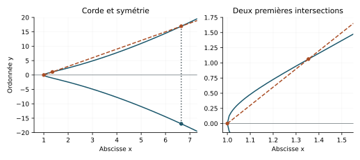

# ENS Paris et Lyon — Mathématiques MP 2003 · Corrigé brut

*Corrigé rédigé par IA, non officiel. Signalez toute erreur.*

**Rédaction** · GPT-6.2 Astra Ultra · vitesse non renseignée

**Révision** · GPT-6.2 Astra Ultra · vitesse non renseignée

On travaille sur la branche réelle d’abscisse positive de la courbe $y^2=x^3-D^2x$, complétée par le point à l’infini. Une intégrale paramètre le groupe réel. Des valuations et une hauteur explicite établissent ensuite la finitude de la torsion et la génération finie du sous-groupe rationnel.

L’épreuve commune dure six heures, avec les coefficients 6 à Paris et 4 à Lyon. On conserve l’équation du sujet et l’hypothèse que $D$ est le produit de premiers impairs distincts (éventuellement le produit vide, égal à un). [Sujet officiel](https://banques-ecoles.fr/cms/wp-content/data/filiere-mp/annales-de-la-banque-mp/session-2003/sujet-2003-ecrit-mp_mathematiques_lyon_paris.pdf) · [Rapport du jury](https://banques-ecoles.fr/cms/wp-content/data/filiere-mp/rapports-des-jurys-de-la-banque-mp/rapport-de-jury-session-2003/rapport-2003-mp_ecrit_mathematiques_lyon_paris.pdf)

## I. Hauteurs sur un groupe abélien

### Question I.1.a

Le neutre est annulé par $1$. Si $mx=0$ et $ny=0$ avec $m,n\ne0$, alors $mn(x-y)=0$. Le critère de sous-groupe donne le résultat.

### Question I.1.b

Dans $\mathbb Q/\mathbb Z$, la classe de chaque rationnel $a/b$ est annulée par $b$. Les classes de $1/n$ pour $n\ge2$ sont toutes distinctes. Le sous-groupe de torsion peut donc être infini.

### Question I.2.a

En prenant $y=x$ dans l’inégalité, on a $|h(2x)-4h(x)|\le M+h(0)=K$. Pour $a_n=4^{-n}h(2^nx)$, $|a_{n+1}-a_n|\le K4^{-n-1}$. La somme des majorants converge, donc $(a_n)$ est de Cauchy. Sa limite $\widehat h(x)$ est positive ou nulle, et $|\widehat h(x)-h(x)|\le\sum_{n\ge0}K4^{-n-1}=K/3$, uniformément en $x$.

### Question I.2.b

Appliquons l’inégalité à $2^nx,2^ny$ et divisons par $4^n$. Chaque terme converge d’après I.2.a, tandis que $M/4^n\to0$. On obtient $\widehat h(x+y)+\widehat h(x-y)=2\widehat h(x)+2\widehat h(y)$.

### Question I.2.c

Par définition $\widehat h(0)=0$. I.2.b en $x=0$ donne $\widehat h(-y)=\widehat h(y)$. Pour $a_n=\widehat h(nx)$, $a_{n+1}=2a_n-a_{n-1}+2a_1$. Les valeurs $a_0=0$, $a_1$ et cette récurrence donnent $a_n=n^2a_1$ pour $n\ge0$, puis pour tout $n\in\mathbb Z$ par parité.

### Question I.3.a

I.2.b donne la condition de hauteur avec erreur nulle. Par I.2.a, $\{\widehat h\le B\}\subset\{h\le B+K/3\}$, ensemble fini par admissibilité de $h$. Donc $\widehat h$ est admissible.

### Question I.3.b

Si $nx=0$ avec $n\ne0$, I.2.c donne $n^2\widehat h(x)=0$. Inversement si $\widehat h(x)=0$, tous les $nx$ ont hauteur nulle et appartiennent à un même ensemble fini. Deux multiples distincts en indice coïncident, donc $x$ est de torsion.

### Question I.3.c

Le groupe de torsion est exactement $\{x:\widehat h(x)=0\}$ par I.3.b. Ce sous-niveau est fini par I.3.a.

### Question I.3.d

Puisque $x-z=2y$, $4\widehat h(y)=\widehat h(x-z)=2\widehat h(x)+2\widehat h(z)-\widehat h(x+z)\le2\widehat h(x)+2\widehat h(z)$. Cela donne la borne imprimée.

### Question I.3.e

Soit $Z$ un système fini de représentants modulo $2\Gamma$, et $B=\max_{z\in Z}\widehat h(z)$. Le sous-niveau $S_B$ est fini et contient $Z$. Pour $\widehat h(x)>B$, écrivons $x=z+2y$ ; I.3.d donne $\widehat h(y)<\widehat h(x)$. Une descente à partir de $x$ s’arrête, car elle reste dans le sous-niveau fini de hauteur $\widehat h(x)$. À son terme, on est dans $S_B$ et, en remontant les écritures $z+2y$, on obtient $x\in\langle S_B\rangle$. Ainsi $\Gamma$ est de type fini.

## II. Paramétrage et loi de la corde

### Question II.1.a

Chaque intersection donne une racine positive distincte du polynôme unitaire cubique $P_{u,v}(X)=X^3-D^2X-(uX+v)^2$ et chaque abscisse fixe l’ordonnée. Il y a au plus trois intersections.

### Question II.1.b

Pour $(u_0,v_0)\in U$, les trois racines positives de $P_{u_0,v_0}$ sont simples. Autour de chacune prenons un petit intervalle fermé positif, disjoint des autres, dont les valeurs aux extrémités sont de signes opposés. Ces six signes et la condition $u\ne0$ persistent au voisinage de $(u_0,v_0)$ par continuité des coefficients. Le théorème des valeurs intermédiaires y fournit trois racines positives distinctes. Cela prouve l’ouverture de $U$.

### Question II.1.c

Deux intersections distinctes donnent deux racines positives du cubique ; la troisième est réelle. Si $v=0$, le facteur quadratique de $X(X^2-u^2X-D^2)$ a ses racines de signes contraires, ce qui exclut deux intersections positives. Ainsi $v\ne0$ et le produit des trois racines vaut $v^2>0$. La troisième est positive. Une racine répétée en l’une des deux premières imposerait une tangente, d’où trois points distincts.

### Question II.1.d

Pour que la tangente en $(x,y)$ passe par $(a,b)$, il faut $2yb=2y^2+(3x^2-D^2)(a-x)=-x^3+3ax^2-D^2x-aD^2$. En élevant au carré, on obtient l’égalité du carré de ce polynôme et de $4b^2(x^3-D^2x)$. Leur différence est un polynôme unitaire de degré six. Il donne au plus six abscisses, avec au plus deux ordonnées par abscisse.

### Question II.2.a

Pour $x>0$, $x^3-D^2x\ge0$ équivaut à $x\ge D$. Sur $[D,\infty[$, $A(x)=x^3-D^2x$ est strictement croissante, car $A'(x)=3x^2-D^2\ge2D^2>0$, et va de zéro à l’infini. Tout $t$ donne donc un unique $x=A^{-1}(t^2)$, et $C=\{P(t)=(F(t),t):t\in\mathbb R\}$ avec $F(t)=A^{-1}(t^2)$.

### Question II.2.b

La formule précédente donne $F\ge D$, $F$ paire et $F(t)=F(s)\iff t^2=s^2$. Le théorème des fonctions implicites appliqué à $A(x)-t^2$ donne une fonction $C^1$ localement partout, également en $t=0$ puisque $A'(D)=2D^2$. On a $F'(t)=2t/(3F(t)^2-D^2)$.

### Question II.2.c

Lorsque $|t|\to\infty$, $F(t)\to\infty$ par II.2.a, et $t^2/F(t)^3=1-D^2/F(t)^2\to1$. Ainsi $F(t)/|t|^{2/3}\to1$ aux deux infinis.

### Question II.2.d

La droite s’écrit $x=my+b$ avec $m=(F(t)-F(a))/(t-a)\ne0$ et $b=(tF(a)-aF(t))/(t-a)$. Son cubique en $y$ a pour coefficient dominant $m^3$ et pour terme constant $b^3-D^2b$. Le produit des trois racines est $-(b^3-D^2b)/m^3$. Deux étant $a,t$, non nuls, la troisième est précisément $H_a(t)$ imprimé. Son abscisse est positive par le produit des racines en $x$ comme en II.1.c (l’ordonnée à l’origine de la droite ne peut être nulle). Si la troisième ordonnée est différente des deux autres, on obtient le troisième point. Si elle égale $a$ ou $t$, la racine correspondante est double et les équivalences (T1)–(T3) donnent respectivement la tangence en $P(a)$ ou $P(t)$. Les réciproques suivent des mêmes équivalences.

### Question II.2.e

Pour $t\to+\infty$, $m\sim t^{-1/3}$ et $b\to F(a)$. Ainsi $tm^3\to1$ et $aH_a(t)=-(b^3-D^2b)/(tm^3)\to-(F(a)^3-D^2F(a))=-a^2$. On a $H_a(t)\to-a$ ; la droite $x=my+b$ tend vers la verticale $x=F(a)$ passant par $P(a)$ et $P(-a)$.

### Question II.3.a

La dérivée $L'(y)=2/(3F(y)^2-D^2)$ est continue, strictement positive. L’intégrande est intégrable à l’infini par II.2.c, où elle est équivalente à $2/(3|y|^{4/3})$. Les limites sont $L(-\infty)=0$, $L(+\infty)=\Omega$. Par continuité et stricte croissance, $L$ réalise la bijection demandée.

### Question II.3.b

L’intégrande est paire ; le changement $t\mapsto-t$ donne $L(-y)=\int_y^\infty 2/(3F(t)^2-D^2)\,dt=\Omega-L(y)$.

### Question II.4.a

Le polynôme $\ell_i(X)=\prod_{j\ne i}(X-x_j)/(x_i-x_j)$ vérifie $\ell_i(x_j)=\delta_{ij}$. Donc $Q-\sum_iQ(x_i)\ell_i$ a les $n$ racines $x_i$ et son degré est au plus $n-1$. Il est nul, ce qui prouve la formule d’interpolation.

### Question II.4.b

Le coefficient de $X^{n-1}$ dans $\ell_i$ vaut $1/P'(x_i)$. Pour $Q=X^k$, II.4.a donne donc $\sum_i x_i^k/P'(x_i)=0$ si $0\le k\le n-2$, et $1$ si $k=n-1$. Cette comparaison permet aussi un nœud nul.

### Question II.5.a

Une verticale ne coupe la courbe qu’en deux points au plus. Les $x_i$ sont donc deux à deux distincts et $u=(y_2-y_1)/(x_2-x_1)$, $v=y_1-ux_1$ sont $C^1$ puisque $x_i=F(y_i)$. Posons $A_i=3x_i^2-D^2$. La dérivation donne $A_i x_i'=2y_i y_i'$ et $y_i'=u'x_i+ux_i'+v'$. Éliminons $x_i'$ :
$$\frac{y_i'}{A_i}=\frac{u'x_i+v'}{A_i-2uy_i}=\frac{u'x_i+v'}{P_{u,v}'(x_i)}.$$
Les trois racines étant simples, ces dénominateurs sont non nuls. Or $G'=\sum_i2y_i'/A_i=0$ par II.4.b pour $k=1,0$. Sur l’intervalle $I$, $G$ est constante.

### Question II.5.b

Fixons $a>0$. Sur $t>a$, $H_a(t)$ est $C^1$. L’égalité $H_a(t)=a$ impose que $P(t)$ appartienne à l’unique tangente en $P(a)$, ce qui ne donne qu’un nombre fini de valeurs. L’égalité $H_a(t)=t$ impose que la tangente en $P(t)$ passe par $P(a)$ ; II.1.d en donne aussi un nombre fini. Ailleurs, II.5.a appliquée à $P(a),P(t),P(H_a(t))$ assure la constance de la somme. La continuité la prolonge avec la même valeur à travers chaque exception. Selon II.2.e et II.3.b, sa limite à l’infini est $L(a)+\Omega+L(-a)=2\Omega$.

### Question II.5.c

Si deux ordonnées sont positives, prenons-les pour $a<t$ dans II.5.b. La troisième racine est l’ordonnée du dernier point et la somme vaut $2\Omega$. Si deux sont négatives, réfléchissons les trois points dans l’axe des abscisses et utilisons II.3.b : la somme initiale vaut $3\Omega-2\Omega=\Omega$. Ces cas couvrent aussi la présence d’une ordonnée nulle car la droite passant par $(D,0)$ a pour équation $y=u(x-D)$ et ses deux autres points ont le même signe.

### Question II.5.d

La tangente en $P(y_1)$ passant par le point distinct $P(y_2)$ est non verticale. Joignons ce dernier à $P(t)$, avec $t\to y_1$, en évitant les tangences (II.1.d et l’unique tangente en $P(y_2)$) et les points de même abscisse. Le troisième point existe par II.1.c. L’abscisse de la troisième racine est le carré de la pente moins les deux premières abscisses, par le coefficient quadratique de $P_{u,v}$. Elle tend donc vers celle de la racine double de la tangente, et son ordonnée vers $y_1$. Par II.5.c et continuité, $2L(y_1)+L(y_2)\in\{\Omega,2\Omega\}$.

### Question II.5.e

Si deux points étaient opposés par réflexion, leurs $L$ auraient pour somme $\Omega$ et le troisième $L$, strictement entre zéro et $\Omega$, ne permettrait pas le multiple demandé. La droite des deux premiers est donc non verticale. En cas de tangence en l’un des deux points, II.5.d et la congruence donnée forceraient le troisième $L$ à égaler celui du point de tangence, impossible par injectivité. Il existe alors un troisième point distinct d’après II.1.c. II.5.c impose que son $L$ soit congru à $L(y_3)$ modulo $\Omega$. Ces deux valeurs sont dans $]0,\Omega[$, donc égales, et les points coïncident.

### Question II.6.a

Comme $L$ parcourt $]0,\Omega[$ une fois, $E$ est bijective de $\overline C$ sur le cercle unité, $\infty$ fournissant la seule valeur manquante $1$. Posons $P+Q=E^{-1}(E(P)E(Q))$. Cela définit l’unique loi voulue, associative et commutative par transport. Pour une somme finie, $L(y(P+Q))$ est le représentant dans $]0,\Omega[$ de $L(y(P))+L(y(Q))$ modulo $\Omega$. Si la somme des deux $L$ est inférieure à $\Omega$, elle est conservée ; si elle est supérieure, on retranche $\Omega$.

### Question II.6.b

Le neutre est $E^{-1}(1)=\infty$. Pour trois points finis distincts, leur somme est $\infty$ exactement quand la somme des trois $L$ est un multiple de $\Omega$. II.5.c et II.5.e établissent l’équivalence avec l’alignement.

### Question II.6.c

D’après II.3.b, $E(P(-y))=E(P(y))^{-1}$. Puisque $F$ est paire, $-P(y)=P(-y)=(F(y),-y)$, le symétrique par rapport à l’axe des abscisses.

### Question II.6.d

Dans le cercle, $z^2=E(P)$ a exactement deux racines opposées de module un. Leurs antécédents par $E$ donnent exactement deux solutions, y compris pour $P=\infty$.

### Question II.6.e

Si $y_1+y_2\ne0$, alors $L(y_1)+L(y_2)\ne\Omega$ par II.3.b et injectivité. Dans un voisinage, on conserve donc la même branche de la formule de II.6.a. La continuité de $L$ et de $L^{-1}$ donne la convergence demandée. Si $y_2=-y_1$, la somme limite est $\infty$. Les sommes finies ont une ordonnée tendant vers $+\infty$ quand la somme des $L$ approche $\Omega$ par dessous, et vers $-\infty$ par dessus. Sur la coupure exacte, leur somme est déjà le point à l’infini.

## III. Formules de la corde et du double

### Question III.1.a

La droite joignant les deux points a pour pente $m=(y_2-y_1)/(x_2-x_1)$. Si les trois points sont distincts, II.6.b donne l’alignement. Dans le cas d’une tangente, II.5.d identifie le point double par la loi du cercle ; les deux abscisses comptées avec multiplicité donnent alors les mêmes trois racines. Ainsi le polynôme est $X^3-D^2X-[y_1+m(X-x_1)]^2$. Le coefficient de $X^2$ donne $x_3=m^2-x_1-x_2$, et $y_3=m(x_3-x_1)+y_1$. Les abscisses étant distinctes, $y_1+y_2\ne0$. La différence des équations de la courbe donne $m=(x_1^2+x_1x_2+x_2^2-D^2)/(y_1+y_2)$, ce qui fournit les deux écritures imprimées.

Pour contrôler le dessin, $D=1$ et $y=3(x-1)$ donnent $P(x)=(x-1)(x^2-8x+9)$. Les trois abscisses sont $1,4-\sqrt7,4+\sqrt7$, toutes au moins égales à $1$. La troisième intersection est sur la droite, et la somme des deux premiers points a pour ordonnée l’opposé de la sienne.

### Question III.1.b

Pour $b=y_1-mx_1$, le polynôme est $P=\prod_i(X-x_i)$. Comme $(-D)^3-D^2(-D)=0$, l’évaluation en $-D$ donne $\prod_i(x_i+D)=(b-mD)^2$. Or $b-mD=((x_2+D)y_1-(x_1+D)y_2)/(x_2-x_1)$, d’où l’identité au carré. L’évaluation en zéro donne aussi la formule entre crochets, $x_1x_2x_3=b^2$.

### Question III.2.a

Pour $y\ne0$, la pente de la tangente est $m=(3x^2-D^2)/(2y)$. Prenons un second point proche de $P$ et appliquons III.1.a. II.6.e donne la convergence de la somme vers $2P$ puisque $2y\ne0$. Le troisième point est son opposé, d’où $x'=m^2-2x$ et $-y'=m(x'-x)+y$.

### Question III.2.b

Le numérateur de $4y^2x'$ est $(3x^2-D^2)^2-8x(x^3-D^2x)=(x^2+D^2)^2$. Donc $x'=((x^2+D^2)/(2y))^2$. En ajoutant ou retranchant $4Dy^2$ au numérateur, on obtient aussi $x'\pm D=((x^2\pm2Dx-D^2)/(2y))^2$, comme annoncé.

### Question III.3

Le point $\infty$ appartient à $\overline C(\mathbb Q)$ ; l’opposé d’un point rationnel est rationnel par II.6.c. Pour des abscisses distinctes, III.1.a exprime les coordonnées de la somme par des opérations rationnelles. À abscisse égale, les points sont opposés ou identiques. Dans le premier cas leur somme vaut $\infty$. Dans le second, III.2.a couvre $y\ne0$ et, pour $y=0$, le point est son propre opposé. D’où le sous-groupe annoncé.

### Question III.4

Dans III.1.b, remplacer $y_2$ par $-y_2$ ne change que le signe intérieur. Après multiplication, on obtient pour $(x_3+D)(x_4+D)$ le carré du quotient de
$$(x_1+D)^2y_2^2-(x_2+D)^2y_1^2$$
par $(x_2-x_1)^2(x_1+D)(x_2+D)$. Substituons $y_i^2=x_i(x_i-D)(x_i+D)$. Après simplification, le numérateur restant vaut $(x_1+D)x_2(x_2-D)-(x_2+D)x_1(x_1-D)=(x_2-x_1)[x_1x_2+D(x_1+x_2)-D^2]$. Cela donne la formule hors crochets. Pour la seconde, le même calcul appliqué à $x_1x_2x_3=b^2$ donne $x_3x_4=((x_1x_2+D^2)/(x_2-x_1))^2$.

## IV.A. Descente modulo 2 sur les points rationnels

### Question IV.A.1.a

Un carré rationnel non nul est positif et a toutes ses valuations paires. Inversement pour $a>0$ et des valuations toutes paires, $\prod_p p^{v_p(a)/2}$ est un rationnel, car seuls un nombre fini d’exposants sont non nuls. Son carré vaut $a$.

### Question IV.A.1.b

Écrivons $a=p^k u$, $b=p^{k+h}v$ avec $h>0$ et $u,v$ rationnels de valuation nulle. Après réduction à un dénominateur premier à $p$, le numérateur de $u+p^hv$ est non nul modulo $p$. Ainsi $v_p(a+b)=k$, même si $k<0$.

### Question IV.A.2.a

Comme $c$ est un carré, toute valuation positive de $c$ vaut au moins $2$. Si aussi $p^2\mid a$, le carré plus petit $c/p^2$ rendrait $(c/p^2)x=a/p^2$ entier, contradiction. Donc $v_p(a)\in\{0,1\}$ pour $p\mid c$.

### Question IV.A.2.b

On a $a(a-Dc)(a+Dc)=c^3y^2=(c^{3/2}y)^2$. Le produit est entier, et un rationnel dont le carré est entier est entier (réduire la fraction). C’est donc un carré entier, y compris zéro.

### Question IV.A.2.c

Si $v_p(x)<0$, dans $x^3-D^2x$ le premier terme a une valuation strictement plus petite que le second. Donc $2v_p(y)=3v_p(x)$ et $v_p(x)$ est pair. Ainsi le dénominateur réduit de $x$ est déjà un carré ; par minimalité, c’est $c$ et $\gcd(a,c)=1$. Pour $p\nmid2D$, si $p\mid c$, ni $a$ ni $a+Dc$ ne sont divisibles par $p$. Si $p\nmid c$, les trois résidus $a,a-Dc,a+Dc$ sont distincts modulo $p$. Au plus un est nul, et, si $y\ne0$, la valuation du produit carré de IV.A.2.b est paire. La valuation de chaque facteur est ainsi paire. Pour $y=0$, $x=D$, $a=D$, $c=1$, et $p$ ne divise ni $a$ ni $a+Dc=2D$.

### Question IV.A.3.a

Pour des abscisses différentes, les deux produits $x_1x_2x_3$ et $(x_1+D)(x_2+D)(x_3+D)$ de III.1.b sont des carrés rationnels non nuls. L’abscisse est invariante par changement de signe du point ; réduire les valuations modulo $2$ donne donc $\phi(P_1+P_2)=\phi(P_1)+\phi(P_2)$. Pour $P_2=-P_1$, les deux images coïncident et leur somme est nulle. Pour $P_2=P_1$ avec $y_1\ne0$, III.2.b rend $x(2P_1)$ et $x(2P_1)+D$ carrés. Le cas $y_1=0$ est déjà le cas opposé, et le neutre est envoyé sur zéro par définition.

### Question IV.A.3.b

Écrivons $Q=(x,y)$. Comme $2Q=P$ est fini, $y\ne0$. Par III.2.b, les nombres
$$A=\frac{x^2+D^2}{2y},\qquad B_\pm=\frac{x^2\pm2Dx-D^2}{2y}$$
ont respectivement pour carrés $x',x'\pm D$. Chacun est rationnel, puisqu’une racine réelle d’un carré rationnel est rationnelle. Or $A-(B_++B_-)/2=D^2/y$, puis $B_+-B_-=2Dx/y$. Ces deux relations donnent $y\in\mathbb Q$ puis $x\in\mathbb Q$.

### Question IV.A.3.c

Le morphisme à valeurs de caractéristique deux annule $2\overline C(\mathbb Q)$. Pour un point fini de son noyau, $x,x+D>0$ ont toutes leurs valuations paires : pour les premiers divisant $2D$, c’est la définition, et pour les autres cela suit de IV.A.2.c puisque $c$ est carré. IV.A.1.a les rend carrés dans $\mathbb Q$. L’identité $x-D=y^2/[x(x+D)]$ en fait aussi un carré, éventuellement nul. II.6.d fournit un antécédent par doublement et IV.A.3.b le rend rationnel. Le point $\infty$ est son propre double. Ainsi $\ker\phi=2\overline C(\mathbb Q)$.

### Question IV.A.3.d

Le groupe cible a $2^{2s+2}$ éléments. Pour chaque valeur atteinte, choisissons un point rationnel $z$ ayant cette image. Pour tout $P$ ayant la même image, $P-z$ est dans le noyau et vaut $2Q$ avec $Q$ rationnel. Les représentants ainsi choisis forment un système fini modulo $2$.

## IV.B. Hauteur explicite et finitude

### Question IV.B.1

Pour $P=(x,y)$, posons $x=a/c$ et $b=c^{3/2}y\in\mathbb Z$ comme en IV.A.2.b. Si $y\ne0$, III.2.b donne
$$x(2P)+D=\frac{(a^2+2Dac-D^2c^2)^2}{4b^2c}.$$
Le dénominateur est un carré entier et rend donc aussi $x(2P)$ entier après multiplication. Le plus petit tel carré est au plus ce dénominateur. Comme $a\ge Dc$, le numérateur est au plus $(a+Dc)^4$. En prenant les logarithmes, $h(2P)\le4h(P)$. Les points $\infty$ et $(D,0)$ doublent en $\infty$ et vérifient aussi la borne.

La hauteur employée dans cette dernière partie est $h(\infty)=0$ et $h(P)=\ln(a+Dc)=\ln(c(x+D))$. Le facteur $c$ est le plus petit carré entier positif qui rende $cx$ entier. Quand $2P$ est fini, $x(2P)+D>0$ : la comparaison des dénominateurs carrés conserve donc le sens de l’inégalité avant le logarithme.

### Question IV.B.2.a

Travaillons modulo $d$. De $T+U\pm DV\equiv0$ viennent $2a_1(a_2+Dc_2)\equiv0$ et $2a_2(a_1+Dc_1)\equiv0$. De $U-T+DV\equiv0$ vient aussi $2Dc_2(a_1-Dc_1)\equiv0$. Multiplions la première relation par $Dc_2$ et cette dernière par $a_2$. Soustrayons et utilisons $a_2c_1\equiv a_1c_2$ : le résultat est $4D^2a_1c_2^2\equiv0$. Par échange des indices, $4D^2a_2c_1^2\equiv0$ également.

### Question IV.B.2.b

Par IV.A.2.c, $\gcd(a_i,c_i)=1$ pour chaque $i$. Soit $p\nmid2D$. Supposons $p$ diviseur commun de $4D^2a_1c_2^2$, $4D^2a_2c_1^2$ et $T$. Si $p\mid c_1$, alors $p\nmid a_1$ et le premier produit impose $p\mid c_2$. On aurait alors $p\nmid a_1a_2$ et $p\mid D^2c_1c_2$, ce qui contredit $p\mid T$. Même conclusion en échangeant les indices. Si les deux $c_i$ sont inversibles modulo $p$, les premiers produits imposent $p\mid a_1,a_2$ et $T\equiv D^2c_1c_2\ne0$. Ces trois entiers n’ont donc pas ce premier pour diviseur commun.

### Question IV.B.2.c

Si $p\mid2D$, on a $v_p(4D^2)=2$ car $D$ est impair sans facteur carré. Si $p^4$ divise les deux produits, alors $v_p(a_1)+2v_p(c_2)\ge2$ et $v_p(a_2)+2v_p(c_1)\ge2$. Si $p\mid c_1$, la première inégalité et la coprimalité imposent $p\mid c_2$ ; alors $T\equiv a_1a_2\ne0\pmod p$. L’argument est symétrique. Si $p$ ne divise aucun des $c_i$, il faut $p^2\mid a_1,a_2$. Dans $T=a_1a_2+D^2c_1c_2$, le premier terme est divisible par $p^4$ et le second a valuation $2$ si $p\mid D$, zéro si $p=2$. Ainsi $p^4$ ne divise pas simultanément les trois entiers.

### Question IV.B.2.d

Pour $g=\gcd(T,U,V)$, IV.B.2.a donne $g\mid 4D^2a_1c_2^2,4D^2a_2c_1^2$. D’après IV.B.2.b et IV.B.2.c, ses facteurs premiers divisent $2D$ et leurs exposants sont au plus trois. Comme $2D$ est sans facteur carré, $g\mid(2D)^3$.

### Question IV.B.2.e

Prenons $e>0$, donc $d,d'>0$. Comme $c_ix_i$ et $c_i(x_i+D)$ sont entiers, $e$ divise $c_3c_4d$ et $c_3c_4d'$. Il divise aussi $c_3c_4e$. Une identité de Bézout pour $d,d',e$ donne donc $e\mid c_3c_4\delta$. Ainsi $c_3c_4\delta/e\ge1$, et
$$h(P_3)+h(P_4)=\ln(c_3c_4d'/e)\ge\ln d'-\ln\delta.$$

### Question IV.B.2.f

Avec les notations imprimées, III.4 donne $d=T^2$, $d'=U^2$, $e=V^2$, et $\delta=\gcd(T,U,V)^2\le(2D)^6$. En outre $U=(a_1+Dc_1)(a_2+Dc_2)-2D^2c_1c_2$. Le produit est au moins $4D^2c_1c_2$ puisque $a_i\ge Dc_i$. Donc $U\ge(a_1+Dc_1)(a_2+Dc_2)/2$. IV.B.2.e donne
$$h(P_1+P_2)+h(P_1-P_2)\ge2h(P_1)+2h(P_2)-2\ln\big(2(2D)^3\big).$$
Les hypothèses $P_1\pm P_2\ne\infty$ équivalent ici à la distinction des abscisses.

Si l’un des points est le point à l’infini, la somme et la différence ont la même hauteur que l’autre point et la minoration reste vraie. Pour deux points finis, $P_1\pm P_2\ne\infty$ exclut précisément le cas d’abscisses égales. L’écriture de IV.B.2.e admet bien ici $e=V^2>0$.

### Question IV.B.3.a

Le neutre convient. Pour un point fini, $2P=\infty$ équivaut à $P=-P$, donc à $y=0$. L’équation avec $x>0$ impose $x=D$. Les deux seules solutions sont $\infty$ et $(D,0)$.

### Question IV.B.3.b

Posons $C_0=2\ln(2(2D)^3)$. Si $2P\ne\infty$, choisissons dans le groupe infini un $Q$ en dehors des points d’ordre divisant deux et de $\{P,-P\}$. Les deux paires satisfont les hypothèses de IV.B.2.f. Pour la seconde, les somme et différence sont $2P,2Q$. Il vient
$$h(2P)+h(2Q)\ge2h(P+Q)+2h(P-Q)-C_0\ge4h(P)+4h(Q)-3C_0.$$
IV.B.1 permet de retrancher $h(2Q)\le4h(Q)$. Si $P=\infty$ ou $(D,0)$, les hauteurs sont respectivement $0$ et $\ln(2D)$, et la même borne est immédiate. Ainsi $h(2P)\ge4h(P)-6\ln(2(2D)^3)$.

### Question IV.B.3.c

Pour deux points finis d’abscisses distinctes, IV.B.2.f s’applique avec $C_0$. Lorsque $P=\pm Q$, la somme des deux hauteurs à gauche vaut $h(2P)$, puisque $h(-P)=h(P)$ et $h(\infty)=0$. IV.B.3.b donne la borne avec $3C_0$. Si un argument vaut $\infty$, il y a égalité sans erreur. On peut donc prendre $A=3C_0$ uniformément.

### Question IV.B.3.d

IV.B.3.c aux points $P+Q,P-Q$ donne $2h(P+Q)+2h(P-Q)\le h(2P)+h(2Q)+A$. En appliquant IV.B.1, le membre droit est au plus $4h(P)+4h(Q)+A$. Avec la minoration de IV.B.3.c, l’écart au parallélogramme est donc en valeur absolue au plus $A$. La fonction est positive ou nulle car $a+Dc\ge1$ et $h(\infty)=0$. C’est une hauteur.

### Question IV.B.3.e

Si $h(P)\le B$ pour $P$ fini, alors $a+Dc\le e^B$. Les entiers positifs $a,c$ ont donc chacun un nombre fini de valeurs. À chaque $x=a/c$ correspondent au plus deux ordonnées, et il n’y a qu’un point à l’infini. Cela prouve l’admissibilité.

### Question IV.B.3.f

Dans le cas infini de IV.B.3, la hauteur admissible de IV.B.3.e permet d’appliquer I.3.c : la torsion est finie. IV.A.3.d donne un système fini de représentants modulo deux, donc I.3.e implique que $\overline C(\mathbb Q)$ est de type fini. Si le groupe est fini dès le départ, les deux conclusions sont immédiates.
