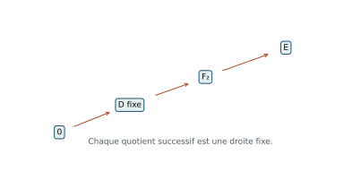

# École polytechnique MP — Deuxième composition de mathématiques 2003 · Corrigé brut

*Corrigé rédigé par IA, non officiel. Signalez toute erreur.*

**Rédaction** · GPT-6.2 Astra Ultra · vitesse non renseignée

**Révision (tour 1)** · GPT-6.2 Astra Ultra · vitesse non renseignée · 26 novembre 2026

Des commutants des rotations à l’action d’un groupe unipotent, le problème relie irréductibilité et forme triangulaire. La dernière partie démontre sur l’espace des colonnes le théorème d’algèbre utilisé dans la troisième.

## I. Commutants des groupes de rotations

### Question 1

Si $A=\operatorname{diag}(a_1,\ldots,a_n)$, les entrées $(i,j)$ de $AB$ et $BA$ valent $a_i b_{ij}$ et $b_{ij}a_j$. L’égalité et $a_i\ne a_j$ imposent $b_{ij}=0$.

### Question 2

Notons $J=\left(\begin{smallmatrix}0&-1\\1&0\end{smallmatrix}\right)$. L’équation $BJ=JB$ impose $B=\left(\begin{smallmatrix}a&-b\\b&a\end{smallmatrix}\right)=aI+bJ$. Réciproquement, toute rotation est $\cos\theta I+\sin\theta J$, qui commute avec toute matrice de cette forme. C’est exactement le commutant.

### Question 3.a

Pour $i\ne j$, choisissons $l$ distinct de $i,j$, possible pour $n\ge3$. La diagonale de signes qui vaut $-1$ en $i,l$ et $1$ ailleurs a déterminant $1$, donc appartient à $\mathrm{SO}(n,\mathbb R)$. Les signes en $i,j$ diffèrent. Par 1, toute matrice du commutant a $b_{ij}=0$, donc est diagonale.

### Question 3.b

Soit $B=\operatorname{diag}(b_1,\ldots,b_n)$ dans le commutant. Le quart de tour dans le plan $(e_i,e_j)$ qui envoie $e_i$ sur $e_j$ impose $b_i=b_j$ en appliquant la commutation à $e_i$. Cela vaut pour chaque paire. Les scalaires commutent avec tout, donc le commutant est $\mathbb R I$.

## II. Irréductibilité

### Question 4

Pour $n\ge2$, étant donnés deux vecteurs de même norme non nulle, on peut compléter leurs directions en bases orthonormées de même orientation. La transformation envoyant la première base sur la seconde appartient à $\mathrm{SO}(n,\mathbb R)$. Tout sous-espace stable contenant un vecteur non nul contient sa sphère entière, qui engendre $\mathbb R^n$. Il est donc égal à l’espace entier.

### Question 5

Si $Ax=\lambda x$ et $AB=BA$, alors $A(Bx)=B(Ax)=\lambda Bx$. Ainsi $\ker(A-\lambda I)$ est stable par $B$. En échangeant les rôles de $A$ et $B$, chaque espace propre de $B$ est de même stable par $A$.

### Question 6

Si $B$ commute avec la famille irréductible, il admet une valeur propre $\lambda$ car le corps est $\mathbb C$. Son espace propre non nul est stable sous toute la famille par 5. L’irréductibilité impose que cet espace propre soit $E$, donc $B=\lambda I$. Les scalaires appartiennent bien au commutant.

### Question 7

Sur $\mathbb R^2$ la famille $\mathrm{SO}(2,\mathbb R)$ est irréductible par 4 et son commutant contient $J$ d’après 2. Cette matrice n’est pas scalaire ; elle ne possède aucune valeur propre réelle. Le résultat de 6 ne subsiste donc pas sur les réels.

## III. Groupes d’endomorphismes unipotents

### Question 8

Notons $N=I-A$ et choisissons $r$ tel que $N^r=0$. Alors $(I-N)(I+N+\cdots+N^{r-1})=I-N^r=I$ et le même calcul vaut dans l’autre ordre. Donc $A$ est inversible et $\sum_{m\ge0}(I-A)^m=A^{-1}$.

### Question 9

En dimension deux, $N=g_0-I$ vérifie $N^2=0$. Si $N=0$, tout le groupe est trivial. Sinon, pour un $v$ avec $Nv\ne0$, les vecteurs $Nv,v$ forment une base, dans laquelle $g_0=\left(\begin{smallmatrix}1&1\\0&1\end{smallmatrix}\right)$. Toutes ses puissances entières valent $I+mN$ (aussi pour $m<0$ car $(I+N)^{-1}=I-N$). Cette construction fonctionne sur $\mathbb R$ comme sur $\mathbb C$.

### Question 10

Pour deux éléments de $W=\operatorname{Vect}G$, le produit s’écrit $\sum_{g,h}a_g b_h gh$ avec des sommes finies. Comme $gh\in G$, il reste dans $W$. L’identité est dans $G$, donc $W$ est une sous-algèbre unitaire de $\mathcal L(E)$.

### Question 11

Comme $g-I$ est nilpotent, $\operatorname{tr}(g-I)=0$ et $\operatorname{tr}g=n$. Pour $g'\in G$, $gg'\in G$ et est donc également unipotent. Ainsi $\operatorname{tr}((g-I)g')=\operatorname{tr}(gg')-\operatorname{tr}(g')=n-n=0$.

### Question 12

Les espaces stables par $W$ sont exactement ceux stables par $G$. Si $G$ est irréductible, le résultat admis donne $W=\mathcal L(E)$. Par 11 et linéarité, $\operatorname{tr}((g-I)B)=0$ pour toute matrice $B$. Prendre $B=E_{ji}$ fait apparaître précisément l’entrée $(i,j)$ de $g-I$. Elles sont toutes nulles donc $G=\{I\}$. Chaque sous-espace est alors stable, et l’irréductibilité impose $n=1$.

Pour préciser le test de trace, si $M=(m_{ij})$, le produit $ME_{ji}$ a pour seule colonne potentiellement non nulle sa colonne $i$, égale à la colonne $j$ de $M$. Sa trace est donc $m_{ij}$. La nullité pour tous les couples entraîne bien $g-I=0$ sans hypothèse d’auto-adjonction.

### Question 13

Choisissons un sous-espace $F\ne0$ stable par tout $G$, de dimension minimale. Les restrictions à $F$ forment un groupe, car $g^{-1}$ laisse également $F$ stable. Leur différence à l’identité est la restriction d’un nilpotent, donc elles sont unipotentes. Ce groupe agit irréductiblement sur $F$ par minimalité. D’après 12, il agit trivialement et $\dim F=1$. Tout vecteur non nul de $F$ est alors fixé par tous les éléments du groupe.

### Question 14

La conclusion est vraie en dimension un. Prenons $v_1$ fixe non nul et $D=\mathbb Cv_1$. Les éléments du groupe agissent sur $E/D$, leurs inverses aussi, et $(\bar g-I)^n=0$ car cet endomorphisme est induit par $(g-I)^n=0$. L’image est donc un groupe d’unipotents de dimension ambiante $n-1$. Par récurrence il existe une base du quotient dans laquelle tous les éléments sont triangulaires supérieurs à diagonale unité. Relevons-la en $v_2,\ldots,v_n$. Avec $v_1$ en premier, la base de $E$ a la propriété voulue. Elle est commune au groupe entier.

## IV. Algèbre irréductible contenant l’identité

### Question 15.a

La colonne $i$ de $L_i(x)$ est $x$ et les autres sont nulles. La multiplication à gauche par $A$ remplace $x$ par $Ax$, sans créer d’autre colonne. Ainsi $\Phi(A)L_i(x)=L_i(Ax)$ et $V_i$ est stable par tout $\Phi(A)$.

### Question 15.b

La matrice $P_i(B)$ est obtenue en gardant seulement la colonne $i$ de $B$. Multiplier d’abord par $A$ puis garder cette colonne donne $A$ fois la colonne $i$ de $B$, exactement comme dans l’autre ordre. Donc $\Phi(A)P_i=P_i\Phi(A)$.

### Question 15.c

Comme $W$ est une algèbre, il est stable par $\Phi(A)$ pour $A\in W$. Il en est de même de $W\cap V_i$. Par 15.a, $L_i^{-1}(W\cap V_i)$ est un sous-espace de $E$ stable par tout $A\in W$. L’irréductibilité implique que c’est $0$ ou $E$. L’isomorphisme $L_i$ donne la conclusion.

### Question 16

Posons $S=W$. Il est stable par $\Phi(A)$ pour $A\in W$. Pour $i=1,\ldots,n$, $S\cap V_i$ est nul ou égal à $V_i$ par le même raisonnement qu’en 15.c. Dans le premier cas, remplaçons $S$ par $S\oplus V_i$ et retenons l’indice $i$ ; dans le second gardons $S$. La stabilité par $W$ est conservée et, à la fin, toutes les colonnes $V_i$ sont dans $S$, donc $S=\mathcal L(E)$. La somme directe des $V_i$ retenus fournit le supplémentaire $W'$. Chacun est stable par $\Phi(A)$ pour tout $A\in\mathcal L(E)$, ce qui établit la stabilité demandée de $W'$.

À l’étape $i$, l’intersection à tester est celle de $V_i$ avec la somme déjà construite, et pas seulement $W\cap V_i$. Cela garantit que la somme demeure directe après chaque adjonction. Plus précisément, si $S=W\oplus\bigoplus_{j\in J}V_j$ et $S\cap V_i=0$, alors l’unique décomposition dans $S\oplus V_i$ donne l’unicité de toutes les composantes dans la nouvelle décomposition. Le supplémentaire final est donc disjoint de $W$.

### Question 17

Pour $B\in W$, $W$ et $W'$ sont stables par $\Phi(B)$, donc $\pi\Phi(B)=\Phi(B)\pi$. Les relations de 15.a–b permettent maintenant de déplacer $B$ successivement à travers $L_i,\pi,P_j,L_j^{-1}$ : on obtient $A_{i,j}B=BA_{i,j}$. Ainsi $A_{i,j}$ est dans le commutant de $W$. Par 6, $A_{i,j}=a_{i,j}I$ puisque $W$ est irréductible sur $\mathbb C$.

Pour $x\in E$ et $B\in W$, on a successivement
$$L_j A_{i,j} Bx=P_j\pi L_i Bx=P_j\pi\Phi(B)L_i x
=\Phi(B)P_j\pi L_i x=L_j B A_{i,j}x.$$
Le deuxième signe d’égalité emploie 15.a ; le troisième utilise la stabilité de l’image et du noyau de $\pi$ ainsi que 15.b. L’injectivité de $L_j$ établit la commutation cherchée pour tout $B\in W$.

### Question 18.a

Par hypothèse $I\in W$ et $\pi$ fixe tous les vecteurs de $W$. Donc $\pi(I)=I$.

### Question 18.b

La matrice $L_i(e_i)$ a pour seule entrée non nulle le $1$ diagonal en position $(i,i)$. Leur somme est l’identité.

### Question 18.c

Cette colonne est $e_i$. En annulant les autres, on obtient $P_i(I)=L_i(e_i)$.

### Question 19

Pour $j$ fixé, $e_j=L_j^{-1}P_j\pi(I)=\sum_iL_j^{-1}P_j\pi L_i(e_i)=\sum_i a_{i,j}e_i$. L’unicité des coordonnées donne $a_{i,j}=\delta_{ij}$.

### Question 20

Le résultat précédent donne $P_j\pi L_i(x)=\delta_{ij}L_j(x)$ pour tout $x$. En sommant sur $j$, $\pi L_i(x)=L_i(x)$ pour chaque $i$. Les espaces $V_i$ engendrent $\mathcal L(E)$, donc $\pi$ est l’identité et son image $W$ est $\mathcal L(E)$. Cela contredit l’hypothèse faite en IV et achève la preuve du résultat utilisé en 12.
