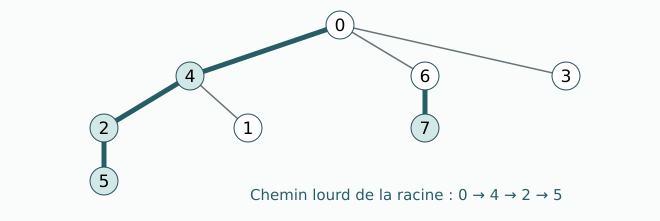

# X · MP · Informatique (option) 2003 — Corrigé guidé

*Corrigé rédigé par IA, non officiel. Signalez toute erreur.*

**Rédaction** · GPT-6.2 Astra Ultra · vitesse non renseignée

Épreuve de quatre heures. Les programmes sont écrits en OCaml avec des tableaux indicés à partir de 0. La racine est son propre ancêtre, son père conventionnel vaut 0, et elle ne figure dans aucune liste de fils. Le rapport d’Anne Dicky précise notamment les coûts attendus et le cas du préfixe impair dans la dernière question.

## I. Fonctions élémentaires

### 1. Tableau du plus proche ancêtre commun

**Pour commencer.** Écrire la chaîne des pères de 5 et celle de 1. Elles se rencontrent pour la première fois en 4.

Le tableau est symétrique. Sur la diagonale, chaque sommet est son propre plus proche ancêtre commun.

| $i$ / $j$ | 0 | 1 | 2 | 3 | 4 | 5 | 6 | 7 |
|---|---|---|---|---|---|---|---|---|
| 0 | 0 | 0 | 0 | 0 | 0 | 0 | 0 | 0 |
| 1 | 0 | 1 | 4 | 0 | 4 | 4 | 0 | 0 |
| 2 | 0 | 4 | 2 | 0 | 4 | 2 | 0 | 0 |
| 3 | 0 | 0 | 0 | 3 | 0 | 0 | 0 | 0 |
| 4 | 0 | 4 | 4 | 0 | 4 | 4 | 0 | 0 |
| 5 | 0 | 4 | 2 | 0 | 4 | 5 | 0 | 0 |
| 6 | 0 | 0 | 0 | 0 | 0 | 0 | 6 | 6 |
| 7 | 0 | 0 | 0 | 0 | 0 | 0 | 6 | 7 |

### 2. Hauteur d’un sommet

**Pour commencer.** Tester la racine avant de suivre le lien vers son père.

```ocaml
let hauteur pere a =
  let rec monter x h =
    if x=0 then h else monter pere.(x) (h+1)
  in monter a 0
```

Le compteur augmente une fois par arête remontée. Le coût est $O(1+h(a))$.

### 3. Des fils aux pères

**Pour commencer.** Chaque numéro autre que 0 apparaît dans exactement une liste.

```ocaml
let filsEnPere fils =
  let p = Array.make (Array.length fils) 0 in
  Array.iteri (fun a -> List.iter (fun b -> p.(b) <- a)) fils;
  p
```

La case 0 garde sa valeur initiale. Les $n-1$ arêtes sont lues une fois, en $O(n)$.

### 4. Rencontrer le premier ancêtre commun

**Pour commencer.** Aligner d’abord les profondeurs, puis remonter d’un cran des deux côtés à chaque étape.

```ocaml
let rec ppacMemeH pere a b =
  if a=b then a else ppacMemeH pere pere.(a) pere.(b)

let ppac pere a b =
  let rec remonte x k =
    if k=0 then x else remonte pere.(x) (k-1)
  in
  let ecart = hauteur pere a - hauteur pere b in
  if ecart >= 0 then ppacMemeH pere (remonte a ecart) b
  else ppacMemeH pere a (remonte b (-ecart))
```

Au-dessus de deux sommets distincts de même hauteur, les ancêtres communs sont exactement ceux de leurs pères. La première rencontre est donc la plus profonde. La mise à hauteur ne dépasse aucun ancêtre commun. Coût $O(1+h(a)+h(b))$.

## II. Arbres binaires complets

### 5. Taille d’un niveau et de l’arbre

**Pour commencer.** Relier deux niveaux consécutifs par le nombre de fils de chaque sommet interne.

On a $s_0=1$ et $s_{k+1}=2s_k$ pour $k<h$. Ainsi $s_k=2^k$ et $n=\sum_{k=0}^h2^k=2^{h+1}-1$.

### 6. Étiquettes des sept sommets

**Pour commencer.** Lire les numéros des sommets de la gauche vers la droite en plaçant chaque père entre ses deux sous-arbres.

L’ordre infixe du dessin est $3,2,6,0,1,5,4$. Les étiquettes par numéro de sommet, de 0 à 6, sont donc $(4,5,2,1,7,6,3)$. Le sommet 6, par exemple, occupe la troisième position.

### 7. Étiqueter en temps linéaire

**Pour commencer.** Le prochain numéro disponible après le sous-arbre gauche est l’étiquette du père.

```ocaml
let etiquettes fils =
  let e = Array.make (Array.length fils) 0 and rang = ref 0 in
  let marque a = incr rang; e.(a) <- !rang in
  let rec visite a = match fils.(a) with
    | [] -> marque a
    | [g;d] -> visite g; marque a; visite d
    | _ -> invalid_arg "arbre binaire complet requis"
  in visite 0; e
```

Chaque sommet est marqué une fois. L’ordre infixe croît strictement, ce qui réalise toutes les inégalités demandées. Le tableau occupe $O(n)$ cases et le parcours $O(n)$ opérations.

### 8. Étiquettes de la racine et de ses fils

**Pour commencer.** La racine est la médiane de l’intervalle entier alloué au sous-arbre.

Chaque sous-arbre de la racine contient $2^h-1$ sommets. Donc $\ell(0)=2^h$. Pour $h\ge1$, le fils gauche porte $2^{h-1}$ et le fils droit $2^h+2^{h-1}=3\cdot2^{h-1}$.

### 9. Caractérisation par la valuation en 2

**Pour commencer.** Dans l’intervalle d’un sous-arbre complet, la racine correspond au milieu et ses deux moitiés reçoivent les étiquettes consécutives restantes.

À profondeur $k$, les étiquettes sont les multiples impairs de $2^{h-k}$ entre 1 et $n$. En effet la racine porte $2^h$. Un sommet interne d’étiquette $r$ et de profondeur $k$ a pour fils les milieux des deux demi-intervalles, soit $r\pm 2^{h-k-1}$. Cela donne bien deux multiples impairs du niveau suivant. Chaque descendant strict a donc une valuation en 2 plus petite que son ancêtre.

Soit $c$ le plus proche ancêtre commun de $a,b$, avec $p\le q$. Si un sommet est ancêtre de l’autre, $\ell(c)$ est une des bornes. Sinon $a$ et $b$ se trouvent dans deux sous-arbres fils distincts de $c$, placés de part et d’autre de $\ell(c)$. Ainsi $p\le\ell(c)\le q$. Tout entier de $[p,q]$ est l’étiquette d’un sommet du sous-arbre de $c$, puisque l’ordre infixe en fait un intervalle. Toutes ces étiquettes sauf $\ell(c)$ ont une valuation strictement inférieure. Cela prouve à la fois le maximum et son unicité.

### 10. Calculer le maximum sans parcourir l’intervalle

**Pour commencer.** Si l’intervalle contient deux entiers consécutifs, le gagnant est pair. Diviser ses bornes par 2 en arrondissant vers l’intérieur.

```ocaml
let rec mu p q =
  if p=q then p
  else 2 * mu (p/2 + p mod 2) (q/2)
```

Les pairs de $[p,q]$ sont deux fois les entiers de $[\lceil p/2\rceil,\lfloor q/2\rfloor]$. La multiplication par 2 augmente uniformément leur valuation. La largeur est au moins divisée par deux à chaque appel. Le coût est $O(1+\log_2(1+q-p))$ en opérations sur un mot.

## III. Arbres généraux

### 11. Calculer les poids et placer un fils maximal en tête

**Pour commencer.** Additionner les poids au retour du parcours. Pour chaque fratrie, une recherche du maximum puis un déplacement suffisent.

```ocaml
let poids fils =
  let w = Array.make (Array.length fils) 0 in
  let rec visite a =
    let taille = List.fold_left (fun s b -> s + visite b) 1 fils.(a) in
    w.(a) <- taille; taille
  in ignore (visite 0); w

let gauchir fils w =
  let ordonne = function
    | [] -> []
    | x::xs as freres ->
        let lourd = List.fold_left (fun a b ->
          if w.(b)>w.(a) then b else a) x xs in
        lourd :: List.filter ((<>) lourd) freres
  in Array.map ordonne fils
```

Les sous-arbres fils sont disjoints et leur réunion avec le père forme le sous-arbre du père. Les deux fonctions coûtent $O(n)$. En cas d’égalité, le premier maximum est choisi. Les autres fils gardent leur ordre dans le nouveau tableau.

### 12. Nombre d’ancêtres légers

**Pour commencer.** Comparer un fils léger avec le premier fils, puis compter les doublements sur le chemin vers la racine.

Pour un sommet léger $a$ autre que la racine, son père $b$ a un fils lourd distinct de poids au moins $w[a]$. Ainsi $w[b]\ge1+2w[a]>2w[a]$. Sur une arête lourde aussi, les poids augmentent strictement vers la racine. Si un chemin compte $L$ ancêtres légers en incluant la racine, ses $L-1$ remontées depuis un sommet léger non racine apportent chacune un facteur strictement supérieur à 2. Pour $L\ge2$, $n>2^{L-1}$, d’où $L<1+\log_2 n$. Pour $L=1$ et $n>1$, l’inégalité reste vraie. Dans l’arbre réduit à la racine, $L=n=1$ et la borne vaut exactement 1. La première inégalité concerne un fils et son père effectif.

### 13. Cimes par transmission descendante

**Pour commencer.** Conserver l’identifiant du dernier sommet léger rencontré, y compris le sommet courant si celui-ci est léger.

```ocaml
let cimes fils =
  let c = Array.make (Array.length fils) 0 in
  let rec visite a leger = match fils.(a) with
    | [] -> ()
    | h::autres ->
        c.(h) <- leger; visite h leger;
        List.iter (fun b -> c.(b) <- a; visite b b) autres
  in visite 0 0; c
```

Le fils lourd hérite du dernier ancêtre léger, et tout fils léger a pour cime son père. Toutes les arêtes sont parcourues une fois.

### 14. L’arbre gauche et ses étiquettes

**Pour commencer.** Partir du chemin lourd de la racine. Un couple $(1,k)$ y désigne une descente de $k$ arêtes, tandis que $(r,0)$ avec $r>1$ désigne le fils léger de rang $r$.

Les listes de fils non vides sont $0:(4,6,3)$, $4:(2,1)$, $2:(5)$ et $6:(7)$. Voici les résultats rangés par numéro.

| Sommet | $t_1$ | $t_2$ | Cime | $\lambda$ |
|---|---|---|---|---|
| 0 | 0 | 0 | 0 | $()$ |
| 1 | 2 | 0 | 4 | $(1,1,2,0)$ |
| 2 | 1 | 2 | 0 | $(1,2)$ |
| 3 | 3 | 0 | 0 | $(3,0)$ |
| 4 | 1 | 1 | 0 | $(1,1)$ |
| 5 | 1 | 3 | 0 | $(1,3)$ |
| 6 | 2 | 0 | 0 | $(2,0)$ |
| 7 | 1 | 1 | 6 | $(2,0,1,1)$ |



### 15. Construire les étiquettes générales

**Pour commencer.** Avant de traiter un enfant, le père et sa cime ont déjà reçu leur étiquette. Maintenir la longueur du chemin lourd courant.

```ocaml
let etiquettes_binaires = etiquettes

let etiquettes fils c =
  let e = Array.make (Array.length fils) [] in
  let rec visite a longueur =
    List.iteri (fun index b ->
      let rang = index+1 in
      let k = if rang=1 then longueur+1 else 0 in
      e.(b) <- e.(c.(b)) @ [rang;k];
      visite b k) fils.(a)
  in visite 0 0; e
```

La concaténation recopie le préfixe à gauche. Le coût est proportionnel au nombre total d’entiers écrits, donc $O(n(1+\log n))$ par 17.a. L’alias préserve le nom de la fonction de la partie II avant la redéfinition demandée par le cahier.

### 16. Retrouver un sommet en lisant son étiquette

**Pour commencer.** Un couple de rang 1 peut résumer plusieurs arêtes. Un rang supérieur à 1 n’en décrit qu’une.

```ocaml
let trouve fils etiquette =
  let rec descendre a k =
    if k=0 then a else descendre (List.hd fils.(a)) (k-1)
  in
  let rec lire a = function
    | [] -> a
    | 1::k::suite -> lire (descendre a k) suite
    | rang::0::suite -> lire (List.nth fils.(a) (rang-1)) suite
    | _ -> invalid_arg "etiquette incorrecte"
  in lire 0 etiquette
```

Pour une étiquette valide, chaque couple inverse exactement la construction à partir de la cime. La dernière position atteinte est le sommet cherché.

### 17.a. Longueur de l’étiquette

**Pour commencer.** Découper le chemin en descentes lourdes maximales et en arêtes vers un fils léger.

Chaque ancêtre léger autre que la racine est atteint par une arête légère, qui coûte un couple. Chaque descente lourde maximale commence en un sommet léger et coûte également un couple, quelle que soit sa longueur. Avec $L$ ancêtres légers il y a donc au plus $(L-1)+L$ couples, et au plus $4L-2\le4L$ entiers.

### 17.b. Étiquette du plus proche ancêtre commun

**Pour commencer.** À la première différence, distinguer un changement de branche et deux longueurs différentes sur la même branche lourde.

Lire les deux listes par couples et recopier leur préfixe commun de couples. Si une liste s’achève, renvoyer ce préfixe. Si les couples suivants ont des premiers termes différents, les deux chemins partent vers des fils distincts et le préfixe suffit. S’ils ont le même premier terme mais des seconds termes différents, les couples sont $(1,k)$ et $(1,k')$ sur la même chaîne lourde. Ajouter $(1,\min(k,k'))$ au préfixe et s’arrêter. Par exemple les étiquettes $(1,1,2,0)$ et $(1,3)$ ont pour ancêtre commun d’étiquette $(1,1)$ le sommet 4.

[Sujet](https://www.wikiprepa.fr/concours/data/x_option-info_mp_2003.pdf) · [Rapport](https://www.doc-solus.fr/prepa/sci/adc/pdf/rapports.pdf/2003/MP_INFO_X_1_2003.rapport.pdf) · [Autre exemplaire](https://www.doc-solus.fr/prepa/sci/adc/pdf/enonces.pdf/2003/MP_INFO_X_1_2003.enonce.pdf)
