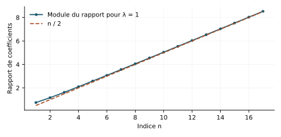

# École polytechnique MP — Première composition de mathématiques 2003 · Corrigé brut

*Corrigé rédigé par IA, non officiel. Signalez toute erreur.*

**Rédaction** · GPT-6.2 Astra Ultra · vitesse non renseignée

**Révision** · GPT-6.2 Astra Ultra · vitesse non renseignée

L’inversion d’un opérateur de Volterra construit deux solutions oscillantes d’une équation différentielle. Le développement à l’infini de l’une d’elles conduit à une série dont le rayon dépend du paramètre complexe.

## I. Inversion d’un opérateur intégral

### Question 1

Pour $u\in E$, le module de l’intégrande est majoré par $\|k\|\|u\|/\tau^2$, intégrable sur $[1,\infty[$. L’intégrale existe et $|Au(t)|\le\|k\|\|u\|/t$. Si $t_j\to t$, prolongeons l’intégrande à zéro pour $\tau<t_j$. Pour $\tau\ne t$, il converge ponctuellement vers celui associé à $t$, et le majorant précédent est indépendant de $j$. La convergence dominée donne $Au(t_j)\to Au(t)$. Ainsi $Au$ est continue bornée.

### Question 2

L’intégrale est linéaire en $u$. Comme $t\ge1$, $\|Au\|\le\|k\|\|u\|$, d’où $A\in\mathcal L(E)$ et $\|A\|\le\|k\|$. La constante est optimale pour $k=1$ et $u=1$, puisque $Au(t)=1/t$.

### Question 3

Posons $K=\|k\|$. La borne est immédiate pour $n=0$. Si elle vaut au rang $n$, alors
$$|A^{n+1}u(t)|\le\frac{K^{n+1}\|u\|}{n!}\int_t^\infty\tau^{-n-2}d\tau=\frac{K^{n+1}\|u\|}{(n+1)!t^{n+1}}.$$
L’induction conclut, même si $K$ est supérieur à $1$.

### Question 4

Une suite uniformément de Cauchy de fonctions de $E$ converge uniformément vers une fonction continue bornée ; $E$ est complet. Donc $\mathcal L(E)$ est complet pour la norme d’opérateur : les limites ponctuelles des opérateurs d’une suite de Cauchy définissent un opérateur borné et la convergence est en norme. Par 3, $\sum\|A^n\|\le e^K$. La série a donc une somme $S$ dans $\mathcal L(E)$. La relation $(I-A)\sum_{n=0}^N A^n=I-A^{N+1}$ et la convergence de $A^{N+1}$ vers zéro donnent $(I-A)S=I$. De même $S(I-A)=I$.

Pour détailler le passage à la norme d’opérateur, si $(T_n)$ est de Cauchy, $Tu=\lim_n T_nu$ existe pour chaque $u$. La borne $\|(T_n-T_m)u\|\le\varepsilon\|u\|$, valable pour $m,n$ assez grands, donne à la limite $\|(T_n-T)u\|\le\varepsilon\|u\|$. Elle établit à la fois la continuité de $T$ et la convergence en norme.

### Question 5

L’équation (1) est $(I-A)u=u_0$. L’inverse étant $S=\sum_{n\ge0}A^n$, il existe exactement une solution dans $E$, donnée par $u=Su_0$.

## II. Équation différentielle et base de solutions

### Question 6

Notons $u=u_\varepsilon$ et $J(t)=\int_t^\infty\sin(t-\tau)u(\tau)\,d\tau/\tau^2$. Les dérivées en $t$ du noyau sont bornées et $u(\tau)/\tau^2$ est absolument intégrable. La règle de Leibniz donne $J'(t)=\int_t^\infty\cos(t-\tau)u(\tau)d\tau/\tau^2$ puis $J''(t)=-J(t)-u(t)/t^2$. Les fonctions en jeu sont continues, donc $u=e^{\varepsilon it}+\lambda J$ est $C^2$. Ces identités donnent $u''=-(1+\lambda/t^2)u$ ; le coefficient lisse permet de gagner successivement deux dérivées à tout ordre, y compris à droite en $1$.

### Question 7

On a $u''=-e^{\varepsilon it}-\lambda J-\lambda u/t^2=-u-\lambda u/t^2$. Ceci établit (2) sans diviser par $\lambda$, et couvre en particulier $\lambda=0$.

### Question 8

Les bornes $|J(t)|,|J'(t)|\le\|u\|/t$ donnent $u_\pm(t)=e^{\pm it}+O(t^{-1})$ et $u_\pm'(t)=\pm i e^{\pm it}+O(t^{-1})$. Le wronskien $u_+u_-' -u_+'u_-$ tend vers $-2i$. Il est constant car l’équation ne comporte pas de terme en $u'$, donc il est non nul. Les deux solutions forment une base de l’espace complexe de dimension deux des solutions de cette équation sur $J$. Comme elles sont bornées, tout cet espace appartient à $E$.

## III. Développement asymptotique de la solution oscillante

### Question 9.a

Pour $m\ge1$, intégrons sur $[t,R]$ avec primitive $e^{i\tau}/i$. Lorsque $R\to\infty$, le terme à droite s’annule et
$$\int_t^\infty e^{i\tau}\tau^{-m}d\tau=-\frac{e^{it}}{it^m}+\frac{m}{i}\int_t^\infty e^{i\tau}\tau^{-m-1}d\tau.$$
Le module de la dernière intégrale est au plus $t^{-m}/m$, d’où la convergence, même pour $m=1$, et la borne $O(t^{-m})$. Le même argument vaut pour $e^{2i\tau}$.

### Question 9.b

Notons $I_p(t)=\int_t^\infty e^{2i\tau}\tau^{-p}d\tau$. L’identité du sinus donne
$$\varphi_n(t)=\frac1{2i(n+1)t^{n+1}}-\frac{e^{-2it}}{2i}I_{n+2}(t).$$
C’est la formule demandée pour $k=1$. Comme $I_p=-e^{2it}/(2it^p)+[p/(2i)]I_{p+1}$, remplacer $I_{n+k+1}$ dans le reste de rang $k$ produit le terme suivant et multiplie le coefficient du nouveau reste par $(n+k+1)/(2i)$. On obtient par récurrence
$$\varphi_n(t)=\frac1{(n+1)!}\left[\sum_{j=1}^k\frac{(n+j-1)!}{(2i)^j t^{n+j}}-\frac{(n+k)!e^{-2it}}{(2i)^k}I_{n+k+1}(t)\right].$$

L’identité d’Euler donne directement $e^{-it}\sin(t-\tau)e^{i\tau}=(1-e^{2i(\tau-t)})/(2i)$. Le terme non oscillant s’intègre en $t^{-n-1}/(n+1)$ et le terme oscillant fournit exactement le signe négatif du reste.

### Question 9.c

Par 9.a, $I_{n+k+1}=O(t^{-n-k-1})$. La formule de 9.b est donc le développement (3), avec $\alpha_{n,j}=(n+j-1)!/[(n+1)!(2i)^j]$ pour $j\ge1$. Les coefficients aux puissances antérieures à $t^{-(n+1)}$ sont nuls.

### Question 10.a

L’équation (4) donne $|u(t)-e^{it}|\le |\lambda|\|u\|\int_t^\infty\tau^{-2}d\tau=|\lambda|\|u\|/t$. Comme $|e^{-it}|=1$, on obtient $e^{-it}u(t)=1+O(t^{-1})$ et $\gamma_0=1$.

### Question 10.b

Si $e^{-i\tau}u(\tau)=\sum_{p=0}^n\gamma_p\tau^{-p}+O(\tau^{-n-1})$, l’erreur intégrée contre $\sin(t-\tau)e^{i(\tau-t)}/\tau^2$ est $O(\int_t^\infty\tau^{-n-3}d\tau)=O(t^{-n-2})$. Chaque monôme donne $\gamma_p\varphi_p(t)$. Donc
$$\gamma_{n+1}=\lambda\sum_{p=0}^n\gamma_p\alpha_{p,n+1-p}.$$
Les coefficients antérieurs sont conservés par unicité. Avec 10.a, ceci établit à la fois l’existence à tout ordre et la récurrence.

### Question 10.c

Substituer 9.c dans 10.b donne $\gamma_{n+1}=\lambda n!\sum_{p=0}^n\gamma_p/[(p+1)!(2i)^{n+1-p}]$. Pour $n\ge1$, la somme des termes $p<n$ vaut $n\gamma_n/(2i)$ grâce à la formule du rang précédent, sans division par $\lambda$. Le dernier terme vaut $\lambda\gamma_n/[2i(n+1)]$. Ainsi $\gamma_{n+1}=(n+\lambda/(n+1))\gamma_n/(2i)$. Pour $n=0$ la même formule découle de $\gamma_1=\lambda/(2i)$.

### Question 10.d

Si $\lambda=-N(N+1)$ pour un entier $N\ge0$, le facteur d’indice $N$ est nul. La série est alors un polynôme de degré $N$ (pour $N=0$, la constante $1$) et son rayon est infini. Pour tout autre $\lambda$, aucun coefficient ne s’annule et $|\gamma_{n+1}/\gamma_n|\sim n/2$. Pour $x\ne0$ les termes $\gamma_nx^n$ ne tendent pas vers zéro. Le rayon de convergence est donc nul. Ces deux situations restent compatibles avec un développement asymptotique à tout ordre.

À titre de vérification, pour $\lambda=-2$ on trouve $\gamma_1=i$ puis $\gamma_2=0$. La série se réduit donc à $1+ix$, conformément au cas $N=1$. Pour le tracé $\lambda=1$, le module du rapport vaut exactement $(n+1/(n+1))/2$.

