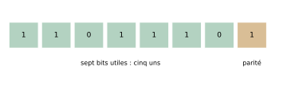
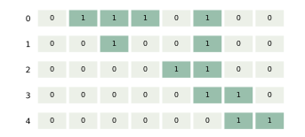
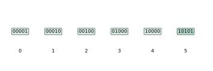

# École polytechnique · PSI et PT · Informatique facultative 2003 · Corrigé brut

*Corrigé rédigé par IA, non officiel. Signalez toute erreur.*

**Rédaction** · GPT-6.2 Astra Ultra · vitesse non renseignée · 25 novembre 2026

**Codage cyclique.** Le langage choisi est Python. Les coefficients sont rangés du plus haut degré à gauche au terme constant à droite. Le texte du sujet occupe les pages 1 à 4 du fac-similé et le rapport du correcteur Marc Pouzet les pages 5 à 8.

## I · Bit de parité

### Question 1 · Calculer le ou exclusif

```python
def ou_exclusif(x, y):
    return int(x != y)
```

Les quatre valeurs, dans l’ordre $(0,0),(0,1),(1,0),(1,1)$, sont $0,1,1,0$. La valeur rendue est un entier 0 ou 1.

### Question 2 · Calculer le bit de parité

```python
def bit_parite(b):
    parite = 0
    for bit in b:
        parite = ou_exclusif(parite, bit)
    return parite
```

Après tout préfixe, l’accumulateur vaut son nombre de bits à 1 modulo 2. Le mot du sujet $(1,1,0,1,1,1,0)$ comporte cinq uns et reçoit un 1 supplémentaire. Le mot transmis en contient ainsi six.



### Question 3 · Caractériser les nombres d’erreurs détectées

Pour $e$ positions dont la valeur a changé durant la transmission, la parité finale vaut la parité initiale augmentée de $e$ modulo 2. Comme le mot complet est construit avec une parité paire, la vérification détecte exactement les altérations en un **nombre impair de positions**. Un nombre pair de changements laisse la parité paire et passe inaperçu. Cela concerne aussi une altération du bit de contrôle lui-même. Le résultat du test ne donne ni le nombre exact ni les positions des erreurs.

## II · Codage CRC

### Question 4 · Trouver le degré d’un polynôme

```python
def degre(b):
    for i in range(len(b)):
        if b[i] == 1:
            return len(b) - 1 - i
    return -1
```

Un tableau de longueur $m$ associe l’indice $i$ à $X^{m-1-i}$. Les zéros initiaux n’augmentent pas le degré. Le tableau entièrement nul rend la valeur conventionnelle $-1$.

### Question 5 · Additionner des portions de tableaux

```python
def plus(b, c, i, j, longueur):
    indices = range(longueur)
    if b is c and j < i < j + longueur:
        indices = range(longueur - 1, -1, -1)
    for h in indices:
        b[i + h] = ou_exclusif(b[i + h], c[j + h])
```

Seule la tranche allant de $i$ à $i+\ell-1$ est modifiée. Le parcours inverse permet également de lire les anciennes valeurs si les deux portions appartiennent au même tableau et que la destination commence à l’intérieur de la source. Le coût est $O(\ell+1)$ en temps et $O(1)$ en mémoire supplémentaire.

### Question 6 · Diviser le message décalé par le générateur

```python
def crc(b, g):
    k = degre(g)
    debut_g = len(g) - 1 - k
    n = len(b)
    travail = list(b) + [0] * k
    for debut in range(n):
        if travail[debut] == 1:
            plus(travail, g, debut, debut_g, k + 1)
    return travail[n:]
```

Les préconditions sont $0<k\leqslant n$ et un générateur de degré $k$. Le premier coefficient significatif de $g$ vaut 1. La somme exclusive annule donc le coefficient de tête et conserve le reste modulo $G$. Après $n$ étapes, les $k$ derniers bits forment un polynôme de degré strictement inférieur à $k$. Le tableau $b$ est resté intact.

Avec les bits du sujet, les lignes successives après les soustractions sont $01110100$, $00100100$, $00001100$, $00000110$, $00000011$. La réponse vaut $11$. Une inspection unique de $g$ coûte $O(|g|)$ pour retrouver sa première case significative. La division coûte $O(n(k+1))$ en temps et $O(n+k)$ en espace de travail. Pour une représentation du générateur de longueur $O(n)$, la borne temporelle usuelle est $O(nk)$.



### Question 7 · Effectuer la division avec un registre circulaire

```python
def crc1(b, g):
    k = degre(g)
    longueur = k + 1
    debut_g = len(g) - longueur
    r = [0] * longueur
    d = 0
    for pos in range(len(b) + k):
        bit = b[pos] if pos < len(b) else 0
        d = (d + 1) % longueur
        r[(d + k) % longueur] = bit
        if r[d] == 1:
            for h in range(longueur):
                u = (d + h) % longueur
                r[u] = ou_exclusif(r[u], g[debut_g + h])
    return [r[(d + h) % longueur] for h in range(1, longueur)]
```

Après chaque réduction, la case logique 0 est nulle et les $k$ dernières donnent le reste du préfixe lu. En faisant avancer $d$, l’ancienne case de tête devient la dernière case et reçoit le nouveau bit. Cette opération représente $R\mapsto XR+\mathrm{bit}$. Le degré provisoire est au plus $k$. Une unique soustraction de $G$ suffit donc lorsque la nouvelle tête vaut 1. Les $k$ derniers bits lus à l’entrée sont des zéros pour réaliser le facteur $X^k$. Le temps est $O(|g|+(n+k)(k+1))$ et le registre ainsi que le résultat occupent $O(k)$ cases. Aucune copie de $b$ n’est requise.

### Question 8 · Lire le circuit et vérifier sa convention temporelle

Posons $u$ le bit qui arrive et $q=r_0$ l’ancienne tête. En suivant les fils, les cinq bascules reçoivent simultanément

$$
(r'_0,r'_1,r'_2,r'_3,r'_4)
=(r_1\oplus q,\ r_2,\ r_3\oplus q,\ r_4,\ u\oplus q).
$$

En effet, dans le quotient par $G=X^5+X^4+X^2+1$, on a $X^5\equiv X^4+X^2+1$. La tête qui sort lors de la multiplication par $X$ est donc réinjectée aux poids $X^4,X^2,1$. Le nouveau reste vaut $(XR+u)\bmod G$.

Prenons le mot $00001$, de longueur 5 comme le permet $k\leqslant n$. En partant de zéros, après lecture du mot on lit $00001$. En injectant des zéros successifs, on obtient

| Zéros injectés après le mot | État $r_0r_1r_2r_3r_4$ |
|---:|:---:|
| 1 | 00010 |
| 2 | 00100 |
| 3 | 01000 |
| 4 | 10000 |
| 5 | 10101 |

**Le texte indique quatre zéros.** Avec les bascules du dessin et la définition $PX^k\bmod G$ de la partie II, il en faut cinq pour ce générateur de degré 5. Au quatrième zéro, on a seulement $PX^4\bmod G$. Dans l’exemple, le cinquième donne $X^5\bmod G=X^4+X^2+1$.



### Question 9 · Retrouver la parité comme CRC

Le générateur recherché est $G(X)=X+1$. Dans le corps à deux éléments, $1+1=0$. Le reste modulo $X+1$ d’un polynôme est donc sa valeur en 1. Pour le message augmenté, on obtient $(PX)(1)=P(1)=\bigoplus_{i=0}^{n-1}b_i$. C’est précisément le bit qu’il faut ajouter pour obtenir une parité totale paire.
