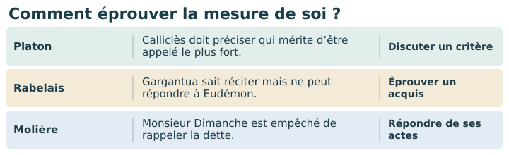

# Banque PT — Français I 2004 · Corrigé guidé

*Corrigé rédigé par IA, non officiel. Signalez toute erreur.*

**Rédaction** · GPT-6.2 Astra Ultra · vitesse non renseignée

[Énoncé officiel](https://www.banquept.fr/IMG/pdf/francais_1_2004.pdf) · [Rapport du jury](https://www.banquept.fr/IMG/pdf/rapport_francais_1_2004.pdf) · [Programme officiel](https://www.education.gouv.fr/bo/2003/19/sup.htm) · [Grille de la session](https://www.banquept.fr/documents/livret/2004/Livret_PT_2004.pdf#page=13)

Épreuve de quatre heures sur « Mesure et démesure ». Platon, Gorgias (traduction de Monique Canto-Sperber) · François Rabelais, Gargantua (édition Gérard Defaux) · Molière, Dom Juan.

## Sujet

Jacques Ellul, Exégèse des nouveaux lieux communs, chapitre « On est ce qu’on est », Calmann-Lévy, Paris, 1966, p. 262.

« Je ne veux pas savoir qui je suis, et ce que je suis, tout simplement, je le suis. Ce n’est pas la peine de chercher au-delà. Je ne veux savoir ni ma mesure, ni ma responsabilité, ni ce que je suis appelé à être (...) A quoi bon me mesurer ? et à quoi ? »

Vous discuterez cette citation à la lumière de votre connaissance des œuvres du programme.

## Préparer la dissertation

**Qui prononce le « je » ?**

Le titre du chapitre donne un indice. Ellul fait entendre une formule toute faite afin de permettre son examen. On peut comprendre ce qui rend cette formule séduisante et éprouver ce qu’elle ferait perdre à celui qui s’y tiendrait.

**Comment distinguer les deux questions finales ?**

« À quoi bon » porte sur l’intérêt de la connaissance de soi. « À quoi » porte sur le critère de cette connaissance. Le succès de l’orateur devant des ignorants offre un moyen de dissocier la force de l’applaudissement et la capacité de donner un conseil juste.

**Comment donner un sens précis à la responsabilité ?**

Chez Monsieur Dimanche, l’obligation est celle d’une dette. Chez Elvire, la parole donnée intéresse l’existence d’une autre personne. La scène change suivant que l’interlocutrice réclame l’exécution de cette promesse ou reconnaît à Dom Juan la liberté de changer.

## Dissertation

Quand un homme dit « je suis comme je suis », on hésite entre deux interprétations. Peut-être défend-il contre les importuns le droit de conduire sa vie. Peut-être aussi coupe-t-il court au reproche de quelqu’un à qui il doit une explication. Le chapitre où Jacques Ellul examine le lieu commun « On est ce qu’on est » donne la parole à un homme qui pousse ce refus jusqu’à ses dernières conséquences. Il assure que son existence lui suffit et entend ignorer à la fois ses limites, sa responsabilité et son avenir possible. Ses deux interrogations finales sont pourtant sérieuses. Que gagnons-nous à nous mesurer, et qui peut nous en donner la juste mesure ? Le Gorgias, Gargantua et Dom Juan font comprendre l’attrait d’une indépendance qui se déroberait à tout jugement. Ils permettent surtout de distinguer entre le pouvoir de juger quelqu’un à sa place et les épreuves grâce auxquelles il peut apprendre à se juger lui-même.

Qui voudrait se connaître à travers le seul regard de son entourage risquerait de se méconnaître durablement. Pendant ses premières études, Gargantua consacre des années à des exercices de mémorisation dont l’exécution est censée prouver son savoir. L’étudiant peut réciter à rebours ce qu’il a appris. La prouesse compte pour ses maîtres, alors qu’elle ne lui donne guère de prise sur ce que d’autres lui disent. C’est précisément parce que l’exercice possède un critère de réussite incontestable qu’il risque de tromper. Si Gargantua acceptait cette réussite pour sa mesure, rien ne le porterait à découvrir ce dont il est capable ailleurs. La même difficulté se présente devant un tribunal dans le Gorgias. Pour Gorgias, l’orateur peut convaincre plus aisément que le médecin lui-même un public ignorant de médecine. Une audience qui acclame ne mesure donc pas toujours la compétence qu’elle croit distinguer.

On comprend même qu’un homme se défende quelquefois contre l’idée d’être « appelé » à une conduite toute tracée. Lorsque Sganarelle lui reproche ses inconstances, Dom Juan défend la liberté de reconnaître une beauté nouvelle sans se tenir pour lié à jamais par son premier choix. Son discours frappe parce qu’il rend à ce qu’il aperçoit aujourd’hui une valeur que la coutume semblait lui ôter dès hier. À Thélème également, Rabelais imagine des femmes et des hommes qui choisissent le moment de leurs occupations au lieu de le recevoir d’une cloche. Mais entre les deux expériences s’ouvre déjà une différence. Les Thélémites trouvent plaisir à faire ensemble ce que l’un d’entre eux propose. Dom Juan prétend disposer seul du sens d’une parole qu’il a pourtant donnée à deux.

Le lieu commun ampute ainsi l’existence dont il prétend respecter la simplicité. Si je suis ce que je suis, mes promesses et mes dettes font aussi partie de moi. Monsieur Dimanche vient rappeler à Dom Juan une obligation que celui-ci peut éluder sans la rendre caduque. L’accueil est d’une politesse exemplaire. Les attentions prodiguées au marchand rendent presque impossible la formulation de sa demande. Le spectateur mesure d’autant mieux la dette que le débiteur parle de tout le reste. Qui la lui rappellera, si le droit de se juger soi-même donne celui de faire taire le créancier ? Dans le Gorgias, Pôlos admire celui qui peut se soustraire aux conséquences de ses actes. Socrate retourne sa perspective en demandant quel dommage l’injustice fait à celui même qui la commet. À suivre la seule mesure du succès, on confondrait l’impunité avec la santé de l’âme.

D’ailleurs, le refus de toute mesure en conserve souvent une, d’autant plus contraignante qu’elle reste inavouée. Calliclès oppose la nature aux conventions dont se servent, selon lui, les faibles pour contenir les forts. Pourtant, sitôt qu’il attribue un droit supérieur au plus fort, il doit dire en quoi consiste cette force. Le grand nombre, précisément parce qu’il est nombreux, peut l’emporter sur un seul. Est-ce donc à la majorité qu’il faut reconnaître ce droit ? La question de Socrate oblige Calliclès à chercher d’autres critères. Chez Rabelais, les conseillers de Picrochole lui font traverser en imagination des pays toujours plus lointains. Leur carte donne une figure à sa grandeur, sans qu’aucune conquête réelle ait encore garanti la suivante. Celui qui ne veut connaître aucune borne finit par tirer la mesure de sa valeur d’une extension indéfinie de sa puissance.

À quoi se mesurer alors ? À l’effet d’abord qu’une conduite produit et qu’un autre peut nous apprendre à discerner. La rencontre d’Eudémon révèle ce que les anciens maîtres de Gargantua ne savaient pas observer. Le jeune orateur lui adresse un discours auquel il ne sait répondre. Ses larmes signalent un désarroi ; elles ne disent pas ce qu’il pourra devenir sous une autre conduite. Ponocrates réorganise ses journées pour que lecture, conversation, observation et exercice du corps se prêtent un appui mutuel. Le soleil observé dans le ciel peut donner matière à vérifier ce que l’on a lu. À la question de savoir quelle quantité de texte le géant peut retenir se substitue celle de savoir ce qu’il peut désormais examiner, discuter et éprouver. Une éducation lui ouvre un avenir dans le geste même où elle reconnaît son insuffisance présente.

Il y a même une manière de s’adresser à quelqu’un qui le mesure à sa capacité de changer. Lors de sa seconde visite à Dom Juan, Elvire ne vient plus lui demander de reprendre la vie qu’il lui avait promise. Elle vient lui rappeler qu’il peut encore choisir comment vivre. Il demeure libre de recevoir cet appel ou de le réduire à l’effet que la visiteuse produit sur lui. Dans le dialogue platonicien aussi, toute question suppose que la réponse est encore ouverte. Consentir à voir sa proposition réfutée est une façon exigeante de faire usage de sa liberté. Quand Socrate compare des désirs incessamment à remplir à des récipients percés, il offre à son interlocuteur une épreuve de pensée : est-ce bien cette activité sans terme qu’il désire pour lui-même ?

Se mesurer vaut donc la peine pour autant que l’on puisse apprendre du jugement prononcé. Ni l’approbation d’une salle ni un classement scolaire ne sauraient faire toute la vérité d’une personne. L’engagement pris envers autrui, les conséquences éprouvables d’un choix, la possibilité de soutenir ce choix devant une objection offrent en revanche des mesures dont on peut répondre. En refusant de savoir ce qu’il est appelé à être, le locuteur d’Ellul croyait sauver le présent. Il s’interdisait d’y reconnaître une puissance particulièrement précieuse : celle de devenir autre par l’exercice de son propre jugement.

