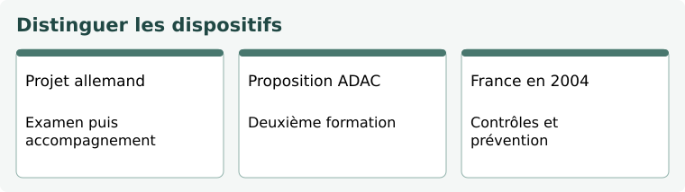
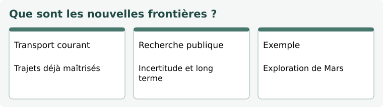
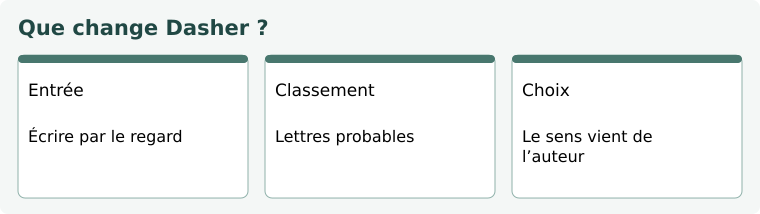
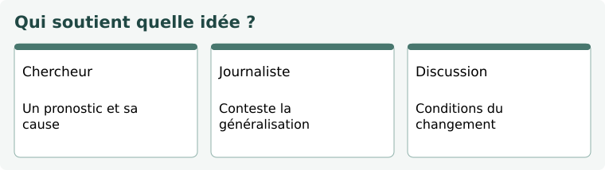
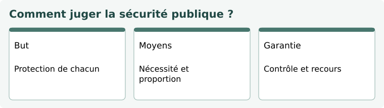

# Banque PT — Langue vivante I-A 2004 · Corrigé guidé

*Corrigé rédigé par IA, non officiel.*

**Rédaction** · GPT-6.2 Astra Ultra · vitesse non renseignée

**Révision** · GPT-6.2 Astra Ultra · vitesse non renseignée

L’épreuve dure trois heures. Chaque candidat traite la langue choisie à l’inscription. La version française vaut 10 points. La question a demande 80 à 100 mots pour 4 points. La question b demande 200 à 250 mots pour 6 points.

[Sujet](https://www.banquept.fr/IMG/pdf/lv_1a_2004.pdf) · [Index des rapports](https://www.banquept.fr/article153.html) · [Grille du livret](https://www.banquept.fr/documents/livret/2004/Livret_PT_2004.pdf)

## Allemand

*Frühstart mit Schutzengel*

D’après Stern, référence imprimée « 5/1/2003 ». Texte pages 2 et 3, questions page 3. Le rapport porte son commentaire aux pages 1 et 2. Sa troisième page est blanche. Il distingue la description du projet allemand et la discussion sur la sécurité routière en France. [Rapport du jury](https://www.banquept.fr/IMG/pdf/rapport_allemand_1_a_2004.pdf)

Ne pas confondre le projet de conduite accompagnée et la proposition distincte de l’ADAC. Situer la réponse b à l’époque du concours, notamment les premiers radars automatiques français en 2003 et le permis probatoire en 2004.

### Version française

De « Der Experte Matthias Feltz » à la fin de l’article, « für das erste eigene Auto ».

Le spécialiste Matthias Feltz voit en outre de sérieux obstacles juridiques à l’expérimentation en Allemagne. « Si, par exemple, un jeune de 17 ans roule trop vite dans une zone limitée à 30 km/h et provoque des dommages corporels, l’accompagnateur risque lui aussi d’être poursuivi, s’il était en mesure d’empêcher cet excès de vitesse et ne l’a pas fait. » Selon lui, le projet expérimental ne prévoit jusqu’ici aucune disposition juridique particulière pour des questions aussi importantes.

Comme l’a montré un sondage, les jeunes de 16 et 17 ans ne sont pas enthousiastes. Environ 40 % d’entre eux trouvent que le permis à 17 ans n’a vraiment rien de séduisant et ne souhaitent pas profiter de cette possibilité, ou tout au plus l’envisagent-ils éventuellement. Lors d’un sondage réalisé par Dekra, près de la moitié des adultes (48 %) ont même rejeté l’expérimentation du permis à 17 ans.

L’automobile-club allemand, l’ADAC, ne voit pas non plus d’un bon œil le permis précoce assorti d’un accompagnement obligatoire et formule des critiques à son encontre. Ces critiques ne sont toutefois pas entièrement désintéressées. Le groupe de défense des automobilistes a en effet son propre programme de sécurité à proposer. On passerait le permis comme auparavant à 18 ans, mais une seconde étape de formation suivrait six mois plus tard. Elle consisterait pour l’essentiel en un stage de sécurité de quatre heures sur un terrain d’entraînement. La participation serait facultative, mais elle ramènerait la période probatoire de deux ans à un. Coût de l’opération, environ 80 euros. Une somme qui peut être vite récupérée. L’ADAC propose en effet aussi aux participants des primes d’assurance réduites pour leur première voiture.

### Question a

*Das «begleitete Fahren» kennen wir in Frankreich schon. Nach welchen Regeln soll es in Deutschland organisiert werden? Sie können eventuell die zukünftigen deutschen Regeln mit den französischen vergleichen.*

Im deutschen Modell sollen Jugendliche mit sechzehn Jahren die Fahrschule besuchen, mit siebzehn die Prüfung ablegen und bis zum achtzehnten Geburtstag nur in Begleitung fahren. Die Begleitperson muss mindestens dreißig Jahre alt sein und einen kurzen Kurs von neunzig Minuten besuchen. Sie kann bei der Wahl einer geeigneten Strecke beraten und gelegentlich Hinweise geben, soll aber nicht ins Lenkrad greifen. Fachleute empfehlen ungefähr fünftausend Kilometer Fahrpraxis. Im Unterschied zum französischen Modell, bei dem die begleitete Übungsphase der praktischen Prüfung vorausgeht, beginnt sie hier nach der Prüfung.

**86 mots**

### Question b

*Mehr noch als in Deutschland gibt es in Frankreich zu viele Todesopfer auf den Straßen. Erwähnen Sie die Maßnahmen, die in der letzten Zeit in Frankreich schon getroffen wurden und sagen Sie, was man sonst noch machen könnte, um die Zahl der Unfälle weiter zu senken.*

In Frankreich wurden bereits Schritte unternommen, um gefährliches Verhalten auf den Straßen seltener zu machen. Seit dem Herbst 2003 werden automatische Geschwindigkeitskontrollen eingesetzt. Sie sollen dazu beitragen, dass eine Überschreitung der erlaubten Geschwindigkeit tatsächlich Folgen hat. Der 2004 eingeführte Führerschein auf Probe gibt Fahranfängern zunächst sechs Punkte. Damit wird ihnen deutlich gemacht, dass der Erwerb des Führerscheins den Lernprozess nicht beendet.

Kontrollen allein verändern allerdings nicht jede Situation, in der Fehler entstehen. Vor einer Schule kann eine breite, gerade Straße selbst vorsichtige Fahrer dazu verleiten, schneller zu fahren, als es bei vielen Kindern angemessen ist. Eine übersichtlichere Kreuzung, ein gut sichtbarer Übergang und niedrigere Geschwindigkeiten könnten dort gemeinsam mehr bewirken als eine allgemeine Mahnung. Die Gemeinde sollte Eltern, Schüler und Busfahrer fragen, an welchen Stellen sie regelmäßig Schwierigkeiten erleben.

Außerdem ist es wichtig, sichere Alternativen zu schaffen. Wenn nach einem Abend mit Freunden kein Bus mehr fährt, hilft ein verlässliches Nachtangebot allen, die ihr Auto stehen lassen möchten. Schließlich sollte man die Maßnahmen anhand der tatsächlichen Unfälle überprüfen und anpassen. Eine sinkende Zahl von Strafzetteln allein zeigt noch nicht, ob die Wege sicherer geworden sind. Erfolg wäre für mich, wenn auch diejenigen geschützt sind, die selbst kein Auto fahren, aber jeden Tag dieselben Straßen überqueren müssen.

**206 mots**

## Anglais

*Old, unsafe and costly*

The Economist, 28 août 2003. Texte pages 4 et 5, questions page 5. Le rapport anglais appartient à la série de cinq rapports de langue I-A de la session. [Rapport du jury](https://www.banquept.fr/IMG/pdf/rapport_anglais_1_a_2004.pdf)

Le second passage commence au bas de la page 4 et continue page 5. La borne est identifiée par le gras. « High-risk » porte ici sur l’incertitude des recherches. Dans la question a, expliquer l’opposition construite par l’éditorial entre transport courant et exploration.

### Version française

Deux passages en gras. De « One day » à « America’s very deep pockets », puis de « Instead, NASA » à la fin de la phrase « the first privately financed craft to take people into space ». S’arrêter avant « In five years’ time ».

Un jour, on s’étonnera que la navette spatiale américaine soit restée en service aussi longtemps. Elle le doit en partie aux émotions qu’elle suscite. Après tout, des millions de personnes dans le monde ont regardé en direct à la télévision l’atterrissage impeccable de Columbia sur la base aérienne d’Edwards, en Californie. Pourtant, depuis cette journée ensoleillée de 1981, la navette n’a jamais rempli convenablement la mission pour laquelle elle avait été conçue. Dès l’origine, elle a souffert d’une mauvaise conception. Elle coûte cher, comporte des risques inhérents à sa nature même et, comme l’ont démontré deux accidents mortels, elle n’est pas sûre. Elle ne peut mettre des satellites en orbite à un prix raisonnable et, si elle emmène des hommes dans l’espace, c’est uniquement parce que les États-Unis en ont très largement les moyens.

La NASA devrait plutôt s’attacher à mettre au point des technologies dont la mise au point est très incertaine mais qui pourraient transformer le transport spatial courant des personnes et du matériel. Autrement dit, elle devrait mener les travaux de recherche et de développement que les entreprises privées n’entreprendront pas de leur propre initiative. Elle pourrait aussi se spécialiser dans l’exploration au long cours et ouvrir la voie à l’exploration de Mars.

Car, tandis que la NASA engloutissait des sommes considérables dans la navette, une nouvelle génération d’entrepreneurs et d’entreprises s’efforçait de prendre pied dans le secteur spatial. Certains, comme M. Rutan, rivalisent pour construire le premier engin à financement privé qui emmènera des passagers dans l’espace.

### Question a

*Explain what is meant by «NASA could explore the real frontiers.»*

The editorial distinguishes the frontiers of knowledge from journeys that have become routine. In its view, NASA spends too much money running a shuttle that carries people and equipment into orbit at great expense. Private firms might eventually provide some of that transport. A public agency could then devote time and resources to work with uncertain returns, such as developing a technology that changes how people travel in space or exploring Mars. The phrase therefore refers both to distant destinations and to research that companies would hesitate to undertake alone.

**90 mots**

### Question b

*Should governments and private companies have different research objectives?*

Governments and private companies often have good reasons for choosing different research objectives. A government can support a problem that matters to many people even when nobody knows how to sell the eventual result. Recording changes in the oceans over several decades, for instance, requires continuity and produces information that should be available to everyone. A firm can be particularly good at turning a promising idea into a product that works reliably at a price customers can afford.

However, I would avoid drawing a permanent boundary between the two. A company may invest in a difficult question because its engineers see possibilities that others have overlooked. A public laboratory may need to solve a very practical problem before it can collect any scientific evidence. In both cases, the right question is what each partner can contribute and who will be able to use the result.

Public funding also creates obligations. If taxpayers help develop a new instrument, the agreement should explain what data will be published and how the public will benefit. Companies should know whether they can recover the cost of further development. Clear arrangements make cooperation easier without requiring every participant to share the same motive. Different priorities can serve a common purpose, provided that important questions do not disappear simply because they promise no immediate return.

**219 mots**

## Espagnol

*Tecleando con mucho ojo*

Cienciadigital.net, septembre 2002. Texte et questions pages 6 et 7. Le rapport d’espagnol est un fichier distinct d’une page. [Rapport du jury](https://www.banquept.fr/IMG/pdf/rapport_espagnol_1_a_2004.pdf)

Le programme présente les suites de lettres probables, puis s’adapte à l’usage. Le handicap moteur et la commande par l’œil apparaissent avant la version, mais importent pour a. En b, distinguer une collection de tous les livres et la possibilité de composer une suite.

### Version française

De « El programa analiza la probabilidad » à « prácticamente sin ningún esfuerzo ». Le passage commence page 6 et s’achève page 7.

Le programme analyse la probabilité qu’un caractère donné apparaisse après une suite de lettres connue et propose à l’utilisateur les lettres les plus probables, de façon que les plus fréquentes soient les plus faciles à trouver. Il part d’une base de données pour la langue souhaitée, que l’on peut constituer en y introduisant deux textes littéraires représentatifs. En outre, Dasher apprend au fur et à mesure. Il met constamment sa base de données à jour pour s’adapter au vocabulaire propre à chaque utilisateur. Ainsi, plus on s’en sert, plus on peut écrire vite.

L’un des pères de Dasher, David MacKay, est un lecteur de Jorge Luis Borges. Dans La Bibliothèque de Babel, celui-ci évoque une bibliothèque infinie dans laquelle sont conservés, en désordre, les livres qui contiennent toutes les combinaisons possibles des 26 caractères. Ce récit a tant inspiré MacKay qu’il le cite dans la bibliographie de son article paru dans Nature. En réalité, Dasher n’est rien d’autre que la bibliothèque de Borges parfaitement ordonnée en fonction de nos besoins. En effet, à la différence des bibliothécaires du récit, les utilisateurs ne sont pas obligés de passer le reste de leur vie à rechercher péniblement les suites de caractères qui ont un sens pour eux. Celles-ci leur apparaissent sous les yeux presque sans effort.

### Question a

*Apoyándose en el texto, analice Usted qué revolución supone la creación de «Dasher» en el mundo de la información.*

Dasher cambia la forma de introducir información porque permite escribir sin pulsar un teclado. Si el ordenador sigue el movimiento del ojo y propone las letras que probablemente vendrán después, una persona con dificultades para mover las manos puede construir su propio mensaje. El sistema aprende además del vocabulario de cada usuario, de modo que la ayuda se vuelve más pertinente con el uso. El autor ve también una posible aplicación en los teléfonos móviles. La novedad une así una mayor rapidez a la posibilidad de participar en la comunicación escrita.

**91 mots**

### Question b

*¿Le parece a Usted acertada la comparación de «Dasher» con la biblioteca infinita o el Libro de Arena de Borges? Justifique su parecer.*

La comparación con Borges me parece acertada si nos preguntamos qué significa encontrar algo entre un número enorme de posibilidades. En la biblioteca del relato existen todas las combinaciones, pero esa abundancia apenas ayuda al lector que busca una frase comprensible. Dasher introduce una diferencia decisiva: ordena las opciones según un idioma y una persona concreta. Una combinación que antes estaba perdida entre millones se convierte así en un camino que el usuario puede seguir.

El Libro de Arena ofrece otra imagen sugestiva. Un objeto que cabe en la mano parece contener más páginas de las que nadie podría recorrer. Algo semejante siente quien escribe un mensaje largo en un aparato pequeño. Sin embargo, el teléfono no guarda ya escritos todos los mensajes posibles. Aplica unas reglas para ofrecer opciones a medida que alguien escribe. La libertad del usuario consiste precisamente en poder escoger una palabra poco probable cuando expresa mejor lo que quiere decir.

También hay una diferencia en la experiencia humana. El libro infinito puede inquietar a su dueño porque no consigue orientarse en él. El programa, en cambio, se diseñó para que una persona recupere la posibilidad de expresarse sin ayuda de otra. Por eso conservaría la metáfora como punto de partida imaginativo, con una condición: recordar que aquí el sentido nace de las decisiones de quien escribe, no del tamaño del catálogo.

**226 mots**

## Arabe

*ثقافة التغيير*

Al-Watan Al-Arabi, n° 1391 du vendredi 31 octobre 2003. Texte pages 8 et 9, consignes page 9. Le rapport d’arabe de 2004 est distinct. Il insiste notamment sur la construction française des verbes de parole. [Rapport du jury](https://www.banquept.fr/IMG/pdf/rapport_arabe_1_a_2004.pdf)

Le chercheur et le journaliste défendent des positions différentes. Dans la version, « je » est le journaliste et le manque d’ambition est une affirmation de son interlocuteur, qu’il conteste. En b, discuter les effets des institutions, de l’éducation et des possibilités d’emploi.

### Version française

De « كنت أتحدث » à « كما يجب ». Le troisième paragraphe de la page 8 est à traduire jusqu’à l’objection du journaliste, avant la réplique du chercheur.

Il y a peu de temps, je m’entretenais avec un chercheur en économie qui travaille dans l’une des institutions financières internationales. La conversation a porté sur de nombreux sujets et, au fil de l’entretien, je lui ai demandé comment il voyait l’avenir économique des pays arabes. Sa réponse a été immédiate et franche. Il m’a dit que, d’ici à dix ans, aucun pays arabe n’était en mesure de devenir un « tigre ». Il faisait allusion aux tigres asiatiques qui, en dix ans, étaient passés d’une économie dirigée et faible à une économie forte, fondée sur les services et d’envergure mondiale. Il a poursuivi en disant que, dans le même temps, il ne pensait pas que les pays arabes connaîtraient des crises économiques. Leur économie s’améliorerait même légèrement par rapport à ce qu’elle était alors.

J’ai discuté son point de vue en lui demandant pourquoi un essor économique ne se produirait pas si les marchés arabes s’ouvraient aux échanges entre pays de la région et si l’on réformait les lois économiques et la législation sur l’investissement. Il m’a répondu que ce que l’on observait, c’était que les gens, dans les pays arabes, ne voulaient pas travailler et qu’on ne pouvait changer la nature humaine. Selon lui, les Asiatiques aimaient le travail, tandis que, dans les pays arabes, l’individu manquait d’ambition et qu’il fallait une éducation de longue haleine pour le former à nouveau.

Je lui ai répondu que son opinion frôlait le préjugé raciste et que, même si elle avait pu être juste à une époque révolue, les gens comprenaient désormais qu’ils ne pouvaient vivre sans travailler et qu’aucun peuple au monde ne refusait de vivre comme il se doit.

### Question a

*ما هي فكرة النص الأساسية؟*

يعرض الكاتب حوارا بينه وبين باحث اقتصادي يشك في قدرة الدول العربية على تحقيق نهضة سريعة، ويعزو ذلك إلى ما يراه ضعفا في الرغبة في العمل. يعترض الكاتب على تعميم هذه الصفة على شعوب بأكملها، ويرى أن العادات تتغير مع التعليم والإرادة السياسية والتواصل بين المجتمعات. وهو لا ينكر وجود مشكلات حقيقية، لكنه يرفض تفسيرها بطبيعة بشرية ثابتة. لذلك ينتهي إلى أن الرد على الأحكام المسبقة يقتضي الاعتراف بما يحتاج إلى إصلاح والعمل على تغييره، بدل الاكتفاء بالغضب من رأي الباحث.

**81 mots**

### Question b

*علقوا على رأي الباحث الاقتصادي في الأوضاع الاقتصادية بالعالم العربي.*

أجد في رأي الباحث سؤالا اقتصاديا مشروعا واستنتاجا لا يقنعني. فمن حقه أن يسأل هل تكفي عشر سنوات لتغيير بنية اقتصادات مختلفة، وهل تتوفر فرص الاستثمار والتدريب والأسواق اللازمة. لكن الانتقال من هذا السؤال إلى القول إن الناس لا يحبون العمل يتجاهل الفرق بين الرغبة في العمل وإمكان العثور عليه. شابة تخرجت في الجامعة ولا تجد وظيفة تناسب تدريبها لا تصبح أقل طموحا لأن اسمها بقي في قائمة الباحثين عن عمل.

وينبغي أيضا أن ننتبه إلى الأعمال التي لا يظهر أثرها كاملا في المؤشرات المعتادة. فقد يساعد شخص أسرته في متجر صغير، أو ترعى امرأة قريبا مسنا ساعات طويلة، من غير أن يسجل ذلك في صورة وظيفة بأجر. وإذا أردنا فهم الفروق بين بلدين، فلنقارن فرص التعليم والنقل وإمكان إنشاء مشروع والوصول إلى الزبائن. مثل هذه المقارنة تقود إلى أسئلة يمكن الإجابة عنها وإلى قرارات يمكن تقييمها بعد مدة.

أوافق الكاتب على أهمية التعليم، بشرط ألا نجعله وعدا غامضا يطلب من جيل كامل أن ينتظر. من الممكن ربط التكوين بحاجات محلية واضحة، وإشراك العاملين في تحديد المهارات التي يحتاجون إليها. وقد تتغير عادات العمل حين يرى الناس أن الجهد يؤدي إلى نتيجة وأن القواعد تطبق على الجميع. بهذا المعنى يظل المستقبل الاقتصادي مفتوحا أمام الاختيار والإصلاح، ولا يتحدد بصفة يفترض أنها تلازم شعبا منذ ولادته.

**205 mots**

## Italien

*Quella scelta tra diritti e sicurezza*

D’après La Repubblica. Texte pages 10 et 11, questions page 11. Le fichier de jury séparé, intitulé « ITALIEN IA », indique deux candidats et une moyenne de 9,5 sur 20. [Rapport du jury](https://www.banquept.fr/IMG/pdf/rapport_italien_1_a_2004.pdf)

La série de questions ouvre plusieurs définitions de la sécurité. Le rejet de la justice privée, la dévolution à l’autorité civile et le monopole du pouvoir absolu forment trois étapes distinctes. Pour b, tester la nécessité d’une mesure sur un cas précis.

### Version française

De « Libertà e sicurezza » à « con rinunce alla libertà », pages 10 et 11.

Liberté et sécurité se trouvent depuis toujours confrontées l’une à l’autre. Mais qu’est-ce que la sécurité ? Un besoin primordial à satisfaire par n’importe quel moyen, ou une construction complexe de la modernité qui est née précisément du fait que l’on a « apprivoisé » ce besoin primordial ? Un trait qui distingue, par la manière dont on la réalise, les systèmes démocratiques des systèmes autoritaires ?

La lente construction de la sécurité part du refus d’une conception égoïste de celle-ci, et donc du refus de la logique qui consiste à assurer soi-même sa protection et à se faire justice. Cette logique mène à un conflit incessant de tous contre tous et, par conséquent, à une insécurité permanente et généralisée. Cette construction n’est toutefois pas linéaire. Elle connaît des contradictions et des ruptures dont les reconstitutions hâtives de notre époque ne tiennent pas toujours compte. Confier à une autorité civile la tâche de garantir la sécurité est une étape décisive. Mais cette compétence a longtemps été presque l’apanage d’un pouvoir absolu, qui fondait sa légitimité aux yeux de ses sujets précisément sur le fait qu’il se présentait comme le seul garant possible de leur sécurité. Une sécurité que les citoyens payaient pourtant en renonçant à certaines libertés.

### Question a

*È conciliabile l’uso della forza ai fini di sicurezza con l’istituzione democratica?*

L’uso della forza può essere compatibile con una democrazia se serve a proteggere le persone, segue regole pubbliche ed è sottoposto al controllo di un’autorità indipendente. Il cittadino non deve essere costretto a farsi giustizia da sé, ma nemmeno a subire senza ricorso una decisione arbitraria. Conta quindi il modo in cui il potere è esercitato: chi interviene deve poter spiegare la necessità del proprio atto e risponderne davanti a un giudice. La sicurezza perde il suo carattere democratico quando basta invocarla per sottrarsi a ogni controllo.

**87 mots**

### Question b

*È davvero indispensabile limitare i diritti dei cittadini per assicurare a tutti la necessaria sicurezza alla quale aspiriamo?*

Alcune regole limitano ciò che ciascuno può fare e rendono possibile la libertà di tutti. Durante una manifestazione, per esempio, chiudere per poche ore una strada al traffico può proteggere sia i partecipanti sia chi abita nel quartiere. La misura ha un luogo, una durata e uno scopo riconoscibili. Sarebbe molto diverso conservare per anni i nomi di tutte le persone presenti, comprese quelle che hanno soltanto attraversato la piazza.

Prima di limitare un diritto occorre dunque chiedersi se il pericolo sia concreto, se la misura proposta possa ridurlo e se esista una soluzione meno invasiva. Bisogna anche ascoltare chi rischia di subirne gli effetti più pesanti. Un controllo che sembra trascurabile a chi lo incontra una volta può diventare una fonte di umiliazione per chi viene fermato ogni giorno senza spiegazioni.

Non credo che una società diventi più sicura semplicemente accumulando informazioni sui cittadini. La fiducia nelle istituzioni aiuta le persone a segnalare un problema e a collaborare quando serve. Questa fiducia si costruisce anche permettendo di contestare una decisione, fissando una scadenza ai poteri eccezionali e pubblicando i risultati ottenuti. La domanda finale non dovrebbe essere quanta libertà siamo disposti a perdere in astratto. Dovremmo domandarci quale misura protegga concretamente qualcuno e quali garanzie impediscano che domani venga impiegata per tutt’altro scopo.

**214 mots**
