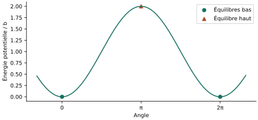
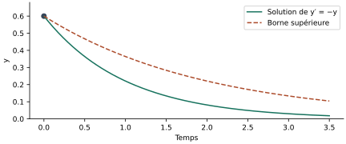

# Banque PT — Mathématiques I-A 2004 · Corrigé guidé

*Corrigé rédigé par IA, non officiel. Signalez toute erreur.*

**Rédaction** · GPT-6.2 Astra Ultra · vitesse non renseignée

Un pendule amorti illustre le lien entre le spectre d’une linéarisation et la stabilité locale. Le sujet passe du système linéaire complexe à une équation scalaire puis à un système non linéaire réel. La grille d’admissibilité attribue à Maths I-A un coefficient 6 pour l’École polytechnique et 3 pour l’ENS Cachan. [Sujet officiel](https://www.banquept.fr/IMG/pdf/math_1_a_2004.pdf) · [Rapport du jury](https://www.banquept.fr/IMG/pdf/rapport_mathematiques_1A_2004.pdf) · [Grille des coefficients](https://www.banquept.fr/documents/livret/2004/Livret_PT_2004.pdf#page=13)

Le rapport insiste sur les racines complexes du polynôme du pendule, l’existence du polynôme particulier et le rôle de l’unicité des trajectoires. Deux précisions de rédaction du sujet interviennent en III.5.c au temps initial et en IV.6.b lors du changement de coordonnées.

## Partie I · Pendule amorti

### I.1 · Passage au système

> [!INDICATION]
> Utiliser pour deuxième coordonnée la vitesse angulaire.

Pour $Y=(\alpha,\alpha')^{\mathsf T}$, $Y'=(\alpha',-b\sin\alpha-c\alpha')^{\mathsf T}=G(Y)$ avec $G(x,v)=(v,-b\sin x-cv)^{\mathsf T}$, $b,c>0$.

### I.2 · Zéros du champ

> [!INDICATION]
> Annuler les deux composantes simultanément.

La première composante impose $v=0$, puis la seconde donne $b\sin x=0$. Les zéros sont exactement $(k\pi,0)$ pour $k\in\mathbb Z$.

### I.3 · Angles constants

> [!INDICATION]
> Vérifier l’équation initiale pour un angle indépendant du temps.

Pour $\alpha(t)=a$, les deux dérivées sont nulles et l’équation devient $\sin a=0$. Les solutions constantes sont donc $\alpha(t)=k\pi$ pour tout entier relatif $k$.

### I.4 · Jacobienne du champ

> [!INDICATION]
> Chaque ligne regroupe les dérivées partielles d’une composante.

Dans l’ordre des variables $(x,v)$, la jacobienne vaut
$$
DG(x,v)=\begin{pmatrix}0&1\\-b\cos x&-c\end{pmatrix}.
$$

### I.5 · Spectre aux équilibres

> [!INDICATION]
> Distinguer la parité de l’entier qui repère l’équilibre.

En $(k\pi,0)$, le polynôme caractéristique est $z^2+cz+b(-1)^k$. Pour $k$ impair, ses racines $(-c\pm\sqrt{c^2+4b})/2$ sont réelles, de signes opposés. Pour $k$ pair, si $c^2>4b$, les racines $(-c\pm\sqrt{c^2-4b})/2$ sont négatives. Si $c^2=4b$, la racine double est $-c/2$. Si $c^2<4b$, les racines conjuguées sont $-c/2\pm i\sqrt{4b-c^2}/2$.

### I.6 · Nature des positions d’équilibre

> [!INDICATION]
> Relier la position verticale basse à un minimum de l’énergie.

Aux points bas ($k$ pair), toutes les parties réelles sont négatives et l’équilibre est asymptotiquement stable. On peut le voir directement avec l’énergie $E=v^2/2+b(1-\cos x)$, de dérivée $-cv^2$. Près d’un point bas, ses petits sous-niveaux sont compacts et retiennent la trajectoire. Sur tout ensemble limite l’énergie est constante, donc $v=0$ et, pour y rester, $\sin x=0$. Le seul tel état dans un petit sous-niveau autour du point bas est cet équilibre, d’où la convergence.

Aux points hauts ($k$ impair), il existe une valeur propre positive. L’équilibre est instable. En effet, en posant $u=x-k\pi$, on a $u''+cu'=b\sin u$. Partant de $u(0)=a>0$ arbitrairement petit et $u'(0)=0$, tant que $a\le u\le\delta<\pi/2$ on a $u'(t)\ge b\sin(a)(1-e^{-ct})/c$ par facteur intégrant. La vitesse devient positive et $u$ finit par sortir de ce voisinage.

## Partie II · Système linéaire

### II.1 · Équation homogène complexe

> [!INDICATION]
> Employer un facteur intégrant qui reste défini pour toutes les valeurs de y.

Si $y'=\lambda y$, la dérivée de $e^{-\lambda t}y(t)$ est nulle. Ainsi $y(t)=Ce^{\lambda t}$ avec $C\in\mathbb C$. Réciproquement toute fonction de cette forme convient.

### II.2.a · Recherche d’un polynôme particulier

> [!INDICATION]
> Sur les polynômes de degré borné, la dérivation devient nulle après un nombre fini d’itérations.

Substituer $y=Qe^{\mu t}$ conduit à $Q'+aQ=P$, avec $a=\mu-\lambda$. Pour $a=0$, choisir une primitive polynomiale de $P$. Pour $a\ne0$ et $\deg P=n$, posons $Q=\sum_{j=0}^n(-1)^jP^{(j)}/a^{j+1}$. Dans $Q'+aQ$ les termes successifs se compensent et $P^{(n+1)}=0$, donc le résultat vaut $P$. L’existence est établie dans les deux cas.

### II.2.b · Degré et résonance

> [!INDICATION]
> Identifier le terme de plus haut degré dans la construction précédente.

Si $\lambda\ne\mu$, le terme $P/a$ a degré $n$ et tous les autres degrés sont inférieurs, donc $\deg Q=n$. Si $\lambda=\mu$, toute primitive de $P$ a degré $n+1$.

### II.2.c · Ensemble des solutions

> [!INDICATION]
> Soustraire une solution particulière fixée.

La différence de deux solutions de l’équation avec second membre satisfait l’équation homogène. Ainsi toutes les solutions sont $Ce^{\lambda t}+Q(t)e^{\mu t}$, $C\in\mathbb C$, où $Q$ est une solution polynomiale de II.2.a de degré au plus $n+1$. La substitution vérifie la réciproque.

### II.3 · Superposition de plusieurs termes

> [!INDICATION]
> Construire une solution particulière pour chaque terme avant d’ajouter la solution homogène.

Pour chaque $P_i(t)e^{\mu_i t}$, II.2.a fournit $Q_i(t)e^{\mu_i t}$ de degré polynomial au plus $n_i+1$. L’opérateur $y\mapsto y'-\lambda y$ étant linéaire, la somme est une solution particulière du second membre total. Toute solution est donc $Ce^{\lambda t}+\sum_{i=1}^k Q_i(t)e^{\mu_i t}$, même si certaines fréquences coïncident.

### II.4 · Matrice triangulaire à valeur propre unique

> [!INDICATION]
> Isoler la partie strictement triangulaire, dont la puissance d’ordre d est nulle.

Écrivons $A=\lambda I+N$. La matrice $N$ est strictement triangulaire supérieure. Par récurrence sur $j$, $(N^j)_{ik}=0$ si $k-i<j$ puisque chaque facteur non nul doit faire avancer l’indice d’au moins un. Donc $N^d=0$. Si $Z=e^{-\lambda t}Y$, on a $Z'=NZ$ puis, par récurrence, $Z^{(j)}=N^j Z$. Comme $Z^{(d)}=0$, Taylor donne
$$
Y(t)=e^{\lambda t}\sum_{j=0}^{d-1}\frac{t^j}{j!}N^jY(0).
$$
C’est la forme demandée, avec des coefficients vectoriels constants.

### II.5.a · Plusieurs valeurs propres en forme triangulaire

> [!INDICATION]
> Raisonner sur les lignes en partant de la dernière.

Les valeurs propres sont les termes diagonaux $\lambda_i$. La dernière composante satisfait $y_d'=\lambda_d y_d$, donc est exponentielle fois une constante. Supposons, pour toutes les lignes $j>i$, que $y_j$ soit somme d’exponentielles issues des diagonales rencontrées, multipliées par des polynômes de degré au plus $d-j$. Dans $y_i'=\lambda_i y_i+\sum_{j>i}a_{ij}y_j$, les polynômes du second membre ont degré au plus $d-i-1$. Par II.3 ils gagnent au plus un degré, et le terme homogène ajoute une constante fois $e^{\lambda_i t}$. La récurrence descendante établit le résultat pour toute composante. En regroupant les coefficients selon la fréquence et la puissance,
$$
Y(t)=\sum_{i=1}^d e^{\lambda_i t}\sum_{j=0}^{d-1}t^j a_j^{(i)},\qquad a_j^{(i)}\in\mathbb C^d.
$$

### II.5.b · Retour à une matrice quelconque

> [!INDICATION]
> Le corps complexe assure la trigonalisation.

Le polynôme caractéristique de $A$ est scindé sur $\mathbb C$. Il existe $S$ inversible et $T$ triangulaire supérieure avec $A=STS^{-1}$. Alors $Z=S^{-1}Y$ vérifie $Z'=TZ$. En appliquant II.5.a puis en multipliant par $S$, on obtient la même forme pour $Y$, les vecteurs coefficients étant multipliés par $S$.

### II.6.a · Noyau du système stable

> [!INDICATION]
> Vérifier si zéro peut être une valeur propre.

Toutes les valeurs propres ayant une partie réelle strictement négative, zéro ne figure pas dans le spectre. La matrice $A$ est donc inversible et $AZ=0$ impose $Z=0$, en particulier pour $Z\in\mathbb R^d$.

### II.6.b · Limite des trajectoires

> [!INDICATION]
> Comparer la décroissance d’une exponentielle à toute puissance de t.

Pour chaque $i,j$, $|t^j e^{\lambda_i t}|=t^j e^{t\operatorname{Re}\lambda_i}\to0$ lorsque $t\to+\infty$. Chaque terme de la somme finie de II.5.b tend vers zéro et donc $Y(t)\to0$.

## Partie III · Équation scalaire

### III.1 · Trajectoire issue de zéro

> [!INDICATION]
> Appliquer l’unicité à une solution candidate connue.

Comme $g(0)=0$, la fonction identiquement nulle est solution de $y'=g(y)$. Si $y(0)=0$, l’unicité postulée donne $y(t)=0$ pour tout $t\in\mathbb R$.

### III.2 · Conservation du signe

> [!INDICATION]
> L’unicité est donnée pour une condition à n’importe quel instant.

Si $y(t_1)=0$, l’unicité au temps $t_1$ imposerait la solution nulle pour tout $t$, donc $y_0=0$. Lorsque $y_0\ne0$, $y$ ne s’annule donc jamais et garde le signe de $y_0$ par continuité.

### III.3 · Continuité du reste

> [!INDICATION]
> Reconnaître un taux d’accroissement en zéro.

Pour $x\ne0$, $h(x)=g(x)/x+\lambda$ est continue. Comme $g(0)=0$ et $g'(0)=-\lambda$, le quotient tend vers $-\lambda$ quand $x\to0$. Ainsi $h(x)\to0=h(0)$.

### III.4 · Choix du rayon local

> [!INDICATION]
> Prendre pour tolérance la moitié du taux de décroissance linéaire.

Par continuité de $h$ en zéro et $\lambda>0$, il existe $r_0>0$ tel que $|x|<r_0$ implique $|h(x)-h(0)|<\lambda/2$. Or $h(0)=0$.

### III.5.a · Premier intervalle de contrôle

> [!INDICATION]
> Utiliser la marge de la donnée initiale par rapport aux deux extrémités.

Puisque $0<y_0<r_0/2$ et $y$ est continue en zéro, il existe $T>0$ tel que $|y(s)-y_0|<\tfrac12\min(y_0,r_0-y_0)$ pour $0\le s\le T$. On a alors $0<y(s)<r_0$ sur cet intervalle.

### III.5.b · Dérivée logarithmique

> [!INDICATION]
> Écrire le quotient de la dérivée par la valeur comme la partie linéaire plus le reste.

Sur $[0,T]$, $y'/y=g(y)/y=-\lambda+h(y)<-\lambda/2$, d’après III.4 et III.5.a.

### III.5.c · Borne exponentielle et temps initial

> [!INDICATION]
> L’intégrale d’une inégalité stricte sur un intervalle de longueur nulle donne une égalité.

Pour $0<t\le T$, l’intégration donne $\log(y(t)/y_0)<-\lambda t/2$. Ainsi $0<y(t)<y_0e^{-\lambda t/2}$. En $t=0$, le membre de droite est égal à $y(0)=y_0$. Sur l’intervalle fermé imprimé, l’inégalité supérieure correcte est donc large, avec stricte inégalité dès que $t>0$.

### III.5.d · Prolongement du contrôle

> [!INDICATION]
> Écarter une première sortie avant de réutiliser l’inégalité différentielle.

Si $y$ atteignait $r_0$ après $T$, il existerait un premier temps $\tau>T$ avec $y(\tau)=r_0$. Avant $\tau$, la positivité est acquise par III.2 et l’argument précédent s’applique. À la limite $y(\tau)\le y_0e^{-\lambda\tau/2}<r_0$, contradiction. Sur $[T,2T]$, $y$ garde donc ses valeurs dans $]0,r_0[$ et l’intégration depuis zéro donne encore l’inégalité stricte.

### III.6 · Estimation pour les deux signes

> [!INDICATION]
> Le logarithme de la valeur absolue a la même dérivée pour les données négatives.

Le premier temps de sortie de $]-r_0,r_0[$ est impossible pour toute donnée $0<|y_0|<r_0/2$ : tant qu’on reste dans l’intervalle, $(\log|y|)'=g(y)/y<-\lambda/2$, donc $|y(t)|\le|y_0|e^{-\lambda t/2}<r_0$. Par continuité cette borne contredirait une sortie. La solution globale vérifie donc l’estimation pour tout $t\ge0$. Lorsque $y_0=0$, III.1 la vérifie aussi.

### III.7 · Limite locale

> [!INDICATION]
> Utiliser l’hypothèse sur la donnée initiale de la question précédente.

Pour $|y_0|<r_0/2$, la borne exponentielle tend vers zéro. On obtient $\lim_{t\to+\infty}y(t)=0$. Les hypothèses au voisinage de zéro ne déterminent pas la limite de données initiales quelconques.

## Partie IV · Système non linéaire

### IV.1 · Dérivée de l’énergie quadratique

> [!INDICATION]
> Dériver les carrés des coordonnées et sommer.

$E(t)=\|Y(t)\|^2$ est de classe $C^1$ puisque $Y'=G(Y)$ est continue. La dérivée est $E'=2\langle Y',Y\rangle=2\langle G(Y),Y\rangle$.

### IV.2 · Majoration du reste

> [!INDICATION]
> Appliquer Cauchy-Schwarz au terme non linéaire.

La définition donne $G(Y)=AY+\|Y\|H(Y)$, y compris en zéro. Ainsi
$$
E'=2\langle AY,Y\rangle+2\|Y\|\langle H(Y),Y\rangle
\le2\langle AY,Y\rangle+2\|Y\|^2\|H(Y)\|.
$$

### IV.3 · Base de trigonalisation

> [!INDICATION]
> Interpréter l’hypothèse de trigonalisation réelle.

Par hypothèse, $A$ est trigonalisable sur $\mathbb R$. Il existe donc une base réelle $(e_1,\ldots,e_d)$ dans laquelle $u$ a une matrice triangulaire supérieure $T=(t_{ij})$. Les termes diagonaux sont les valeurs propres, toutes négatives.

### IV.4 · Base redimensionnée

> [!INDICATION]
> Les nouveaux vecteurs sont des multiples non nuls des anciens.

Pour $\alpha>0$, le changement de base a pour matrice $D_\alpha=\operatorname{diag}(1,\alpha,\ldots,\alpha^{d-1})$ dans la base précédente. Son déterminant $\alpha^{d(d-1)/2}$ est non nul, donc les vecteurs forment une base.

### IV.5 · Petits coefficients hors diagonale

> [!INDICATION]
> Calculer chaque coefficient de la matrice conjuguée.

Dans cette base $T_\alpha=D_\alpha^{-1}TD_\alpha$ a pour coefficient $t_{ij}\alpha^{j-i}$. Sous la diagonale les coefficients restent nuls, sur la diagonale ils sont inchangés et au-dessus ils tendent vers zéro pour $\alpha\to0^+$. Ils sont en nombre fini, donc un même $\alpha$ les rend tous strictement inférieurs à $\varepsilon$ en valeur absolue.

### IV.6.a · Transformation du champ

> [!INDICATION]
> La matrice de changement de coordonnées est indépendante du temps.

Pour $Z=Y_*=PY$, on a $Z'=PY'=PG(P^{-1}Z)$.

### IV.6.b · Énergie en coordonnées adaptées

> [!INDICATION]
> Distinguer la composition du reste avec le changement de coordonnées et le reste du champ transformé.

Notons $B=PAP^{-1}=D+N$ la matrice de IV.5, $\lambda=\min_i|\lambda_i|>0$. On peut imposer $\|N\|_2\le\|N\|_{\rm F}<\lambda/4$ en rendant chaque coefficient assez petit. D’où $2\langle BZ,Z\rangle\le-3\lambda\|Z\|^2/2$. Posons $H_*(Z)=H(P^{-1}Z)$ comme dans l’énoncé, et $K=\|P\|_2\|P^{-1}\|_2$. La véritable équation transformée est $Z'=BZ+\|P^{-1}Z\|P H_*(Z)$. Par Cauchy-Schwarz, l’estimation valable globalement est donc
$$
(\|Z\|^2)'\le\|Z\|^2\bigl(-3\lambda/2+2K\|H_*(Z)\|\bigr).
$$
Comme $H_*(0)=0$ et $H_*$ est continue, on peut imposer $2(K-1)\|H_*(Z)\|\le\lambda/2$ dans un voisinage de zéro. On y obtient exactement la majoration imprimée, avec $-\lambda+2\|H_*(Z)\|$. Pour la même écriture globale, il faut remplacer $H_*(Z)$ par le reste transformé $\|P^{-1}Z\|P H(P^{-1}Z)/\|Z\|$, prolongé par zéro en zéro.

Un contre-exemple montre pourquoi la portée locale importe. En dimension deux, choisissons $A=\left(\begin{smallmatrix}-1&4\\0&-1\end{smallmatrix}\right)$. Pour $r=\|x\|\ge2$, posons $H(x)=\log r\,(\cos(\log r),\sin(\log r))$. On le raccorde par une coupure lisse à $H=0$ pour $r\le1$. Le champ $G(x)=Ax+rH(x)$ est $C^1$ et ses solutions sont globales car sa croissance est majorée par $C(1+r)\log(2+r)$, dont l’inverse a une intégrale divergente à l’infini, dans les deux sens du temps.

Si la formule imprimée valait partout pour un $P$, posons $M=P^{\mathsf T}P$. Au temps initial $x=rv$, où $v$ est unitaire, divisons cette formule par $2r^2\log r$ et prenons $r\to\infty$ le long de valeurs pour lesquelles $(\cos(\log r),\sin(\log r))$ égale une direction unitaire $w$ choisie. On obtient $\langle Mv,w\rangle\le\langle Mv,v\rangle$. Choisir $w=Mv/\|Mv\|$ impose l’égalité dans Cauchy-Schwarz. Chaque $v$ est donc vecteur propre de $M$, ce qui force $M$ à être scalaire. Mais près de zéro le reste est nul et $v=(1,1)/\sqrt2$ satisfait $\langle Av,v\rangle=1$, en contradiction avec la décroissance imposée. L’hypothèse spectrale garantit bien l’estimation locale utilisée en IV.7.

### IV.7 · Stabilité asymptotique locale

> [!INDICATION]
> Retenir la trajectoire dans une boule en appliquant l’estimation jusqu’au premier temps de sortie.

Choisissons $\rho>0$ assez petit pour que IV.6.b donne $(\|Z\|^2)'\le-(\lambda/2)\|Z\|^2$ lorsque $\|Z\|<\rho$, grâce à $H_*(Z)\to0$. En multipliant par $e^{\lambda t/2}$ et en intégrant, on obtient $\|Z(t)\|^2\le\|Z(0)\|^2e^{-\lambda t/2}$ tant que la trajectoire reste dans la boule. Si $\|Z(0)\|<\rho$, la continuité et cette majoration excluent un premier instant où $\|Z\|=\rho$, comme en III.5.d. La borne vaut donc pour tout $t\ge0$. Prenons $r=\rho/\|P\|_2$. Lorsque $\|Y_0\|<r$, on a $\|Z(0)\|<\rho$ et $\|Y(t)\|\le\|P^{-1}\|_2\|Z(0)\|e^{-\lambda t/4}\to0$.
