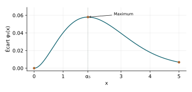
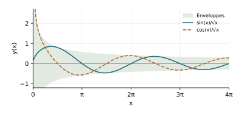

# Banque PT — Mathématiques II-B 2004 · Corrigé guidé

*Corrigé rédigé par IA, non officiel. Signalez toute erreur.*

**Rédaction** · GPT-6.2 Astra Ultra · vitesse non renseignée · 26 novembre 2026

La Banque PT a programmé cet écrit le lundi 10 mai 2004, de 8 h à 12 h. La garde interdit la calculatrice. Le code imprimé est RS80. Les questions figurent aux pages 1 à 4 du PDF de 4 pages. En admissibilité, le coefficient de Mathématiques II-B est de 3 pour l’ENS Cachan et de 6 pour l’École polytechnique. [Sujet](https://www.banquept.fr/IMG/pdf/math_2_b_2004.pdf) · [Rapport du jury](https://www.banquept.fr/IMG/pdf/rapport_mathematiques_2B_2004.pdf) · [Livret de la Banque PT, p. 8, 9 et 13](https://www.banquept.fr/documents/livret/2004/Livret_PT_2004.pdf)

## I. Fonction bêta et approximation de l’exponentielle

### Question I.1.a

> [!INDICATION]
> Prendre le logarithme pour n supérieur à x.

#### Solution

Fixons $x>0$. Pour $n>x$, la base est positive et $n\ln(1-x/n)=-x+O(1/n)$ par développement du logarithme en zéro. L’exponentiation donne $\lim_{n\to\infty}(1-x/n)^n=e^{-x}$.

### Question I.1.b

> [!INDICATION]
> Comparer le signe de la dérivée à celui de la fonction auxiliaire.

#### Solution

Pour $0<x<n$, $\varphi_n(x)=e^{-x}-(1-x/n)^n$ et $\varphi_n'(x)=(1-x/n)^{n-1}-e^{-x}$. Son signe est celui de $\psi_n(x)=(n-1)\ln(1-x/n)+x$. On a $\psi_n(0)=0$, $\psi_n'(x)=(1-x)/(n-x)$ et $\psi_n(x)\to-\infty$ en $n^-$. Donc $\psi_n$ croît sur $[0,1]$, puis décroît jusqu’à $-\infty$. Elle s’annule une seule fois après $1$, en un point noté $\alpha_n$.

| Abscisse | $0$ | $0<x<\alpha_n$ | $\alpha_n$ | $\alpha_n<x<n$ | $n$ |
|---|---|---|---|---|---|
| Signe de la dérivée | $0$ à droite | $+$ | $0$ | $-$ | $-$ à gauche |
| Valeur ou variation | $0$ | croissante | maximum | décroissante | $e^{-n}$ |

Sur $]-\infty,0[$ et $]n,\infty[$, la fonction est nulle par définition. Elle est continue en zéro et présente un saut à droite de $n$.

### Question I.1.c

> [!INDICATION]
> Employer la stricte décroissance de la fonction auxiliaire après un.

#### Solution

Comme $\psi_n(1)>\psi_n(0)=0$ et $\psi_n(n^-)=-\infty$, la continuité et la stricte décroissance sur $]1,n[$ donnent une unique racine $\alpha_n$ dans cet intervalle. La dérivée de $\varphi_n$ passe du signe positif au signe négatif. Ses valeurs hors du segment étant nulles, son maximum global strict est atteint seulement en $\alpha_n$.

### Question I.1.d

> [!INDICATION]
> Réutiliser l’égalité des deux termes de la dérivée.

#### Solution

Au point critique, $(1-\alpha_n/n)^{n-1}=e^{-\alpha_n}$. En multipliant par $1-\alpha_n/n$ puis en soustrayant de $e^{-\alpha_n}$, on obtient $\varphi_n(\alpha_n)=(\alpha_n/n)e^{-\alpha_n}$.

### Question I.1.e

> [!INDICATION]
> Maximiser x exp(−x) sur le demi-axe.

#### Solution

La fonction $xe^{-x}$ est positive pour $x>0$. Sa dérivée $(1-x)e^{-x}$ est positive jusqu’à $1$ puis négative. Son maximum vaut $1/e$. Ainsi $0\le\varphi_n(\alpha_n)\le1/(ne)$.

### Question I.1.f

> [!INDICATION]
> Placer les deux extrémités et le sommet avant de relier les points.

#### Solution

Sur $[0,n]$, la courbe part de $(0,0)$ avec tangente horizontale, croît jusqu’à $(\alpha_n,\alpha_ne^{-\alpha_n}/n)$, puis décroît jusqu’à $(n,e^{-n})$, dont l’ordonnée reste strictement positive. Sa pente à gauche de $n$ est $-e^{-n}$. Le schéma donne un représentant chiffré de cette famille et situe le maximum.

### Question I.2.a

> [!INDICATION]
> Transporter le demi-axe sur le segment par une fraction homographique.

#### Solution

Pour $u,v>0$, l’intégrande de $B(u,v)=\int_0^\infty t^{u-1}(1+t)^{-u-v}\,dt$ est équivalent à $t^{u-1}$ en zéro et à $t^{-v-1}$ à l’infini. Les deux extrémités sont intégrables. Le changement croissant $s=t/(1+t)$ donne $t=s/(1-s)$, $dt=ds/(1-s)^2$. En passant aux bornes après substitution sur des segments, on trouve $B(u,v)=\int_0^1s^{u-1}(1-s)^{v-1}\,ds$.

### Question I.2.b

> [!INDICATION]
> Réfléchir l’intervalle autour de son milieu.

#### Solution

Le changement de variable $s=1-t$ dans l’intégrale de I.2.a échange les facteurs et inverse les bornes. Ainsi $B(u,v)=B(v,u)$.

### Question I.2.c

> [!INDICATION]
> Établir deux relations en additionnant les intégrandes puis en intégrant par parties.

#### Solution

L’identité $t+(1-t)=1$ donne $B(u+1,v)+B(u,v+1)=B(u,v)$. En intégrant $t^u(1-t)^{v-1}$ par parties, le terme de bord $-t^u(1-t)^v/v$ est nul aux deux extrémités car $u,v>0$. Il vient $B(u+1,v)=(u/v)B(u,v+1)$. Les deux relations donnent $B(u+1,v)=uB(u,v)/(u+v)$.

### Question I.3.a

> [!INDICATION]
> Ramener l’intervalle de longueur n à l’unité.

#### Solution

Pour $x>0$ et $n>1$, poser $t=ns$ dans $I_n(x)=\int_0^n(1-t/n)^n t^{x-1}\,dt$ donne $I_n(x)=n^x\int_0^1(1-s)^ns^{x-1}\,ds=n^xB(x,n+1)=n^xB(n+1,x)$.

### Question I.3.b

> [!INDICATION]
> Itérer la récurrence jusqu’au premier argument un.

#### Solution

On a $B(1,x)=\int_0^1(1-t)^{x-1}\,dt=1/x$. En utilisant I.2.c pour les premiers arguments $1,\dots,n$, on obtient
$$I_n(x)=\frac{n^x n!}{x(x+1)\cdots(x+n)}.$$

## II. Fonction Gamma et prolongement

### Question II.1

> [!INDICATION]
> Traiter séparément les voisinages de zéro et de l’infini.

#### Solution

Pour $x>0$, $e^{-t}t^{x-1}\sim t^{x-1}$ en zéro et $x-1>-1$. À l’infini, $e^{-t/2}t^{x-1}$ est borné, donc l’intégrande est au plus une constante fois $e^{-t/2}$, intégrable. Ainsi $\Gamma(x)$ existe et est strictement positive.

### Question II.2.a

> [!INDICATION]
> Profiter de l’éloignement du segment d’intégration par rapport à zéro.

#### Solution

Fixons $n>1$. Sur le produit de tout segment compact de paramètres $x>0$ et de $[1/n,n]$, la fonction $(x,t)\mapsto e^{-t}t^{x-1}$ est continue et bornée. Le théorème de continuité des intégrales à paramètre sur un segment donne la continuité de $\Gamma_n$ sur $]0,\infty[$.

### Question II.2.b

> [!INDICATION]
> Comparer les morceaux retranchés à des queues convergentes.

#### Solution

Pour $x>0$ fixé, $\Gamma(x)-\Gamma_n(x)=\int_0^{1/n}e^{-t}t^{x-1}\,dt+\int_n^\infty e^{-t}t^{x-1}\,dt$. Par II.1 les deux quantités tendent vers zéro. On a donc $\Gamma_n(x)\to\Gamma(x)$.

### Question II.2.c

> [!INDICATION]
> Calculer directement l’intégrale.

#### Solution

La puissance $t^{x-1}$ vaut un lorsque $x=1$. Donc $\Gamma(1)=\int_0^\infty e^{-t}\,dt=[-e^{-t}]_0^\infty=1$.

### Question II.2.d

> [!INDICATION]
> Abaisser l’exposant par intégration par parties.

#### Solution

Pour un entier $m\ge2$, les termes de bord $e^{-t}t^{m-1}$ s’annulent en zéro et à l’infini. L’intégration par parties donne $\Gamma(m)=(m-1)\Gamma(m-1)$. Partant de $\Gamma(1)=1$, une récurrence donne $\Gamma(m)=(m-1)!$.

### Question II.3

> [!INDICATION]
> Résoudre la relation de récurrence en la valeur d’indice inférieur.

#### Solution

Pour tout réel $x>1$, la même intégration par parties donne $\Gamma(x)=(x-1)\Gamma(x-1)$ avec les mêmes termes de bord nuls. Pour $-1<s<0$, posons donc $\Gamma(s)=\Gamma(s+1)/s$. Plus généralement, pour $s<0$ non entier, choisissons $m\in\mathbb N$ tel que $s+m>0$ et posons $\Gamma(s)=\Gamma(s+m)/[s(s+1)\cdots(s+m-1)]$. Aucun facteur ne s’annule. Augmenter $m$ d’une unité conserve le quotient par la relation sur les arguments positifs. On obtient ainsi un prolongement cohérent et non nul à chaque réel négatif non entier.

### Question II.4.a

> [!INDICATION]
> Revenir à la définition d’une intégrale convergente.

#### Solution

Par II.1, les intégrales de zéro à $A$ tendent vers $\Gamma(x)$. Leur différence positive avec $\Gamma(x)$ est exactement la queue au-delà de $A$. On peut donc choisir $A>0$ tel que cette queue soit au plus $\varepsilon$.

### Question II.4.b

> [!INDICATION]
> Choisir n assez grand pour que le segment reste dans la zone de définition de l’écart.

#### Solution

Prenons $n_0\ge\max(2,A)$. Pour $n\ge n_0$ et $0\le t\le A$, $e^{-t}-f_n(t)=\varphi_n(t)$ appartient à $[0,\varphi_n(\alpha_n)]$ d’après I.1. Après multiplication par $t^{x-1}$ puis intégration, la valeur absolue de la différence demandée est au plus $\varphi_n(\alpha_n)\int_0^A t^{x-1}\,dt$. La singularité possible en zéro est intégrable car $x>0$.

### Question II.4.c

> [!INDICATION]
> Évaluer l’intégrale du majorant.

#### Solution

Par I.1.e, la borne de II.4.b est au plus $A^x/(xne)$. Choisir $n_1\ge n_0$ tel que $A^x/(xn_1e)\le\varepsilon$ rend l’erreur au plus $\varepsilon$ pour tous les $n\ge n_1$.

### Question II.4.d

> [!INDICATION]
> Sur la queue, comparer directement les deux intégrandes positifs.

#### Solution

Pour $0\le t\le n$, $0\le f_n(t)\le e^{-t}$ par I.1, et pour $t>n$ le prolongement de $f_n$ vaut zéro. Donc $\Gamma(x)-I_n(x)\ge0$. Pour $n\ge n_1$, la contribution de $[0,A]$ est au plus $\varepsilon$ et celle de $[A,\infty[$ au plus la queue de Gamma, elle aussi au plus $\varepsilon$. La différence est au plus $2\varepsilon$, d’où $I_n(x)\to\Gamma(x)$.

### Question II.4.e

> [!INDICATION]
> Reporter la valeur exacte de l’intégrale finie.

#### Solution

La limite précédente et I.3.b fournissent, pour tout réel $x>0$,
$$\Gamma(x)=\lim_{n\to\infty}\frac{n^x n!}{x(x+1)\cdots(x+n)}.$$

## III. Équation de Bessel

### Question III.1.a

> [!INDICATION]
> Substituer x puissance lambda fois la série entière avant d’identifier les coefficients.

#### Solution

Soit $\lambda>0$ non entier. En mettant $y=x^\lambda a(x)$ dans $x^2y''+xy'+(x^2-\lambda^2)y=0$ et en divisant par $x^\lambda$ pour $0<x<R$, on obtient $x^2a''+(2\lambda+1)xa'+x^2a=0$. Dans l’intervalle de convergence les dérivations terme à terme sont permises. L’identification du coefficient de $x^n$ pour $n\ge2$ donne $n(n+2\lambda)a_n+a_{n-2}=0$, donc $a_n=-a_{n-2}/[n(n+2\lambda)]$.

### Question III.1.b

> [!INDICATION]
> Identifier aussi la première puissance avant l’apparition du terme décalé.

#### Solution

Pour $n=1$ le coefficient du membre gauche est $(1+2\lambda)a_1$. Comme $1+2\lambda>0$, $a_1=0$.

### Question III.1.c

> [!INDICATION]
> Suivre séparément les rangs pairs et impairs.

#### Solution

Le coefficient constant de l’équation est identiquement nul. Tout réel non nul est admissible pour $a_0$. Le choix zéro donnerait tous les coefficients nuls par la récurrence et contredirait l’hypothèse sur $y$. Les rangs impairs sont nuls. La somme $a(x)=\sum_{p\ge0}a_{2p}x^{2p}$ est donc paire sur son intervalle de convergence, entièrement déterminée à un facteur constant près.

### Question III.1.d

> [!INDICATION]
> Appliquer le quotient aux seuls termes non nuls.

#### Solution

La valeur absolue du rapport de deux termes pairs successifs vaut $|x|^2/[(2p+2)(2p+2+2\lambda)]$ et tend vers zéro pour tout $x$ fixé. Le rayon est donc infini. Les identités sur les coefficients restent vraies et la série peut être dérivée deux fois sur tout segment. L’équation de III.1.a, puis celle de Bessel pour $y=x^\lambda a$, sont donc satisfaites sur tout $]0,\infty[$.

### Question III.1.e

> [!INDICATION]
> Écrire le produit des facteurs de la récurrence aux indices pairs.

#### Solution

On impose $a_0=1/[2^\lambda\Gamma(\lambda+1)]$. Pour $p\ge1$, le produit des dénominateurs est $\prod_{j=1}^p4j(j+\lambda)=4^p p!\,\Gamma(\lambda+p+1)/\Gamma(\lambda+1)$ par II.3. Par conséquent
$$a_{2p}(\lambda)=\frac{(-1)^p}{2^{2p+\lambda}p!\,\Gamma(\lambda+p+1)},$$
formule aussi valable au rang zéro.

### Question III.1.f

> [!INDICATION]
> Vérifier directement les coefficients pairs pour éviter une division nulle à un rang impair.

#### Solution

Prenons $\nu=-\lambda$ et choisissons les coefficients impairs nuls. Posons $b_{2p}=(-1)^p/[2^{2p+\nu}p!\Gamma(p+\nu+1)]$. La non-intégralité de $\lambda$ assure que chaque Gamma est définie et non nulle, même aux arguments négatifs. L’équation fonctionnelle donne $4p(p+\nu)b_{2p}=-b_{2p-2}$ pour $p\ge1$. Les coefficients impairs satisfont l’identité du fait de leur nullité, y compris si $n+2\nu=0$ à un rang impair. Le quotient des termes pairs tend vers zéro pour tout $x$, en valeur absolue. En substituant $J_\nu=x^\nu\sum b_{2p}x^{2p}$ on annule donc tous les coefficients. Puisque $\nu^2=\lambda^2$, $J_{-\lambda}$ résout bien la même équation sur $]0,\infty[$.

### Question III.1.g

> [!INDICATION]
> Extraire la puissance commune de x sur deux.

#### Solution

En multipliant la série paire de III.1.e par $x^\lambda$ et en regroupant les puissances de deux, il vient, pour $x>0$,
$$J_\lambda(x)=\left(\frac{x}{2}\right)^\lambda\sum_{p=0}^{\infty}\frac{(-1)^p(x/2)^{2p}}{p!\,\Gamma(\lambda+p+1)}.$$

### Question III.1.h

> [!INDICATION]
> Écrire une combinaison linéaire dans la base proposée.

#### Solution

Dans la base du sujet, $y(x)=A J_{-\lambda}(x)+B J_\lambda(x)$, avec $A,B\in\mathbb R$ uniques. On peut vérifier l’indépendance par les premiers termes en zéro, proportionnels à $x^{-\lambda}$ et $x^\lambda$ avec coefficients non nuls. L’espace a dimension deux par le théorème de Cauchy appliqué sur $]0,\infty[$.

### Question III.2.a

> [!INDICATION]
> Réécrire y comme le produit de u et d’une puissance.

#### Solution

Posons $y=x^{-1/2}u$. Alors $y'=x^{-1/2}u'-\tfrac12 x^{-3/2}u$ et $y''=x^{-1/2}u''-x^{-3/2}u'+\tfrac34 x^{-5/2}u$. Dans l’équation de Bessel, les dérivées premières s’annulent et il reste $u''+[1+(1/4-\lambda^2)/x^2]u=0$. Ainsi $\sigma=1/4-\lambda^2$.

### Question III.2.b

> [!INDICATION]
> Résoudre l’équation harmonique et diviser par la racine de x.

#### Solution

Pour $\lambda=1/2$, $\sigma=0$ et $u''+u=0$. Ainsi $y(x)=(A\cos x+B\sin x)/\sqrt x$ pour $x>0$, avec $(A,B)\ne(0,0)$. Pour représenter toute la famille, posons $R=\sqrt{A^2+B^2}$ et choisissons $\delta$ tel que $A=R\sin\delta$, $B=R\cos\delta$. Les courbes sont $R\sin(x+\delta)/\sqrt x$, comprises entre $\pm R/\sqrt x$, avec zéros en $k\pi-\delta>0$. Si $A\ne0$, $y(x)\sim A/\sqrt x$ à l’origine. Si $A=0$, $y(x)\sim B\sqrt x$. Toutes les solutions tendent vers zéro à l’infini. Le tracé présente un représentant de chacun des deux comportements en zéro.

