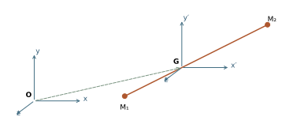
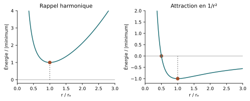
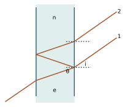
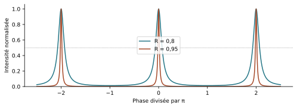

# Banque PT — Physique I-A 2004 · Corrigé brut

*Corrigé rédigé par IA, non officiel. Signalez toute erreur.*

**Rédaction** · GPT-6.2 Astra Ultra · vitesse non renseignée

**Révision** · GPT-6.2 Astra Ultra · vitesse non renseignée

Comment déceler deux étoiles lorsque le télescope ne sépare pas leurs images ? Le mouvement relatif fixe le décalage Doppler et la finesse du Fabry–Perot fixe l’écart mesurable. Coefficients d’admissibilité : 6 pour l’École polytechnique, 5 pour l’ENS Cachan. [Sujet officiel](https://www.banquept.fr/IMG/pdf/phys_1_a_2004.pdf) · [Rapport du jury](https://www.banquept.fr/IMG/pdf/rapport_sc_physiques_1A_2004.pdf) · [Grille des coefficients](https://www.banquept.fr/documents/livret/2004/Livret_PT_2004.pdf#page=13)

## A.I — Cinétique du système double

### A.I.1 · Deux référentiels

Un référentiel galiléen est celui dans lequel un point matériel isolé se déplace à vitesse vectorielle constante. Le référentiel barycentrique $\mathcal R^*$ a son origine en $G$ et ses axes parallèles à ceux du référentiel galiléen $\mathcal R$ d’origine $O$. Il est donc en translation de vitesse $\vec v_G$. Son caractère galiléen dépend du mouvement de $G$. Posons $M=m_1+m_2$, $\mu=m_1m_2/M$ et $\vec r=\overrightarrow{M_1M_2}$.

### A.I.2 · Position, vitesse et quantité de mouvement

**a.** De $m_1\vec r_1^*+m_2\vec r_2^*=0$ et $\vec r_2^*-\vec r_1^*=\vec r$ résultent $\vec r_1^*=-(m_2/M)\vec r$ et $\vec r_2^*=(m_1/M)\vec r$.

**b.** La dérivation dans $\mathcal R^*$ donne $\vec v_1^*=-(m_2/M)\vec v^*$ et $\vec v_2^*=(m_1/M)\vec v^*$. **c.** Les bases ne tournent pas l’une par rapport à l’autre, donc la dérivée du même vecteur libre est la même, $\vec v^*=\vec v=\vec v_2-\vec v_1$. **d.** Ainsi $\vec P^*=\sum m_i\vec v_i^*=\vec0$.

### A.I.3 · Moments cinétiques

**a.** $\vec\sigma_O=\sum_i\overrightarrow{OM_i}\times m_i\vec v_i$ et $\vec\sigma_G^*=\sum_i\vec r_i^*\times m_i\vec v_i^*$.

**b.** Le premier théorème de König donne $\vec\sigma_O=\overrightarrow{OG}\times M\vec v_G+\vec\sigma_G^*$. Les termes croisés s’annulent car $\sum m_i\vec r_i^*=\sum m_i\vec v_i^*=0$. Dans $\mathcal R^*$, changer le point de réduction ajoute un produit vectoriel avec $\vec P^*=0$. On peut donc écrire $\vec\sigma^*$.

**c.** Les coefficients devant $\vec r\times\vec v$ s’additionnent en $(m_1m_2^2+m_2m_1^2)/M^2=\mu$. Ainsi $\vec\sigma^*=\mu\vec r\times\vec v$.

### A.I.4 · Énergies et masse réduite

**a.** $E_c=\tfrac12\sum m_i\|\vec v_i\|^2$ et $E_c^*=\tfrac12\sum m_i\|\vec v_i^*\|^2$. **b.** Substituer $\vec v_i=\vec v_G+\vec v_i^*$ élimine le terme croisé $\vec v_G\cdot\vec P^*$. Le deuxième théorème de König donne $E_c=\tfrac12Mv_G^2+E_c^*$. **c.** Avec les vitesses de A.I.2, $E_c^*=\tfrac12\mu v^{*2}$.

## A.II — Forces internes et extérieures

### A.II.1 · Action et réaction

Le principe des actions réciproques, sous sa forme forte pour deux points matériels, donne des forces opposées sur la droite des centres. En effet, l’annulation du moment des interactions internes s’écrit $\overrightarrow{M_1M_2}\times\vec F_{i2}=0$ après utilisation de $\vec F_{i1}=-\vec F_{i2}$. La seule opposition vectorielle ne suffirait pas à établir cette colinéarité.

### A.II.2 · Séparer translation et mouvement relatif

**a.** $m_j\dot{\vec v}_j=\vec F_{ej}+\vec F_{ij}$, d’où $M\dot{\vec v}_G=\vec F_{e1}+\vec F_{e2}$ et
$$\left({d\vec v\over dt}\right)_{\mathcal R}=\left({d\vec v^*\over dt}\right)_{\mathcal R^*}={\vec F_{i2}\over\mu}+{\vec F_{e2}\over m_2}-{\vec F_{e1}\over m_1}.$$
**b.** La condition C1 est $\vec F_{e1}+\vec F_{e2}=0$ car $\mathcal R^*$ doit être en translation uniforme. **c.** C2 est $\vec F_{e1}/m_1=\vec F_{e2}/m_2$, qui élimine les forces extérieures de l’équation relative. **d.** Le poids en champ uniforme non nul satisfait seulement C2. Si C1 et C2 sont simultanées, l’accélération extérieure commune est nulle, donc chaque résultante extérieure est nulle. On retrouve la dynamique d’un système isolé (ou pseudo-isolé si plusieurs actions extérieures se compensent sur chaque point).

## A.III — Système isolé

### A.III.1 · Mouvement de G

$M\dot{\vec v}_G=0$ implique un mouvement rectiligne uniforme, éventuellement le repos. Le référentiel barycentrique est galiléen.

### A.III.2 · Conservation du moment cinétique

$\dot{\vec\sigma}^*=\mu\vec v^*\times\vec v^*+\vec r\times\vec F_{i2}=0$, par colinéarité de la force et du rayon. Le vecteur est constant.

### A.III.3 · Plan et loi des aires

Comme $\vec r\perp\vec\sigma^*\ne0$, la trajectoire de l’extrémité de $\vec r$ est dans le plan fixe $Gxy$. Dans sa base polaire, $\sigma^*=\mu r^2\dot\theta$, donc la vitesse aréolaire $r^2\dot\theta/2=\sigma^*/(2\mu)$ est constante.

### A.III.4 · Puissance dans le référentiel initial

Pour $j=1,2$, la dérivée de $\tfrac12m_j v_j^2$ est $m_j\dot{\vec v}_j\cdot\vec v_j=\vec F_{ij}\cdot\vec v_j$, où la première lettre de l’indice signifie « interne ». En additionnant et en utilisant l’opposition des forces, $\dot E_c=\vec F_{i2}\cdot(\vec v_2-\vec v_1)=\vec F_{i2}\cdot\vec v$.

### A.III.5 · Puissance barycentrique

L’énergie de translation $\tfrac12Mv_G^2$ étant constante, $\dot E_c^*=\dot E_c=\vec F_{i2}\cdot\vec v^*$. On peut aussi dériver directement $E_c^*=\mu v^{*2}/2$.

### A.III.6 · Énergie mécanique

$\vec F=-\nabla E_p$ implique $\dot E_p=\nabla E_p\cdot\vec v^*=-\vec F\cdot\vec v^*$. Ainsi $\dot E_c^*+\dot E_p=0$. La constante $E^*=E_c^*+E_p$ est l’énergie mécanique barycentrique.

### A.III.7 · Mobile équivalent et reconstruction

**a.** Les trois lois se résument dans le tableau suivant.

| Grandeur dérivée dans $\mathcal R^*$ | Valeur |
|---|---|
| $\mu\,d\vec v^*/dt$ | $\vec F$ |
| $d\vec\sigma^*/dt$ | $\vec0$ |
| $dE^*/dt$ | $0$ |

**b.** Avec $\overrightarrow{GP}=\vec r$, le mobile équivalent de masse $\mu$ obéit à $\mu\ddot{\vec r}=\vec F$, force centrale et conservative. **c.** À chaque date, $\overrightarrow{OM_1}=\overrightarrow{OG}-(m_2/M)\vec r$ et $\overrightarrow{OM_2}=\overrightarrow{OG}+(m_1/M)\vec r$.

## A.IV — Potentiels effectifs

### A.IV.1 · Plan orbital initial

Les données donnent $G(0)$, $\vec r_0=\overrightarrow{OM_2}-\overrightarrow{OM_1}$ et $\vec v_0=\vec v_2-\vec v_1$. Leur produit $\vec r_0\times\vec v_0$ non nul fixe la normale au plan passant par $G$ dans $\mathcal R^*$, et sa conservation fixe ce plan pour tout $t$.

### A.IV.2 · Potentiel radial

Sur un tel déplacement $\vec F\cdot d\vec r=0$, donc $dE_p=0$. Le potentiel est constant sur chaque sphère et s’écrit $E_p(r)$. Par dérivation $F=-dE_p/dr$ ne dépend que de $r$.

### A.IV.3 · Signe de la force

$F=-\alpha n r^{n-1}$ est négatif pour $\alpha n>0$ (attraction), positif pour $\alpha n<0$ (répulsion) et nul pour $\alpha n=0$.

### A.IV.4 · Élimination de la vitesse angulaire

De $\vec v^*=\dot r\,\vec u_r+r\dot\theta\,\vec u_\theta$ vient $\sigma^*=\mu r^2\dot\theta$. Substituer $\dot\theta=\sigma^*/(\mu r^2)$ donne $E^*=\mu\dot r^2/2+\sigma^{*2}/(2\mu r^2)+\alpha r^n$.

### A.IV.5 · Rayons accessibles et référentiel tournant

**a.** $E_{\rm eff}=\alpha r^n+\sigma^{*2}/(2\mu r^2)$. **b.** À énergie donnée, conserver les rayons où $E_{\rm eff}\le E^*$. L’égalité annule $\dot r$ et marque un rayon de rebroussement s’il s’agit d’une intersection simple.

**c.** Dans la base qui tourne à $\dot\theta$, le mouvement relatif est radial. La force centrifuge $\mu r\dot\theta^2=\sigma^{*2}/(\mu r^3)$ est radiale. Sa puissance est l’opposé de la dérivée de $\sigma^{*2}/(2\mu r^2)$ le long de l’orbite à moment fixé. Les forces de Coriolis et d’Euler, tangentielles ici, ont une puissance radiale nulle. L’énergie cinétique relative s’écrit donc $\mu\dot r^2/2=E^*-E_{\rm eff}$.

### A.IV.6 · Extremum

$E'_{\rm eff}=0$ exige $\alpha n r_e^{n+2}=\sigma^{*2}/\mu$, donc une attraction. Pour $n\ne-2$, $r_e=[\sigma^{*2}/(\mu\alpha n)]^{1/(n+2)}$ et $E_{\rm eff}(r_e)=\alpha(1+n/2)r_e^n$. La dérivée seconde y vaut $\alpha n(n+2)r_e^{n-2}$, positive si $n>-2$. Pour $n=-2$, $E_{\rm eff}=(\alpha+\sigma^{*2}/(2\mu))/r^2$ est monotone ou identiquement nul, sans extremum isolé.

### A.IV.7 · Rappel harmonique

**a.** Le rappel $\vec F=-k\vec r$ dérive de $kr^2/2$ avec $n=2$, $\alpha=k/2>0$. **b.** Aux deux extrémités $r\to0^+$ et $r\to\infty$, $E_{\rm eff}\to+\infty$. Il atteint son minimum en $r_e=[\sigma^{*2}/(2\mu\alpha)]^{1/4}$, $E_{\min}=2\alpha r_e^2$.

**c.** Si $E^*<E_{\min}$, aucun rayon n’est possible. À égalité le rayon est constant. Au-dessus, les deux intersections avec l’horizontale $E^*$ encadrent l’intervalle des rayons. **d.** Tous les mouvements permis sont liés, y compris le cercle au minimum.

### A.IV.8 · Attraction en carré inverse

**a.** La gravitation et l’attraction coulombienne entre charges opposées donnent $n=-1$, $\alpha=-k<0$. **b.** $E_{\rm eff}=\sigma^{*2}/(2\mu r^2)-k/r$. Il part de $+\infty$, s’annule en $r_1=\sigma^{*2}/(2\mu k)=r_e/2$, atteint son minimum $-k/(2r_e)$ en $r_e=\sigma^{*2}/(\mu k)$, et tend vers $0$ par valeurs négatives.

**c.** Au-dessous du minimum, aucun mouvement. Au minimum, cercle lié. Pour $E_{\min}<E^*<0$, le rayon reste entre deux racines positives, état lié. Pour $E^*=0$, tous les $r\ge r_1$ sont accessibles, état limite non lié. Pour $E^*>0$, tous les $r\ge r_{\min}>0$ sont accessibles, état de diffusion non lié.

## A.V — Orbite de Kepler

### A.V.1 · Équation du mouvement

Le mobile équivalent vérifie $\mu\ddot{\vec r}=(\alpha/r^2)\vec u_r$ avec $\alpha=-Gm_1m_2<0$.

### A.V.2 · Famille des trajectoires

Les trajectoires sont des coniques de foyer $G$. Pour une étoile double ou un couple étoile–planète lié et périodique, la trajectoire relative est une ellipse, éventuellement un cercle.

### A.V.3 · Éléments orbitaux et troisième loi

**a.** Dans $r=p/(1+e\cos\theta)$, $p$ est le paramètre (rayon à $\theta=\pi/2$) et $e$ l’excentricité, qui fixe la forme. $C=\sigma^*/\mu=r^2\dot\theta$ est la constante des aires, double de la vitesse aréolaire. **b.** La dérivée temporelle de $1/r$ donne $\dot r=Ce\sin\theta/p$ et $r\dot\theta=C/r=C(1+e\cos\theta)/p$.

**c.** En remplaçant dans $\mu(\dot r^2+r^2\dot\theta^2)/2+\alpha/r$ et en développant, on trouve
$$E^*={\mu C^2(1+e^2)\over2p^2}+{\alpha\over p}+\left({\mu C^2\over p^2}+{\alpha\over p}\right)e\cos\theta.$$
**d (p. 6).** Pour $e\ne0$ le coefficient du terme variable est nul. Ainsi $p=-\mu C^2/\alpha$ et $e^2-1=2\mu C^2 E^*/\alpha^2$. Pour le cercle, la dynamique radiale $\mu C^2/r^3=-\alpha/r^2$ donne aussi $r=p=-\mu C^2/\alpha$, puis la même relation d’énergie.

**e (p. 6).** Toute l’aire $\pi ab$ est balayée en $T=2\pi ab/C$. En introduisant $b^2=ap$ et $p/C^2=-\mu/\alpha$, il vient $T^2=4\pi^2\mu a^3/(-\alpha)=4\pi^2a^3/(GM)$.

## B.I — Lame à faces parallèles

### B.I.1 · Amplitudes transmises et réfléchies

**a.** En omettant les phases de propagation, le rayon transmis de rang $k\ge1$ a pour amplitude $a_{t,k}=a_0t_{12}t_{21}r_{21}^{2(k-1)}$. **b.** En réflexion $a_{r,1}=a_0r_{12}$, puis $a_{r,k}=a_0t_{12}t_{21}r_{21}^{2k-3}$ pour $k\ge2$.

**c.** À incidence normale, $r_{12}=-0,2$, $r_{21}=0,2$, $t_{12}=0,8$ et $t_{21}=1,2$. En unités de $a_0$ :

| Rang | 1 | 2 | 3 |
|---|---:|---:|---:|
| Réfléchi | $-0,2$ | $0,192$ | $0,00768$ |
| Transmis | $0,96$ | $0,0384$ | $0,001536$ |

**d.** Pour deux ondes d’amplitudes de modules $A,B$, $V=2AB/(A^2+B^2)$. En transmission, $B/A=0,04$ donne $V\simeq0,080$, faible. **e.** En réflexion, $B/A=0,96$ donne $V\simeq0,9992$. Le signe négatif de la première amplitude inverse les conditions de maximum et de minimum par rapport à deux amplitudes positives.

**f.** Physiquement il existe une infinité de rayons dans les deux cas. Sur le verre nu, la réflexion fournit un excellent interféromètre à deux ondes, la transmission une modulation très peu visible, approximable par deux ondes dont l’une domine. Ni l’une ni l’autre ne présente la sélectivité caractéristique de nombreuses ondes d’amplitudes comparables.

### B.I.2 · Retard de marche et franges

**a.** L’aller-retour intérieur ajoute $2ne/\cos\theta$ de chemin optique. Les points de sortie sont séparés transversalement de $2e\tan\theta$, et la correction de front vaut $2e\tan\theta\sin i$. Avec $\sin i=n\sin\theta$, la différence est $\delta=2ne\cos\theta$.

**b.** Avec une phase temporelle croissante, $\phi_k(J,t)=\omega t-(k-1)\phi$, $\phi=2\pi\delta/\lambda$. **c.** $\delta$ est constante à inclinaison $i$ fixée. Les cônes d’égale inclinaison donnent des anneaux concentriques à l’infini (ou dans le plan focal d’une lentille), centrés sur la normale.

## B.II — Fabry–Perot et observation d’une étoile double

### B.II.1 · Somme géométrique des champs

Le premier champ est $a_0T$ et le rapport de deux champs successifs $R e^{-i\phi}$, avec $R=r^2$, $T=t'^2$ et $\phi=4\pi e\cos i/\lambda$. Pour $R<1$ la somme converge vers $\underline a_T=a_0T/(1-R e^{-i\phi})$, à la phase temporelle commune près.

### B.II.2 · Profil d’Airy, contraste et finesse

**a.** $|1-Re^{-i\phi}|^2=(1-R)^2+4R\sin^2(\phi/2)$ donne $I_T=I_{\max}/[1+m\sin^2(\phi/2)]$, où $I_{\max}=I_0T^2/(1-R)^2$ et $m=4R/(1-R)^2$.

**b.** $I_{\min}=I_{\max}/(1+m)=I_0T^2/(1+R)^2$. Le contraste $V=m/(2+m)=2R/(1+R^2)$ se rapproche de 1 quand $R$ se rapproche de 1.

**c.** La demi-hauteur $\mathcal I=1/2$ exige $|\sin(\phi/2)|=1/\sqrt m$. La largeur totale est $\delta\phi=4\arcsin(1/\sqrt m)=4\arcsin[(1-R)/(2\sqrt R)]$, définie pour $m\ge1$. **d.** La période est $2\pi$, donc $\mathcal F=2\pi/\delta\phi\simeq\pi\sqrt R/(1-R)$ à grande finesse. **e.** Pour deux ondes de même intensité, $\mathcal I=\cos^2(\phi/2)$, la largeur vaut $\pi$ et la finesse vaut 2.

**f.** Pour $R=0,8$, $m=80$ et $\mathcal F\simeq14,0$. Pour $R=0,95$, $m=1520$ et $\mathcal F\simeq61,2$. Les pics gardent la même période et deviennent environ 4,4 fois plus étroits.

### B.II.3 · Ordre et disposition des anneaux

**a.** $p_l=q_0\cos i_l$ avec $q_0=2e/\lambda$. En développant au deuxième ordre, $i_l\simeq\sqrt{(\lambda/e)(q_0-p_l)}$. **b (p. 10).** Vers l’extérieur, $p_{l+1}-p_l=-1$. **c.** Les carrés des angles sont régulièrement espacés, mais la différence $i_{l+1}-i_l$ varie. Il n’existe donc pas d’interfrange angulaire constant. **d.** À angle fixé, $d\phi/d\lambda=-4\pi e\cos i/\lambda^2=-\phi/\lambda$.

### B.II.4 · Pouvoir de résolution spectrale

**a.** À ordre $p$ fixé, $\delta_1-\delta_2=p(\lambda_1-\lambda_2)$. Pour une longueur d’onde $\lambda$, une période en différence de marche vaut $\lambda$, donc la largeur de pic vaut $\lambda/\mathcal F$. À la limite de séparation, $p\Delta\lambda=\lambda/\mathcal F$, soit $P=\lambda/\Delta\lambda=p\mathcal F$.

**b.** Pour $e=1$ mm et $\lambda=0,4$ micromètre, $q_0=2e/\lambda=5000$ est entier : le centre est brillant (maximum transmis). Son pouvoir de résolution pour $R=0,95$ vaut environ $5000\times61,2=3,06\times10^5$.

### B.II.5 · Vitesse relative et masse totale

**a.** La distance constante $R'$ fait de l’orbite relative un cercle parcouru uniformément, $v^*=2\pi R'/T$. **b.** Avec $T=864\,000$ s et $R'=2\times10^{10}$ m, $v^*\simeq1,45\times10^5$ m/s. L’écart relatif supposé dans le sujet est $v^*/c\simeq4,85\times10^{-4}$, supérieur au seuil $1/P\simeq3,27\times10^{-6}$. Les deux séries d’anneaux sont donc séparables dans la géométrie d’observation retenue. En observation réelle la composante projetée sur la ligne de visée intervient.

**c.** La loi de Kepler de A.V.3 donne $M=4\pi^2R'^3/(G T^2)\simeq6,34\times10^{30}$ kg, environ $3,17$ masses solaires. C’est la masse totale des deux étoiles.
