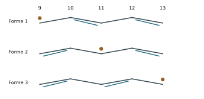
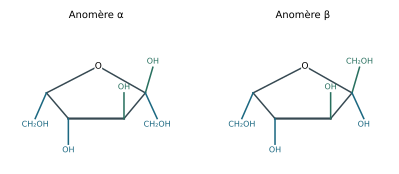
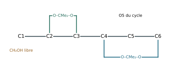
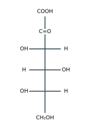
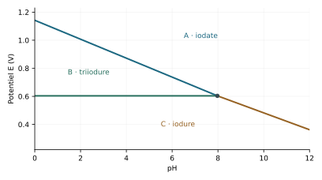

# ENS de Lyon — Second concours, Chimie 2004 · Corrigé guidé

*Corrigé rédigé par IA, non officiel.*

**Rédaction (tour 1)** · GPT-6.2 Astra Ultra · vitesse non renseignée

Ces éditions traitent 32 des 35 questions ou sous-questions terminales. Les parties A, B.II et C sont couvertes, ainsi que B.I.2 sur l’orientation aromatique. Les mécanismes et le choix expérimental de catalyseur de B.I.1 et B.I.3.a–b sont hors couverture. Le rapport écrit du jury commun Paris–Lyon confirme les thèmes. La numérotation distingue les lettres a à e lorsqu’elles sont imprimées.

## A.I. Chaîne radicalaire lipidique

### Question A.I.1 — Entretien de la chaîne

> [!INDICATION]
> Retrouver le radical consommé dans la première étape de propagation.

#### Solution

Après $\mathrm{R^{\bullet}+O_2\to ROO^{\bullet}}$, le radical peroxyle prélève un H sur un nouveau lipide. La seconde étape est $\mathrm{ROO^{\bullet}+RH\to ROOH+R^{\bullet}}$. L’espèce $\mathrm{R^{\bullet}}$ est régénérée. L’addition des deux étapes donne $\mathrm{RH+O_2\to ROOH}$.

### Question A.I.2 — Deux terminaisons

> [!INDICATION]
> Chercher des rencontres entre deux radicaux dont le produit est à couche fermée.

#### Solution

Une recombinaison possible est $\mathrm{R^{\bullet}+R^{\bullet}\to R{-}R}$. Une autre est $\mathrm{R^{\bullet}+ROO^{\bullet}\to R{-}O{-}O{-}R}$. Dans chaque cas deux porteurs de chaîne disparaissent et aucun radical n’est régénéré.

### Question A.I.3 — Site bis-allylique

> [!INDICATION]
> Numéroter la chaîne à partir du carboxyle et comparer les énergies C–H du tableau.

#### Solution

Les doubles liaisons de l’acide linoléique sont C9=C10 et C12=C13. Le méthylène C11 est entre les deux. Une de ses liaisons C–H, bis-allylique, possède dans les données l’énergie la plus faible, **272 kJ par mole**, contre 322 kJ par mole pour le motif allylique simple. L’arrachement d’un H de C11 est donc favorisé.

### Question A.I.4 — Régions du radical pentadiényle

> [!INDICATION]
> Écrire les trois représentations limites du radical sur cinq carbones.

#### Solution

Le radical initial situé en C11 est délocalisé sur C9, C11 et C13. L’addition de $\mathrm{O_2}$ aux sites terminaux C9 ou C13, suivie du transfert de H, donne les deux hydroperoxydes correspondants. Chacun conserve un diène conjugué, contrairement au produit d’addition centrale. La délocalisation, l’accessibilité des extrémités et la stabilisation du motif conjugué rendent compte de la prédominance observée. Le sujet ne permet pas de donner un rapport quantitatif des deux isomères.

## A.II. Rôle des antioxydants

### Question A.II.1 — Piégeage par un phénol

> [!INDICATION]
> Identifier le donneur d’atome d’hydrogène et le radical qui subsiste.

#### Solution

$\mathrm{ROO^{\bullet}+\Phi OH\to ROOH+\Phi O^{\bullet}}$. Le peroxyle devient un hydroperoxyde. Le nouveau porteur de l’électron célibataire est un radical phénoxyle relativement stable, ce qui freine la propagation de l’oxydation lipidique.

### Question A.II.2 — Stabilité du phénoxyle

> [!INDICATION]
> Regarder le système aromatique et l’environnement des positions voisines de OH.

#### Solution

La délocalisation répartit l’électron célibataire entre l’oxygène et les positions ortho et para du cycle. Les substituants voisins protègent aussi le centre réactif par encombrement, particulièrement les deux groupes tert-butyle du BHT. Ces effets réduisent la propension du phénoxyle à arracher à son tour un H au lipide.

## B.I. Orientation aromatique

*Question B.I.1 hors couverture.*

### Question B.I.2 — Orientation sur le noyau du BHT

> [!INDICATION]
> Repérer les positions activées par le groupe hydroxyle et la position déjà occupée.

#### Solution

Le doublet de l’oxygène stabilise par mésomérie l’intermédiaire d’une substitution électrophile en ortho ou en para de OH. Dans le para-crésol, la position para est déjà occupée par le méthyle. Les deux positions ortho, d’abord équivalentes, portent ainsi les substituants du **2,6-di-tert-butyl-4-méthylphénol**.

*Question B.I.3.a hors couverture.*

*Question B.I.3.b hors couverture.*

## B.II. Sucre et vitamine C

### Question B.II.1 — Série du sucre A

> [!INDICATION]
> Redessiner la projection de Fischer avec l’extrémité la plus proche du carbonyle en haut.

#### Solution

Une rotation de 180° de toute la projection de Fischer conserve la configuration. Le carbonyle est alors en C2, et les OH de C3, C4 et C5 apparaissent successivement à gauche, à droite, à gauche. Le centre asymétrique de numéro le plus élevé, C5, a son OH à gauche. Ce cétohexose, le **L-sorbose**, appartient à la série L.

### Question B.II.2.a — Fermeture en furanose

> [!INDICATION]
> Compter les atomes du cycle de B.

#### Solution

L’oxygène du OH porté par C5 est nucléophile et le carbone C2 du carbonyle est électrophile. Leur liaison ferme un cycle de cinq atomes, O5–C2–C3–C4–C5. L’oxygène de l’ancien carbonyle devient un OH sur C2. B est un hémicétal cyclique.

### Question B.II.2.b — Configurations de C3 et C4

> [!INDICATION]
> Classer chaque chaîne carbonée en tenant compte de la duplication CIP de l’oxygène carbonylé.

#### Solution

Dans la Fischer remise à l’endroit, C3 a les priorités OH, branche C2, branche C4, H, d’où **3S**. Pour C4, la branche C3 précède la branche C5 au premier point de différence du côté du carbonyle. Avec OH en première position puis C3, C5, H, on obtient **4R**. Dans la projection cyclique choisie avec O en haut et C2 à droite, OH en C3 est sur la face supérieure et OH en C4 sur la face inférieure. Le groupe $\mathrm{CH_2OH}$ de C5 est sur la face inférieure.

### Question B.II.2.c — Les deux anomères

> [!INDICATION]
> Conserver les positions de C3, C4 et C5 et inverser seulement le nouveau centre.

#### Solution

L’ébauche de B place le OH de C2 sur la face supérieure et le $\mathrm{CH_2OH}$ de C1 sur l’autre face. Dans l’autre forme, inverser ces deux substituants en C2. Les configurations de C3, C4 et C5 sont identiques entre les deux structures. Ce sont des **anomères**, diastéréoisomères épimères au carbone hémicétalique. Sur cette représentation de série L, le premier est α (OH anomérique trans au substituant de référence en C5), le second β.

### Question B.II.3.a — Motif cétal

> [!INDICATION]
> Faire participer les deux oxygènes du diol au même carbone de la propanone.

#### Solution

Le produit a pour cycle $\mathrm{{-}O{-}CH_2{-}CH_2{-}O{-}C(CH_3)_2{-}}$, la dernière liaison revenant au premier O. C’est le **2,2-diméthyl-1,3-dioxolane**, un cétal cyclique. Le bilan formel de la condensation comprend une molécule d’eau.

### Question B.II.3.b — Deux protections dans C

> [!INDICATION]
> Décrire la connectivité en numérotant les oxygènes du sucre.

#### Solution

C est le dérivé **2,3:4,6-di-O-isopropylidène** de la forme furanose. Sur le squelette B, on a deux ponts distincts $\mathrm{O2{-}C(CH_3)_2{-}O3}$ et $\mathrm{O4{-}C(CH_3)_2{-}O6}$. Le groupe de C1 est toujours $\mathrm{CH_2OH}$ et O5 reste l’oxygène du cycle furanose. Cette formule par connectivité précise les cinq positions impliquées sans modifier les centres stéréogènes hérités du sucre.

### Question B.II.4 — Produit d’oxydation D

> [!INDICATION]
> Déterminer quelle fonction alcool est encore libre dans C.

#### Solution

D conserve les deux ponts isopropylidène, le cycle du sucre et sa stéréochimie. Le carbone C1, initialement en $\mathrm{CH_2OH}$, devient le carbone d’un carboxyle. Les protections différencient l’alcool primaire de C1 des autres hydroxyles, notamment du groupe primaire de C6 qui doit être conservé.

### Question B.II.5 — Forme ouverte E et vitamine C

> [!INDICATION]
> Remplacer les protections par des hydroxyles et restituer le carbonyle de C2 dans la forme ouverte.

#### Solution

E est l’**acide 2-céto-L-gulonique**. En Fischer, COOH est en haut (C1), C2 est carbonylé, les OH de C3, C4 et C5 sont respectivement à gauche, à droite et à gauche, et $\mathrm{CH_2OH}$ est en bas (C6). La formation d’une γ-lactone unit le carboxyle C1 et l’oxygène du OH en C4 en un cycle à cinq atomes. L’énolisation de la fonction 2-céto crée le motif énediol C2=C3 de l’acide ascorbique.

### Question B.II.6.a — Attribution du spectre RMN

> [!INDICATION]
> Repérer les quatre H liés aux carbones saturés C4, C5 et C6.

#### Solution

Le doublet **A, 4,94 ppm, 1 H**, correspond à H4 du cycle lactone, couplé à H5. Le multiplet **B, 4,06 ppm, 1 H** correspond à H5, couplé à H4 et aux H de C6. Le signal **C, 3,76 ppm, 2 H**, correspond à $\mathrm{CH_2OH}$ de C6, principalement couplé à H5. Le tableau le décrit comme un doublet apparent. En environnement chiral, les deux H du méthylène peuvent être diastéréotopiques et ne pas se résoudre dans ce relevé.

### Question B.II.6.b — Influence du solvant deutéré

> [!INDICATION]
> Identifier les protons qui peuvent être remplacés par du deutérium.

#### Solution

Dans le DMSO, les protons des groupes OH peuvent devenir visibles si l’échange est suffisamment lent. Dans $\mathrm{D_2O}$, ils s’échangent avec le deutérium, donnant des groupes OD. Le deutérium n’est pas détecté sur le canal de RMN du proton et ces OH ne donnent pas les signaux distincts observés dans le DMSO.

### Question B.II.7.a — Premier proton acide

> [!INDICATION]
> Comparer la stabilisation des bases conjuguées des deux hydroxyles de l’énediol.

#### Solution

Le proton le plus acide est celui du **OH en C3**, le carbone de l’énediol le plus éloigné du carbonyle C1 le long de C1–C2–C3. Sa perte donne un ascorbate dont la charge peut se délocaliser du O3 au carbonyle de la lactone via C3=C2 et C2–C1. Les alcools ordinaires de la chaîne latérale ne bénéficient pas de cette conjugaison.

### Question B.II.7.b — Déplacement du maximum UV

> [!INDICATION]
> Relier la conjugaison électronique à l’écart d’énergie de la transition.

#### Solution

En milieu basique, l’ascorbate possède une délocalisation renforcée par rapport à la forme acide. La transition électronique correspondante est observée à plus basse énergie, donc à **plus grande longueur d’onde** que les 245 nm de la forme acide. Il s’agit d’un déplacement bathochrome. La valeur du nouveau maximum nécessiterait un spectre.

## C.I. Complexation et diagramme de l’iode

### Question C.I.1.a — Diiode libre et diiode complexé

> [!INDICATION]
> Distinguer la concentration libre à saturation et la quantité totale dissoute.

#### Solution

La molécule $\mathrm{I_2}$ est apolaire et ne forme pas de liaisons hydrogène avec l’eau, d’où sa faible solubilité. L’ion $\mathrm{I^-}$ se lie à $\mathrm{I_2}$ pour former le triiodure chargé $\mathrm{I_3^-}$. Ce complexe dissous ajoute un réservoir de diiode. En présence du solide, la concentration de $\mathrm{I_2}$ libre reste fixée par la saturation tandis que sa concentration analytique totale augmente.

### Question C.I.1.b — Solubilité à saturation dans KI

> [!INDICATION]
> Ne pas assimiler la concentration d’iodure libre à la teneur initiale en KI.

#### Solution

En présence de solide, $[\mathrm{I_2}]=10^{-3}\,\mathrm{mol\,L^{-1}}$. Posons $x=[\mathrm{I_3^-}]$. Le bilan en iodure apporté par KI donne $[\mathrm{I^-}]=0{,}100-x$. D’où $x=794\times10^{-3}(0{,}100-x)=0{,}04426\,\mathrm{mol\,L^{-1}}$ après résolution. La solubilité, exprimée en moles de diiode dissous, est $[\mathrm{I_2}]+[\mathrm{I_3^-}]=\mathbf{0{,}0453\,\mathrm{mol\,L^{-1}}}$. Chaque triiodure contient un équivalent de diiode complexé.

### Question C.I.1.c — Solution sans solide résiduel

> [!INDICATION]
> Établir deux bilans indépendants sur les quantités introduites.

#### Solution

En posant $x=[\mathrm{I_3^-}]$, on a $[\mathrm{I_2}]=0{,}0100-x$ et $[\mathrm{I^-}]=0{,}100-x$. La racine physique de $x=794(0{,}0100-x)(0{,}100-x)$ donne **$[\mathrm{I_3^-}]=9{,}86\times10^{-3}$**, **$[\mathrm{I_2}]=1{,}38\times10^{-4}$** et **$[\mathrm{I^-}]=0{,}0901\,\mathrm{mol\,L^{-1}}$**. Le potassium spectateur reste à $0{,}100\,\mathrm{mol\,L^{-1}}$. Le rapport triiodure/diiode libre vaut environ 72. La solution est bien en dessous de la saturation en diiode libre.

### Question C.I.2.a — Domaines de l’iode

> [!INDICATION]
> Classer les degrés d’oxydation moyens et lire les potentiels du haut vers le bas.

#### Solution

L’espèce la plus oxydée est $\mathrm{IO_3^-}$ (iode +V), dans **A**. Le triiodure occupe le domaine intermédiaire **B**. L’iodure, de degré $-\mathrm I$, occupe **C**. Le domaine intermédiaire forme un coin du côté acide du graphique.

### Question C.I.2.b — Frontière iodate–triiodure

> [!INDICATION]
> Écrire la réduction pour trois atomes d’iode. À la frontière, égaliser les quantités d’élément iode et non les concentrations moléculaires.

#### Solution

Le bilan est $\mathrm{3IO_3^-+18H^++16e^-\rightleftharpoons I_3^-+9H_2O}$. La relation de Nernst donne $E=1{,}15+(0{,}06/16)\log_{10}([\mathrm{IO_3^-}]^3/[\mathrm{I_3^-}])-(18\times0{,}06/16)\,\mathrm{pH}$. Les concentrations numériques sont rapportées à l’état standard. À la frontière, $[\mathrm{IO_3^-}]=3[\mathrm{I_3^-}]=0{,}050\,\mathrm{mol\,L^{-1}}$. D’où **$E\simeq1{,}142-0{,}0675\,\mathrm{pH}$** en volts. Ce segment cesse au point où disparaît le domaine B.

### Question C.I.2.c — Stabilité du triiodure

> [!INDICATION]
> Comparer les frontières haute et basse de son domaine.

#### Solution

La frontière $\mathrm{I_3^-/I^-}$ est horizontale car le bilan ne fait pas intervenir $\mathrm{H^+}$. L’équation $E=0{,}54+(0{,}06/2)\log_{10}([\mathrm{I_3^-}]/[\mathrm{I^-}]^3)$ y donne environ $0{,}604\,\mathrm V$ avec équipartition de l’élément. La frontière supérieure rejoint cette valeur vers **pH 8**. En dessous, le triiodure a un domaine de stabilité propre entre les deux lignes. Plus haut en pH, il peut se dismuter en iodure et iodate dans le modèle du diagramme.

### Question C.I.2.d — Deux degrés d’oxydation vers un intermédiaire

> [!INDICATION]
> Additionner les demi-équations de part et d’autre du domaine du triiodure.

#### Solution

En milieu acide, iodate et iodure réagissent et du triiodure coloré apparaît en présence d’iodure. Le bilan est $\mathrm{IO_3^-+8I^-+6H^+\to3I_3^-+3H_2O}$. Un élément situé dans deux états d’oxydation différents donne une forme intermédiaire. C’est une **médiamutation**, ou comproportionation.

### Question C.I.2.e — Oxydation de la vitamine C

> [!INDICATION]
> Vérifier le sens du transfert électronique par comparaison des potentiels.

#### Solution

À pH acide, le potentiel du couple triiodure/iodure est supérieur à celui du couple acide déhydroascorbique/acide ascorbique (les valeurs standard sont 0,54 et 0,13 V). Le triiodure capte deux électrons de la vitamine C réduite. Le bilan est $\mathrm{C_6H_8O_6+I_3^-\to C_6H_6O_6+3I^-+2H^+}$. Une mole de triiodure oxyde une mole de vitamine C.

## C.II. Analyse du comprimé

### Question C.II.1 — Origine de l’effervescence

> [!INDICATION]
> Combiner un échange acido-basique et la libération d’un gaz.

#### Solution

Notons $\mathrm{AscH_2}$ la vitamine C sous sa forme acide. Le bilan principal est $\mathrm{AscH_2+HCO_3^-\to AscH^-+CO_2+H_2O}$. Le bicarbonate accepte un proton. L’écart entre les pKa $6{,}4-4{,}05$ favorise le transfert, puis le départ du dioxyde de carbone entraîne l’effervescence.

### Question C.II.2 — Principe du dosage indirect

> [!INDICATION]
> Suivre le triiodure avant l’équivalence et juste après celle-ci.

#### Solution

Chaque mole d’iodate forme trois moles de triiodure avec l’iodure disponible. Tant que la vitamine C reste en excès, chacune de ces trois moles est réduite en iodure en oxydant une mole d’acide ascorbique. La coloration bleue locale du complexe avec l’amidon disparaît. Après épuisement de la vitamine C, le triiodure persiste et la coloration devient durable. Le bilan global avant l’équivalence est $\mathrm{IO_3^-+3C_6H_8O_6\to I^-+3C_6H_6O_6+3H_2O}$.

### Question C.II.3 — Quantités qui entrent dans le résultat

> [!INDICATION]
> Séparer l’aliquote et le titrant des espèces simplement présentes en excès.

#### Solution

Parmi les trois prélèvements cités, le **volume de 25 mL de S** doit être connu avec précision. Il fixe la fraction de comprimé analysée. L’iodure et l’acide doivent être présents en excès suffisant mais leurs quantités exactes n’interviennent pas dans le calcul. Le volume de solution mère, la concentration de l’iodate et son volume à l’équivalence interviennent aussi dans le résultat final.

### Question C.II.4 — Masse de vitamine C

> [!INDICATION]
> Ne pas oublier le facteur trois de la réaction et le facteur quatre de l’aliquote.

#### Solution

Dans la prise d’essai, $n(\mathrm{IO_3^-})=0{,}010\times0{,}0091=9{,}1\times10^{-5}\,\mathrm{mol}$. Elle contient donc $2{,}73\times10^{-4}\,\mathrm{mol}$ de vitamine C. Le comprimé entier représente quatre prises, soit $1{,}092\times10^{-3}\,\mathrm{mol}$. Avec $M=176\,\mathrm{g\,mol^{-1}}$, la masse vaut **0,192 g**, soit **environ 0,19 g** à la précision du dosage.

### Question C.II.5 — Origine d’un déficit apparent

> [!INDICATION]
> Quel composé le dosage quantifie-t-il effectivement ?

#### Solution

Le dosage mesure l’acide ascorbique encore réduit. Une oxydation partielle par le dioxygène de l’air, avant l’analyse ou pendant la préparation, diminue la quantité qui consomme le triiodure. Cette hypothèse est compatible avec la valeur faible et avec le potentiel fourni pour le couple dioxygène/eau. Le seul écart de masse ne suffit pas à identifier une cause unique.
