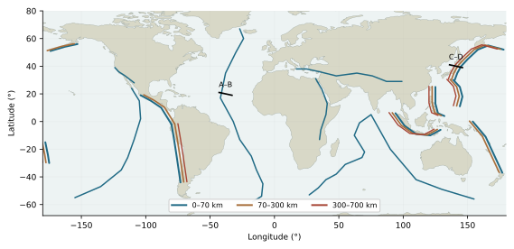
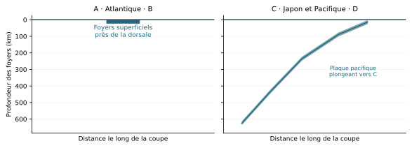
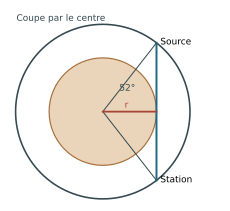
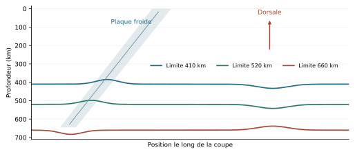
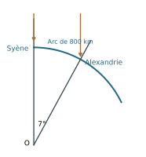
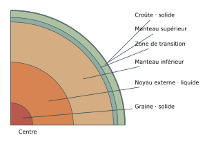

# ENS de Lyon — Second concours, Géosciences 2004 · Corrigé brut

*Corrigé rédigé par IA, non officiel.*

**Rédaction (tour 1)** · GPT-6.2 Astra Ultra · vitesse non renseignée

Épreuve commune aux ENS Ulm et Lyon. Les 40 consignes sont traitées, y compris les deux planches à compléter et la coupe de synthèse. Les quatre sous-questions suivant l’introduction 1.7 portent les numéros 1.8.1 à 1.8.4 dans l’original. La question PREM est également numérotée 1.8. Les profondeurs et températures lues sur les diagrammes sont approximatives.

## 1. Sismologie et structure interne

### Question 1.1 — Définir la sismologie

La sismologie étudie les séismes et la propagation des ondes élastiques dans la Terre. L’enregistrement des temps d’arrivée, des amplitudes et des mécanismes au foyer informe à la fois sur les ruptures et sur les propriétés physiques des milieux traversés.

### Question 1.2 — Compléter le planisphère de la sismicité

Sur les dorsales océaniques, les transformantes et les rifts, les séismes sont superficiels, généralement dans les premières dizaines de kilomètres. Les collisions continentales sont surtout marquées par des séismes superficiels à crustaux. Le pourtour du Pacifique, les Antilles, les Sandwich du Sud ou les arcs indonésiens associent sismicité superficielle près des fosses, séismes intermédiaires (70–300 km) puis profonds (300–700 km) dans certains panneaux plongeants. Plusieurs de ces bandes profondes sont discontinues. La carte donne les ordres de profondeur le long des principales ceintures. La sismicité intraplaque existe aussi, plus dispersée.

### Question 1.3 — Comparer les coupes A–B et C–D

Sur A–B, la sismicité se concentre près de l’axe et sur ses accidents transformants, à faible profondeur, généralement 0–20 km. Il n’y a pas de plan de séismes plongeant en profondeur. Sur C–D, C est du côté asiatique et D du côté de l’océan Pacifique. Près de la fosse, du côté de D, les séismes sont superficiels. Vers C, le plan de Wadati–Benioff s’enfonce vers l’ouest jusqu’à plusieurs centaines de kilomètres, pouvant approcher 600–700 km. Les deux tracés figurent des bandes attendues et non des hypocentres mesurés individuellement.

### Question 1.4 — Expliquer les contextes sismogènes

Les trois grands contextes sont les limites divergentes (dorsales, rifts), transformantes (décrochements) et convergentes (subduction ou collision). La déformation élastique se charge pendant le blocage, puis une rupture ou un glissement brutal sur une faille rayonne des ondes. Dans une plaque subduite à grande profondeur, la déshydratation, les transformations minérales et les instabilités thermomécaniques peuvent intervenir. Volcanisme et ruptures intraplaques donnent aussi des séismes plus localisés.

### Question 1.5 — Classer les ondes sismiques

Les ondes de volume P sont des ondes longitudinales de compression–dilatation. Les ondes S sont transversales et imposent un cisaillement. Les ondes de surface comprennent les ondes de Love, à déplacement horizontal transverse, et de Rayleigh, à déplacement elliptique dans le plan vertical de propagation. Réflexions, réfractions et conversions engendrent de multiples phases sur les sismogrammes.

### Question 1.6 — Relier modules, densité et vitesse

$K_S$ mesure la résistance à la compression adiabatique et $\mu$ la résistance au cisaillement. Tous deux s’expriment en Pa, de dimension $M L^{-1}T^{-2}$. La masse volumique $\rho$ est en kg/m³, de dimension $M L^{-3}$. Ainsi $V_P=\sqrt{(K_S+4\mu/3)/\rho}$ et $V_S=\sqrt{\mu/\rho}$ sont en m/s. Dans un solide ordinaire, $V_P>V_S$. Dans un liquide, le cisaillement statique est nul, les S ne se propagent pas, les P subsistent. Dans une même phase comprimée, densité et généralement modules augmentent en profondeur. Si les modules croissent plus vite que la densité, les vitesses augmentent. Transitions de phase, état liquide, changement de composition et température perturbent cette tendance.

### Question 1.8.1 — Nommer la bande sans onde directe

C’est la **zone d’ombre sismique**. La bande 104–144° indiquée dans la consigne est classiquement celle de l’ombre des P directes. L’absence de transmission des ondes S à travers le noyau externe liquide s’étend à un domaine plus vaste.

### Question 1.8.2 — Expliquer la discontinuité responsable

À la limite manteau–noyau, les P passent d’un manteau rapide à un noyau externe où leur vitesse est bien plus faible. La forte réfraction dévie les trajets traversant le noyau, qui réapparaissent à de plus grandes distances que les trajets restés dans le manteau. Il existe un intervalle de surface sans arrivée P directe prévue par ces deux familles. Diffractions, réflexions et conversions peuvent y produire d’autres phases.

### Question 1.8.3 — Calculer la profondeur par une corde tangente

Pour la limite proche de la zone d’ombre, $\Delta=104^\circ$. Avec le foyer en surface et des rais droits, la corde source–station est tangente à une sphère de rayon $r$. Dans le triangle rectangle formé avec le centre, $r=R\cos(\Delta/2)=R\cos52^\circ$. Pour $R=6\,371$ km, $r\simeq3\,922$ km et la **profondeur** est $R-r\simeq2\,449$ km. La borne à 144° concerne les rais réfractés qui traversent le noyau et ne définit pas la corde tangente.

### Question 1.8.4 — Comparer au rayon réel du noyau

La limite manteau–noyau réelle se trouve vers 2 890 km de profondeur. L’estimation géométrique est trop faible d’environ 440 km, soit environ 15 %. En réalité, les vitesses varient avec la profondeur, les rais sont courbes et la réfraction se produit dans une Terre stratifiée. Profondeur réelle du foyer, approximation des angles et hétérogénéités latérales contribuent aussi aux écarts.

### Question 1.8 — Interpréter le modèle PREM

PREM est un modèle radial moyen issu des observations sismiques. En croûte puis dans le manteau supérieur et inférieur, les P et S se propagent. Les vitesses augmentent en moyenne et présentent des sauts, notamment aux transitions minérales vers 410 et 660 km. Le Moho marque un changement de composition entre croûte et manteau. Vers 2 890 km, $V_P$ passe d’environ 13,5 à 8 km/s et $V_S$ tombe à zéro. Le noyau externe liquide a un module de cisaillement nul. Vers 5 150 km, la vitesse P augmente et la graine solide possède de nouveau un module de cisaillement. La pression, les compositions et les états physiques contribuent aux contrastes.

## 2. Transitions de phase dans le manteau

### Question 2.1 — Reconnaître les péridotites du manteau

Le manteau supérieur est surtout constitué de péridotites, dominées par l’olivine et les pyroxènes (orthopyroxène et clinopyroxène), avec spinelle ou grenat selon la pression et la composition. Une masse volumique usuelle proche de la surface est 3,3 t/m³, donc une densité d’environ 3,3. On les observe dans des massifs mantelliques exhumés, des ophiolites, certaines dorsales lentes et sous forme de xénolithes remontés par des magmas.

### Question 2.2 — Analyser le diagramme de phase

Des minéraux de même composition et de structures différentes sont des **polymorphes**, par exemple quartz et coésite pour SiO₂. Pour l’olivine de composition $(\mathrm{Mg}_{0,9}\mathrm{Fe}_{0,1})_2\mathrm{SiO}_4$, la phase $\alpha$ (olivine) passe à $\beta$ (wadsleyite), puis à $\gamma$ (ringwoodite), de structures plus compactes. Les deux premières limites ont une pente positive et les bandes $\alpha+\beta$ et $\beta+\gamma$ indiquent la coexistence dans la solution solide. À pression plus élevée, la ringwoodite se décompose en deux phases, pérovskite silicatée (bridgmanite) et magnésiowüstite (ferropériclase). Cette dernière limite a une pente négative.

### Question 2.3 — Équilibrer la réaction profonde

En notant $M$ le mélange Mg–Fe, $M_2\mathrm{SiO}_4\ (\gamma)\longrightarrow M\mathrm{SiO}_3\ (\mathrm{Pv})+M\mathrm O\ (\mathrm{Mw})$. Les trois oxygènes du silicate et celui de l’oxyde compensent les quatre de la ringwoodite. Le partage de Mg et Fe entre les deux produits peut différer de leur partage dans la phase initiale.

### Question 2.4 — Relier pétrologie et sauts de vitesse

Vers 410 km, la transformation olivine–wadsleyite accroît la compacité et les modules élastiques. Une transition plus faible vers 520 km est associée au passage wadsleyite–ringwoodite. Vers 660 km, la décomposition de la ringwoodite marque l’entrée dans le manteau inférieur. Ces changements de phase expliquent des sauts de $V_P$ et $V_S$ sans changement obligatoire de composition globale. Le manteau est une roche polyminérale, d’autres phases et transitions contribuent au profil PREM.

### Question 2.5 — Calculer les masses volumiques des trois phases

Les masses molaires données conduisent à $M_{\rm Mg_2SiO_4}=140,66$ et $M_{\rm Fe_2SiO_4}=203,74$ g/mol. Pour la solution à 90 % de pôle Mg et 10 % de pôle Fe, $M=146,968$ g/mol. On prend un volume molaire idéal $V=0,9V_{\rm Mg}+0,1V_{\rm Fe}$ et $\rho=M/V$.

| Phase | Pôle Mg (g/cm³) | Pôle Fe (g/cm³) | Volume du mélange (cm³/mol) | Mélange (g/cm³) |
| --- | ---: | ---: | ---: | ---: |
| α | 3,221 | 4,402 | 43,931 | 3,345 |
| β | 3,470 | 4,723 | 40,800 | 3,602 |
| γ | 3,548 | 4,849 | 39,887 | 3,685 |

Par exemple, $146,968/43,931=3,345$ g/cm³, soit $3\,345$ kg/m³. La densité de chaque composition augmente de α vers γ.

### Question 2.6 — Déduire les signes de volume et d’entropie

La phase de haute pression est plus compacte, d’où $\Delta V<0$ dans le sens de l’enfouissement. Pour $\alpha\to\beta$ et $\beta\to\gamma$, $\mathrm dP/\mathrm dT>0$. Puisque $\mathrm dP/\mathrm dT=\Delta S/\Delta V$, on en déduit $\Delta S<0$. Pour $\gamma\to\mathrm{Pv}+\mathrm{Mw}$, la pente est négative, donc $\Delta S>0$ avec $\Delta V<0$.

### Question 2.7 — Identifier chaleur libérée ou absorbée

Dans le sens de pression croissante, $Q=T\Delta S<0$ pour les transitions α→β et β→γ. Le système cède de la chaleur, ces transitions sont exothermiques. Pour la décomposition de γ en Pv + Mw, $Q>0$, la réaction absorbe de la chaleur et est endothermique. Les transitions inverses échangent de la chaleur avec le signe opposé.

### Question 2.8 — Calculer les vitesses des phases

Pour α, $V_S=\sqrt{80/3,345}=4,89$ km/s et $V_P=\sqrt{(129+4\times80/3)/3,345}=8,39$ km/s. La même opération pour chaque assemblage donne le tableau.

| Phase | $K_S$ (GPa) | $\mu$ (GPa) | $V_P$ (km/s) | $V_S$ (km/s) |
| --- | ---: | ---: | ---: | ---: |
| α | 129 | 80 | 8,39 | 4,89 |
| β | 174 | 114 | 9,51 | 5,63 |
| γ | 184 | 119 | 9,64 | 5,68 |

Les modules augmentent suffisamment pour faire croître les vitesses malgré la hausse de densité. Ces valeurs calculées pour une composition et des paramètres donnés ne sont pas toutes les vitesses in situ de PREM.

### Question 2.9 — Estimer les températures de transition

Vers 410 km, l’axe de droite indique autour de 14 GPa. L’horizontale coupe la bande α + β pour des températures de l’ordre de **1 450 à 1 700 °C**, soit environ 1 500–1 700 °C à la centaine près. Vers 520 km (environ 17–18 GPa), la bande β + γ suggère à nouveau un ordre de **1 400–1 700 °C**, dépendant de la profondeur retenue dans le saut. Vers 660 km (un peu plus de 23 GPa sur ce dessin), la bande γ → Pv + Mw se situe grossièrement vers **1 500–1 700 °C**. Une imprécision de quelques kilomètres modifie sensiblement la température lue sur des limites peu pentues. Les valeurs centrales proches de 1 500–1 600 °C sont plus significatives que des extrêmes à la dizaine de degrés.

### Question 2.10 — Reporter les limites sous la subduction et la dorsale

La plaque froide descend dans le manteau et entraîne les isothermes vers le bas. Sous la dorsale, l’ascension rapide du manteau chaud soulève les isothermes. Ces mouvements participent au renouvellement de la lithosphère et à la convection. Pour les limites à pente positive, à température plus basse la transition survient à plus faible pression. Les limites de référence 410 et 520 km remontent dans la plaque froide et s’enfoncent dans l’anomalie chaude. Pour la limite à pente négative vers 660 km, le sens s’inverse. Avec des pentes de l’ordre de 2–3 MPa/K et environ 33–37 MPa/km, une anomalie de 300 K correspond typiquement à quelques dizaines de kilomètres de déflexion. L’isothermie de la figure est schématique et ne permet pas une profondeur unique à tout point de la coupe.

### Question 2.11 — Suivre la flottabilité de la plaque

La plaque froide est en général plus dense par contraction thermique. À la transition α→β, la plaque froide acquiert plus tôt la phase dense, ce qui accroît son excès de densité sur un intervalle de profondeur. Il en va de même, en première approximation, pour β→γ. Près de 660 km, le passage aux phases de haute pression est retardé dans la plaque froide. Celle-ci conserve de la ringwoodite alors que le manteau voisin contient déjà les phases plus denses du manteau inférieur. L’effet de phase diminue alors son excès de densité et peut freiner son passage. Le contraste total dépend aussi du réchauffement, de la composition et de la cinétique des transitions.

## 3. Rayon, masse et composition de la Terre

### Question 3.1.1 — Choisir le midi du solstice

Le 21 juin est proche du solstice d’été boréal, lorsque la déclinaison solaire est maximale vers le nord. À midi solaire local, l’astre culmine et son ombre est dans le plan du méridien. Le Soleil peut alors être au zénith près du tropique du Cancer, donnant à Syène une verticale de référence.

### Question 3.1.2 — Situer Syène

Syène, l’actuelle Assouan, est proche du tropique du Cancer. Au solstice, la latitude y est proche de la déclinaison solaire. Dans l’approximation de l’expérience, les rayons sont verticaux et atteignent le fond d’un puits étroit.

### Question 3.1.3 — Convertir le trajet des caravanes

$50\times100=5\,000$ stades, puis $5\,000\times0,16=800$ km. Cette valeur est assimilée à une distance méridienne à la surface d’une Terre sphérique.

### Question 3.1.4 — Calculer le rayon d’Ératosthène

L’angle vaut $7\pi/180=0,12217$ rad. La longueur d’arc satisfait $s=R\theta$ d’où $R=800/0,12217\simeq6\,548$ km. La figure montre les deux rayons terrestres et la verticale de Syène alignée sur les rayons solaires. Il faut utiliser l’angle en radians dans le quotient.

### Question 3.1.5 — Calculer l’erreur relative

Par rapport à $R=6\,371$ km, l’écart vaut environ $+177$ km, soit $(6\,548-6\,371)/6\,371\simeq+2,8\,\%$. Le rayon trouvé avec ces données est légèrement surestimé.

### Question 3.1.6 — Évaluer les hypothèses géométriques

Les deux villes devraient être sur le même méridien pour identifier exactement la différence de latitude à l’angle au centre et à la distance nord–sud. Elles sont légèrement décalées en longitude. La route des caravanes n’est pas un arc de méridien, la longueur du stade et l’estimation du pas quotidien sont incertaines. Syène n’est pas exactement sur le tropique, le Soleil a un diamètre apparent fini et la Terre est légèrement aplatie. Les incertitudes sur les verticales, les ombres et le midi local s’ajoutent.

### Question 3.2.1 — Écrire la relation gravitationnelle

Pour une Terre sphérique, en négligeant rotation et altitude, $mg=G M_Tm/R_T^2$, soit $M_T=gR_T^2/G$. La masse test s’élimine.

### Question 3.2.2 — Déterminer masse et masse volumique

Avec le rayon moyen connu $6,371\times10^6$ m, $g=9,81$ m/s² et $G=6,67\times10^{-11}$ SI, $M_T\simeq5,97\times10^{24}$ kg. Le volume est $4\pi R_T^3/3\simeq1,083\times10^{21}$ m³, d’où $\bar\rho\simeq5,51\times10^3$ kg/m³, ou 5,51 g/cm³.

### Question 3.2.3 — Comparer aux roches de surface

Les roches crustales courantes ont des masses volumiques proches de 2,7–3,0 g/cm³ et les péridotites superficielles environ 3,3 g/cm³. La moyenne globale, 5,51 g/cm³, exige des régions beaucoup plus denses en profondeur. Compression et composition métallique du noyau y contribuent.

### Question 3.3 — Interpréter les lois de Birch

Le domaine mantellique correspond à des matériaux dont la masse atomique moyenne est relativement faible, compatibles avec des silicates à O, Mg, Si et une proportion de Fe. Péridotite et phases silicatées de haute pression répondent à cette exigence. Le noyau est bien plus dense à vitesse P comparable et se situe dans les familles de métaux de transition, compatibles avec un alliage dominé par Fe, avec Ni et des éléments plus légers. La figure montre plusieurs droites proches. L’identification chimique demande aussi les abondances cosmiques, la sismologie et la géochimie, et ne résulte pas d’une correspondance unique à un élément pur.

### Question 3.4.1 — Choisir des échantillons pour les deux rapports

Des météorites chondritiques primitives donnent un analogue de composition des matériaux non différenciés d’accrétion et servent de référence pour Fe/Mg global, sous une hypothèse cosmochimique. Pour le manteau, on analyse des péridotites, notamment des xénolithes et des massifs exhumés, avec correction de l’altération et de l’extraction de magmas. Il faut un ensemble représentatif pour obtenir le rapport moyen.

### Question 3.4.2 — Expliquer le déficit en Fe du manteau

La séparation du métal et des silicates a transféré une grande partie du fer vers le noyau, tandis que le magnésium est resté essentiellement dans les silicates. Le rapport massique Fe/Mg du manteau (0,23) est donc nettement inférieur au rapport global (1,8).

### Question 3.4.3 — Écrire le bilan du fer

En notant $T$, $m$ et $c$ la Terre, le manteau et le noyau, $M_{\rm Fe,c}=M_{\rm Fe,T}-M_{\rm Fe,m}$. Si $r_T=(\mathrm{Fe}/\mathrm{Mg})_T$ et $r_m=(\mathrm{Fe}/\mathrm{Mg})_m$, alors $M_{\rm Fe,c}=r_T M_{\rm Mg,T}-r_m M_{\rm Mg,m}=1,8M_{\rm Mg,T}-0,23M_{\rm Mg,m}$. Les rapports sont massiques.

### Question 3.4.4 — Placer le magnésium dans les enveloppes

Un élément sidérophile se concentre préférentiellement dans le métal riche en fer lors de la différenciation. Un élément lithophile préfère les phases oxydées, principalement silicatées. Dans le modèle où le magnésium est entièrement lithophile et la croûte négligée, $M_{\rm Mg,T}\simeq M_{\rm Mg,m}$. Dès lors $M_{\rm Fe,c}=(1,8-0,23)M_{\rm Mg,m}=1,57M_{\rm Mg,m}$.

### Question 3.4.5 — Passer au rapport des masses d’enveloppes

Si le noyau est du fer pur, $M_c=M_{\rm Fe,c}$. Avec $X_{\rm Mg,m}=M_{\rm Mg,m}/M_m=0,2278$, le rapport vaut $M_c/M_m=(M_{\rm Fe,c}/M_{\rm Mg,m})X_{\rm Mg,m}=1,57\times0,2278=0,3576$. Il y aurait donc environ 0,36 kg de noyau pour 1 kg de manteau dans ce modèle.

### Question 3.4.6 — Séparer la masse terrestre

Avec $r=0,3576$, $M_m=M_T/(1+r)\simeq4,40\times10^{24}$ kg et $M_c=rM_m\simeq1,57\times10^{24}$ kg. Le noyau représente environ 26,3 % du total dans ce calcul. Le modèle sismologique réel donne une fraction plus proche du tiers. Les hypothèses de fer pur, des rapports imposés et de réservoirs négligés déterminent l’écart.

## 4. Coupe des enveloppes terrestres

### Question 4.1 — Tracer une coupe des enveloppes terrestres

La coupe radiale ci-dessous réunit une croûte solide silicatée (environ 5–10 km sous les océans, 30–70 km sous les continents), un manteau silicaté solide mais déformable jusqu’à 2 890 km et un noyau métallique. Le manteau supérieur à péridotite passe dans une zone de transition entre environ 410 et 660 km. Plus bas, bridgmanite et ferropériclase figurent parmi les phases dominantes. Le noyau externe liquide, alliage de fer avec du nickel et des éléments légers, s’étend jusqu’à environ 5 150 km. Le noyau interne solide atteint le centre vers 6 371 km. La lithosphère comprend la croûte et la partie rigide du manteau supérieur.

### Question 4.2 — Justifier la coupe par des observations indépendantes

Les profondeurs des foyers et les trajectoires des ondes dessinent les plaques et les discontinuités internes. Les sauts de P et S, la zone d’ombre et l’absence de S dans le noyau externe contraignent les états physiques. Échantillons de péridotite et expériences à haute pression relient transitions de phases, contrastes élastiques et zone de transition. La gravitation impose une masse globale et une densité moyenne supérieure à celle des roches superficielles. Les lois de Birch, les chondrites et le partage Fe–Mg appuient la différenciation entre un manteau silicaté et un noyau riche en fer. Ces contraintes conjointes permettent une coupe cohérente, même si le modèle chimique minimal donne des masses d’enveloppes approximatives.
