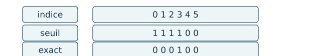
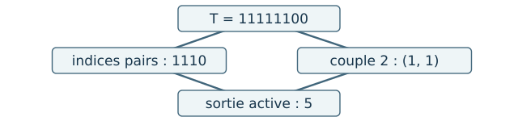

# ENS de Lyon · Second concours · Informatique 2004 — corrigé brut

*Corrigé rédigé par IA, non officiel. Signalez toute erreur.*

**Rédaction** · GPT-6.2 Astra Ultra · vitesse non renseignée · 25 novembre 2026

**Révision** · GPT-6.2 Astra Ultra · vitesse non renseignée · 26 novembre 2026

Les sections I et II du sujet commun à Ulm et Lyon fixent la syntaxe. Les programmes Python 3 ci-dessous, à réunir dans l’ordre, impriment des équations booléennes. Les paramètres de signaux sont des chaînes. Le préfixe aux est réservé aux fils internes, les noms d’entrée et de sortie sont disjoints et les sorties demandées sont distinctes.

## Partie III. Cellules élémentaires

### Question 1 · OU exclusif

$D=(A\lor B)\land\neg(A\land B)$ vaut vrai quand au moins une des entrées est vraie et qu’elles ne sont pas toutes deux vraies. Les constructeurs suivants produisent des chaînes d’opérateurs à deux entrées ou à une entrée pour NON.

```python
from itertools import combinations, count

serie = count()

def frais():
    return f"aux[{next(serie)}]"

def case(nom, i):
    return f"{nom}[{i}]"

def ligne(d, expr):
    print(f"{d} = {expr}")

def et(a, b):
    return f"({a} ET {b})"

def ou(a, b):
    return f"({a} OU {b})"

def non(a):
    return f"(NON ({a}))"

def XOR(a, b, d):
    ligne(d, et(ou(a, b), non(et(a, b))))
```

### Question 2 · OU exclusif sur trois tranches

Chaque triplet $(\text{nom},\text{début},\text{pas})$ définit une adresse de cellule au rang $j$. Les trois progressions avancent indépendamment et ont une même longueur. Le pas de sortie est non nul pour plusieurs sorties. Chaque appel émet exactement une définition.

```python
def tranche(nom, debut, pas, nombre):
    return [case(nom, debut+j*pas) for j in range(nombre)]

def XOR_Tableau(R, S, T, nombre):
    for a, b, d in zip(*(tranche(*v, nombre)
                         for v in (R, S, T))):
        XOR(a, b, d)
```

### Question 3 · Multiplexeur

La formule $D=(C\land A)\lor(\neg C\land B)$ se réduit à $A$ si $C$ est vrai et à $B$ sinon.

```python
def MUX(a, b, c, d):
    ligne(d, ou(et(c, a), et(non(c), b)))
```

### Question 4 · Multiplexeur sur des tableaux

Employer le même $C$ dans toutes les cellules de 3, avec les adresses calculées en 2.

```python
def MUX_Tableau(R, S, T, c, nombre):
    for a, b, d in zip(*(tranche(*v, nombre)
                         for v in (R, S, T))):
        MUX(a, b, c, d)
```

## Partie IV. Compter les entrées vraies

### Question 5 · Code thermométrique

Notons $T[k]$ la condition « poids au moins $k$ ». Pour $k>0$, elle équivaut à l’existence d’un sous-ensemble de $k$ entrées toutes vraies. Décrire une conjonction par sous-ensemble, puis leur disjonction. Le seuil 0 est la constante vraie. Les listes de noms $R,T$ ont respectivement $N-1$ et $N$ éléments.

```python
def plier(op, termes, neutre):
    termes = iter(termes)
    z = next(termes, None)
    if z is None:
        return neutre
    for t in termes:
        z = op(z, t)
    return z

def seuil(V, k):
    if k == 0:
        return "VRAI"
    termes = (plier(et, g, "VRAI")
              for g in combinations(V, k))
    return plier(ou, termes, "FAUX")

def THERMOMETRE(R, T):
    for k, sortie in enumerate(T):
        ligne(sortie, seuil(R, k))
```

### Question 6 · Détecter la transition

La suite $T$ commence à vrai et décroît. Le poids exact $k<N-1$ est donné par le OU exclusif de $T[k]$ et $T[k+1]$. Pour $k=N-1$, recopier le dernier seuil. Cette version emploie $N-1$ opérateurs NON puisque le XOR de 1 en contient un.

```python
def PREMIER_THERMO_EN_1_PARMI_N(T, S, n):
    XOR_Tableau((T, 0, 1), (T, 1, 1), (S, 0, 1), n-1)
    ligne(case(S, n-1), case(T, n-1))
```



### Question 7 · Décoder deux seuils

Pour $T_0\ge T_1$, prendre $S_0=T_0\land\neg T_1$, $S_1=T_1$. Il y a un ET et un NON. Les paramètres sont deux listes ordonnées de noms.

```python
def THERMO_EN_1_PARMI_2(T, S):
    ligne(S[0], et(T[0], non(T[1])))
    ligne(S[1], T[1])
```

### Question 8 · Doubler la taille

Pour $2h$ seuils, prendre $W_j=T_{2j}$. Si le poids est $k$, le poids désigné par le décodage de $W$ est $a=\lfloor k/2\rfloor$. Soient $C_j$ les sorties de ce décodage. Former $F=\bigvee_j(C_j\land T_{2j})$, $G=\bigvee_j(C_j\land T_{2j+1})$. Ce sont les deux valeurs du couple $a$. Appliquer 7 à $(F,G)$, d’où $B_0,B_1$. Émettre $S_{2j}=C_j\land B_0$ et $S_{2j+1}=C_j\land B_1$. Seul le couple $a$ peut s’allumer et son membre allumé est celui de parité $k\bmod2$.



### Question 9 · Générateur récursif

Pour $N=2^p$, le tableau lu aux indices pairs est deux fois plus court. La seule négation ajoutée à chaque étage est celle de la cellule à deux signaux. Avec zéro négation pour un seul seuil et une pour deux, le total est $p=\log_2 N$.

```python
def THERMO_EN_1_PARMI_N(T, S):
    n = len(T)
    if n == 1:
        ligne(S[0], T[0])
        return
    if n == 2:
        THERMO_EN_1_PARMI_2(T, S)
        return
    h = n//2
    actif = [frais() for j in range(h)]
    THERMO_EN_1_PARMI_N(T[::2], actif)
    f, g, b0, b1 = (frais() for j in range(4))
    for r, nom in enumerate((f, g)):
        choix = (et(actif[j], T[2*j+r]) for j in range(h))
        ligne(nom, plier(ou, choix, "FAUX"))
    THERMO_EN_1_PARMI_2([f, g], [b0, b1])
    for j in range(h):
        ligne(S[2*j], et(actif[j], b0))
        ligne(S[2*j+1], et(actif[j], b1))
```

## Partie V. Complémenter un tableau

### Question 10 · Poids nul

Si le poids est nul, toutes les sorties demandées sont vraies. Aucune porte n’est nécessaire.

```python
def INV_N_SACHANT_0_VRAI(V, U):
    for d in U:
        ligne(d, "VRAI")
```

### Question 11 · Poids égal à un

Sous cette hypothèse, $\neg V_i$ est le OU de tous les $V_j$ pour $j\ne i$. Pour une seule entrée, la famille vide donne faux.

```python
def INV_N_SACHANT_1_VRAI(V, U):
    for i, d in enumerate(U):
        ligne(d, plier(ou, V[:i]+V[i+1:], "FAUX"))
```

### Question 12 · Poids connu égal à K

Si le poids total est $K$, le poids hors de la position $i$ est $K-V_i$. Le complément de $V_i$ est donc le seuil $K$ des autres entrées. Pour $K=0$ on émet vrai et pour $K=N$ on émet faux.

```python
def INV_N_SACHANT_K_VRAI(V, U, k):
    for i, d in enumerate(U):
        ligne(d, seuil(V[:i]+V[i+1:], k))
```

### Question 13 · Nombre de portes à poids connu

Pour $1\le K<N$, posons $c=\binom{N-1}{K}$. Une sortie utilise $c$ conjonctions à $K$ termes puis une disjonction à $c$ termes. Les comptes totaux sont $N c(K-1)$ ET et $N(c-1)$ OU. Les cas $K=0,N$ coûtent zéro porte pour le générateur donné.

### Question 14 · Assembler et compter le circuit

Soit $p=\lceil\log_2(N+1)\rceil$ et $L=2^p$. Compléter les $N+1$ seuils par faux jusqu’à $L$ puis les décoder. Les sorties $S_k$ sélectionnent les $N$ bits $B_{ki}$ de la branche de poids $k$ par $U_i=\bigvee_{k=0}^N(S_k\land B_{ki})$. Une seule branche contribue. Le code accepte des indices inclusifs et un pas non nul.

```python
def INV(Vnom, Unom, debut, fin, pas):
    indices = list(range(debut, fin+(1 if pas>0 else -1), pas))
    V = [case(Vnom, i) for i in indices]
    U = [case(Unom, i) for i in indices]
    n = len(V)
    if n == 0:
        return
    l = 1 << n.bit_length()
    T = [frais() for j in range(n+1)]
    THERMOMETRE(V, T)
    S = [frais() for j in range(l)]
    THERMO_EN_1_PARMI_N(T+["FAUX"]*(l-n-1), S)
    B = [[frais() for i in V] for k in range(n+1)]
    for k, sorties in enumerate(B):
        INV_N_SACHANT_K_VRAI(V, sorties, k)
    for i, d in enumerate(U):
        choix = (et(S[k], B[k][i]) for k in range(n+1))
        ligne(d, plier(ou, choix, "FAUX"))
```

Pour cette description précise, posons $c_k=\binom Nk$, $d_k=\binom{N-1}k$. Le thermomètre compte $A_T=\sum_{k=1}^N c_k(k-1)$ ET et $O_T=\sum_{k=1}^N(c_k-1)$ OU. Les branches de poids totalisent $A_B=N\sum_{k=1}^{N-1} d_k(k-1)$ et $O_B=N\sum_{k=1}^{N-1}(d_k-1)$. Pour le décodeur, $A_2=1$, $O_2=0$. À chaque étage $2h\ge4$, ajouter $4h+1$ ET et $2h-2$ OU aux comptes de l’étage $h$, ainsi qu’un NON. En effet, la préparation de $F,G$ demande $2h$ ET et $2(h-1)$ OU, le petit décodeur un ET et le routage $2h$ ET. D’où $A_L=4L+p-8$ et $O_L=2L-2p-2$ pour $p\ge1$. Le total est

$$
\begin{gathered}
\mathrm{ET}=A_T+A_B+A_L+N(N+1),\\
\mathrm{OU}=O_T+O_B+O_L+N^2,\qquad \mathrm{NON}=p .
\end{gathered}
$$

Les copies et les constantes ne sont pas des portes.

Pour deux entrées, $p=2$ et $L=4$. Les quatre sorties du décodeur correspondent aux poids 0, 1, 2 et à une position de remplissage toujours inactive. Le choix de $L$ tient donc au nombre de poids possibles, et le seuil ajouté est bien la constante fausse.

### Question 15 · Trois entrées

Les poids possibles sont 0 à 3, donc $L=4$ et $p=2$. Les couples (ET, OU) du thermomètre, du décodeur, des branches et de la sélection sont respectivement $(5,4),(10,2),(3,3),(12,9)$. On obtient **30 ET, 18 OU et 2 NON** au lieu des trois négations du circuit direct.

### Question 16 · Optimalité du nombre de négations

Sur une chaîne croissante d’entrées booléennes, appeler chute tout passage où au moins une sortie passe de vrai à faux. Un circuit sans NON est monotone et présente zéro chute. Par induction, un circuit à $t$ négations présente au plus $2^t-1$ chutes. En effet, choisir le premier NON dans un ordre topologique. Son entrée est monotone sur la chaîne, donc sa sortie change au plus une fois. Sur chaque segment où elle est constante, la remplacer par sa valeur donne un circuit à $t-1$ négations. Il y a deux segments au plus et un passage entre eux, d’où $2(2^{t-1}-1)+1$.

Sur la chaîne qui allume successivement les $N$ bits, le vecteur des compléments présente une chute à chaque passage. Ainsi $N\le2^t-1$, soit $t\ge\lceil\log_2(N+1)\rceil$. La construction atteint la borne, pour trois entrées comme en général.
