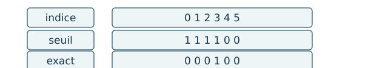
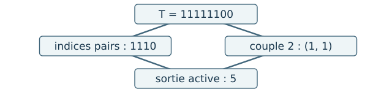

# ENS de Lyon · Second concours · Informatique 2004 — corrigé guidé

*Corrigé rédigé par IA, non officiel. Signalez toute erreur.*

**Rédaction** · GPT-6.2 Astra Ultra · vitesse non renseignée · 25 novembre 2026

**Révision** · GPT-6.2 Astra Ultra · vitesse non renseignée · 26 novembre 2026

Comment inverser trois signaux avec deux négations ? Le programme construit d’abord un signal pour chaque nombre possible de bits vrais. Lorsqu’on connaît ce nombre, les portes ET et OU suffisent à compléter chaque bit. Les fragments Python 3 se lisent dans l’ordre. Ils impriment les équations du circuit. Les entrées, les sorties et le préfixe auxiliaire aux occupent des noms distincts.

## Partie III. Cellules élémentaires

### Question 1 · OU exclusif

Calculer deux informations sur le couple, « au moins un » et « les deux ». Le OU exclusif accepte le premier cas à condition que le second soit faux. Sa table, lue sur $00,01,10,11$, vaut $0,1,1,0$. Les fonctions ci-dessous parenthèsent chaque expression logique. Seule la fonction de sortie écrit une définition.

```python
from itertools import combinations, count

serie = count()

def frais():
    return f"aux[{next(serie)}]"

def case(nom, i):
    return f"{nom}[{i}]"

def ligne(d, expr):
    print(f"{d} = {expr}")

def et(a, b):
    return f"({a} ET {b})"

def ou(a, b):
    return f"({a} OU {b})"

def non(a):
    return f"(NON ({a}))"

def XOR(a, b, d):
    ligne(d, et(ou(a, b), non(et(a, b))))
```

### Question 2 · OU exclusif sur trois tranches

Le rang du traitement est commun aux trois tableaux, leur indice physique peut différer. Par exemple les triplets (« R », 1, 2), (« S », 7, −1), (« T », 0, 1) font intervenir en second lieu les cases 3, 6 et 1. Le code fabrique les trois noms avant d’appeler la cellule scalaire.

```python
def tranche(nom, debut, pas, nombre):
    return [case(nom, debut+j*pas) for j in range(nombre)]

def XOR_Tableau(R, S, T, nombre):
    for a, b, d in zip(*(tranche(*v, nombre)
                         for v in (R, S, T))):
        XOR(a, b, d)
```

### Question 3 · Multiplexeur

Lorsque $C$ commande l’entrée $A$, la branche $B$ doit être coupée, et inversement. Chaque branche est donc une conjonction protégée par la commande convenable, et on réunit leurs sorties par OU.

```python
def MUX(a, b, c, d):
    ligne(d, ou(et(c, a), et(non(c), b)))
```

### Question 4 · Multiplexeur sur des tableaux

Les indices progressent comme dans XOR_Tableau. La commande est un signal unique qui peut alimenter plusieurs portes. La cellule d’indice $j$ n’utilise que les deux entrées de ce même rang.

```python
def MUX_Tableau(R, S, T, c, nombre):
    for a, b, d in zip(*(tranche(*v, nombre)
                         for v in (R, S, T))):
        MUX(a, b, c, d)
```

## Partie IV. Compter les entrées vraies

### Question 5 · Code thermométrique

Prendre l’exemple de trois entrées. Le seuil 2 est vrai dès qu’une paire entière vaut vrai, donc il est le OU des trois produits par paires. Le même procédé vaut pour tout $k$. La fonction de pliage évite une porte supplémentaire sur un terme seul et gère une famille vide par sa valeur neutre. THERMOMETRE reçoit les noms des $N-1$ entrées et des $N$ seuils, du seuil zéro au dernier.

```python
def plier(op, termes, neutre):
    termes = iter(termes)
    z = next(termes, None)
    if z is None:
        return neutre
    for t in termes:
        z = op(z, t)
    return z

def seuil(V, k):
    if k == 0:
        return "VRAI"
    termes = (plier(et, g, "VRAI")
              for g in combinations(V, k))
    return plier(ou, termes, "FAUX")

def THERMOMETRE(R, T):
    for k, sortie in enumerate(T):
        ligne(sortie, seuil(R, k))
```

### Question 6 · Détecter la transition

Repérer la frontière entre les 1 et les 0. Si toute la ligne vaut 1, la réponse est l’ultime case. Deux seuils voisins différents révèlent autrement la frontière. Ici $T$ et $S$ sont les noms de base des deux tableaux, et le premier indice vaut zéro.



```python
def PREMIER_THERMO_EN_1_PARMI_N(T, S, n):
    XOR_Tableau((T, 0, 1), (T, 1, 1), (S, 0, 1), n-1)
    ligne(case(S, n-1), case(T, n-1))
```

Le premier appel engendre $N-1$ cellules de la question 1, chacune avec une négation. La copie terminale ne demande aucune porte.

### Question 7 · Décoder deux seuils

Les seules configurations thermométriques utiles sont $(1,0)$ et $(1,1)$. La seconde sortie est simplement le second seuil. La première est allumée si le premier seuil est franchi et le second ne l’est pas. Cette observation économise toute seconde négation.

```python
def THERMO_EN_1_PARMI_2(T, S):
    ligne(S[0], et(T[0], non(T[1])))
    ligne(S[1], T[1])
```

### Question 8 · Doubler la taille

Conserver un seuil sur deux donne le numéro du couple où s’arrête le thermomètre. Décoder les seuils pairs par le circuit à $h$ entrées. Une seule sortie $C_j$ vaut vrai, celle d’indice $j=\lfloor k/2\rfloor$ pour un poids réel $k$. Pour lire le premier membre du bon couple, faire le OU des $C_j\land T_{2j}$. Pour le second, remplacer $2j$ par $2j+1$. On obtient ainsi $F,G$ avec des opérateurs positifs. La cellule à deux signaux indique alors si le dernier seuil franchi est le premier membre ou le second. Distribuer ces deux bits au couple actif par deux ET par couple.



### Question 9 · Générateur récursif

Le programme comporte un seul appel récursif, sur la moitié des entrées. Les autres calculs au même étage servent à sélectionner une paire et à distribuer sa réponse. Chaque appel à frais fournit le nom d’un fil encore inutilisé. Une cellule à deux seuils ajoute un NON par étage. En descendant de $N=2^p$ à 1, on compte donc exactement $p$ négations.

```python
def THERMO_EN_1_PARMI_N(T, S):
    n = len(T)
    if n == 1:
        ligne(S[0], T[0])
        return
    if n == 2:
        THERMO_EN_1_PARMI_2(T, S)
        return
    h = n//2
    actif = [frais() for j in range(h)]
    THERMO_EN_1_PARMI_N(T[::2], actif)
    f, g, b0, b1 = (frais() for j in range(4))
    for r, nom in enumerate((f, g)):
        choix = (et(actif[j], T[2*j+r]) for j in range(h))
        ligne(nom, plier(ou, choix, "FAUX"))
    THERMO_EN_1_PARMI_2([f, g], [b0, b1])
    for j in range(h):
        ligne(S[2*j], et(actif[j], b0))
        ligne(S[2*j+1], et(actif[j], b1))
```

## Partie V. Complémenter un tableau

### Question 10 · Poids nul

Avec zéro entrée vraie, toute cellule d’entrée vaut faux. Une définition constante par sortie suffit.

```python
def INV_N_SACHANT_0_VRAI(V, U):
    for d in U:
        ligne(d, "VRAI")
```

### Question 11 · Poids égal à un

Chercher l’unique bit vrai parmi les autres positions. S’il s’y trouve, le bit étudié est faux et sa sortie doit être vraie. Le OU réalise exactement ce test.

```python
def INV_N_SACHANT_1_VRAI(V, U):
    for i, d in enumerate(U):
        ligne(d, plier(ou, V[:i]+V[i+1:], "FAUX"))
```

### Question 12 · Poids connu égal à K

Retirer provisoirement un bit. Si les autres atteignent encore le seuil $K$, le bit retiré vaut zéro. Sinon, le bit retiré contribue au poids et vaut un. On reprend donc le seuil positif de 5, une fois par position. L’identité vaut sur la classe de poids promise.

```python
def INV_N_SACHANT_K_VRAI(V, U, k):
    for i, d in enumerate(U):
        ligne(d, seuil(V[:i]+V[i+1:], k))
```

### Question 13 · Nombre de portes à poids connu

Chaque sortie dispose de $N-1$ entrées candidates. Pour $1\le K<N$, choisir $K$ indices peut se faire de $c=\binom{N-1}{K}$ façons. La conjonction d’une sélection comporte $K-1$ ET. Joindre les $c$ termes comporte $c-1$ OU. Multiplier par $N$ donne $Nc(K-1)$ et $N(c-1)$. Aux deux poids extrêmes les sorties sont des constantes et les deux comptes s’annulent.

### Question 14 · Assembler et compter le circuit

D’abord déduire le poids $K$ des entrées, puis autoriser uniquement la famille de sorties construite sous cette hypothèse. Le seuil 0 est inclus, donc il faut pouvoir coder $N+1$ possibilités. Prendre $L=2^p$ avec $p=\lceil\log_2(N+1)\rceil$, puis compléter la liste par des seuils faux. Les noms des sorties temporaires sont tous distincts.

```python
def INV(Vnom, Unom, debut, fin, pas):
    indices = list(range(debut, fin+(1 if pas>0 else -1), pas))
    V = [case(Vnom, i) for i in indices]
    U = [case(Unom, i) for i in indices]
    n = len(V)
    if n == 0:
        return
    l = 1 << n.bit_length()
    T = [frais() for j in range(n+1)]
    THERMOMETRE(V, T)
    S = [frais() for j in range(l)]
    THERMO_EN_1_PARMI_N(T+["FAUX"]*(l-n-1), S)
    B = [[frais() for i in V] for k in range(n+1)]
    for k, sorties in enumerate(B):
        INV_N_SACHANT_K_VRAI(V, sorties, k)
    for i, d in enumerate(U):
        choix = (et(S[k], B[k][i]) for k in range(n+1))
        ligne(d, plier(ou, choix, "FAUX"))
```

Pour retrouver les coûts exacts, compter les quatre groupes de portes ci-dessous. On suppose $N\ge1$ et on compte les opérateurs effectivement imprimés, même avec une constante comme opérande.

| Groupe | ET | OU |
|---|---:|---:|
| Seuils sur les $N$ entrées | $\sum_{k=1}^N\binom Nk(k-1)$ | $\sum_{k=1}^N(\binom Nk-1)$ |
| Décodeur sur $L$ seuils | $4L+p-8$ | $2L-2p-2$ |
| Calculs à poids fixé | $N\sum_{k=1}^{N-1}\binom{N-1}k(k-1)$ | $N\sum_{k=1}^{N-1}(\binom{N-1}k-1)$ |
| Sélection des réponses | $N(N+1)$ | $N^2$ |

Additionner les colonnes pour obtenir les comptes demandés. La deuxième ligne part d’un ET en taille 2. En taille $2h\ge4$, chaque signal $F,G$ consomme $h$ ET et $h-1$ OU. Le petit décodeur ajoute un ET, et les $2h$ sorties consomment chacune un ET. Sommer ces incréments sur les tailles dyadiques donne la ligne du tableau. Les seuls NON sont les $p$ négations du décodeur. Sur la ligne de sélection, une sortie relie $N+1$ branches par $N+1$ ET et $N$ OU.

Pour deux entrées, $p=2$ et $L=4$. Les quatre sorties du décodeur correspondent aux poids 0, 1, 2 et à une position de remplissage toujours inactive. Le choix de $L$ tient donc au nombre de poids possibles, et le seuil ajouté est bien la constante fausse.

### Question 15 · Trois entrées

Avec trois entrées, il y a quatre classes de poids, et la taille du décodeur est déjà une puissance de deux. Les deux étages suffisent à partager deux négations entre les trois sorties. En reprenant les lignes du tableau, le total est de $5+10+3+12=30$ portes ET et $4+2+3+9=18$ portes OU. Le gain porte sur les négations, de trois à deux, au prix du circuit positif supplémentaire.

### Question 16 · Optimalité du nombre de négations

Considérer les entrées $000,100,110,111$. Le complément d’au moins une sortie descend à chaque pas. Pour $N$ variables, la chaîne analogue a $N$ passages de cette sorte. Combien un circuit avec $t$ NON peut-il en supporter ? Sans NON, toutes les sorties sont croissantes. Sinon, suivre la première négation dans l’ordre des dépendances. Avant elle on ne rencontre que des opérations monotones, donc la valeur à son entrée ne peut que monter. Sa sortie découpe la chaîne en au plus deux morceaux constants. Sur chaque morceau, cette première négation se remplace par une constante et il reste au plus $t-1$ négations. En ajoutant la jonction des deux morceaux, le nombre maximal de passages descendants vérifie $D_t\le2D_{t-1}+1$ et $D_0=0$. Donc $D_t\le2^t-1$. Pour assurer les $N$ chutes observées, il faut au moins $\lceil\log_2(N+1)\rceil$ négations. Les deux obtenues pour $N=3$, et plus généralement celles de 14, réalisent déjà ce minimum.
