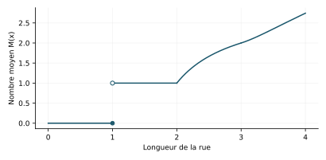

# ENS Ulm et Lyon — Mathématiques du second concours 2004 · Corrigé brut

*Corrigé rédigé par IA, non officiel. Signalez toute erreur.*

**Rédaction** · GPT-6.2 Astra Ultra · vitesse non renseignée · 25 novembre 2026

**Révision** · GPT-6.2 Astra Ultra · vitesse non renseignée · 26 novembre 2026

Le modèle de stationnement séquentiel relie une équation à retard, sa transformée de Laplace et un théorème taubérien. Les sauts de la fonction intégratrice et la convention de placement en longueur exactement un interviennent dans la démonstration.

## I. Théorème taubérien pour une fonction croissante

### Question I.1

Pour $r>0$, $\alpha(r-)=\sup_{s<r}\alpha(s)\le\alpha(r)\le\inf_{s>r}\alpha(s)=\alpha(r+)$. Si les deux inégalités étaient des égalités, $\alpha$ serait continue en $r$. En zéro on ne considère que la limite à droite, ou l’on prolonge $\alpha$ par zéro à gauche. Pour toute famille finie de points de $[0,m]$, la somme des amplitudes de saut $\alpha(r+)-\alpha(r-)$ est au plus $\alpha(m+1)$, par ordre croissant des points et télescopage. Chaque point de $D_n$ y apporte plus de $1/n$, donc $D_n\cap[0,m]$ est fini. Les unions sur $m$, puis sur $n$, sont dénombrables.

### Question I.2

Par uniforme continuité de $g$ sur le compact, choisissons une partition de pas assez fin pour que son oscillation soit $<\varepsilon$ sur chacun des segments fermés $[a_{i-1},a_i]$. Prenons leur minimum $f_i$ et leur maximum $h_i$. Attribuons ces valeurs sur $[a_{i-1},a_i[$ et la dernière paire en $b$. On a alors $f\le g\le h$ et $0\le h-f<\varepsilon$ partout, y compris aux nœuds.

### Question I.3

La différence des sommes est $\sum_i(h_i-f_i)(\beta(a_i)-\beta(a_{i-1}))$. Chaque accroissement de $\beta$ est positif ou nul et $h_i-f_i<\varepsilon$. La différence est donc entre zéro et $\varepsilon\sum_i(\beta(a_i)-\beta(a_{i-1}))=\varepsilon(\beta(b)-\beta(a))$.

### Question I.4

Un raffinement augmente la somme inférieure et diminue la somme supérieure, les accroissements de $\beta$ étant additifs et positifs. Toute somme inférieure est donc au plus toute somme supérieure. I.2–3 montrent que le supremum des premières et l’infimum des secondes coïncident, puisque leur différence est arbitrairement petite. Leur valeur commune définit $\int_{[a,b]}g\,d\beta$.

### Question I.5

Notons $A_r=\alpha(r+)-\alpha(r)$ et $B_r=\alpha(r)-\alpha(r-)$. Pour $a\le t\le b$, la somme des **accroissements** de saut entre $a$ et $t$ est
$$J(t)=\sum_{a\le r<t} A_r+\sum_{a<r\le t} B_r.$$
Sa série converge uniformément : les termes pertinents sont positifs et leur somme totale est au plus $\alpha(b)-\alpha(a)$, par télescopage sur les familles finies ordonnées. Pour $s<t$, $J(t)-J(s)\le\alpha(t)-\alpha(s)$ par le même argument. Ainsi $\beta=\alpha-J$ est croissante. En chaque point intérieur, $J$ a les mêmes sauts gauche et droit que $\alpha$ (passage aux limites par convergence uniforme). Il en va de même pour le saut intérieur à chaque extrémité. Donc $\beta$ est continue.

La formule imprimée pour $\beta$ comporte un défaut en $t=a$ si $A_a\ne0$. Pour $\alpha(a)=0$ et $\alpha(t)=1$ pour $t>a$, avec prolongement nul à gauche, elle donne $\beta(a)=-1$ et $\beta(t)=0$ pour $t>a$. La formule d’intégration suivante échange aussi les extrémités pour $A$ et $B$. Avec les accroissements ci-dessus, la formule qui conserve $\int_{[a,b]}1\,d\alpha=\alpha(b)-\alpha(a)$ est
$$\int_{[a,b]}g\,d\alpha=\int_{[a,b]}g\,d\beta+\sum_{a\le r<b}g(r)A_r+\sum_{a<r\le b}g(r)B_r.$$
Pour des extrémités de continuité, les termes de bord s’annulent.

### Question I.6

Si $g$ est continue positive à support compact, prenons $R$ strictement après son support, et posons $\int_{\mathbb R_+}g\,d\alpha=\int_{[0,R]}g\,d\alpha$. L’additivité sur deux segments adjacents découle de I.4 et de la répartition des sauts en I.5. L’intégrale est donc indépendante de $R$. Pour $e^{-yt}$, les intégrales tronquées sont croissantes en la borne supérieure, d’où l’existence comme limite, finie exactement sous l’hypothèse du sujet.

### Question I.7

Posons $a=e^{-1}$ et prenons $0<\delta<\min(a/2,1-a)$. Une minorante continue est nulle jusqu’à $a$, puis vaut $((x-a)/\delta)/x$ sur $[a,a+\delta]$, puis $1/x$. Une majorante vaut zéro jusqu’à $a-\delta$, monte linéairement jusqu’à $1/a$ en $a$, puis vaut $1/x$. Ces fonctions encadrent $g$, coïncident hors de $[a-\delta,a+\delta]$ et leur écart est borné par $1/a$. Choisissons $2\delta/a<\varepsilon/2$. Approchons chacune uniformément à $\eta<\varepsilon/8$ près par un polynôme. Soustraire $\eta$ au premier et ajouter $\eta$ au second donne $P_1\le g\le P_2$ et $\int_0^1(P_2-P_1)<\varepsilon$. Le même couple encadre la variante prenant la valeur zéro en $a$.

### Question I.8

Pour $P(x)=x^n$, l’expression de gauche vaut $yI((n+1)y)\to C/(n+1)$. Le membre de droite vaut aussi $C\int_0^\infty e^{-(n+1)t}dt=C/(n+1)$. La linéarité donne le résultat pour tout polynôme. Les intégrales existent car $P$ est borné sur $[0,1]$ et $I(y)$ est fini.

### Question I.9

La croissance de $\alpha$ permet d’encadrer l’expression pour $g$ par celles pour $P_1,P_2$. Pour les fonctions ayant un saut, on peut intégrer à l’aide de la partie continue et des masses ponctuelles de I.5, ou encadrer séparément les deux valeurs au point de saut. Par le changement $s=e^{-t}$, l’écart des deux limites est $C\int_0^1(P_2-P_1)ds<C\varepsilon$. Le nombre $C\int_0^\infty e^{-t}g(e^{-t})dt$ est entre ces bornes. Comme $\varepsilon$ est arbitraire, c’est la limite, et la même limite vaut pour l’autre convention ponctuelle de I.7.

### Question I.10

Le produit $e^{-t}g(e^{-t})$ est l’indicatrice de $[0,1]$, donc le membre de droite vaut $C$. À gauche, $e^{-yt}g(e^{-yt})$ est l’indicatrice de $[0,1/y]$. Les deux choix d’inclure ou non le dernier point encadrent l’accroissement $\alpha(1/y)-\alpha(0)$ : ils prennent le saut terminal en entier ou le laissent en dehors, tandis que cet accroissement en prend la partie gauche. Les deux expressions multipliées par $y$ tendent vers $C$ par I.9. Comme $\alpha(0)=0$, le changement $x=1/y$ donne $\alpha(x)/x\to C$.

Plus précisément, pour $T=1/y>0$, les masses de $[0,T[$ et $[0,T]$ sont $\alpha(T-)-\alpha(0)$ et $\alpha(T+)-\alpha(0)$. Comme $\alpha(T-)\le\alpha(T)\le\alpha(T+)$, le résultat vaut même si la valeur choisie au saut n’est aucune des deux limites.

## II. Équation à retard et constante limite

### Question II.1

Le premier morceau donne $M(s)=0$ pour $0\le s\le1$. Pour $1<s\le2$ l’intégrale est nulle, donc $M(s)=1$. Pour $2<s\le3$, en posant $x=s-1$, l’intégrale vaut $x-1$, donc $M(s)=3-2/(s-1)$. Enfin pour $3<s\le4$ elle vaut $1+\int_2^x(3-2/(t-1))dt=3x-5-2\log(x-1)$. Ainsi $M(s)=7-[10+4\log(s-2)]/(s-1)$. La valeur en $1$ est zéro, sa limite à droite vaut un.

### Question II.2

L’inégalité $x/2\le M(x)$ imprimée pour tout $x$ échoue sur $0<x\le1$, où $M=0$. Elle vaut pour $x>1$ et la borne $M(x)\le x$ vaut pour tout $x\ge0$. En effet ces bornes sont immédiates jusqu’à $2$ avec cette précision. Si la borne supérieure est connue sur $[0,x]$, alors $M(x+1)\le1+(2/x)\int_0^x t\,dt=x+1$. Pour $x\ge1$, la borne inférieure sur $]1,x]$ donne $M(x+1)\ge1+(2/x)\int_1^x(t/2)dt=1+x/2-1/(2x)\ge(x+1)/2$. L’induction par intervalles conclut.

La moyenne $x^{-1}\int_0^xM=\int_0^1M(xs)ds$ est croissante sur tout intervalle où $M$ est déjà croissante depuis zéro. Partant de la monotonie sur $[0,2]$, la relation (2) la propage sur chaque morceau suivant. On obtient donc la croissance sur toute la demi-droite.

### Question II.3

La primitive $B(x)=\int_0^x M(t)dt$ est continue, puisque $M$ est localement bornée. Ainsi $M(x+1)=1+2B(x)/x$ est continue pour $x>0$. Sur $[0,1[$ elle est constante, et en $1$ elle a le saut décrit en II.1. Aux points de continuité de $M$, $B'=M$. La relation précédente donne donc la dérivabilité de $M$ pour $s>1$, sauf éventuellement en $s=2$, ainsi que sur $[0,1[$ (à droite en zéro). Les pentes à gauche et à droite de $2$ sont respectivement $0$ et $2$.

### Question II.4

On a $xM(x+1)=x+2\int_0^x M(t)dt$. Pour $x>0$, $x\ne1$, la dérivation donne $xM'(x+1)+M(x+1)=1+2M(x)$. L’égalité vaut aussi presque partout pour les intégrations suivantes.

### Question II.5

Pour $y>0$, $0\le M(x)e^{-yx}\le xe^{-yx}$ et $\int_0^\infty xe^{-yx}dx=1/y^2$. La transformée $\phi(y)$ existe donc absolument et $0\le\phi(y)\le y^{-2}$.

### Question II.6

La transformée de $M(x+1)$ vaut $e^y\phi(y)$ puisque $M$ est nulle sur $[0,1]$. Posons $w=e^y\phi$. La dérivation sous l’intégrale donne $-w'(y)=\int_0^\infty xM(x+1)e^{-yx}dx$, justifiée localement pour $y>0$ par un polynôme fois une exponentielle décroissante. Multiplier (3) par $e^{-yx}$ et intégrer par parties sur les deux côtés de $1$ donne $-yw'(y)=2\phi(y)+1/y$. Le terme de bord en zéro est nul à cause du facteur $x$, celui à l’infini par décroissance, ceux en $1$ se compensent. Donc $(ye^y\phi)'=\phi(e^y-2)-1/y$. Enfin $\phi(y)\to0$ à l’infini par II.5.

### Question II.7

L’équation de II.6 est $w'(y)+(2e^{-y}/y)w(y)=-1/y^2$. On a $0\le w(y)=\int_0^\infty M(1+x)e^{-yx}dx\le\int_0^\infty(1+x)e^{-yx}dx=1/y+1/y^2$. Donc $w(y)\to0$ lorsque $y\to\infty$.

### Question II.8

Posons $B(y)=\exp(-2\int_y^\infty e^{-u}du/u)$. Alors $B'/B=2e^{-y}/y$ et $(Bw)'=-B/y^2$. Comme $B(y)\to1$ et $w(y)\to0$ à l’infini,
$$w(y)=\int_y^\infty\frac{B(z)}{z^2B(y)}dz=\frac1{y^2}\int_y^\infty\exp\left(-2\int_y^z\frac{1-e^{-u}}u\,du\right)dz.$$
La dernière égalité utilise $z^{-2}=y^{-2}\exp(-2\int_y^z du/u)$. On obtient $\phi(y)=e^{-y}w(y)$, expression demandée.

### Question II.9

Écrivons $H(z)=\int_0^z(1-e^{-u})du/u$, dont l’intégrande se prolonge par $1$ en zéro. Alors $y^2\phi(y)=e^{-y+2H(y)}\int_y^\infty e^{-2H(z)}dz$. Pour $z\ge1$, $H(z)=H(1)+\log z-\int_1^z e^{-u}du/u=\log z+O(1)$. L’intégrande est donc $O(z^{-2})$ à l’infini et continu en zéro. À la limite $y\downarrow0$ on trouve $C_P=\int_0^\infty e^{-2H(z)}dz$, réel fini strictement positif.

On peut contrôler numériquement la constante. Pour $z>0$, $H(z)=\gamma+\log z+E_1(z)$, où $E_1(z)=\int_z^\infty e^{-t}\,dt/t$ et $\gamma$ est la constante d’Euler. Le reste au-delà de $R$ équivaut donc à $e^{-2\gamma}/R$. Une quadrature de l’intégrale donne $C_P\simeq0{,}747598$.

### Question II.10

La fonction $M$ croît, $M(0)=0$, et $M(R)e^{-yR}\to0$ par la borne supérieure. Sur $[0,R]$, l’intégration par parties donne $\int e^{-yt}dM(t)=e^{-yR}M(R)+y\int_0^R M(t)e^{-yt}dt$. Elle peut aussi se vérifier sur les morceaux de continuité : pour $R>1$, le saut de hauteur $1$ ajoute $e^{-y}$ et annule le terme intérieur correspondant. D’où $I(y)=y\phi(y)$ sur la demi-droite, fini pour tout $y>0$, et $yI(y)=y^2\phi(y)\to C_P>0$.

### Question II.11

Les hypothèses du théorème 1 ont été vérifiées en II.10 avec la constante $C_P$. Il donne directement $\lim_{x\to\infty}M(x)/x=C_P$, donc le théorème 2.

## III. Stationnement aléatoire

### Question III.1

On considère le stationnement séquentiel uniforme : chaque essai choisit une position au hasard, une voiture de longueur $1$ est acceptée si l’espace le permet, et l’on poursuit jusqu’au blocage. Sur une rue de longueur $x+1$ avec $x>0$, l’extrémité gauche de la première voiture est uniforme sur $[0,x]$. Si elle vaut $t$, les deux espaces restants ont pour longueurs $t$ et $x-t$. Dans chaque intervalle, la succession des essais qui y tombent a la même loi uniforme locale. La linéarité de l’espérance donne, conditionnellement, $1+M(t)+M(x-t)$ (l’indépendance des deux nombres n’est pas nécessaire). La moyenne en $t$ donne $M(x+1)=1+(2/x)\int_0^xM(t)dt$.

Sur une longueur $<1$, aucune voiture ne tient. En longueur exactement $1$, la convention de (1) écarte le placement au contact exact des deux bouts, événement de probabilité nulle pour des tentatives à positions continues. Une convention permettant d’emblée ce placement isolé ne modifierait ni les intégrales de (2), ni la densité limite.

### Question III.2

Le nombre moyen de voitures par unité de longueur sur un trottoir de longueur $x$ est $M(x)/x$. Les voitures étant de longueur un, c’est aussi la fraction moyenne de longueur occupée. Par II.11, cette densité tend vers la constante $C_P$ de II.9 pour une rue dont la longueur croît indéfiniment.
