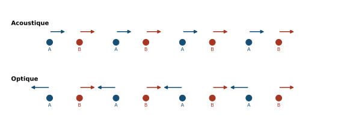
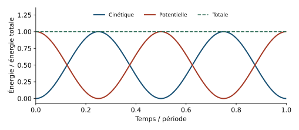
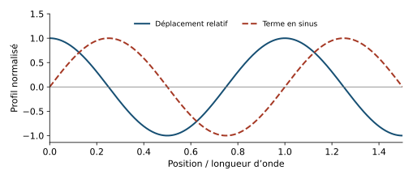

# ENS de Lyon, second concours 2004 — Physique · Corrigé guidé

*Corrigé rédigé par IA, non officiel. Signalez toute erreur.*

**Lecture du rapport du jury** · GPT-6.2 Astra Ultra · vitesse non renseignée

**Rédaction** · GPT-6.2 Astra Ultra · vitesse non renseignée

## I — Vibrations du réseau cristallin binaire

### Question I.1 — Énergie cinétique d’une maille

**Indication.** Dériver les positions instantanées. Les positions du réseau de référence sont constantes.

Les abscisses d’équilibre $x_{AnE}$ et $x_{BnE}$ sont fixes dans le référentiel du cristal. Les vitesses instantanées sont donc $\dot u_{An}$ et $\dot u_{Bn}$. Pour les deux masses ponctuelles, l’énergie cinétique classique est
$$T_n=\tfrac12 m_A\dot u_{An}^{\,2}+\tfrac12 m_B\dot u_{Bn}^{\,2}.$$
Elle s’exprime en joules et s’annule dès que les deux vitesses s’annulent, même si la paire est à cet instant déformée.

### Question I.2 — Coordonnées de centre de masse et de déformation

**Indication.** Sommer les positions avec les masses pour trouver la translation commune. Soustraire ensuite les deux positions pour mesurer l’allongement.

La séparation instantanée vaut $r_n=x_{Bn}-x_{An}=x_{BA}+\delta_n$ avec $\delta_n=u_{Bn}-u_{An}$. Une valeur positive de $\delta_n$ traduit un allongement. Le choix de l’origine dans la maille donne $m_Ax_A+m_Bx_B=0$. On en tire
$$R_n=x_n+\Delta_n,\qquad \Delta_n=\frac{m_Au_{An}+m_Bu_{Bn}}{M},\qquad M=m_A+m_B.$$
Ainsi $\Delta_n$ décrit le déplacement du barycentre par rapport au nœud. À l’équilibre choisi dans le fascicule, les deux déplacements $u$ sont nuls, d’où $\delta_n=\Delta_n=0$, bien que la séparation $x_{BA}$ soit non nulle.

### Question I.3 — Séparation des deux énergies

**Indication.** Exprimer d’abord les deux déplacements individuels en fonction des nouvelles variables. Le terme croisé doit disparaître pour toute vitesse.

L’inversion des relations précédentes donne $u_{An}=\Delta_n-(m_B/M)\delta_n$ et $u_{Bn}=\Delta_n+(m_A/M)\delta_n$. En substituant leurs dérivées dans $T_n$, le coefficient du terme $\dot\Delta_n\dot\delta_n$ est $-m_Am_B/M+m_Bm_A/M=0$. On obtient
$$T_n=\tfrac12 M\dot\Delta_n^2+\tfrac12\mu\dot\delta_n^2,\qquad \mu=\frac{m_Am_B}{M}.$$
La somme des masses intervient pour le mouvement collectif de la paire et la masse réduite pour son mouvement interne.

### Question I.4 — Onde collective du réseau

**Indication.** Factoriser le cosinus avant d’interpréter les coefficients. Comparer sa phase au même instant sur deux sites voisins.

Les deux déplacements partagent le facteur $\cos(kx_n-\omega t)$. Par linéarité,
$$\delta_0=u_{B0}-u_{A0},\qquad \Delta_0=\frac{m_Au_{A0}+m_Bu_{B0}}{M}.$$
On retrouve $\delta_n=\delta_0\cos(kx_n-\omega t)$ et $\Delta_n=\Delta_0\cos(kx_n-\omega t)$. Les amplitudes algébriques peuvent être négatives. Le nombre d’onde $k$ détermine le déphasage $ka_0$ entre deux mailles voisines et une période spatiale $2\pi/|k|$. Des valeurs de $k$ différant de $2\pi/a_0$ donnent les mêmes phases sur les nœuds.

### Question I.5 — Branches acoustique et optique à grande longueur d’onde

**Indication.** Comparer les déplacements, puis leur moyenne pondérée. Une phase identique d’une maille à l’autre n’interdit pas un mouvement opposé à l’intérieur de chacune.

Pour la vibration acoustique décrite par le sujet, $u_{A0}=u_{B0}=u_0$, d’où $\delta_0=0$ et $\Delta_0=u_0$. Quand $k\to0$, les mailles successives se déplacent pratiquement ensemble. À $k=0$ le mouvement correspond à une translation rigide, sans rappel interne dans un cristal libre. C’est le prolongement d’une onde sonore de fréquence tendant vers zéro.
Pour le mode optique, $m_Au_{A0}=-m_Bu_{B0}$, d’où $\Delta_0=0$, $u_{A0}=-(m_B/M)\delta_0$ et $u_{B0}=(m_A/M)\delta_0$. Les deux atomes oscillent en sens opposés autour d’un barycentre fixe. Dans la limite $k\to0$, toutes les paires font ce mouvement interne en phase. Il reste une force de rappel relative et une pulsation optique peut rester finie. Comme les deux atomes portent des charges effectives opposées, cette vibration module le dipôle de chaque maille. Les flèches de la figure représentent une même phase du mouvement.

### Question I.6 — Énergie du mode harmonique

**Indication.** Rechercher l’énergie cinétique au passage par la position d’équilibre et la comparer à sa moyenne sur une période.

Pour un oscillateur harmonique sans dissipation, l’énergie totale est égale à l’énergie cinétique maximale et au double de sa moyenne temporelle. À un instant quelconque $T_n$ n’est qu’une partie de cette énergie. Pour le mode optique,
$$T_n=\tfrac12\mu\omega^2\delta_0^2\sin^2(kx_n-\omega t),\qquad V_n=\tfrac12\mu\omega^2\delta_0^2\cos^2(kx_n-\omega t).$$
L’énergie par paire est $E_1=\mu\omega^2\delta_0^2/2$. Chaque site a la même amplitude et une énergie totale indépendante de sa phase, donc $E_N=NE_1$ dans le modèle du mode.

### Question I.7 — Densité linéique et amplitude

**Indication.** L’énergie d’une maille est la densité linéique multipliée par le pas, et dépend du carré de l’amplitude.

La densité d’énergie de la chaîne est $\rho=E_1/a_0$ en $\mathrm{J\,m^{-1}}$. L’amplitude relative s’en déduit :
$$|\delta_0|=\sqrt{\frac{2a_0\rho}{\mu\omega^2}}.$$
Le rapport sous la racine est une énergie divisée par une raideur, donc a la dimension d’une longueur au carré. Les amplitudes individuelles suivent les facteurs de masse de I.5.

### Question I.8 — Nombre de phonons

**Indication.** Égaler l’énergie de la chaîne entière à l’énergie de ses quanta. Il serait incorrect d’attribuer un quantum à chaque paire lorsqu’on donne $p=1$.

Avec $L=Na_0$, l’énergie d’excitation du cristal est $\rho L=p\hbar\omega$. Ainsi
$$p=\frac{\rho L}{\hbar\omega},\qquad |\delta_0|=\sqrt{\frac{2p\hbar}{N\mu\omega}}=\sqrt{\frac{2p\hbar a_0}{L\mu\omega}}.$$
À densité imposée, cette dernière expression redonne I.7. La prescription associe une amplitude classique à l’énergie d’excitation au-dessus du fondamental comme le demande l’énoncé. Dans un état quantique à nombre de phonons fixé, la valeur moyenne du déplacement n’est pas une oscillation classique de phase déterminée. L’amplitude calculée ici est l’amplitude harmonique d’énergie équivalente.

### Question I.9 — Un phonon dans cinq micromètres de GaAs

**Indication.** Employer $E=hf=\hbar\omega$ en gardant distinctes la fréquence et la pulsation. Relier ensuite $f$ à la longueur d’onde de la lumière correspondante.

Les constantes arrondies du fascicule donnent $m_{\rm u}\simeq1840\times9\times10^{-31}\,\mathrm{kg}$ et $\mu\simeq(69\times75/144)m_{\rm u}=5{,}95\times10^{-26}\,\mathrm{kg}$. Avec $a_0=5\times10^{-10}\,\mathrm m$, on a $N=10^4$. Un quantum de $36\,\mathrm{meV}$ représente $5{,}76\times10^{-21}\,\mathrm J$ et $\omega=5{,}48\times10^{13}\,\mathrm{rad/s}$. D’après I.8, $|\delta_0|\simeq8{,}0\times10^{-14}\,\mathrm m$ et
$$\frac{|\delta_0|}{a_0}\simeq1{,}6\times10^{-4}.$$
Cette petite amplitude relative est compatible avec la linéarisation. L’énergie d’un phonon est distribuée sur dix mille mailles. La fréquence est $8{,}7\,\mathrm{THz}$, soit, dans le vide, une longueur d’onde d’environ $34\,\mu\mathrm m$. Il s’agit d’infrarouge lointain, à la frontière de certaines classifications de l’infrarouge moyen. D’autres cristaux ioniques, comme NaCl, présentent des phonons optiques dans cette gamme, ainsi que certaines vibrations de réseau ou de flexion de molécules à atomes lourds. La longueur d’onde électromagnétique citée ne désigne pas la longueur d’onde mécanique $2\pi/|k|$.

## II — Interaction entre un électron et les vibrations optiques

### Question II.1 — Dipôle d’un site neutre

**Indication.** Écrire la somme des deux moments avec les charges signées avant de remplacer les positions.

Les charges valent $q_A=-e^*$ et $q_B=+e^*$. La composante suivant $Ox$ du moment dipolaire est
$$D_n=-e^* x_{An}+e^* x_{Bn}=e^* x_{BA}+e^*\delta_n.$$
Ainsi $D_E=e^*x_{BA}$ et $C_0=1$. La neutralité rend le résultat indépendant du choix d’origine. Une translation de la maille déplace les deux charges également et ne change pas le moment dipolaire.

### Question II.2 — Noyau d’interaction électrostatique

**Indication.** La charge de l’électron est déjà négative dans les notations du sujet. Déduire la dimension de $A$ de l’énergie, puis choisir le zéro du potentiel.

Dans $V=e e^* A(z)$, les charges se mesurent en coulombs et l’énergie en joules. L’unité de $A$ est donc $\mathrm{J\,C^{-2}}=\mathrm{V/C}$. Pour une interaction coulombienne tridimensionnelle évaluée le long de l’axe dans un diélectrique homogène, $A(z)\sim1/(4\pi\varepsilon |z|)$ lorsque la séparation croît. Le noyau pair tend vers zéro des deux côtés si le zéro d’énergie est choisi à l’infini. Un écrantage éventuel accélère la décroissance. La seule hypothèse mathématique de parité ne fixerait pas le taux de décroissance. Le noyau détaillé au voisinage d’un site n’est pas donné.

### Question II.3 — Parties statique et variable de l’interaction

**Indication.** Factoriser les charges et garder d’abord séparées les deux positions d’équilibre à l’intérieur de la maille.

Avec $s=x-x_n$ et $e<0$ la somme exacte pour le site est
$$V_n=e e^*\big[A(s-x_B-u_{Bn})-A(s-x_A-u_{An})\big].$$
On soustrait la valeur d’équilibre $e e^*[A(s-x_B)-A(s-x_A)]$ pour isoler l’interaction variable. Le signe opposé des deux termes provient des charges du cristal. La composante statique participe déjà au potentiel périodique du réseau au repos.

### Question II.4 — Développement dipolaire

**Indication.** Distinguer le développement dans les déplacements de vibration et le remplacement du gradient aux deux atomes par sa valeur au centre de maille.

Le développement (D1) à l’ordre un dans les déplacements donne exactement à cet ordre
$$V_{n,\mathrm{dyn}}=e e^*\left[-u_{Bn}A'(s-x_B)+u_{An}A'(s-x_A)\right].$$
Pour obtenir la forme prévue par le sujet, il faut également prendre le terme dipolaire de la maille, c’est-à-dire évaluer les deux gradients au même nœud sur l’échelle de variation du champ. Il vient alors
$$V_{n,\mathrm{dyn}}\simeq -e e^*\delta_n A'(x-x_n),\qquad C_1=-e.$$
On peut retrouver le signe en écrivant l’énergie de l’électron dans le potentiel d’un dipôle. Le passage des deux gradients à un seul est une approximation spatiale supplémentaire, pertinente lorsque le noyau est lisse à l’échelle de la maille ou pour la composante de grande longueur d’onde. Un Taylor limité aux seuls $u$ ne suffirait pas pour un noyau arbitraire. La partie dynamique disparaît avec les déplacements.

### Question II.5 — Somme sur les sites et transformée de Fourier

**Indication.** Changer de variable dans la convolution avant de dériver. Contrôler séparément le signe, la densité de sites et la normalisation de Fourier.

Introduisons une variable continue $u$ à la place de l’abscisse $x_n$. La formule (R1) apporte le facteur $1/a_0$. Avec (R2), à partir de II.4,
$$V_{\rm int}(x,t)\simeq-\frac{e e^*\delta_0}{a_0}\frac{\partial}{\partial x}\int_{-\infty}^{+\infty}A(x-u)\cos(ku-\omega t)\,du.$$
En posant $z=x-u$, les bornes s’échangent et la différentielle compense ce changement. Le cosinus devient $\cos(kx-\omega t)\cos(kz)+\sin(kx-\omega t)\sin(kz)$. Son second terme s’intègre à zéro pour le noyau pair. La convention imprimée est $\widetilde A(k)=(2\pi)^{-1}\int A(z)e^{ikz}dz$. L’intégrale vaut donc $2\pi\widetilde A(k)\cos(kx-\omega t)$. Après dérivation :
$$V_{\rm int}(x,t)=\frac{2\pi e}{a_0}\, e^*\delta_0\, k\widetilde A(k)\sin(kx-\omega t),\qquad C_2=\frac{2\pi e}{a_0}.$$
Le signe de $C_2$ est négatif car $e<0$. Le facteur $k$ vient de la dérivée spatiale du dipôle distribué et le facteur $2\pi$ de la convention de Fourier. La figure illustre le décalage d’un quart de période entre le déplacement et la forme spatiale en sinus. Ce calcul suppose les bords éloignés et une transformée bien définie, au besoin pour un noyau régularisé. Il représente l’origine électrostatique du couplage entre électron et vibrations optiques polaires dans ce modèle unidimensionnel.

