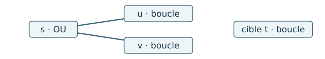
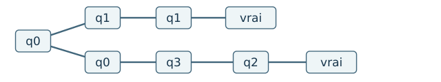

# ENS · MP-PC · Informatique 2004 — corrigé brut

*Corrigé rédigé par IA, non officiel. Signalez toute erreur.*

**Rédaction** · GPT-6.2 Astra Ultra · vitesse non renseignée · 25 novembre 2026

On pose N = |V|, M = |E|. Une union vide vaut l’ensemble vide et une intersection vide vaut V. Aux questions 1, 2 et 7, les égalités imprimées et les graphes autorisant des puits imposent de distinguer le résultat vrai de l’assertion demandée.

## Partie 1. Accessibilité dans les graphes ET/OU

### Question 1 · L’application constante

Noter $F(g)(s)$ le membre de droite de l’équation de compatibilité. Si $s$ est OU avec un successeur, l’union des valeurs constantes $V$ vaut $V$. Pour un ET, même sans successeur, l’intersection vaut $V$. Mais pour un OU sans successeur, $F(g)(s)=\{s\}$. Avec deux sommets isolés de type OU, la constante $V$ n’est donc pas compatible. L’assertion est vraie en l’absence de puits OU (ou pour $|V|=1$).

### Question 2 · Intersection de solutions

C’est faux, même sans puits. Prendre quatre sommets OU : $s$ a les fils $u,v$, et $u,v,t$ ont chacun une boucle vers eux-mêmes. Dans $g_1$, poser $g_1(u)=\{u,t\}, g_1(v)=\{v\}$ ; dans $g_2$, poser $g_2(u)=\{u\}, g_2(v)=\{v,t\}$. Dans les deux, $g(t)=\{t\}$ et $g(s)=\{s,u,v,t\}$. Les deux applications vérifient chaque égalité. Leur intersection garde $t$ en $s$ mais ne l’a plus en aucun de ses fils, en contradiction avec la règle OU. Pour les seules inclusions $F(g)\subseteq g$, la stabilité par intersection serait vraie par monotonie.

### Question 3 · Plus petite solution

$F$ est croissante pour l’inclusion composante par composante. Partir de $D(s)=\{s\}$ et poser $D_{r+1}=F(D_r)$ avec $D_0=D$. Comme $D\subseteq F(D)$, la suite croît. Sur les $N^2$ couples possibles elle stationne, et sa limite est fixe. Toute solution $g$ contient $D$, donc par récurrence chaque $D_r$ puis la limite. Deux plus petites solutions se contiendraient mutuellement : unicité.

### Question 4.1 · Appartenance

Représenter $U$ par son tableau de bits $B_U$. Renvoyer $B_U[x]$. Le codage définit ce bit comme vrai exactement pour $x\in U$, en $O(1)$.

### Question 4.2 · Égalité

Comparer $B_U[i]$ et $B_W[i]$ pour $i=1,\ldots,N$, renvoyer faux à la première différence, vrai à défaut. Une différence est exactement un témoin de différence symétrique. Pire coût $O(N)$.

### Question 4.3 · Union

Pour tout $i$, écrire $C[i]=B_U[i]\lor B_W[i]$. La définition du OU est l’appartenance à l’union ; coût $\Theta(N)$ avec la production du tableau.

### Question 4.4 · Union d’une famille

Avec $S$ en liste, initialiser $C$ à faux puis fusionner par OU dans $C$ chacune des lignes $g(s)$ pour $s\in S$. L’invariant après $j$ lectures est l’union des $j$ premières lignes. Coût $O(N(1+|S|))$. Pour $S$ vide la ligne reste nulle.

### Question 4.5 · Compatibilité

Pour chaque $s$, initialiser une ligne à faux si $s$ est OU, à vrai si $s$ est ET. Pour chaque fils combiner bit à bit par OU ou ET. Mettre la case $s$ à vrai et comparer la ligne à $g(s)$. Renvoyer vrai si toutes les lignes coïncident. On évalue exactement $F(g)=g$ en $O(N(N+M))$ et $O(N)$ mémoire auxiliaire.

### Question 5.1 · Itérations sur la figure

Les chaînes de chiffres ci-dessous représentent des ensembles de sommets. Chaque colonne est calculée depuis la colonne précédente.

| $s$ | $A_0$ | $A_1$ | $A_2$ | $A_3$ | $A_4$ | $A_5$ | $A_6$ |
|---|---|---|---|---|---|---|---|
| 1 | 1 | 13 | 1346 | 1346 | 13468 | 13468 | 13468 |
| 2 | 2 | 12 | 123 | 12346 | 12346 | 123468 | 123468 |
| 3 | 3 | 346 | 346 | 3468 | 3468 | 3468 | 3468 |
| 4 | 4 | 4 | 4 | 34 | 346 | 346 | 3468 |
| 5 | 5 | 58 | 358 | 34568 | 34568 | 34568 | 34568 |
| 6 | 6 | 6 | 68 | 368 | 3468 | 3468 | 3468 |
| 7 | 7 | 78 | 378 | 34678 | 34678 | 34678 | 34678 |
| 8 | 8 | 38 | 3468 | 3468 | 3468 | 3468 | 3468 |
| 9 | 9 | 689 | 3689 | 34689 | 34689 | 34689 | 34689 |

### Question 5.2 · Stabilisation

Pour une cible $t$ fixée, la colonne $\{s:t\in A_r(s)\}$ est croissante. Sa mise à jour ne dépend que d’elle-même. Elle a au moins un élément initial, $t$. Une fois inchangée elle reste fixe, et elle ne peut avoir plus de $N-1$ augmentations strictes. Ainsi $A_N=A_{N-1}$ pour $N\ge1$, et l’on peut prendre la borne $N-1$.

### Question 5.3 · Identification de la limite

La récurrence du sujet conserve l’ancienne valeur avant d’ajouter les contributions des fils. Elle coïncide néanmoins avec l’itération de $F$ de la question 3 : au premier tour c’est exact, puis $A_r=F(A_{r-1})\subseteq F(A_r)$ par croissance. L’union avec $A_r$ n’ajoute donc rien à $F(A_r)$. La limite est le plus petit point fixe $A_G$.

### Question 5.4 · Calcul de la relation

Garder deux matrices de bits. Initialiser l’identité, puis calculer chaque nouvelle matrice depuis la précédente comme en 4.5. Arrêter après $N-1$ tours ou dès l’égalité. La preuve précédente donne la correction, le temps est $O(N^2(N+M))$ et l’espace $O(N^2)$.

### Question 6 · Inverse d’un ensemble de cibles

Si $S$ est vide, renvoyer l’ensemble vide. Sinon effectuer le calcul inverse de 7.2 séparément pour chaque $t\in S$ puis prendre l’union des résultats, en $O((1+|S|)(N+M))$. En n’utilisant que les questions précédentes, on peut aussi calculer toute la matrice $A_G$ puis tester l’intersection de chaque ligne avec $S$ en $O(N|S|)$ supplémentaires.

### Question 7.1 · Coût de l’algorithme imprimé

Après initialisation, les compteurs ne font que décroître à chaque traitement d’un arc entrant. Un sommet autre que la graine ne peut atteindre zéro qu’une fois, donc il est empilé au plus une fois. Le compteur de la graine est déjà nul et ne peut repasser à zéro. Chaque liste de prédécesseurs est donc visitée au plus une fois et le coût global est $O(N+M)$.

### Question 7.2 · Correction et puits ET

Avec la convention usuelle $\bigcap\varnothing=V$, le programme imprimé oublie les puits ET. Par exemple, un puits ET $p\ne s_0$ indépendant de la cible devrait atteindre $s_0$ mais ne sera jamais empilé. Initialiser la pile avec $s_0$ **et tous les puits ET**, sans doublon, et mettre leurs compteurs à zéro. S’il n’y a aucun puits ET, le programme imprimé convient tel quel.

La graine et ces puits sont justifiés. Pour un ET non initial et non encore activé, le compteur est le nombre de successeurs non encore traités. Pour un OU, le premier successeur traité déclenche l’ajout. Par induction les sommets traités atteignent la cible ; à pile vide, les sommets traités forment un ensemble contenant les graines et fermé par ces deux règles, donc contenant le plus petit tel ensemble. Il égale la colonne de $A_G$. L’invariant suggéré sur le compteur ET s’applique avant activation et hors graine : imposer artificiellement zéro à la graine peut le rendre faux pour elle.

### Question 7.3 · Initialisation en temps linéaire

Initialiser chaque liste $P[t]$ à vide. Pour chaque $s$, compter ses fils en parcourant sa liste et, pour chaque $s\to t$, ajouter $s$ en tête de $P[t]$. Enregistrer le compteur égal au degré sortant si ET, à 1 si OU. L’absence de répétition des listes de successeurs empêche les doublons. Temps et espace $O(N+M)$.

### Question 7.4 · Une requête

Pour tester $t\in A_G(s)$, exécuter le parcours inverse corrigé de graine $t$. Renvoyer le bit de présence de $s$ à la fin. Avec 7.1 et 7.3 le temps global est $O(|G|)$.

## Partie 2. Automates alternants

### Question 8 · Trois calculs réussis

Dans les trois cas, la première lettre 0 crée les deux obligations $q_1,q_0$. On donne les deux branches, en écrivant la lettre consommée sur chaque flèche et $\top$ pour la transition ET vide qui termine la branche.

| Mot | Branche issue de $q_1$ | Branche issue de $q_0$ |
|---|---|---|
| $0101$ | $q_1\xrightarrow{1}q_1\xrightarrow{0}\top$ | $q_0\xrightarrow{1}q_3\xrightarrow{0}q_2\xrightarrow{1}\top$ |
| $0110$ | $q_1\xrightarrow{1}q_1\xrightarrow{1}q_1\xrightarrow{0}\top$ | $q_0\xrightarrow{1}q_2\xrightarrow{1}\top$ |
| $0111$ | $q_1\xrightarrow{1}q_0\xrightarrow{1}q_2\xrightarrow{1}\top$ | $q_0\xrightarrow{1}q_2\xrightarrow{1}\top$ |

$\top$ ne crée aucun nouveau nœud : aucune feuille de profondeur quatre ne requiert un état final.

### Question 9 · Du non-déterminisme à l’alternance

Garder états, initial, finaux et listes de transitions, en déclarant chaque transition de type OU. Un calcul est alors un chemin qui choisit exactement un successeur à chaque lettre, et il réussit précisément en état final. Une liste vide interdit ce chemin. La taille est $O(|A_1|)$ puisque l’alphabet a au plus deux lettres.

### Question 10 · Complément

Échanger OU et ET pour chaque paire (état, lettre) et remplacer $Q_f$ par $Q\setminus Q_f$. Par induction sur la longueur du suffixe, l’acceptation depuis chaque état dans le dual est la négation de celle de l’original : initialisation par les finaux sur $\varepsilon$, puis lois de De Morgan, y compris pour les listes vides. Parcourir la représentation donne $O(|A|)$.

### Question 11 · Reconnaissance d’un mot

Initialiser $B[q]=[q\in Q_f]$. Pour les lettres $a$ de $w$ de droite à gauche, calculer dans un nouveau tableau, pour chaque $q$, le OU ou le ET des $B[r]$ pour $r\in\delta(q,a)$ selon le type. Échanger les deux tableaux. Par induction $B[q]$ décrit l’acceptation du suffixe courant depuis $q$. Renvoyer $B[q_0]$. Coût $O((1+|w|)|A|)$ avec initialisation, soit $O(|w||A|)$ pour un mot non vide ; sur le mot vide, tester directement le statut de $q_0$.

### Question 12 · Éliminer l’alternance

Prendre comme états non déterministes les sous-ensembles $P\subseteq Q$, interprétés comme des obligations simultanées. Initial $\{q_0\}$, finaux $P\subseteq Q_f$. Pour une lettre $a$, autoriser $P\to U$ si pour chaque $q\in P$ de type ET, $\delta(q,a)\subseteq U$, et pour chaque $q\in P$ de type OU, $\delta(q,a)\cap U\ne\varnothing$. Les supersets d’obligations minimales sont inoffensifs : si tous leurs états réussissent, les enfants exigés réussissent aussi. Inversement choisir un témoin par OU et tous les enfants des ET donne une transition vers une union d’obligations qui réussissent. L’induction sur le suffixe prouve l’équivalence, y compris pour $P=\varnothing$. Avec $q=|Q|$, au plus $2^q$ états et $2\cdot4^q$ arcs ; énumérer les paires et tester les contraintes coûte $O(4^q|A_1|)$.

### Question 13.1 · Borne non déterministe

Sur un chemin acceptant $1^{2^n}$ il y a $2^n+1$ positions, avant et après chaque lettre. Si deux portaient le même état, on pourrait retirer la portion entre les deux et accepter un mot strictement plus court. Il faut donc au moins $2^n+1$ états.

### Question 13.2 · Automate alternant de taille quadratique

Construire un petit compteur sur la **longueur du suffixe**. Pour les bits $i=0,\dots,n-1$, prendre $B_i^0,B_i^1$. Sur un mot de longueur $2k$, $B_i^d$ signifie que le bit $i$ de $k$ vaut $d$. Les transitions évolueront par deux lettres. Sur $\varepsilon$, seuls les $B_i^0$ sont finaux parmi ces états.

Sur $2k+2$, la première lettre 1 d’un état $B_i^d$ choisit par OU un état intermédiaire. La seconde lettre fait un ET des obligations suivantes sur le suffixe de longueur $2k$ :

- pour chaque $j<i$, une possibilité teste $B_i^d$ et $B_j^0$ (pas de report) ;
- une dernière possibilité teste $B_i^{1-d}$ et tous les $B_j^1$ pour $j<i$ (report).

Le premier cas conserve le bit de $k$, le second le renverse. Par induction, les bits codent $k$ modulo $2^n$. Chaque test de paire coûte deux fils et chaque test de report $O(i+1)$ fils. Tous ces intermédiaires sont non finaux.

Déclarer $H$ final sur le suffixe vide. Sur un suffixe de longueur $2k$, cet état teste $k<2^n$. Pour $H$ sur $2k+2$, il faut $H$ sur $2k$ et au moins un bit nul de $k$. Sur le premier 1, prendre un OU vers des auxiliaires qui sur le second 1 testent $H\land B_i^0$ pour un $i$. **Tous les auxiliaires sont non finaux**, de sorte que les états principaux rejettent les longueurs impaires. Pour $n\ge1$, l’objectif $2^n=2\cdot2^{n-1}$ est de tester $H$, le bit $n-1$ égal à 1 et tous les bits inférieurs égaux à 0 sur une longueur paire. Une conjonction directe à l’initial consommerait une lettre de trop : calculer plutôt les bits et $H$ pour la longueur $2^n-2$, soit le nombre $2^{n-1}-1$. Créer un initial non final qui, sur 1, passe à un auxiliaire non final, puis sur 1 au ET de $H,B_{n-1}^0$ et des $B_i^1$ pour $i<n-1$. Toute transition sur 0 peut être mise à faux. Les seuls mots acceptés sont alors les $1^{2^n}$. Le coût des tests, états et arcs est $O(\sum_{i<n}(i+1))=O(n^2)$. Pour $n=0$, deux états suffisent pour reconnaître $1$.
