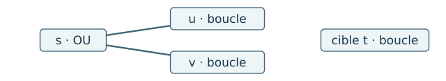
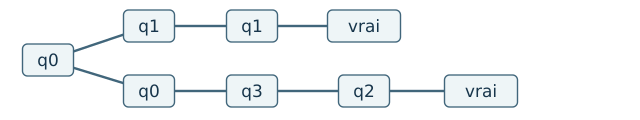

# ENS · MP-PC · Informatique 2004 — corrigé guidé

*Corrigé rédigé par IA, non officiel. Signalez toute erreur.*

**Rédaction** · GPT-6.2 Astra Ultra · vitesse non renseignée · 25 novembre 2026

Chaque cible peut être suivie séparément à travers les portes ET et OU du graphe. Le sujet imprime des égalités pour la compatibilité. Deux contre-exemples précisent leurs conséquences avant la construction du plus petit point fixe.

## Partie 1. Accessibilité dans les graphes ET/OU

### Question 1 · L’application constante

Tester le plus petit graphe qui distingue $V$ de $\{s\}$ : deux sommets isolés. L’une des règles demande de prendre l’union de zéro ensemble et d’y ajouter le sommet lui-même. Le résultat n’est que ce singleton. Dans un graphe où chaque OU possède une sortie, en revanche, la valeur constante $V$ satisfait bien toutes les égalités imprimées.

### Question 2 · Intersection de solutions

Tester une cible à la fois. Dans une première solution, laisser la boucle en $u$ porter la cible $t$ ; dans la seconde, donner ce rôle à la boucle en $v$. Il y a dans chacune un témoin pour $s$, dont les deux sorties vont vers $u,v$. Dans l’intersection, $s$ conserve $t$ mais aucun successeur ne le justifie. Dans les deux solutions, prendre $g(t)=\{t\}$ et $g(s)=\{s,u,v,t\}$. En $u$ et $v$, inclure leur propre sommet et ajouter $t$ seulement sur la boucle choisie. Le problème provient de l’échange injustifié d’une intersection et d’une union.

### Question 3 · Plus petite solution

L’échec de la question 2 empêche de justifier directement l’intersection de toutes les solutions. Construire plutôt les conséquences obligatoires en partant des singletons. Ajouter une information à un enfant ne peut rendre fausse ni une union ni une intersection déjà satisfaite. Le calcul croît jusqu’à un point fixe et toute solution contenait déjà, à chaque étape, ce que l’on a construit.

### Question 4.1 · Appartenance

Le numéro du sommet est un indice autorisé. Une consultation directe suffit une fois l’ensemble représenté.

Renvoyer le bit d’indice $s$ du tableau indicateur, en $O(1)$.

### Question 4.2 · Égalité

Pour deux ensembles écrits en indicatrices, l’égalité est coordonnée par coordonnée. Dans le pire cas ils sont égaux et on doit tout lire.

La comparaison s’arrête au premier désaccord ; au pire son coût est $\Theta(N)$.

### Question 4.3 · Union

Un sommet doit être conservé dès que l’un des deux bits est vrai. Un parcours commun des deux tableaux donne le résultat.

Écrire $C[i]=A[i]\lor B[i]$ pour $i=1,\ldots,N$. Le temps est $\Theta(N)$.

### Question 4.4 · Union d’une famille

Accumuler une ligne à la fois au lieu de recalculer l’union depuis zéro. La taille d’une ligne vaut $N$, et la création de la ligne résultat a aussi ce coût.

Le coût est $O(N(1+|S|))$ si l’on parcourt directement les éléments de $S$, plus $O(N)$ si sa représentation exige de les retrouver en balayant son indicatrice.

### Question 4.5 · Compatibilité

Le choix du tableau initial est crucial aux sommets sans fils : une disjonction vide donne faux, une conjonction vide vrai. Remettre ensuite le bit diagonal, puis tester toutes les coordonnées. Le nombre total de lectures de listes de fils est $M$, et chaque fusion de ligne examine $N$ bits.

Le test complet prend $O(N(N+M))$ dans la représentation par lignes de bits et listes de successeurs.

### Question 5.1 · Itérations sur la figure

Lire les successeurs, dans l’ordre des sommets : $3$ ; $1$ ; $4,6$ ; $2,5$ ; $8$ ; $7,9$ ; $8$ ; $3$ ; $6,8$. Les carrés sont $1,4,6,8$. Pour reconstituer les sept étapes, partir de chaque singleton, puis ajouter à chaque tour les seuls chiffres suivants (un tiret signifie aucune addition).

| $s$ | tour 1 | tour 2 | tour 3 | tour 4 | tour 5 | tour 6 |
|---|---|---|---|---|---|---|
| 1 | 3 | 46 | — | 8 | — | — |
| 2 | 1 | 3 | 46 | — | 8 | — |
| 3 | 46 | — | 8 | — | — | — |
| 4 | — | — | 3 | 6 | — | 8 |
| 5 | 8 | 3 | 46 | — | — | — |
| 6 | — | 8 | 3 | 4 | — | — |
| 7 | 8 | 3 | 46 | — | — | — |
| 8 | 3 | 46 | — | — | — | — |
| 9 | 68 | 3 | 4 | — | — | — |

### Question 5.2 · Stabilisation

Au lieu de compter ensemble les $N^2$ cases, suivre une même cible sur tous les sommets. Les règles ne mêlent jamais deux cibles différentes. Chaque étape utile ajoute un sommet, et la cible elle-même est acquise dès le départ. Toutes les colonnes ont donc fini après au plus $N-1$ propagations.

### Question 5.3 · Identification de la limite

Au point fixe de la récurrence inflationniste, on pourrait craindre de n’obtenir qu’une inclusion. Mais tout élément acquis à l’étape précédente est diagonal ou avait déjà un témoin chez les fils. Les témoins persistent par monotonie. C’est donc bien l’égalité imprimée qui est satisfaite, et la minimalité découle de la comparaison avec toute solution.

### Question 5.4 · Calcul de la relation

Ne pas mélanger les valeurs d’un même tour. Remplir un deuxième tableau avec les unions ou intersections pour chaque sommet et chaque cible, puis échanger les deux tableaux. Chaque tour coûte $O(N(N+M))$ ; la borne de 5.2 donne au plus $N-1$ tours.

### Question 6 · Inverse d’un ensemble de cibles

Il faut qu’une même cible soit garantie à toutes les branches d’un ET. Partir simultanément de toutes les cibles peut autoriser une cible différente selon la branche : avec deux fils bouclés et deux cibles distinctes, le père ET ne garantit ni l’une ni l’autre. Réunir les réponses obtenues une cible à la fois, ou lire directement les colonnes de la matrice calculée à la question 5.

### Question 7.1 · Coût de l’algorithme imprimé

Le fait qu’un compteur puisse devenir négatif n’augmente pas le coût : seul le passage exact à zéro déclenche un nouvel ajout. Chaque sommet extrait est distinct et un arc ne figure que dans la liste de son extrémité.

Après l’initialisation, le parcours traite au plus $N$ sommets et $M$ arcs, d’où $O(N+M)$.

### Question 7.2 · Correction et puits ET

Un ET vide est déjà satisfait pour n’importe quelle cible. Pour que l’algorithme fonctionne sur tous les graphes de la première page, l’enfiler dès le départ, même si la cible est ailleurs. Les autres ET attendent le dernier de leurs successeurs, les OU attendent le premier. Un sommet ajouté l’est ainsi toujours à bon droit. Au terme du parcours, aucune règle ne pourrait ajouter un nouveau sommet : la file vide certifie exactement le plus petit ensemble fermé contenant la cible.

### Question 7.3 · Initialisation en temps linéaire

Transposer le graphe en distribuant chaque arc dans la liste de son extrémité. Pendant cette même lecture, accumuler le nombre de fils. Il n’est donc pas nécessaire d’essayer les $N^2$ couples possibles.

### Question 7.4 · Une requête

Inverser les rôles d’entrée dans l’appel : le sommet recherché dans les lignes est la cible $t$, et c’est la colonne de $t$ que le parcours construit. Consulter ensuite une seule case pour le départ $s$.

## Partie 2. Automates alternants

### Question 8 · Trois calculs réussis

Une branche peut réussir avant la fin du mot grâce à une conjonction vide. Après le zéro initial, il reste donc à réussir deux calculs. Sur $101$, depuis $q_1$ rester en $q_1$ puis terminer au zéro ; depuis $q_0$ choisir $q_3$, suivre $q_2$ au zéro et terminer au dernier 1. Sur $110$, depuis $q_1$ rester deux fois en $q_1$ puis terminer au zéro ; depuis $q_0$ choisir $q_2$ puis terminer au 1 suivant. Sur $111$, depuis $q_1$ choisir $q_0$, puis $q_2$, puis terminer ; depuis $q_0$ choisir $q_2$ et terminer à la lettre suivante.

### Question 9 · Du non-déterminisme à l’alternance

Le choix existentiel d’un automate non déterministe est déjà un OU. Aucun dédoublement du chemin n’est nécessaire. Le cas du mot vide est aussi préservé, car seul l’état initial y est testé.

On conserve les états et les transitions, toutes déclarées de type OU. La taille est $O(|A_1|)$.

### Question 10 · Complément

Sur une lettre, « il existe un fils qui réussit » devient par négation « tous les fils échouent ». À la fin du mot il suffit de renverser le statut final. Une transition toujours vraie devient toujours fausse et réciproquement. Ces échanges se font localement dans la table.

### Question 11 · Reconnaissance d’un mot

Plutôt que de construire chacun des arbres de calcul, mémoriser une réponse par état pour le suffixe restant. Quand une lettre est placée devant le suffixe, une seule lecture des transitions suffit à mettre toutes les réponses à jour. Le ET vide vaut vrai même si le suffixe restant est long. Deux tableaux de $|Q|$ bits suffisent.

Renvoyer le bit de l’état initial après lecture inverse, en $O(|w|\,|A|)$ pour $w$ non vide. Sur le mot vide, tester directement l’appartenance de l’état initial aux états finaux.

### Question 12 · Éliminer l’alternance

Un chemin du nouvel automate transporte toute une rangée de l’arbre. Au départ elle ne contient que la racine. Pour la prochaine rangée, vérifier que chaque ET a tous ses enfants présents et chaque OU au moins un enfant présent. Les rangées pouvant seulement ajouter des obligations, toute rangée réussie fournit les branches requises. Un arbre réussi fournit en retour un chemin de rangées réussies, en fusionnant les obligations identiques. En fin de mot tous les états de la rangée doivent être finaux, ce qui accepte en particulier la rangée vide. Le passage d’états individuels à des parties explique le coût exponentiel.

Avec $q=|Q|$ états dans le premier automate, la construction a au plus $2^q$ états, $2\cdot4^q$ transitions sur l’alphabet binaire et un temps $O(4^q|A_1|)$.

### Question 13.1 · Borne non déterministe

Choisir un seul calcul qui réussit, même si le comportement est non déterministe. Un état répété sur ce calcul produit une boucle que l’on peut omettre sans changer l’état final. C’est interdit dans un langage réduit à un seul mot.

### Question 13.2 · Automate alternant de taille quadratique

Utiliser deux lettres 1 pour une incrémentation. Aux longueurs paires $2k$, un état $B_i^d$ teste le bit $i$ de $k$ modulo $2^n$, et $H$ teste $k<2^n$. Sur le suffixe vide, rendre finaux $H$ et tous les $B_i^0$. Tous les autres états sont non finaux. Le tableau suivant se lit sur deux lettres : la première transition, de type OU, choisit une ligne possible ; la seconde, de type ET, vérifie les tests listés sur le suffixe de longueur $2k$.

| Test voulu à la longueur $2k+2$ | Choix au premier 1 | Tests simultanés après le second 1 |
|---|---|---|
| $B_i^d$ sans report | choisir un $j<i$ | $B_i^d$ et $B_j^0$ |
| $B_i^d$ avec report | choix unique | $B_i^{1-d}$ et tous les $B_j^1$, $j<i$ |
| $H$ | choisir un $i<n$ | $H$ et $B_i^0$ |

Ainsi le bit est inchangé si un bit inférieur vaut 0, et inversé sinon. Pour le bit zéro le report est automatique. Le drapeau $H$ cesse d’être vrai dès le premier dépassement et ne redevient plus vrai. Une entrée de table est un état intermédiaire **non final**, et les deux lignes concernant le même $B_i^d$ offrent les branches du même OU. Tous les tests conjoints sont non vides ; cela exclut les longueurs impaires par induction. Toute lecture de 0 échoue.

Il reste à déclencher exactement à $2^n$. Pour $n\ge1$, consommer deux 1 depuis un état initial non final via un état non final ; le deuxième 1 impose $H$, le bit de poids fort à 0 et tous les bits inférieurs à 1 sur le suffixe. Le compteur de ce suffixe doit être exactement $2^{n-1}-1$, donc la longueur totale exactement $2^n$. Les paires $(i,j)$ utilisent $O(n^2)$ états à deux fils, les reports utilisent $O(n)$ états dont la somme des degrés vaut $O(n^2)$, et le reste est linéaire. Cette estimation compte les transitions et les états comme le demande le sujet. Pour $n=0$, tester seulement le mot $1$.
