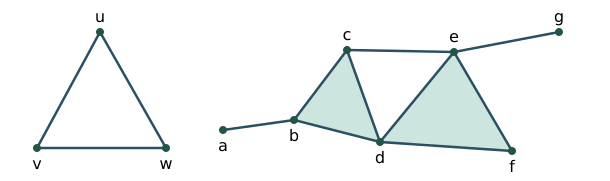
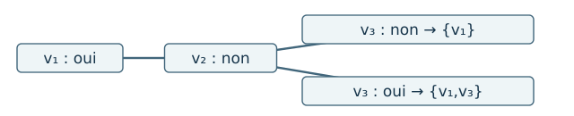

# ENS · MP-PC · Mathématiques-informatique 2004 — corrigé brut

*Corrigé rédigé par IA, non officiel. Signalez toute erreur.*

**Rédaction** · GPT-6.2 Astra Ultra · vitesse non renseignée · 25 novembre 2026

**Révision** · GPT-6.2 Astra Ultra · vitesse non renseignée · 26 novembre 2026

Toutes les chaînes sont à coefficients réels. Les simplexes sont non vides. On note rₚ le rang du bord dₚ et βₚ le nombre de Betti en dimension p. Les flèches d’un appariement montent et les incidences non appariées descendent.

## Partie 1 · Calculs matriciels

### Question 1.1 · Résidu orthogonal

Posons $v'=v-\sum_{i<k}(v\cdot v_i)v_i/\|v_i\|^2$. Pour chaque $j<k$, le produit par $v_j$ élimine tous les termes sauf celui de rang $j$, qui annule $v\cdot v_j$. De plus $v-v'$ est dans l’espace des premiers vecteurs. Remplacer $v$ par $v'$ ne change donc pas l’espace engendré, dans les deux sens.

### Question 1.2 · Rôle de GS1

Au rang $j$, le programme calcule $s=v_j\cdot w$ pour la colonne courante $w$ et $t=\|v_j\|^2$. Si $t\ne0$, il remplace $w$ par $w-(s/t)v_j$. Les soustractions antérieures sont orthogonales à $v_j$, donc $s=v_j\cdot v_k^{\rm initial}$. Une colonne nulle est ignorée. En sortie seule la colonne $k$ a changé et elle est le résidu orthogonal de 1.1 pour les colonnes antérieures non nulles.

### Question 1.3 · Correction et coût de GS

Après $k$ passages, les $k$ premières colonnes sont orthogonales et engendrent l’espace des $k$ premières colonnes d’entrée. L’invariant est vrai au préfixe vide et se propage par 1.1 et 1.2. Un couple $j<k$ impose au plus $Cm+C$ opérations pour une constante uniforme $C$. Les $n(n-1)/2$ couples donnent $O(n^2m)$ opérations pour $m,n\ge1$.

### Question 1.4 · Noyau par les colonnes

Les colonnes non nulles de la sortie sont orthogonales, donc indépendantes. Leur nombre est le rang $r$ de $A$. Balayer les colonnes pour tester si elles sont nulles coûte $O(mn)$. Le théorème du rang donne $\dim\ker A=n-r$, en $O(n^2m)$ opérations au total.

### Question 1.5 · Passer aux lignes

Les rangs de $A$ et $A^T$ sont égaux. Orthogonaliser les $m$ colonnes de $A^T$, de longueur $n$, donne donc $r$ en $O(m^2n)$. La dimension cherchée reste $n-r$, puisque le domaine est celui de $A$.

### Question 1.6 · Choisir la petite dimension

Si $n\le m$, calculer le rang sur les colonnes. Sinon le calculer sur les lignes. Renvoyer $n-r$. Le coût est $O(\min(m,n)^2\max(m,n))$. Pour une matrice sans ligne ou sans colonne, le rang est directement nul.

## Partie 2 · Complexes simpliciaux et homologie

### Question 2.1 · Deux faces successives

Pour $i<j$, retirer le sommet $j$ puis le sommet $i$ laisse la même face que retirer $i$ puis le sommet devenu de rang $j-1$. Ainsi $\partial_i\partial_j\sigma=\partial_{j-1}\partial_i\sigma$.

### Question 2.2 · Le bord du bord

Pour chaque paire originale $i<j$, la double suppression dans $d_{p-1}d_p$ porte les deux signes $(-1)^{i+j}$ et $(-1)^{i+j-1}$. Les faces sont identiques par 2.1, donc les termes s’annulent deux à deux. Pour $p=1$, $d_0=0$. Par linéarité le composé est nul sur toute chaîne, d’où $\operatorname{Im}d_p\subset\ker d_{p-1}$.

### Question 2.3 · Euler–Poincaré

Écrire $r_p=\operatorname{rang} d_p$, avec $r_0=0$. Puisque $Z_p=B_p\oplus H_p$, $\beta_p=|K_p|-r_p-r_{p+1}$. Dans la somme alternée sur $p$, les contributions de chaque $r_j$, $j\ge1$, arrivent deux fois avec signes contraires. Les sommes sont finies. Ainsi $\sum_p(-1)^p\beta_p=\sum_p(-1)^p|K_p|=\chi(K)$.

### Question 2.4 · Contour du triangle

Dans les bases $u,v,w$ et $uv,uw,vw$, les trois colonnes de $d_1$ sont $v-u,w-u,w-v$. Leur rang vaut deux, et leur relation est $d_1(uv-uw+vw)=0$. Comme il n’y a pas de triangle plein, $r_2=0$. Ainsi $\beta_0=1$, $\beta_1=1$, $\beta_p=0$ ensuite, et $\chi=3-3=0$.



## Partie 3 · Calculer et préserver les nombres de Betti

### Question 3.1 · Un seul noyau

Dans les bases orthonormées, $(\operatorname{Im}d_{p+1})^\perp=\ker(d_{p+1}^T)$. Ainsi $H_p=\ker d_p\cap\ker d_{p+1}^T$, noyau de la matrice obtenue en empilant $d_{p+1}^T$ puis $d_p$. Ces deux blocs ont exactement $|K_p|$ colonnes.

### Question 3.2 · Construire la matrice

Posons $b=c[p]$, $u=c[p+1]$, $l=c[p-1]$, avec zéro hors des dimensions représentées. Si $b=0$, renvoyer zéro. Si $u+l=0$, renvoyer $b$.
```text
M ← matrice nulle de (u+l) lignes et b colonnes
pour j de 1 à u
    pour i de 0 à p+1
        M[j, face[p+1,j,i]] ← (−1)^i
si p > 0
    pour j de 1 à b
        pour i de 0 à p
            M[u+face[p,j,i], j] ← (−1)^i
renvoyer dimension_noyau(M)
```
Les faces d’un simplexe sont distinctes, donc les affectations construisent exactement les colonnes signées. Notons $m=u+l$. Coût $O(mb+(p+2)u+(p+1)b+\min(m,b)^2\max(m,b))$, avec les boucles réellement présentes. Pour des dimensions positives, les incidences sont au plus $mb$ car les faces d’une colonne sont distinctes. Le terme de rang domine. Espace $O(mb)$.

### Question 3.3 · Ajouter un simplexe

Seul $|K_p|$ augmente d’un, et seul $r_p$ peut changer par adjonction de la colonne $d'_p\gamma$. Le bord suivant n’a aucune composante sur $\gamma$, puisque aucune coface de $\gamma$ n’était dans $K$. Si la colonne est déjà dans l’image de $d_p$, les rangs restent inchangés et $\beta_p$ augmente d’un. Sinon $r_p$ augmente d’un, donc $\beta_p$ reste fixe et $\beta_{p-1}$ diminue d’un. Ce dernier cas exige $p\ge1$ car $d_0=0$. Les autres nombres de Betti restent inchangés.

### Question 3.4 · Contraction d’une face libre

Soit $\alpha$ la face directe retirée avec $\beta$. Toute autre coface de $\alpha$ serait restée dans $K$ malgré l’absence de $\alpha$, impossible. Les faces propres de $\alpha$ sont dans $K$, donc $K\cup\{\alpha\}$ est un complexe. $K\cup\{\beta\}$ omet une face et ne l’est pas. Écrire $d\beta=\pm\alpha+t$ avec $t$ chaîne dans $K$. Comme $d^2=0$, $d\alpha=\mp dt$ est un bord dans $K$, donc $\alpha$ crée un cycle au sens du sujet. Mais aucun autre simplexe présent n’a pour face $\alpha$. La composante de $d\beta$ en $\alpha$ exclut donc cette colonne de l’image antérieure. L’ajout de $\beta$ détruit la classe que venait de créer $\alpha$. Les deux complexes ont les mêmes nombres de Betti.

### Question 3.5 · Exemple de droite

L’invariance se transmet le long de toute suite finie de contractions et d’expansions. Dans le complexe de droite, sept sommets sont reliés, donc $r_1=6$ (les six arêtes d’un arbre donnent six différences indépendantes et tout bord d’arête a somme nulle). Les deux triangles pleins ont des arêtes propres, donc leurs bords sont indépendants et $r_2=2$. Avec $(|K_0|,|K_1|,|K_2|)=(7,9,2)$ on trouve $(\beta_0,\beta_1,\beta_2)=(1,1,0)$ et $\chi=0$.

## Partie 4 · Champs de vecteurs discrets

### Question 4.1 · Retirer une paire

Fixons $\alpha=\alpha_{\max}(K')$. Son partenaire $\beta$ est dans $K'$ par normalité. Comme $\alpha$ est de dimension maximale, $\beta\triangleright\alpha$ et $\beta$ est sa face directe. Si une autre coface directe $\gamma$ de $\beta$ était dans $K'$, elle aurait la dimension maximale de $\alpha$, et $\gamma\to\beta\to\alpha$ car $\beta$ est déjà appariée à $\alpha$. Cela contredit le choix de $\alpha$. Il n’y a pas de coface de dimension supérieure. La face $\beta$ est donc libre, le retrait de la paire donne un sous-complexe. Toute autre paire est intacte, d’où sa normalité.

### Question 4.2 · Retirer un simplexe critique

Le simplexe $\alpha$ est maximal en dimension, donc n’est face d’aucun autre simplexe de $K'$. Sa suppression laisse le complexe fermé par faces. Comme il n’a pas de partenaire, aucune paire n’est divisée. Le résultat est normal.

### Question 4.3 · Inégalités fortes et égalité de Morse

Partir du vide et reconstruire $K'$ dans l’ordre inverse des suppressions autorisées par 4.1 et 4.2. Notons $D_m=\sum_{p=0}^m(-1)^{m-p}(c_p-\beta_p)$. Une paire contractile ne modifie ni les Betti ni les nombres critiques. Ajouter un simplexe critique de dimension $q$ augmente $c_q$ d’un. S’il crée un cycle, $\beta_q$ augmente aussi et $D_m$ reste inchangé. Sinon $q\ge1$ et $\beta_{q-1}$ diminue d’un. Ainsi les différences $c_p-\beta_p$ augmentent simultanément d’un pour $p=q-1,q$. La variation de $D_m$ vaut un pour $m=q-1$ et zéro pour les autres $m$. Depuis $D_m=0$ dans le vide, on obtient $D_m\ge0$. La somme alternée complète des différences reste nulle dans tous les cas. La formule d’Euler–Poincaré donne $\chi(K')=\sum_p(-1)^pc_p$.

### Question 4.4 · Inégalités faibles

Avec $D_{-1}=0$, on a $c_p-\beta_p=D_p+D_{p-1}$. Les deux termes sont positifs ou nuls par 4.3. En prenant $K'=K$, $c_p(K)\ge\beta_p(K)$.

## Partie 5 · Nombre de questions d’un arbre de décision

### Question 5.1 · Partenaire du dernier test

Prolongeons, si nécessaire, une branche déjà décidée en posant les questions restantes dans un ordre déterministe commun. Sur l’entrée $\alpha$, modifier la réponse au dernier test conserve toute l’histoire avant ce test. Les deux exécutions posent donc la même dernière question, que son sommet soit retiré ou ajouté. Ainsi $\check\alpha=\alpha\mathbin{\triangle}\{v_{\sigma_\alpha(n)}\}$ a pour partenaire $\alpha$ et l’opération est une involution sans point fixe. Réciproquement, toute paire déclarée par la règle diffère exactement en cette dernière réponse. Le partenaire est unique.

### Question 5.2 · Ordre des suites

Compléter chaque suite finie par une infinité de symboles $+\infty$, supérieurs à tous les entiers. La relation est l’ordre lexicographique strict sur ces suites complétées. En particulier une extension propre vient avant son préfixe. L’irréflexivité est immédiate. Pour la transitivité, considérer la première des deux positions de différence entre $u,v$ puis $v,w$. Les trois préfixes antérieurs coïncident et à cette position $u$ est strictement inférieur à $w$, même lorsque les deux positions coïncident.

### Question 5.3 · Acyclicité sur le complexe

Notons $L(\alpha)$ la liste croissante des rangs des réponses positives. Pour une paire montante $\beta\triangleright\alpha$, les permutations coïncident et $L(\alpha)$ prolonge $L(\beta)$ par le rang $n$. Comme $\check\beta=\alpha$ et $\check\alpha=\beta$, on a $L(\check\beta)\prec L(\check\alpha)$.

Il reste à établir l’inégalité demandée pour une flèche descendante non appariée $\beta\to\alpha$. Écrivons $\alpha=\beta\setminus\{v\}$, et soit $k$ le rang du test de $v$ sur $\beta$. On a $k<n$, car le retrait du dernier sommet testé formerait une paire appariée dont la flèche serait ascendante. Sur $\alpha$ et $\beta$, les questions posées jusqu’au rang $k$ sont identiques, ainsi que les réponses avant $k$. Le changement en $\check\alpha$ et $\check\beta$ ne modifie que la dernière réponse de chacune de ces exécutions. Les deux listes $L(\check\beta)$ et $L(\check\alpha)$ ont donc le même préfixe avant $k$. La première a ensuite l’indice $k$, alors que la seconde a un indice supérieur ou se termine. Dans l’ordre de 5.2, cela donne bien $L(\check\beta)\prec L(\check\alpha)$.

Cette même mesure augmente strictement sur toute flèche. Un circuit contredirait la transitivité et l’irréflexivité de $\prec$. Chaque simplexe de $K$ conserve au plus un partenaire par 5.1, et toute paire restante relie une face directe à sa coface. On obtient ainsi le champ de vecteurs discret acyclique demandé.



### Question 5.4 · Borne de Kahn–Saks–Sturtevant

Dans la restriction de l’appariement à $K$, un simplexe critique a son partenaire hors de $K$. Au plus un est apparié au vide. Chaque autre simplexe critique fournit deux sous-ensembles non vides évasifs, lui et son partenaire extérieur. Ces paires sont disjointes par 5.1. Le nombre d’ensembles évasifs vaut donc au moins $2(\sum_p c_p-1)\ge2(\sum_p\beta_p-1)$ par 4.4. Si la somme des Betti est au moins deux, aucun reconnaisseur n’est efficace. Les deux complexes de la figure 1 ont $\beta_0+\beta_1=2$, donc tous leurs reconnaisseurs présentent au moins deux entrées évasives.
