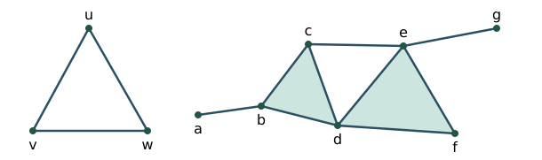
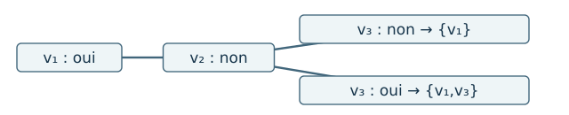

# ENS · MP-PC · Mathématiques-informatique 2004 — corrigé guidé

*Corrigé rédigé par IA, non officiel. Signalez toute erreur.*

**Rédaction** · GPT-6.2 Astra Ultra · vitesse non renseignée · 25 novembre 2026

**Révision** · GPT-6.2 Astra Ultra · vitesse non renseignée · 26 novembre 2026

Un triangle rempli et son seul contour se distinguent par leurs cycles qui ne sont pas des bords. Le sujet relie le calcul de ces cycles au nombre de questions qu’un arbre de décision doit poser pour reconnaître un simplexe.

## Partie 1 · Calculs matriciels

### Question 1.1 · Résidu orthogonal

Pour enlever la composante de $v$ le long de $v_j$, diviser son produit scalaire avec $v_j$ par la norme carrée de ce dernier. Les directions étant orthogonales, enlever une composante ne perturbe pas les autres. La différence des deux derniers vecteurs est une combinaison de ceux qui sont restés dans la famille, d’où l’égalité des espaces.

### Question 1.2 · Rôle de GS1

Lire les deux accumulateurs comme un produit scalaire et une norme carrée. La garde avant la division permet de traverser les colonnes nulles, qui n’apportent aucune direction. À chaque tour, une nouvelle composante disparaît sans réintroduire celles déjà éliminées. Toutes les autres colonnes restent en place.

### Question 1.3 · Correction et coût de GS

Ajouter à chaque tour une colonne résiduelle au préfixe déjà orthogonal. Elle est perpendiculaire à ce préfixe et garde avec lui le même espace que la colonne originale, même si elle devient nulle. Pour le coût, chaque paire de colonnes déclenche au plus deux balayages de $m$ cases, avec un nombre fixe d’opérations par case. Il y a moins de $n^2/2$ paires.

### Question 1.4 · Noyau par les colonnes

Une colonne qui s’annule était déjà dans l’espace des précédentes. Chaque colonne non nulle ajoute au contraire une direction indépendante. Compter les directions donne la dimension de l’image, à retrancher du nombre de colonnes pour obtenir celle du noyau.

### Question 1.5 · Passer aux lignes

L’orthogonalisation des lignes fournit aussi le rang. Le gain vient de l’échange des deux dimensions dans le coût. Une fois le rang calculé, reprendre la dimension du domaine initial pour appliquer le théorème du rang.

### Question 1.6 · Choisir la petite dimension

La dimension qui compte les vecteurs est celle qui intervient au carré. Choisir donc le sens de la matrice qui présente le moins de vecteurs à orthogonaliser, puis soustraire ce rang de $n$. En dimension nulle aucun calcul de rang n’est nécessaire.

## Partie 2 · Complexes simpliciaux et homologie

### Question 2.1 · Deux faces successives

Suivre les lettres dans la liste triée des sommets. Supprimer un rang après $i$ ne décale pas $i$. Supprimer $i$ décale d’une place vers la gauche tous les rangs strictement supérieurs. Les deux procédures rayent donc les mêmes sommets.

### Question 2.2 · Le bord du bord

Pour former une face de codimension deux il faut oublier deux sommets. Deux ordres sont possibles et leurs signes diffèrent parce que le plus grand indice diminue après retrait du plus petit. Les contributions opposées s’effacent. En degré un la seconde application est déjà nulle. Chaque bord appartient donc au noyau du bord suivant.

### Question 2.3 · Euler–Poincaré

Décomposer les chaînes en ce qui sort par le bord et ce qui reste dans le noyau. Dans le noyau, distinguer ensuite les bords venus du degré supérieur et leur complément orthogonal. Le nombre de simplexes au degré $p$ est donc $r_p+\beta_p+r_{p+1}$. Alterner les signes fait disparaître chaque rang et ne conserve que les dimensions d’homologie.

### Question 2.4 · Contour du triangle

Les trois arêtes relient les trois sommets, ce qui laisse une seule classe en degré zéro. Leur somme orientée autour du contour est un cycle. Les deux premières colonnes du bord étant indépendantes, c’est le seul cycle à un facteur près. Aucun simplexe de dimension deux ne vient le remplir. Les deux nombres de Betti non nuls valent un et s’annulent dans la somme alternée.



## Partie 3 · Calculer et préserver les nombres de Betti

### Question 3.1 · Un seul noyau

Un représentant harmonique doit avoir bord nul et être orthogonal à chaque colonne du bord venu d’en haut. Ce second système s’écrit à l’aide de la transposée. Écrire les deux systèmes l’un au-dessus de l’autre donne une unique recherche de noyau.

### Question 3.2 · Construire la matrice

Prévoir une colonne par simplexe de dimension $p$. Les lignes du haut correspondent aux simplexes de dimension $p+1$ et celles du bas aux faces de dimension $p-1$.
```text
si p est hors tableau ou c[p] = 0 : renvoyer 0
haut ← c[p+1] ou 0 hors tableau
bas ← c[p−1] ou 0 hors tableau
si haut+bas = 0 : renvoyer c[p]
initialiser à zéro M[haut+bas, c[p]]
pour chaque simplexe j de dimension p+1
    pour chaque position i de sa liste de faces
        écrire le signe alterné (−1)^i en ligne j, colonne face[p+1,j,i]
pour chaque simplexe j de dimension p, si p > 0
    pour chaque position i de sa liste de faces
        écrire le signe (−1)^i en ligne haut+face[p,j,i], colonne j
renvoyer la dimension du noyau selon 1.6
```
Le premier bloc est transposé au moment même de l’écriture. L’initialisation et les incidences coûtent au plus l’ordre de la taille du tableau. Pour $m$ lignes et $b$ colonnes non vides, le coût dominant est $O(\min(m,b)^2\max(m,b))$.

### Question 3.3 · Ajouter un simplexe

La nouvelle colonne du bord peut soit répéter une combinaison de colonnes existantes, soit ajouter une direction. Dans le premier cas, la nouvelle chaîne peut être corrigée par une ancienne chaîne de même bord pour devenir un cycle indépendant. Dans le second, sa nouvelle image fait disparaître une classe du degré inférieur. La formule $\beta_q=|K_q|-r_q-r_{q+1}$ vérifie précisément ces deux variations et exclut tout autre changement.

### Question 3.4 · Contraction d’une face libre

Remettre d’abord la petite face est permis car toutes ses faces sont là. Remettre seulement la grande laisserait précisément cette petite face absente. Le bord de la grande s’écrit comme la petite face signée plus une chaîne ancienne. Son bord étant nul, le bord de la petite face était déjà réalisable. La petite crée donc une classe. Le bord de la grande contient une coordonnée que n’utilise aucun autre bord de ce degré, puisque la petite face était libre. Le second ajout fait alors disparaître une classe dans la dimension de la petite, ce qui compense exactement le premier.

### Question 3.5 · Exemple de droite

Deux complexes simplement homotopes ont les mêmes nombres de Betti à chaque degré, puisqu’une étape conserve ces nombres dans les deux sens. Dans la figure de droite, retirer les deux arêtes pendantes avec leurs sommets terminaux, puis chaque triangle plein avec une arête libre. Le graphe connecté restant possède un seul circuit indépendant. On peut aussi vérifier les dimensions par $7-9+2=0$ et par l’indépendance des deux colonnes du bord en dimension deux. Les seuls nombres de Betti non nuls valent un en degrés zéro et un.

## Partie 4 · Champs de vecteurs discrets

### Question 4.1 · Retirer une paire

La normalité empêche de séparer les deux membres de la paire. Celui de plus grande dimension est ici $\alpha$. Une deuxième face maximale appuyée sur sa petite face donnerait un chemin orienté depuis cette autre face maximale vers $\alpha$, en descendant puis en remontant. Ce chemin est interdit par le choix de $\alpha$. Les deux simplexes peuvent donc être enlevés ensemble sans faire perdre une face à un simplexe restant et sans couper un autre appariement.

### Question 4.2 · Retirer un simplexe critique

Deux conditions sont à vérifier. Aucune face nécessaire aux simplexes gardés ne disparaît car le simplexe enlevé est maximal. Aucun partenaire ne reste isolé car le simplexe enlevé était critique. On a donc encore un sous-complexe normal.

### Question 4.3 · Inégalités fortes et égalité de Morse

Raisonner à rebours, en ajoutant ce que l’on sait retirer. Les paires de simplexes ne changent aucune quantité à comparer. Pour un simplexe critique, faire le tableau des deux cas de 3.3. S’il apporte une classe à son degré, le compte critique augmente en même temps et les écarts restent fixes. S’il fait disparaître une classe juste en dessous, les écarts $c-\beta$ gagnent une unité à deux degrés consécutifs. Une somme alternée tronquée ne voit alors une augmentation que si elle s’arrête au premier de ces degrés, auquel cas elle gagne un. Toutes sont initialement nulles et restent positives ou nulles. La somme alternée entière ne change jamais, ce qui donne l’égalité de Morse avec 2.3.

### Question 4.4 · Inégalités faibles

Additionner les inégalités fortes arrêtées à deux degrés consécutifs. Tous les termes plus anciens ont des signes contraires et disparaissent. Il reste exactement la comparaison entre simplexes critiques et classes d’homologie au degré voulu.

## Partie 5 · Nombre de questions d’un arbre de décision

### Question 5.1 · Partenaire du dernier test

Suivre les $n-1$ premières réponses. Elles déterminent la branche et le seul sommet qui reste à tester. Parmi les ensembles compatibles avec ces réponses, deux possibilités restent, selon la présence de ce sommet. Chacune a exactement l’autre pour partenaire. Cet argument fonctionne aussi pour une branche prolongée après une décision anticipée.

### Question 5.2 · Ordre des suites

Pour comparer deux listes, lire jusqu’au premier désaccord. Si une liste se termine, donner à son symbole de fin une valeur plus grande que tous les indices. Aucune liste ne diffère d’elle-même. Pour trois listes ordonnées successivement, le premier désaccord rencontré dans l’une des deux comparaisons assure déjà le bon sens entre la première et la troisième, par transitivité des entiers si les désaccords sont simultanés.

### Question 5.3 · Acyclicité sur le complexe

Au sein d’une paire, l’entrée haute ajoute la réponse positive de dernier rang. Sa liste, plus longue et de même préfixe, vient avant celle de l’entrée basse. Échanger chaque membre avec son partenaire donne l’inégalité demandée.

Suivre ensuite une descente non appariée $\beta\to\alpha$. Quel sommet disparaît, et quand a-t-il été testé ? Son rang $k$ est inférieur à $n$. S’il avait été testé en dernier, les deux entrées formeraient une paire orientée dans le sens montant. Les deux exécutions prennent le même chemin jusqu’à la question $k$, où la réponse passe de oui à non. Passer aux partenaires $\check\beta$ et $\check\alpha$ laisse intactes les $n-1$ premières réponses de chaque exécution. Les listes de leurs réponses positives coïncident donc avant $k$. La liste de $\check\beta$ donne ensuite $k$, et celle de $\check\alpha$ donne un rang supérieur ou se termine. Dans les deux cas, la règle de 5.2 place la première strictement avant la seconde.

La liste du partenaire augmente donc strictement à chaque flèche, montante ou descendante. Elle ne peut revenir à son point de départ. La restriction à $K$ conserve la propriété de partenaire unique et chaque paire monte d’une seule dimension. Le champ est acyclique.



### Question 5.4 · Borne de Kahn–Saks–Sturtevant

Une paire qui reste entièrement dans le complexe ne fournit aucun simplexe critique. Tout simplexe critique est donc relié à une entrée extérieure. Si cette entrée est non vide, les deux extrémités de la paire vérifient la définition d’évasivité. L’exception éventuelle du vide ne coûte qu’une paire puisqu’il n’a qu’un seul partenaire. Les inégalités faibles de Morse garantissent au moins autant de simplexes critiques que la somme des nombres de Betti. Ôter une unité puis doubler donne la borne. Le contour du triangle comme le complexe à deux faces pleines ont tous deux une composante et un cycle indépendant non bordant. Leur somme de Betti vaut deux, ce qui empêche une reconnaissance efficace.
