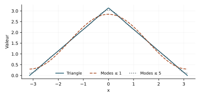

# ENS Paris et Cachan — Mathématiques MP, session 2004 · Corrigé brut

*Corrigé rédigé par IA, non officiel. Signalez toute erreur.*

**Rédaction** · GPT-6.2 Astra Ultra · vitesse non renseignée

**Révision** · GPT-6.2 Astra Ultra · vitesse non renseignée

Les coefficients de Fourier mesurent la régularité des fonctions périodiques. Les symboles décrivent ensuite les opérateurs qui changent cette régularité et permettent de résoudre une équation différentielle avec un défaut aussi régulier qu’on le souhaite.

L’épreuve commune dure quatre heures, avec les coefficients 4 pour Paris et 5 pour Cachan. Le jury corrige l’indice de norme en I.3 et demande de justifier les permutations de sommes. [Sujet officiel](https://banques-ecoles.fr/cms/wp-content/data/filiere-mp/annales-de-la-banque-mp/session-2004/sujet-2004-ecrit-mp_mathematiques_cachan_paris.pdf) · [Rapport du jury](https://banques-ecoles.fr/cms/wp-content/data/filiere-mp/rapports-des-jurys-de-la-banque-mp/rapport-de-jury-session-2004/rapport-2004-mp_ecrit_mathematiques_cachan_paris.pdf)

## I. Normes de fonctions périodiques

### Question I.1

L’inégalité $|\phi(x)|^2\le N_\infty(\phi)^2$ intégrée sur une période donne $N_2(\phi)\le\sqrt{2\pi}\,N_\infty(\phi)$. Une constante non nulle réalise l’égalité.

Les conventions utilisées dans la suite sont $e_n(x)=e^{inx}$, $c_n(\phi)=(2\pi)^{-1}\int_0^{2\pi}\phi(x)e^{-inx}\,dx$ et $\|\phi\|_s^2=\sum_{n\in\mathbb Z}(1+n^2)^s|c_n(\phi)|^2$. En particulier, le facteur $2\pi$ de Parseval donne $N_2(\phi)=\sqrt{2\pi}\|\phi\|_0$.

### Question I.2

On a $\int|\phi|^4\le N_\infty(\phi)^2\int|\phi|^2$. En prenant la racine quatrième, $N_4(\phi)\le N_2(\phi)^{1/2}N_\infty(\phi)^{1/2}$.

### Question I.3

Pour $s>1/2$, $C(s)=(\sum_{n\in\mathbb Z}(1+n^2)^{-s})^{1/2}<\infty$. Cauchy–Schwarz donne $\sum_n|c_n(\phi)|\le C(s)\|\phi\|_s$. Lorsque la norme est finie, la série de Fourier converge normalement vers une fonction continue dont les coefficients sont ceux de $\phi$. Par Parseval, sa différence avec $\phi$ est nulle, donc $N_\infty(\phi)\le C(s)\|\phi\|_s$. Si la norme est infinie la borne est immédiate. L’indice $s$ est la correction signalée au rapport.

### Question I.4

La moyenne du triangle vaut $c_0=\pi/2$. Pour $n\ne0$,
$$c_n=\frac1\pi\int_0^\pi(\pi-x)\cos(nx)dx=\frac{1-(-1)^n}{\pi n^2}.$$
La fonction est continue et ses pentes sont opposées de part et d’autre de zéro, donc $\phi\in C^p_{\rm per}$ exactement pour $p=0$ parmi les entiers naturels. La série pondérée, hors du terme constant, est de même nature que $\sum_{n>0,\ n\,\mathrm{impair}}n^{2s-4}$. Ainsi $\phi\in H^s$ exactement pour $s<3/2$, avec divergence harmonique à l’extrémité.

Pour vérifier directement la constante du mode non nul, une première intégration par parties élimine le terme de bord en sinus et donne $n^{-1}\int_0^\pi\sin(nx)\,dx=(1-(-1)^n)/n^2$ avant la division par $\pi$. Le mode $n=0$ se calcule à part par l’aire du triangle.

### Question I.5

Sur $[-\pi,\pi]$ prenons $h_j(x)=\max(1-j|x|,0)$ pour $j\ge1$, prolongée périodiquement. Elle est continue, $N_\infty(h_j)=1$ et $N_2(h_j)^2=2\int_0^{1/j}(1-jx)^2dx=2/(3j)$. Le quotient tend vers l’infini, d’où l’impossibilité d’une constante universelle.

### Question I.6

L’intégration par parties donne $c_n(\phi')=in c_n(\phi)$, avec annulation des termes de bord par périodicité. Donc $\|\phi\|_1^2=(N_2(\phi)^2+N_2(\phi')^2)/(2\pi)<\infty$ pour $\phi\in C^1_{\rm per}$.

### Question I.7

La fonction triangulaire de I.4 est dans $H^1$ car $1<3/2$ et n’est pas dérivable en zéro. C’est une fonction continue périodique ayant les propriétés demandées.

### Question I.8.1

Pour $\phi\in C^\infty_{\rm per}$, des intégrations par parties répétées donnent $|c_n(\phi)|\le C_N(1+|n|)^{-N}$ à tout ordre. Ainsi $\phi\in H^s$. L’application $\phi\mapsto((1+n^2)^{s/2}c_n(\phi))_n$ est linéaire et injective par Parseval. Sa norme dans $\ell^2$ est $\|\phi\|_s$ : positivité, homogénéité et inégalité triangulaire résultent de ces propriétés dans $\ell^2$.

### Question I.8.2

En prenant la convention linéaire dans le premier argument, posons $\langle\phi,\eta\rangle_s=\sum_n(1+n^2)^s c_n(\phi)\overline{c_n(\eta)}$. La série converge absolument par Cauchy–Schwarz. C’est un produit hermitien, défini positif par injectivité, et $\langle\phi,\phi\rangle_s=\|\phi\|_s^2$.

### Question I.8.3

Les fonctions $g_n=(1+n^2)^{-s/2}e_n$ forment une famille orthonormée puisque les coefficients des modes sont des symboles de Kronecker. Les sommes $\sum_{|n|\le N}c_n(\phi)e_n$ appartiennent à leur espace engendré et l’erreur en norme au carré est la queue $\sum_{|n|>N}(1+n^2)^s|c_n(\phi)|^2\to0$. Cela prouve la densité demandée.

### Question I.8.4

Comme $c_{n+p}(M_p\phi)=c_n(\phi)$, la norme de l’opérateur vaut $\sup_{n\in\mathbb Z}R_p(n)^{s/2}$ avec $R_p(n)=(1+(n+p)^2)/(1+n^2)$. La majoration suit de la somme pondérée et chaque quotient est réalisé sur un mode normalisé. Il suffit d’étudier $p\ge0$ par symétrie. Pour $p\ge2$, $(1+p^2)(1+n^2)-(1+(n+p)^2)=pn(pn-2)\ge0$ sur les entiers, et $n=0$ donne l’égalité. Pour $p=0$ la norme vaut $1$. Pour $p=1$, $R_1(n)\le5/2$ équivaut à $(3n-1)(n-1)\ge0$, vrai pour tout entier, avec égalité en $1$. La réponse est donc $(1+p^2)^{s/2}$ pour $p\ne\pm1$ et $(5/2)^{s/2}$ pour $p=\pm1$. Ces valeurs finies établissent aussi la continuité.

## II. Opérateurs définis par un symbole périodique

### Question II.1.1

Pour une dérivée d’ordre $r$ du terme $a(x,n)c_n(\phi)e^{inx}$, Leibniz donne la somme sur $j=0,\ldots,r$ des termes $\binom rj(\partial_x^j a)(in)^{r-j}c_n(\phi)e^{inx}$. Leur module total est au plus $C_r(1+|n|)^{m+r}|c_n(\phi)|$. Les coefficients de $\phi$ décroissent à tout ordre. Les séries dérivées convergent donc normalement pour tout $r$. La somme est lisse, périodique et dépend linéairement de $\phi$.

### Question II.1.2

Pour $\phi\in C^p_{\rm per}$, les intégrations par parties donnent $|c_n(\phi)|\le C(1+|n|)^{-p}$. Si $p>m+1$, la série du symbole appliqué est normalement convergente, car ses termes sont majorés par $C'(1+|n|)^{m-p}$. Elle définit une fonction continue périodique, comme demandé.

### Question II.2

Toutes les dérivées en $x$ de $a(x)$ sont bornées par périodicité et les dérivées d’ordre positif en $\xi$ sont nulles. Il s’agit d’un symbole d’ordre zéro. On obtient $T_a\phi=a(x)\sum_n c_n(\phi)e_n(x)=a\phi$, la série étant normalement convergente pour $\phi$ lisse.

### Question II.3

Le symbole $i\xi$ est linéaire, de dérivée constante, de dérivées supérieures nulles et indépendant de $x$. Il est d’ordre un. Comme $e_n'=in e_n$ et $e_n''=-n^2e_n$, on a $T_{i\xi}\phi=\phi'$ et $T_{\xi^2}\phi=-\phi''$ par dérivation terme à terme.

### Question II.4.1

Pour $p\ne0$, $N$ intégrations par parties donnent $|\widehat a(p,\xi)|\le |p|^{-N}\sup_x|\partial_x^Na(x,\xi)|$. L’ordre zéro rend cette borne uniforme pour les fréquences $\xi$ du symbole. Pour $p=0$, utiliser la borne de $a$. L’ajustement d’une constante donne $A_N(1+|p|)^{-N}$. Les opérateurs du sujet n’utilisent que $\xi\in\mathbb Z$. Si « pour tout $\xi$ » est interprété sur $\mathbb R$ alors que les estimations de la définition ne sont exigées que sur $\mathbb Z$, cette extension demande aussi ces estimations sur $\mathbb R$ : par exemple $a(x,\xi)=e^{\xi^2}\eta(\xi)$ avec $\eta$ lisse périodique non nulle, nulle dans un voisinage des entiers, s’annule à tout ordre aux entiers sans être borné sur $\mathbb R$.

### Question II.4.2

Pour chaque entier $n$, $a(y,n)=\sum_p\widehat a(p,n)e_p(y)$ normalement par II.4.1. En substituant dans $T_a\phi$, la série des modules est majorée par $A_2\sum_p(1+|p|)^{-2}\sum_n|c_n(\phi)|<\infty$. En permutant les sommes on obtient $T_a\phi(y)=\sum_pe_p(y)\sum_n\widehat a(p,n)c_n(\phi)e_n(y)=\sum_pe_p(y)(T_{f_p}\phi)(y)$.

### Question II.4.3

Parseval ou la définition de la norme donne $\|T_{f_p}\phi\|_0\le A_N(1+|p|)^{-N}\|\phi\|_0$. Multiplier par $e_p$ est isométrique en norme zéro. La somme des normes sur $p$ converge pour $N>1$. L’inégalité triangulaire et II.4.2 donnent $\|T_a\phi\|_0\le A_N\sum_p(1+|p|)^{-N}\|\phi\|_0$.

### Question II.4.4

Le multiplicateur $T_{f_p}$ satisfait la même borne en norme $s$ qu’en norme zéro, car il agit diagonalement. D’après I.8.4, $\|M_p\|\le C_s(1+|p|)^s$. Ainsi la norme du $p$-ième terme est au plus $C_s A_N(1+|p|)^{s-N}\|\phi\|_s$. Choisissons $N>s+1$ et sommons. L’égalité de II.4.2 identifie le résultat par ses coefficients de Fourier, ce qui donne la borne demandée.

### Question II.5

Pour $b(\xi)=1+i\xi$, $T_b=1+\partial_x$ et $(T_b)^{-1}=T_{(1+i\xi)^{-1}}$ sur les fonctions lisses, car tous les modes diagonaux sont inversibles. Alors $T_a(T_b)^{-m}=T_c$ avec $c=a(1+i\xi)^{-m}$, d’ordre zéro par Leibniz et les bornes $|\partial_\xi^j(1+i\xi)^{-m}|\le C_j(1+|\xi|)^{-m-j}$. Donc $T_a=T_c(T_b)^m$. Comme $|1+in|^2=1+n^2$, $\|(T_b)^m\phi\|_s=\|\phi\|_{s+m}$, et II.4.4 conclut.

### Question II.6

Pour $m=-k<0$, $c=a(1+i\xi)^k$ est d’ordre zéro, et $T_a=T_c(T_b)^{-k}$. Le calcul diagonal donne encore $\|(T_b)^{-k}\phi\|_s=\|\phi\|_{s-k}$. Par la borne d’ordre zéro, $\|T_a\phi\|_s\le C\|\phi\|_{s+m}$, y compris quand $s+m<0$.

## III. Composition des symboles

### Question III.1

La dérivée $\partial_x^\beta\partial_\xi^\alpha(ab)$ est la somme des produits $(\partial_x^j\partial_\xi^l a)(\partial_x^{\beta-j}\partial_\xi^{\alpha-l}b)$ avec coefficients $\binom\beta j\binom\alpha l$. Chaque terme est $O((1+|\xi|)^{m-l+m'-(\alpha-l)})$. Le produit est donc un symbole d’ordre $m+m'$ (éventuellement aussi d’un ordre inférieur).

### Question III.2

Si $a=a(x)$ et $b=b(\xi)$, $T_a$ est la multiplication par $a$ et $T_b$ multiplie chaque coefficient par $b(n)$, d’où $T_aT_b=T_{ab}$. L’ordre inverse donne en général un terme supplémentaire : pour $b=i\xi$, $T_bT_a\phi=a\phi'+a'\phi$ et $T_{ab}\phi=a\phi'$. Avec $a=e^{ix}$ et $\phi=1$ les deux résultats diffèrent. Si $a$ est constante, les deux compositions coïncident.

### Question III.3.1

Pour un mode $e_m$, $T_be_m=b(x,m)e_m=\sum_n\widehat b(n,m)e_{n+m}$. En appliquant $T_a$ et en retirant $e_m(x)$ on obtient le symbole
$$c(x,m)=\sum_n a(x,n+m)\widehat b(n,m)e^{inx}.$$
Les coefficients $\widehat b(n,m)$ sont majorés pour tout $N$ par $C_N(1+|m|)^{m'}(1+|n|)^{-N}$, où $m'$ désigne ici l’ordre de $b$. La croissance de $a$ est polynomiale en les deux indices, tandis que $c_m(\phi)$ décroît à tout ordre pour $\phi$ lisse. Cela justifie toutes les permutations des sommes. On a donc
$$T_aT_b\phi(x)=\frac1{2\pi}\sum_m\int_0^{2\pi}c(x,m)e^{im(x-z)}\phi(z)\,dz.$$
Avec la définition normalisée de $\widehat b$ en II.4.1, le second facteur $1/(2\pi)$ imprimé devant la somme définissant $c$ est superflu. Le cas $a=b=1$ l’établit immédiatement : la composée est l’identité et son symbole vaut $1$.

### Question III.3.2

Si $a$ a degré $d$ en $\xi$, Taylor donne $a(x,m+n)=\sum_{j=0}^d (\partial_\xi^ja)(x,m)n^j/j!$. Dans la série de III.3.1, $\sum_n n^j\widehat b(n,m)e^{inx}=i^{-j}\partial_x^j b(x,m)$. Donc $T_aT_b=T_c$ avec $c=\sum_{j=0}^d(\partial_\xi^ja)(\partial_x^jb)/(i^j j!)$, somme finie. Le terme principal est bien $ab$.

## IV. Application à une équation différentielle

### Question IV.1

Pour $a(x,\xi)=f(x)\xi^2+g(x)$, $T_a\phi=-f\phi''+g\phi$. L’équation est donc $T_a\phi=\psi$. Le symbole a ordre deux, car $f,g$ et leurs dérivées sont bornées et chaque dérivée en $\xi$ abaisse le degré. La stricte positivité de $f$ exclut un ordre inférieur.

### Question IV.2

La périodicité et la stricte positivité donnent $a(x,\xi)\ge c(1+\xi^2)$ pour un $c>0$. Ainsi $b=a^{-1}=O((1+|\xi|)^{-2})$. Une dérivée mixte de $b$ est une somme de termes $a^{-j-1}\prod_{l=1}^j\partial_x^{\beta_l}\partial_\xi^{\alpha_l}a$ où les nombres de dérivées se somment à $(\beta,\alpha)$. Chaque terme est $O((1+|\xi|)^{-2j-2+2j-\alpha})$. Donc $b$ est un symbole d’ordre $-2$.

### Question IV.3

Pour $b=a^{-1}$, III.3.2 donne $T_aT_b=I+T_r$, où
$$r=\frac{2f\xi}{i}\partial_x b-f\partial_x^2b.$$
Le premier terme est d’ordre $-1$, le second d’ordre $-2$. Par II.6, $R=T_r$ gagne un ordre sur les coefficients pondérés. On peut prendre $\phi_1=T_b\psi$ : alors $T_a\phi_1-\psi=R\psi\in H^1$. Pour justifier ces opérations avec $\psi$ seulement continue, l’approximer par ses sommes de Fourier en norme zéro (Parseval). La borne de II.6 pour $b$ donne convergence en norme $2$ et celle pour $r$ en norme $1$. Par I.3 les limites ont un représentant continu. L’identité s’étend par convergence des coefficients et au sens des distributions. Elle donne $\phi_1''=(g\phi_1-\psi-R\psi)/f$ continue. Une distribution dont la dérivée seconde est continue est $C^2$ : il suffit de retrancher une primitive seconde, le reste étant affine. L’identité est donc également classique.

Plus précisément, si $\psi_N$ est une somme partielle de Fourier de $\psi$, alors $\phi_N=T_b\psi_N$ converge dans la norme 2 et $R\psi_N$ dans la norme 1. Ces deux convergences impliquent la convergence uniforme par I.3. L’équation $-f\phi_N''+g\phi_N=\psi_N+R\psi_N$ passe au sens des distributions puisque $\psi_N\to\psi$ en norme zéro. Le membre droit limite est continu car $\psi$ l’est par hypothèse, même lorsque ses sommes partielles ne convergent pas uniformément.

### Question IV.4

Partons de $\phi_0=0$ et écrivons $d_0=T_a\phi_0-\psi=-\psi$. Définissons $\phi_{j+1}=\phi_j-T_b d_j$, $d_{j+1}=T_a\phi_{j+1}-\psi$. L’identité précédente donne $d_{j+1}=-R d_j$. Puisque $R$ envoie la norme $j$ dans la norme $j+1$, $d_n=(-1)^{n+1}R^n\psi$ est dans $H^n$. Les approximations et la régularité classique de IV.3 s’appliquent à chaque étape, les $d_j$ étant continus. Pour $n=0$, le choix initial convient aussi. Cela construit un candidat pour tout ordre prescrit.
