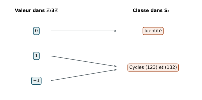

# ENS Paris et Lyon — Mathématiques MP, session 2004 · Corrigé guidé

*Corrigé rédigé par IA, non officiel. Signalez toute erreur.*

**Rédaction** · GPT-6.2 Astra Ultra · vitesse non renseignée

**Révision** · GPT-6.2 Astra Ultra · vitesse non renseignée

Une action de groupe conduit à des classes de cocycles. La construction d’une matrice inversible permet de les calculer pour le groupe linéaire. Le dernier exemple montre pourquoi un noyau trivial ne suffit pas à assurer l’injectivité d’une application d’ensembles pointés.

Le rapport du jury fournit des éléments de solution et précise la dimension de la carte locale de la partie II. On note $G^\Gamma$ le sous-groupe des éléments fixes sous toutes les actions de $\Gamma$. [Sujet officiel](https://banques-ecoles.fr/cms/wp-content/data/filiere-mp/annales-de-la-banque-mp/session-2004/sujet-2004-ecrit-mp_mathematiques_lyon_paris.pdf) · [Rapport du jury](https://banques-ecoles.fr/cms/wp-content/data/filiere-mp/rapports-des-jurys-de-la-banque-mp/rapport-de-jury-session-2004/rapport-2004-mp_ecrit_mathematiques_lyon_paris.pdf)

## I. Actions de groupes et points fixes

### Question I.1

> [!INDICATION]
> Vérifier que l’inverse d’un automorphisme respecte encore le produit.

#### Solution

La composition est associative, conserve les morphismes et les bijections, et l’identité est neutre. Pour un automorphisme $u$ et $x=u(a),y=u(b)$, $u^{-1}(xy)=u^{-1}(u(ab))=ab=u^{-1}(x)u^{-1}(y)$. Ainsi $u^{-1}$ est un automorphisme et $\operatorname{Aut} G$ est un groupe.

### Question I.2

> [!INDICATION]
> Utiliser successivement le caractère multiplicatif de chaque action et celui de l’application vers les automorphismes.

#### Solution

Comme $\Phi(\gamma)$ est un morphisme de groupes, $^{\gamma}(g_1g_2)=({}^{\gamma}g_1)({}^{\gamma}g_2)$, $^{\gamma}e_G=e_G$ et $^{\gamma}(g^{-1})=({}^{\gamma}g)^{-1}$. Comme $\Phi$ est un morphisme de $\Gamma$ vers le groupe des automorphismes, $^{\gamma_1\gamma_2}g={}^{\gamma_1}({}^{\gamma_2}g)$ et $^{e_\Gamma}g=g$.

### Question I.3

> [!INDICATION]
> La conjugaison complexe est multiplicative et son carré est l’identité.

#### Solution

La stabilité de $G$ rend la conjugaison interne à l’ensemble $G$. L’égalité $\overline{MN}=\bar M\bar N$ et l’involutivité en font un automorphisme de groupe. Lui associer $-1$ et associer l’identité à $1$ respecte la loi de $\{\pm1\}$. Une matrice complexe inversible est fixe lorsque toutes ses entrées sont réelles, donc $\mathrm{GL}_n(\mathbb C)^{\Gamma_2}=\mathrm{GL}_n(\mathbb R)$.

### Question I.4.a

> [!INDICATION]
> Appliquer l’équivariance à un point fixe.

#### Solution

Pour $g\in G^\Gamma$ et tout $\gamma$, $^{\gamma}u(g)=u({}^{\gamma}g)=u(g)$. Donc $u(G^\Gamma)\subset H^\Gamma$.

### Question I.4.b

> [!INDICATION]
> Prendre une application surjective dont les racines réelles ne couvrent pas tout le groupe réel.

#### Solution

Sur $G=H=\mathbb C^*$ avec la conjugaison, $u(z)=z^2$ est un morphisme surjectif et équivariant. Mais $G^\Gamma=H^\Gamma=\mathbb R^*$ et $u(\mathbb R^*)=\mathbb R_{>0}$ ne contient pas $-1$. La surjectivité sur les points fixes peut donc échouer.

## II. Sous-groupes matriciels et carrés

### Question II.1

> [!INDICATION]
> Construire une base commune de diagonalisation.

#### Solution

Chaque matrice est annulée par $X^2-1$, polynôme scindé à racines simples, et est donc diagonalisable de spectre inclus dans $\{1,-1\}$. Puisqu’elles commutent, une même base les diagonalise toutes. Dans cette base il y a au plus $2^n$ matrices diagonales de ce type. La borne est atteinte par le groupe de toutes les matrices diagonales de signes.

### Question II.2

> [!INDICATION]
> Calculer la différentielle de l’application diagonale dans la carte autour de l’élément neutre.

#### Solution

Soit $a=\varphi(I_n)$. La multiplication transportée $f$ vérifie $f(x,a)=x$ et $f(a,y)=y$. Donc $D_1f(a,a)=D_2f(a,a)=I_p$. Pour $q(x)=f(x,x)$, $Dq(a)=2I_p$ est inversible. Le théorème d’inversion locale donne un voisinage ouvert de $a$ contenu dans $q(V_1)$. Par $\varphi^{-1}$, l’image des carrés d’éléments de $U$ contient un voisinage ouvert de $I_n$ dans $A$.

### Question II.3.a

> [!INDICATION]
> Près de l’identité, reconstruire une entrée à partir des autres grâce à un cofacteur non nul.

#### Solution

Pour $n\ge2$ prenons $A\subset\mathrm{SL}_n(\mathbb R)$ où le cofacteur de l’entrée $(n,n)$ est non nul. Il contient $I_n$ et est ouvert. En oubliant cette entrée, on obtient un homéomorphisme sur l’ouvert des $n^2-1$ entrées restantes où le même mineur est non nul. En effet l’équation $\det M=1$ est affine en l’entrée oubliée et son unique solution est rationnelle à dénominateur non nul. La continuité du produit permet de choisir un voisinage ouvert $U$ de l’identité avec $UU\subset A$. La multiplication transportée est lisse par ces formules. Cela donne (L). Pour $n=1$, le groupe est le singleton $\{1\}$. Le seul voisinage de son identité dans ce groupe est ce singleton, qui ne peut être homéomorphe à un ouvert non vide de $\mathbb R^p$ pour $p\ge1$. Sous la convention imprimée en page 2 du PDF ($p,q,n$ non nuls), l’assertion vaut donc pour $n\ge2$. Si l’on autorise les cartes de dimension zéro, le singleton possède la carte dans $\mathbb R^0$ et satisfait alors (L).

### Question II.3.b

> [!INDICATION]
> La commutativité fait de l’ensemble des carrés un sous-groupe.

#### Solution

L’application carré est un morphisme, donc son image $J$ est un sous-groupe. Par II.2 elle contient un voisinage de l’identité ouvert dans $G$, puisque $A$ est ouvert dans $G$. Les translations par les éléments de $J$ montrent que $J$ est ouvert. Son complément est une union des classes $M_0J$ disjointes de $J$, toutes ouvertes par translation. Ainsi $J$ est également fermé.

## III. Construction de matrices inversibles

### Question III.1.a

> [!INDICATION]
> Faire varier la phase du scalaire et éviter le spectre fini de la matrice.

#### Solution

Pour $\lambda\ne0$, $\lambda I+\bar\lambda A=\bar\lambda(A+(\lambda/\bar\lambda)I)$. Le quotient $\lambda/\bar\lambda$ parcourt tout le cercle unité. Puisqu’il n’y a qu’un nombre fini de valeurs $-\mu$ pour $\mu$ propre de $A$, on peut choisir un quotient les évitant toutes. La matrice est alors inversible.

### Question III.1.b

> [!INDICATION]
> Chercher B comme combinaison de l’identité et de M.

#### Solution

Avec $A=M$, prenons $B=\lambda I+\bar\lambda M$ inversible par III.1.a. Alors $M\bar B=\bar\lambda M+\lambda M\bar M=\bar\lambda M+\lambda I=B$, d’où $M=B\bar B^{-1}$.

### Question III.2.a

> [!INDICATION]
> Un automorphisme fixant les réels est entièrement déterminé par l’image de i.

#### Solution

Comme $i^2=-1$, son image est $i$ ou $-i$. Tout $z=a+ib$ est alors envoyé sur $a+ib$ ou sur $a-ib$. L’identité et la conjugaison satisfont toutes deux les conditions et épuisent $\Gamma$.

### Question III.2.b

> [!INDICATION]
> Exploiter la dépendance linéaire des premières puissances.

#### Solution

Si $d=[L:K]$, les $d+1$ éléments $1,x,\ldots,x^d$ sont liés sur $K$. Une relation non triviale fournit $P\in K[X]\setminus\{0\}$ tel que $P(x)=0$. Tout $\gamma$ fixe les coefficients, donc $P(\gamma x)=\gamma(P(x))=0$.

### Question III.2.c

> [!INDICATION]
> Contrôler les images des seuls vecteurs d’une base.

#### Solution

Choisissons une base finie $v_1,\ldots,v_d$ de $L$ sur $K$. Chaque $\gamma(v_j)$ appartient à un ensemble fini de racines par III.2.b. L’automorphisme, $K$-linéaire, est déterminé par ce $d$-uplet. Le produit des ensembles de possibilités est fini, donc $\Gamma$ est fini.

### Question III.3

> [!INDICATION]
> Faire disparaître un terme d’une relation de longueur minimale en comparant ses valeurs en x et en hx.

#### Solution

Supposons une relation $\sum_{j=1}^r c_j\rho_j(x)=0$ pour tout $x$, de longueur minimale avec tous les $c_j\ne0$. Une relation à un seul terme est impossible car $\rho_1(1)=1$. Choisissons donc $h$ avec $\rho_1(h)\ne\rho_r(h)$. Écrire la relation en $hx$ et retrancher $\rho_r(h)$ fois celle en $x$ donne $\sum_{j<r}c_j(\rho_j(h)-\rho_r(h))\rho_j(x)=0$. La nouvelle relation est plus courte et son premier coefficient est non nul, contradiction. C’est l’indépendance des caractères multiplicatifs.

### Question III.4.a

> [!INDICATION]
> Fixer x et appliquer l’indépendance des caractères au paramètre scalaire.

#### Solution

Pour tout $h\in L^*$ on a $0=\theta(b(hx))=\sum_{\gamma\in\Gamma}\theta(f(\gamma)\gamma(x))\gamma(h)$. Les restrictions à $L^*$ des automorphismes distincts sont des caractères distincts. III.3 impose, pour chaque $\gamma$ et tout $x$, $\theta(f(\gamma)\gamma(x))=0$. Or $x\mapsto f(\gamma)\gamma(x)$ est surjective sur $L^n$, d’où $\theta=0$.

### Question III.4.b

> [!INDICATION]
> Utiliser une forme linéaire qui annule tout sous-espace propre.

#### Solution

Si les $b(x)$ étaient contenus dans un sous-espace strict, une base de celui-ci complétée en une base de $L^n$ fournirait une forme non nulle qui s’y annule. III.4.a l’interdit. Ils engendrent donc $L^n$ et l’on peut en extraire $n$ vecteurs $b(x_1),\ldots,b(x_n)$ formant une base.

La preuve porte sur l’espace vectoriel engendré par les $b(x)$ sur $L$. Elle n’exige aucune linéarité sur $L$ de l’application $b$ elle-même, puisque les automorphismes du corps agissent aussi sur les scalaires.

### Question III.4.c

> [!INDICATION]
> Identifier les colonnes de la somme de matrices.

#### Solution

La colonne $i$ de $\gamma(M)$ est $\gamma(x_i)$, donc celle de $B(M)=\sum_\gamma f(\gamma)\gamma(M)$ vaut $b(x_i)$. Ces colonnes forment une base par le choix précédent, d’où l’inversibilité de $B(M)$.

## IV. Cocycles et classes d’équivalence

### Question IV.1

> [!INDICATION]
> Suivre l’ordre des témoins de la relation sous composition.

#### Solution

La réflexivité utilise $b=e$. Si $f(\gamma)=b^{-1}f'(\gamma){}^\gamma b$, alors $f'(\gamma)=b f(\gamma){}^\gamma(b^{-1})$, donc la symétrie utilise $b^{-1}$. Si $f'(\gamma)=c^{-1}f''(\gamma){}^\gamma c$, la substitution donne $f(\gamma)=(cb)^{-1}f''(\gamma){}^\gamma(cb)$. Cela prouve la transitivité.

### Question IV.2

> [!INDICATION]
> Un cocycle pour un groupe d’ordre deux est déterminé par la valeur en son générateur.

#### Solution

La relation de cocycle donne $f(1)=I$ puis, pour $M=f(-1)$, $M\bar M=I$. Par III.1.b, $M=B\bar B^{-1}$. En posant $c=B^{-1}$, cela s’écrit $M=c^{-1}\bar c$. Ainsi $f(\gamma)=c^{-1}{}^\gamma c$ pour les deux éléments du groupe, et sa classe est $0$.

### Question IV.3.a

> [!INDICATION]
> Utiliser la loi du cocycle dans la matrice inversible construite en III.4.

#### Solution

Choisissons $M$ de sorte que $B=\sum_\delta f(\delta)\delta(M)$ soit inversible. Alors $f(\gamma)\gamma(B)=\sum_\delta f(\gamma)\gamma(f(\delta))(\gamma\delta)(M)=\sum_\delta f(\gamma\delta)(\gamma\delta)(M)=B$, par réindexation. On obtient $f(\gamma)=B\gamma(B)^{-1}=c^{-1}{}^\gamma c$ avec $c=B^{-1}$. Toutes les classes sont donc nulles.

### Question IV.3.b

> [!INDICATION]
> Identifier l’action dans le cas de l’extension complexe des réels.

#### Solution

D’après III.2.a, le groupe des automorphismes est alors le groupe à deux éléments, dont l’élément non trivial conjugue toutes les entrées des matrices. IV.3.a redonne exactement $\mathcal H(\Gamma_2,\mathrm{GL}_n(\mathbb C))=\{0\}$ de IV.2.

### Question IV.4.a

> [!INDICATION]
> Appliquer le morphisme à la relation de cocycle.

#### Solution

L’égalité $u(f(\gamma\delta))=u(f(\gamma))u({}^\gamma f(\delta))=u(f(\gamma)){}^\gamma u(f(\delta))$ est la relation de cocycle dans $H$ pour $u\circ f$.

### Question IV.4.b

> [!INDICATION]
> Transporter le témoin de l’équivalence.

#### Solution

Si $f(\gamma)=b^{-1}f'(\gamma){}^\gamma b$, alors $(u\circ f)(\gamma)=u(b)^{-1}(u\circ f')(\gamma){}^\gamma u(b)$. Le témoin est $u(b)$. L’application $\widetilde u$ sur les classes est donc bien définie et envoie la classe triviale sur la classe triviale.

### Question IV.5.a

> [!INDICATION]
> Calculer l’image par u de l’élément transformé.

#### Solution

Pour $a\in\ker u$, $u({}^\gamma a)={}^\gamma u(a)=e_C$. Ainsi $A=\ker u$ est stable, l’action s’y restreint et l’inclusion $i$ est équivariante.

### Question IV.5.b

> [!INDICATION]
> Relever dans B un élément de C qui trivialise le cocycle image.

#### Solution

Une classe venant de $A$ devient triviale après application de $u$, puisque $u(A)=\{e\}$. Réciproquement, si $[f]\in\ker\widetilde u$, choisissons $c\in C$ tel que $u(f(\gamma))=c^{-1}{}^\gamma c$ et $b\in B$ avec $u(b)=c$. Alors $a(\gamma)=b f(\gamma){}^\gamma(b^{-1})$ a image unité dans $C$. C’est un cocycle : $a(\gamma){}^\gamma a(\delta)=b f(\gamma){}^\gamma f(\delta){}^{\gamma\delta}(b^{-1})=a(\gamma\delta)$. Il prend ses valeurs dans $A$ et représente $[f]$ dans $B$. D’où $\operatorname{im}\widetilde i=\ker\widetilde u$.

### Question IV.5.c

> [!INDICATION]
> Remplacer le témoin dans B par un témoin dans A à l’aide d’un point fixe.

#### Solution

Si un cocycle $f$ à valeurs dans $A$ devient trivial dans $B$, écrivons $f(\gamma)=b^{-1}{}^\gamma b$. Alors $u(b)$ est fixe dans $C$. Par hypothèse il existe $b_0\in B^\Gamma$ avec $u(b_0)=u(b)$. L’élément $a=b_0^{-1}b$ est dans $A$ et donne $f(\gamma)=a^{-1}{}^\gamma a$. Ainsi $[f]=0$ dans $\mathcal H(\Gamma,A)$ et le noyau de $\widetilde i$ est réduit à $\{0\}$.

## V. Exemples et finitude

### Question V.1.a

> [!INDICATION]
> Combiner le caractère ouvert et fermé de l’image avec la connexité.

#### Solution

Le carré est multiplicatif par commutativité et équivariant par conjugaison. Son image ouverte et fermée par II.3.b contient l’identité. Comme $G$ est connexe par arcs, c’est $G$ tout entier.

### Question V.1.b

> [!INDICATION]
> Exprimer le carré de la valeur d’un cocycle comme un cobord dans G lui-même.

#### Solution

Avec $M=f(-1)$, la relation de cocycle donne $M\bar M=I$. Le cocycle image est déterminé par $M^2$. Pour $c=M^{-1}\in G$, on a $c^{-1}\bar c=M\overline{M^{-1}}=M^2$. Le cocycle image représente donc toujours $0$ dans $\mathcal H(\Gamma_2,G)$.

### Question V.1.c

> [!INDICATION]
> Remonter toutes les classes depuis le noyau fini de l’élévation au carré.

#### Solution

Le noyau $A=\{M\in G:M^2=I\}$ a au plus $2^n$ éléments par II.1. Par IV.5.b et V.1.b, toutes les classes de $\mathcal H(\Gamma_2,G)$ proviennent de $\mathcal H(\Gamma_2,A)$. Ce dernier est fini, car une valeur en $-1$ parmi l’ensemble fini $A$ détermine un cocycle. Ainsi le premier ensemble est fini.

### Question V.2.a

> [!INDICATION]
> Paramétrer par deux coordonnées puis en combiner les parties complexes.

#### Solution

Les identités $M^{-1}=M^t$ et $\det M=1$ imposent $M=\left(\begin{smallmatrix}a&-b\\ b&a\end{smallmatrix}\right)$ avec $a^2+b^2=1$. Le paramètre $z=a+ib$ est non nul car $(a+ib)(a-ib)=1$. L’inverse est $a=(z+z^{-1})/2$, $b=(z-z^{-1})/(2i)$. Le produit des matrices correspond au produit de $z$. C’est donc un groupe commutatif, homéomorphe à $\mathbb C^*$, ouvert de $\mathbb R^2$. Dans cette carte la multiplication est lisse, ce qui établit (L).

### Question V.2.b

> [!INDICATION]
> Examiner les racines de 1 dans le paramètre z et l’action sur celles-ci.

#### Solution

Les éléments de carré unité ont $z=\pm1$, donc $A=\{I,-I\}$. L’action par conjugaison est triviale sur ces matrices réelles. Les cocycles sont les homomorphismes de $\Gamma_2$ vers $A$, au nombre de deux. L’équivalence a pour effet une conjugaison dans $A$, qui est commutatif. Les deux classes restent distinctes.

### Question V.2.c

> [!INDICATION]
> Vérifier la surjectivité du carré sur les rotations réelles et appliquer deux propriétés de IV.5.

#### Solution

Les points fixes dans $\mathrm{SO}_2(\mathbb C)$ sont les rotations réelles. Chacune admet comme racine carrée la rotation de demi-angle. Comme le carré est aussi surjectif sur le groupe complexe (paramètre $z\in\mathbb C^*$), IV.5.c s’applique : le noyau de $\widetilde i$ est nul. Sur les deux classes de V.2.b, la classe non triviale a donc une image différente de $0$. L’application est surjective par IV.5.b et V.1.b, puisque $\mathbb C^*$ est connexe par arcs. Son image comporte exactement deux éléments.

On peut également lire directement les deux classes dans le paramètre de V.2.a. La conjugaison des entrées agit par $z\mapsto1/\bar z$. Ainsi la condition de cocycle $z/\bar z=1$ impose $z\in\mathbb R^*$, tandis qu’un changement de représentant multiplie $z$ par un réel strictement positif de la forme $1/|w|^2$. Les signes positif et négatif sont donc exactement les deux classes.

### Question V.3.a

> [!INDICATION]
> Avec l’action triviale, un cocycle est un homomorphisme et son équivalence est la conjugaison.

#### Solution

L’application $i(\bar n)=\sigma^n$ est bien définie car $\sigma^3=e$, c’est un morphisme injectif et les actions sont triviales. Pour un cocycle $f$, la trivialité de $i\circ f$ à conjugaison près impose $i(f(\gamma))=e$ pour tout $\gamma$, car la classe de conjugaison de l’identité est réduite à elle seule. Par injectivité de $i$, $f=0$. Ainsi $\ker\widetilde i=\{0\}$.

### Question V.3.b

> [!INDICATION]
> Comparer les images des deux générateurs de la même droite cyclique.

#### Solution

Les homomorphismes $\bar n\mapsto\bar n$ et $\bar n\mapsto-\bar n$ donnent deux classes distinctes dans $G=\mathbb Z/3$, qui est commutatif. Dans $S_3$, leurs valeurs sur $\bar1$ sont $\sigma=(123)$ et $\sigma^{-1}=(132)$, conjuguées par $(12)$. Les deux homomorphismes deviennent conjugués et donnent la même classe. Donc $\widetilde i$ n’est pas injective.

Les valeurs possibles de l’image du générateur dans $S_3$ sont l’identité et les deux cycles d’ordre trois. Il y a donc deux classes dans le but et trois dans la source. La fibre de la classe de l’identité compte un élément et l’autre fibre en compte deux, comme le montre le schéma.
