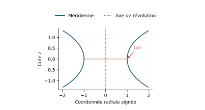

# École polytechnique MP — Deuxième composition de mathématiques 2004 · Corrigé guidé

*Corrigé rédigé par IA, non officiel. Signalez toute erreur.*

**Rédaction** · GPT-6.2 Astra Ultra · vitesse non renseignée

**Révision (tour 1)** · GPT-6.2 Astra Ultra · vitesse non renseignée · 26 novembre 2026

Le choix d’une normale orientée permet de mesurer sa variation dans les directions tangentes. Le problème en déduit les courbures, calcule celles des surfaces de révolution et suit le signe de la courbure moyenne lors d’un changement de paramètres.

## I. Normale orientée et variation des vecteurs tangents

### Question 1.a

> [!INDICATION]
> Introduire un premier vecteur variable dans un déterminant et développer selon ce vecteur.

#### Solution

Pour tout $z\in\mathbb R^{n+1}$, le développement par la première ligne donne $\det(z,x^{(1)},\ldots,x^{(n)})=\sum_k z_kV_k=(z|V)$. Le déterminant ne change pas par transposition si l’on range les vecteurs en colonnes. Avec $z=x^{(i)}$, deux vecteurs sont égaux, donc $(x^{(i)}|V)=0$.

### Question 1.b

> [!INDICATION]
> Traduire les coordonnées du vecteur de cofacteurs en mineurs maximaux.

#### Solution

Le vecteur $V$ est nul exactement quand les $n+1$ mineurs d’ordre $n$ de la matrice des $x^{(i)}$ sont tous nuls. Cela équivaut au rang strictement inférieur à $n$, donc à une famille liée. Les conditions sont équivalentes.

### Question 1.c

> [!INDICATION]
> Prendre le vecteur des cofacteurs comme premier argument du déterminant.

#### Solution

L’identité de 1.a avec $z=V$ donne $\det(V,x^{(1)},\ldots,x^{(n)})=(V|V)=\|V\|^2$, y compris si les vecteurs sont liés.

### Question 2.a

> [!INDICATION]
> Caractériser les deux normales unitaires par le signe du déterminant.

#### Solution

La famille libre engendre un hyperplan dont l’orthogonal est une droite. Par 1.b, $V\ne0$, et les seules normales unitaires sont $\pm V/\|V\|$. Le déterminant associé à la première est $\|V\|>0$ par 1.c, celui de la seconde est négatif. D’où $W=V/\|V\|$ et l’unicité.

### Question 2.b

> [!INDICATION]
> Vérifier les deux conditions de caractérisation après rotation.

#### Solution

Une rotation $R$ préserve le produit scalaire, les normes et le déterminant des familles car $\det R=1$. Ainsi $R(W)$ est normale unitaire à la famille des $Rx^{(i)}$ et le déterminant prescrit est positif. L’unicité de 2.a donne $W(Rx^{(1)},\ldots,Rx^{(n)})=RW(x^{(1)},\ldots,x^{(n)})$.

### Question 3.a

> [!INDICATION]
> Évaluer la forme quadratique de la matrice de Gram.

#### Solution

La matrice $Q$ est symétrique réelle et $c^tQc=\|\sum_i c_ie_i\|^2>0$ pour $c\ne0$, puisque les $e_i$ forment une base. Elle est définie positive, donc diagonalisable dans une base orthonormée, avec toutes ses valeurs propres strictement positives. Elle est inversible.

### Question 3.b

> [!INDICATION]
> Écrire les produits scalaires en développant v dans la base donnée.

#### Solution

Pour tout $j$, $(v|e_j)=\sum_i v_iq_{ij}$. En notation ligne, $((v|e_1),\ldots,(v|e_n))=(v_1,\ldots,v_n)Q$. La ligne des coordonnées s’obtient donc en multipliant celle des produits scalaires à droite par $Q^{-1}$.

### Question 4.a

> [!INDICATION]
> Utiliser la formule par cofacteurs et vérifier que son dénominateur ne s’annule pas.

#### Solution

Les entrées des $\partial_iF$ sont $C^1$ puisque $F$ est $C^2$. Les cofacteurs $V_k$ sont polynomiaux en ces entrées, donc $C^1$. La famille tangente est libre en chaque point, donc $\|V(u)\|>0$ partout. Ainsi $W=V/\|V\|$ est $C^1$.

### Question 4.b

> [!INDICATION]
> Dériver une condition d’orthogonalité.

#### Solution

On a identiquement $(W|\partial_i F)=0$. En dérivant suivant $u_k$, $(\partial_k W|\partial_iF)=-(W|\partial_k\partial_iF)$. Les dérivées mixtes de $F$ commutent par régularité $C^2$.

### Question 4.c

> [!INDICATION]
> Dériver la condition de norme unitaire.

#### Solution

De $(W|W)=1$ on tire $(\partial_iW|W)=0$. L’espace $W^\perp$ est l’hyperplan engendré par les $n$ vecteurs indépendants $\partial_jF$. Ainsi $\partial_iW$ s’y écrit de manière unique $\sum_j a_{ij}\partial_j F$.

### Question 4.d

> [!INDICATION]
> Prendre les produits scalaires de cette décomposition avec chaque vecteur tangent.

#### Solution

Avec les indices du sujet, $(\partial_iW|\partial_kF)=\sum_j a_{ij}q_{jk}=(AQ)_{ik}$. Par 4.b ce nombre vaut $-S_{ik}$. La matrice de Gram des tangentes est inversible, d’où $A=-SQ^{-1}$.

## II. Courbures des surfaces dans l’espace

### Question 5

> [!INDICATION]
> Suivre la normale et les deux formes bilinéaires par la rotation.

#### Solution

Pour $\widehat F=R\circ F$, toutes les dérivées de $F$ sont multipliées par $R$. La normale vaut $\widehat W=RW$ par 2.b. L’invariance du produit scalaire donne alors $\widehat Q=Q$ et $\widehat S=S$, donc $\widehat A=A$. Le déterminant $K$ et la demi-trace $H$ sont conservés, en particulier en zéro.

### Question 6.a

> [!INDICATION]
> Au point de pente nulle, les tangentes du graphe sont les deux premiers vecteurs canoniques.

#### Solution

En zéro, $\partial_1 F=e_1$, $\partial_2 F=e_2$ et $W=e_3$. On a donc $Q=I_2$ et $S=\left(\begin{smallmatrix}r&s\\s&t\end{smallmatrix}\right)$. Avec le signe de la convention du sujet, $A=-S$, d’où $K(0)=rt-s^2$ et $H(0)=-(r+t)/2$.

### Question 6.b

> [!INDICATION]
> Étudier le graphe plan dans les coordonnées horizontale et verticale.

#### Solution

Pour $f(u_1,u_2)=g(u_1)$, on a $s=t=0$ et $H(0)=-g''(0)/2$. Dans le plan de coordonnées $(x_1,x_3)$, orienté dans cet ordre et avec la courbe parcourue pour $x_1$ croissant, la courbure algébrique est $\kappa=g''/(1+g'^2)^{3/2}$. En zéro, $g'=0$, donc $H(0)=-\kappa(0)/2$. Si la courbure de la courbe est prise non signée, elle vaut $2|H(0)|$.

### Question 7.a

> [!INDICATION]
> Calculer les longueurs et le produit scalaire des tangentes.

#### Solution

Notons $z=u_1$, $\theta=u_2$, $e_r=(\cos\theta,\sin\theta,0)$, $e_\theta=(-\sin\theta,\cos\theta,0)$ et $e_z=(0,0,1)$. Alors $F_z=f'e_r+e_z$ et $F_\theta=f e_\theta$ sont orthogonaux, de normes $\sqrt{1+f'^2}$ et $f>0$. Ils sont indépendants pour tout $(z,\theta)\in I\times\mathbb R$.

### Question 7.b

> [!INDICATION]
> Déterminer d’abord le sens de la normale issu de l’ordre des deux paramètres.

#### Solution

Avec $h=\sqrt{1+f'^2}$, le produit vectoriel vaut $f(-e_r+f'e_z)$ et $W=(-e_r+f'e_z)/h$. Les dérivées secondes sont $f''e_r$, $f'e_\theta$ et $-fe_r$, ce qui donne $S=\operatorname{diag}(-f''/h,f/h)$. Puisque $Q=\operatorname{diag}(h^2,f^2)$,
$$A=\operatorname{diag}\left(\frac{f''}{h^3},-\frac1{fh}\right)=\frac1{fh^3}\begin{pmatrix}ff''&0\\0&-(1+f'^2)\end{pmatrix}.$$

### Question 7.c

> [!INDICATION]
> Chercher un profil pour lequel le carré du cosinus hyperbolique intervient sous deux formes.

#### Solution

L’annulation de $H$ équivaut à $ff''=1+f'^2$. La fonction positive $f(z)=\cosh z$ convient, puisque $\cosh^2z=1+\sinh^2z$.

### Question 7.d

> [!INDICATION]
> Translater et dilater le profil précédent afin de régler séparément son rayon et sa pente.

#### Solution

Pour $c>0$, $f(z)=c\cosh(z/c+b)$ vérifie encore $ff''=1+f'^2$. Prenons $b=\operatorname{arsinh}\beta$ et $c=\alpha/\cosh b=\alpha/\sqrt{1+\beta^2}$. Alors $f(0)=\alpha$, $f'(0)=\beta$ et le profil est strictement positif sur $\mathbb R$. Sa révolution autour de l’axe vertical est un caténoïde, qui passe par le cercle de rayon $\alpha$ à la cote zéro avec pente méridienne prescrite. Les rayons et les pentes fixent la dilatation et la translation axiale de ce caténoïde.

L’équation obtenue donne aussi une première intégrale. En dérivant $f/\sqrt{1+f'^2}$, on trouve $f'(1+f'^2-ff'')/(1+f'^2)^{3/2}=0$. Sa valeur constante est $c=\alpha/\sqrt{1+\beta^2}$. On a donc $f''=f/c^2$, avec les deux données à l’origine. L’unique solution de cette équation linéaire est $\alpha\cosh(z/c)+c\beta\sinh(z/c)$, ce qui redonne la chaînette indiquée, sans division par $f'$ au col.

### Question 7.e

> [!INDICATION]
> Exploiter la relation de trace nulle dans la formule diagonale.

#### Solution

Pour une telle solution, les coefficients diagonaux de $A$ sont $1/(fh)$ et $-1/(fh)$. Ainsi $K=-1/[f^2(1+f'^2)]<0$. Pour le profil explicite $h=\cosh(z/c+b)=f/c$, donc $K=-c^2/f^4=-1/[c^2\cosh^4(z/c+b)]$.

Au col, $f=c$ et $f'=0$, de sorte que les deux courbures principales valent $1/c$ et $-1/c$ dans l’orientation calculée. Leur somme s’annule tandis que leur produit est $-1/c^2$, conformément à l’expression obtenue.

### Question 8

> [!INDICATION]
> Rechercher des surfaces homogènes par rotations ou translations.

#### Solution

Le plan, la sphère et le cylindre circulaire droit ont des courbures constantes. Pour le plan elles valent zéro. Avec la normale extérieure et la convention $A=dW$ sur le plan tangent, sur la sphère de rayon $R$ elles valent $K=1/R^2$, $H=1/R$ et sur le cylindre de rayon $R$, $K=0$, $H=1/(2R)$. Changer de normale inverse le signe de $H$.

## III. Reparamétrage et orientation

### Question 9

> [!INDICATION]
> Identifier séparément les colonnes des matrices jacobiennes.

#### Solution

La colonne $i$ de $D_uW$ est $\partial_i W=\sum_j a_{ij}\partial_jF$. C’est la colonne $i$ du produit $(D_uF)A^t$. Ainsi $D_u W=(D_uF)A^t$.

### Question 10.a

> [!INDICATION]
> Appliquer la règle de chaîne puis la bilinéarité alternée du produit vectoriel.

#### Solution

Posons $J=D_{\widetilde u}\Psi$. Alors $D_{\widetilde u}\widetilde F=(D_uF)J$, avec $u=\Psi(\widetilde u)$. Les nouvelles colonnes valent $J_{11}F_1+J_{21}F_2$ et $J_{12}F_1+J_{22}F_2$, où ici $F_j=\partial_jF$. Leur produit vectoriel vaut $(\det J)(\partial_1F\wedge\partial_2F)$.

### Question 10.b

> [!INDICATION]
> Le déterminant jacobien garde son signe sur un domaine connexe.

#### Solution

Le déterminant de $J$ est continu et partout non nul. L’image $\widetilde U=\Phi(U)$ est connexe par arcs, donc son signe $\varepsilon=\operatorname{sgn}\det J$ y est constant. En normalisant le produit vectoriel de 10.a, on obtient $\widetilde W(\widetilde u)=\varepsilon W(u)$.

### Question 10.c

> [!INDICATION]
> Comparer les deux expressions de la dérivée de la nouvelle normale.

#### Solution

La règle de chaîne et 9 donnent $D\widetilde W=\varepsilon(DF)A^tJ$. Par ailleurs $D\widetilde W=(DF)J\widetilde A^t$. Comme $DF$ possède deux colonnes indépendantes, il est injectif et on simplifie à gauche. On en déduit $\widetilde A^t=\varepsilon J^{-1}A^tJ$, soit $\widetilde A=\varepsilon J^t A(J^t)^{-1}$.

### Question 10.d

> [!INDICATION]
> Prendre le déterminant et la trace de la relation de similitude.

#### Solution

On obtient $\widetilde H(\widetilde u)=\varepsilon H(u)$ et $\widetilde K(\widetilde u)=\varepsilon^2K(u)=K(u)$. La courbure totale est intrinsèquement indépendante de l’orientation du paramétrage. La courbure moyenne signée change de signe si le reparamétrage renverse l’orientation.

Pour tester les signes, échangeons les deux paramètres. Le jacobien de l’inverse est alors la matrice de permutation $J$, de déterminant $-1$. Si $A=\operatorname{diag}(k_1,k_2)$ dans les directions initiales, la formule de 10.c donne $\widetilde A=\operatorname{diag}(-k_2,-k_1)$. La demi-somme change de signe et le produit vaut toujours $k_1k_2$.
