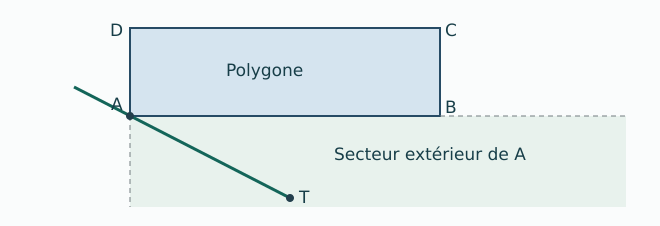

# X · MP · Informatique (option) 2004 — Corrigé brut

*Corrigé rédigé par IA, non officiel. Signalez toute erreur.*

**Rédaction** · GPT-6.2 Astra Ultra · vitesse non renseignée

Deux problèmes indépendants, en quatre heures. Les programmes sont en OCaml. Pour la géométrie, la frontière appartient au polygone. Les calculs de déterminants et de produits scalaires supposent des entiers assez larges pour les coordonnées fournies. Aucun rapport spécifique n’a été retrouvé.

## I. Sélection

### 1. Cardinal

```ocaml
type ensemble = int list
let card x = List.length x
```

Le temps est $\Theta(n+1)$, y compris l’appel sur la liste vide.

### 2. Compter les éléments strictement plus petits

```ocaml
let nPetits p x =
  List.fold_left (fun k a -> if a<p then k+1 else k) 0 x
```

Un test par élément donne un temps $\Theta(n+1)$.

### 3. Construire les deux parties strictes

```ocaml
let partitionP p x = List.filter (fun a -> a<p) x
let partitionG p x = List.filter (fun a -> a>p) x
```

Chaque filtre parcourt tous les éléments, en $\Theta(n+1)$.

### 4. Sélection par le premier pivot

```ocaml
let rec elementDeRang k = function
  | [] -> invalid_arg "rang"
  | p::xs ->
      let r = 1 + nPetits p xs in
      if k=r then p
      else if k<r then elementDeRang k (partitionP p xs)
      else elementDeRang (k-r) (partitionG p xs)
```

Le rang est compté à partir de 1. Chaque appel conserve la réponse et réduit strictement la liste.

### 5. Pire cas

Dans ce cas le pivot est toujours le minimum et le sous-problème perd un seul élément. La somme des travaux est de l’ordre de $n+(n-1)+\cdots+1$. Comme aucun appel ne peut garder plus de $n-1$ éléments, le pire cas est $\Theta(n^2)$.

### 6. Coût moyen sous l’hypothèse du cahier

Pour $n=2m$, $\sum_{i=1}^n\max(i-1,n-i)=2\sum_{j=m}^{2m-1}j=3m^2-m$. Pour $n=2m+1$, la somme vaut $m+2\sum_{j=m+1}^{2m}j=3m^2+2m$. Elles sont toutes deux majorées par $3n^2/4$. Si $T(j)\le cj$ pour $j<n$, la récurrence entraîne $T(n)\le(\ell+3c/4)n$. Prendre $c=4\ell$ ferme la récurrence, initialisée par $T(0)=0$.

### 7. Médians des groupes de cinq

```ocaml
let rec medians = function
  | a::b::c::d::e::reste ->
      elementDeRang 3 [a;b;c;d;e] :: medians reste
  | _ -> []
```

Un bloc demande un nombre borné d’opérations. Le temps total est $\Theta(n+1)$.

### 8. Sélection avec le médian des médians

```ocaml
let rec elementDeRangBis k xs =
  let n = card xs in
  if n<10 then elementDeRang k xs else
  let y = medians xs in
  let p = elementDeRangBis ((card y + 1)/2) y in
  let r = 1 + nPetits p xs in
  let borne = 7*(n/10)+4 in
  let rec choisir j cote taille =
    if taille<=borne then elementDeRangBis j cote else
    let m = List.fold_left min max_int cote in
    if j=1 then m
    else choisir (j-1) (List.filter ((<>) m) cote) (taille-1)
  in
  if k=r then p
  else if k<r then choisir k (partitionP p xs) (r-1)
  else choisir (k-r) (partitionG p xs) (n-r)
```

Les valeurs sont distinctes, d’où la suppression d’un seul minimum à la fois. Les deux appels possibles à `choisir` conservent le rang voulu. Son petit ajustement traite au plus deux éléments avant de relancer la sélection. Il sert à retrouver les parties entières exactes demandées.

### 9. Majorer le pire cas

S’il y a $2q$ groupes complets, chacun des deux côtés, en comptant le pivot, contient au moins $q$ médians avec deux autres éléments par médian du même côté large. La partie stricte retenue a donc au plus $n-3q=7q+r$ éléments, avec $r\le4$. S’il y a $2q+1$ groupes complets, chaque côté large contient au moins $q+1$ médians. La partie stricte a au plus $7q+r-3\le7q+6$ éléments. Dans ce second cas, retirer au besoin un ou deux minima comme en question 8 ramène la taille à $7q+4$, en temps linéaire. Cela donne, pour le maximum pris sur les tailles au plus $n$,

$$M'(n)\le\ell'n+M'(\lfloor n/5\rfloor)+M'(7\lfloor n/10\rfloor+4).$$

Les tailles récursives ont pour somme au plus $0{,}9n+4\le0{,}95n$ dès $n\ge80$. On peut choisir la constante de coût local $\ell'$ assez grande pour majorer aussi $M'(j)/(20j)$ pour $1\le j<80$. Par récurrence forte, $M'(n)\le \ell'n+20\ell'\cdot0{,}95n=20\ell'n$. Ainsi $c'=20\ell'$ convient avec cette convention sur la constante libre du cahier.

### 10. Groupes de trois

Les deux tailles récursives deviennent environ $n/3$ et $2n/3$. Leur somme atteint $n$ et la marge de la preuve linéaire disparaît. La récurrence de majoration $U(n)\le U(n/3+O(1))+U(2n/3+O(1))+O(n)$ donne $O(n\log n)$ par niveaux. Le modèle qui paie un coût linéaire à chaque nœud et prend systématiquement ces deux tailles a l’ordre $\Theta(n\log n)$. La seule majoration des tailles ne démontre pas une borne inférieure de cet ordre pour l’algorithme réel.

## II. Localisation dans un polygone convexe

### 11. Orientation

```ocaml
type point = {x:int; y:int}

let orientation p q r =
  let u = (q.x-p.x)*(r.y-p.y) and v = (q.y-p.y)*(r.x-p.x) in
  if u>v then 1 else if u<v then -1 else 0
```

La valeur retournée est le signe du déterminant. Le signe positif indique le sens direct.

### 12. À droite du zigzag

Posons $A=Q_2$ et $B=R_2$. Dans la configuration du cahier et dans les arcs du polygone direct, la branche entrante prolonge $Q_1A$ dans le demi-plan droit de $AB$, la sortante prolonge $R_1B$ dans le demi-plan gauche (éventuellement sur la droite même). Du côté droit de la corde, on compare donc $T$ à la branche entrante, parcourue en sens inverse de $Q_1A$. Du côté gauche on compare à la branche sortante, parcourue dans le sens $R_1B$.

```ocaml
let aDroiteDe q a r b t =
  let s = orientation a b t in
  if s<0 then orientation q a t >= 0
  else if s>0 then orientation r b t < 0
  else (t.x-b.x)*(b.x-a.x) + (t.y-b.y)*(b.y-a.y) > 0
```

Sur la droite $AB$, l’avant de $A$ est à l’extérieur de cette région et l’au-delà de $B$ lui est attribué. Le segment $[A,B]$ est réservé à l’intérieur du polygone. Les tests larges ou stricts fixent le choix sur les demi-droites partagées. Deux sommets peuvent être des points de tangence valables sur un même prolongement.

### 13. Construire l’arbre équilibré

```ocaml
type arbre =
  | Racine of arbre * arbre
  | Noeud of point * point * point * point * arbre * arbre
  | Feuille of point * point * point

let construire polygone =
  let origine = Array.of_list polygone in
  let m = Array.length origine in
  let o i = origine.((i+m) mod m) in
  let coins = List.filter_map (fun i ->
    if orientation (o (i-1)) (o i) (o (i+1))=0 then None
    else Some (o i)) (List.init m Fun.id) in
  let directs = match coins with
    | a::b::c::_ when orientation a b c<0 -> List.rev coins
    | _ -> coins in
  let v = Array.of_list directs in
  let n = Array.length v in
  if n<3 then invalid_arg "polygone de surface nulle";
  let p i = v.((i+n) mod n) in
  let rec arc i j =
    if j=i+1 then Feuille (p (i-1),p i,p j) else
    let k = (i+j)/2 in
    Noeud (p (i-1),p i,p (j-1),p j,arc i k,arc k j)
  in
  let k = 1+n/2 in Racine (arc 1 k,arc k (1+n))
```

Un intervalle $[i,j)$ représente les secteurs $s_i,\ldots,s_{j-1}$. Ses enfants forment une partition de ces indices, et le triangle au milieu est $P_iP_kP_j$. Les tailles diffèrent d’au plus 1, donnant des hauteurs qui diffèrent d’au plus 1. Le tableau donne les sommets en temps constant. L’arbre a $n$ feuilles et $n-1$ nœuds internes, racine comprise. Le temps et l’espace sont linéaires. Le prétraitement accepte aussi l’ordre horaire et supprime les points intermédiaires d’un côté rectiligne, dont les secteurs seraient dégénérés.

### 14. Appartenance au secteur d’une feuille

L’appel est `aDroiteDe pred pi pi suiv t`, où `pred`, `pi`, `suiv` sont $P_{i-1},P_i,P_{i+1}$. Les deux arguments centraux provenant de $Q_2$ et $R_1$ désignent donc le même sommet. Le long du côté, les points du segment restent dans le polygone.



### 15. Tester l’intérieur en suivant une branche

```ocaml
let contient_region t = function
  | Feuille (q,a,b) -> aDroiteDe q a a b t
  | Noeud (q,a,r,b,_,_) -> aDroiteDe q a r b t
  | Racine _ -> true

let rec secteur arbre t = match arbre with
  | Feuille (_,a,_) ->
      if contient_region t arbre then Some a else None
  | Racine (g,d) | Noeud (_,_,_,_,g,d) ->
      if contient_region t g then secteur g t
      else if contient_region t d then secteur d t
      else None

let aLInterieurDe arbre t = secteur arbre t = None
```

Un résultat `Some` désigne un secteur extérieur. Un résultat `None` provient d’un triangle intérieur ou d’une corde attribuée au polygone. La racine applique le même test, y compris sur sa diagonale de séparation. Deux tests constants par niveau donnent $O(\log n)$.

### 16. Tangente gauche

```ocaml
let tangenteG arbre t = match secteur arbre t with
  | Some a -> a
  | None -> invalid_arg "point exterieur requis"
```

Les inégalités sectorielles placent les deux voisins de $P_i$ à droite de la droite orientée $TP_i$, ou sur elle. La convexité y place alors tout le polygone. La droite est donc une droite d’appui et $P_i$ son contact gauche vu de $T$. Coût $O(\log n)$.

### 17. Tangente droite

Par exemple, construire une seconde fois l’arbre avec les sommets réfléchis par $S(x,y)=(-x,y)$, remis dans le sens direct comme en 13. Pour la requête, renvoyer $S(\mathrm{tangenteG}(A_S,S(T)))$. La symétrie inverse le côté d’appui, donc le point obtenu est un contact droit du polygone initial. Les deux arbres demandent $O(n)$ de préparation et d’espace, chaque tangente $O(\log n)$.

[Sujet](https://www.wikiprepa.fr/concours/data/x_option-info_mp_2004.pdf) · [Autre exemplaire](https://www.doc-solus.fr/prepa/sci/adc/pdf/enonces.pdf/2004/MP_INFO_X_1_2004.enonce.pdf)
