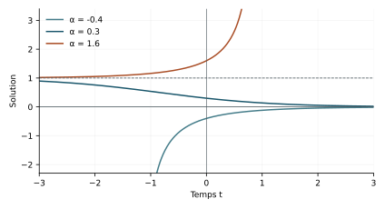

# École polytechnique MP — Première composition de mathématiques 2004 · Corrigé guidé

*Corrigé rédigé par IA, non officiel. Signalez toute erreur.*

**Rédaction** · GPT-6.2 Astra Ultra · vitesse non renseignée

**Révision** · GPT-6.2 Astra Ultra · vitesse non renseignée

Le multiplicateur sur une période décide de l’existence des solutions périodiques. Une perturbation non linéaire s’étudie ensuite par point fixe, puis une équation autonome illustre les intervalles maximaux et la stabilité.

## I. Équations linéaires périodiques

### Question 1

> [!INDICATION]
> Comparer les valeurs du facteur intégrant à deux instants séparés par une période.

#### Solution

Posons $g(t)=\exp(\int_0^ta)$, de sorte que $g'=ag$, $g(0)=1$ et $g(t+T)=e^Ag(t)$. Les solutions sont $x=Cg$ sur $\mathbb R$. Pour $C\ne0$, elles sont $T$-périodiques exactement quand $e^A=1$, soit $A=0$ puisque $A$ est réel.

### Question 2.a

> [!INDICATION]
> Dériver le quotient de la solution par le facteur intégrant.

#### Solution

L’équation équivaut à $(x/g)'=b/g$. Ses solutions maximales sont toutes définies sur $\mathbb R$ par $x_c(t)=g(t)(c+\int_0^t b(s)/g(s)\,ds)$ avec $c=x(0)\in\mathbb R$. La formule y a bien un sens puisque $g$ reste strictement positive.

### Question 2.b

> [!INDICATION]
> La périodicité découle de la coïncidence des données initiales après une période.

#### Solution

La fonction $t\mapsto x_c(t+T)$ satisfait la même équation. Par unicité, la périodicité équivaut à $x_c(T)=x_c(0)$, soit $(1-e^A)c=e^AI$, avec $I=\int_0^Tb/g$. Si $A\ne0$, il existe exactement une solution périodique, donnée par $c=e^AI/(1-e^A)$. Si $A=0$ et $I\ne0$ il n’y en a aucune. Si $A=I=0$, toutes les solutions $x_c$ sont périodiques.

### Question 3.a

> [!INDICATION]
> Intégrer par parties dans le coefficient de Fourier de la dérivée, puis appliquer Cauchy–Schwarz.

#### Solution

Avec la convention $\widehat f(n)=(2\pi)^{-1}\int_0^{2\pi}f(t)e^{-int}\,dt$, l’équation donne $(in-k)\widehat x(n)=\widehat b(n)$. Pour $k\ne0$, le dénominateur ne s’annule jamais. La série des $|\widehat x(n)|$ converge par Cauchy–Schwarz, car $(\widehat b(n))\in\ell^2$ par Bessel et $\sum_n(k^2+n^2)^{-1}<\infty$. La série de Fourier de $x$ converge normalement, donc absolument et uniformément. Sa somme est $x$ par unicité des coefficients pour les fonctions continues périodiques.

Le passage de $x'$ aux coefficients utilise l’intégration par parties. Son terme de bord vaut $[x(t)e^{-int}]_0^{2\pi}=0$, d’où $\widehat{x'}(n)=in\widehat x(n)$. Pour $n=0$ on retrouve bien $\widehat x(0)=-\widehat b(0)/k$.

### Question 3.b

> [!INDICATION]
> Examiner à part la fréquence nulle.

#### Solution

Pour $k=0$, l’équation est $x'=b$. Une primitive périodique existe exactement si $\widehat b(0)=0$. Dans ce cas, $\widehat x(0)$ est une constante réelle arbitraire et $\widehat x(n)=\widehat b(n)/(in)$ pour $n\ne0$. Comme en 3.a, la série converge normalement vers $x$.

## II. Perturbation non linéaire et solutions périodiques

### Question 4

> [!INDICATION]
> Remplacer le terme source de la formule de variation des constantes par sa valeur le long de x.

#### Solution

Pour une solution sur un intervalle contenant zéro, $(x/g)'=H(x(t),t)/g(t)$. L’intégration donne $x(t)=g(t)(x(0)+\int_0^t g(s)^{-1}H(x(s),s)ds)$. Réciproquement, pour une fonction continue satisfaisant cette identité, le membre de droite est $C^1$. Sa dérivée redonne (E3).

### Question 5

> [!INDICATION]
> Résoudre d’abord l’équation linéaire avec une source donnée, obtenue en figeant x.

#### Solution

Pour $x\in P$, $b_x(t)=H(x(t),t)$ est continue et $T$-périodique. La formule de 2.b fournit l’unique solution périodique $y$ de $y'=ay+b_x$. Entre $t$ et $t+T$, la variation des constantes donne $y(t+T)/g(t+T)-y(t)/g(t)=\int_t^{t+T}b_x(s)/g(s)\,ds$. Or $y(t+T)=y(t)$ et $g(t+T)=e^Ag(t)$. On obtient exactement $y=U_Hx$, qui appartient donc à $P$. Ainsi $x$ est solution périodique de (E3) exactement si $x=y$, c’est-à-dire $x=U_Hx$.

Sous forme explicite, le calcul donne $U_Hx(t)=e^Ag(t)\int_t^{t+T}H(x(s),s)/g(s)\,ds/(1-e^A)$. Le signe de $1-e^A$ provient de la différence des valeurs de $y/g$ aux deux extrémités. Il est essentiel, par exemple, pour retrouver la constante en question 8.

### Question 6.a

> [!INDICATION]
> Borner l’intégrale du noyau uniformément sur une période.

#### Solution

Introduisons la constante finie et strictement positive
$$C_a=\frac{e^A}{|1-e^A|}\max_{0\le t\le T}\int_0^T\frac{g(t)}{g(t+u)}\,du.$$
Le quotient dans l’intégrale est invariant par translation simultanée de $T$ et continu sur le compact indiqué. Pour $x\in B_r$, $\|U_\varepsilon x\|\le\varepsilon C_a\alpha_r$. On peut donc choisir $\varepsilon_0=r/[C_a(1+\alpha_r)]>0$, ce qui couvre aussi $\alpha_r=0$.

### Question 6.b

> [!INDICATION]
> Appliquer l’inégalité des accroissements finis dans la première variable.

#### Solution

Pour $x,y\in B_r$, $|F(x(s),s)-F(y(s),s)|\le\beta_r\|x-y\|$, par périodicité de la dérivée et compacité. La même estimation intégrale donne $\|U_\varepsilon x-U_\varepsilon y\|\le\varepsilon C_a\beta_r\|x-y\|$. Le choix $\varepsilon_1=\min(\varepsilon_0,1/[2C_a(1+\beta_r)])$ rend le rapport de contraction au plus $1/2$.

### Question 6.c

> [!INDICATION]
> Vérifier la complétude du domaine du point fixe.

#### Solution

L’espace $P$ s’identifie au sous-espace fermé des fonctions continues sur $[0,T]$ de valeurs égales aux deux extrémités pour la norme uniforme. Il est complet, de même que la boule fermée $B_r$. Pour $0<\varepsilon\le\varepsilon_1$, le théorème du point fixe donne un unique point fixe dans cette boule. Par 5, c’est l’unique solution périodique de (E4) dans $B_r$.

### Question 7

> [!INDICATION]
> Utiliser l’estimation uniforme sur le point fixe et, pour le premier terme, figer F en zéro.

#### Solution

L’identité $x_\varepsilon=U_\varepsilon x_\varepsilon$ donne $\|x_\varepsilon\|\le\varepsilon C_a\alpha_r$. Ainsi $x_\varepsilon\to0$ uniformément à vitesse $O(\varepsilon)$. Plus précisément, si $y$ est la solution périodique de $y'=ay+F(0,t)$, la formule de 5 et 6.b donnent $\|x_\varepsilon/\varepsilon-y\|\le C_a\beta_r\|x_\varepsilon\|=O(\varepsilon)$. Donc $x_\varepsilon=\varepsilon y+O(\varepsilon^2)$ dans la norme de $P$.

### Question 8

> [!INDICATION]
> Observer que les itérations conservent les fonctions constantes.

#### Solution

Pour $x(t)=c$, la solution périodique de $y'=ky+\varepsilon f(c)$ est la constante $-\varepsilon f(c)/k$. L’itération à partir de $0$ reste donc constante et converge dans $B_r$ vers la constante $c_\varepsilon$ vérifiant $kc_\varepsilon+\varepsilon f(c_\varepsilon)=0$. Elle est l’unique racine dans $[-r,r]$ pour la plage de $\varepsilon$ considérée et $x_\varepsilon(t)=c_\varepsilon$.

### Question 9.a

> [!INDICATION]
> Calculer la norme exacte du noyau pour a = −1.

#### Solution

Pour $T=1$ et $a=-1$, la constante de 6.a est $e^{-1}(e-1)/(1-e^{-1})=1$. On a $\alpha_r=r^2$ et $\beta_r=2r$. Il suffit donc de prendre $\varepsilon_0=1/r$ et $\varepsilon_1=1/(4r)$, le rapport de contraction étant alors au plus $1/2$.

### Question 9.b

> [!INDICATION]
> Comparer les équilibres à la boule où le point fixe est unique.

#### Solution

L’équation $-c+\varepsilon c^2=0$ a pour solutions $0$ et $1/\varepsilon$. Pour $0<\varepsilon\le\varepsilon_1$, $1/\varepsilon\ge4r$ est hors de la boule. La solution cherchée est $x_\varepsilon=0$.

### Question 9.c

> [!INDICATION]
> Pour une solution non nulle, dériver son inverse et localiser le premier pôle de la formule.

#### Solution

Le champ polynomial donne existence et unicité locales. Pour $\alpha=0$ la solution est identiquement nulle, pour $\alpha=1/\varepsilon$ elle est constante égale à $1/\varepsilon$, toutes deux sur $\mathbb R$. Pour les autres données, l’unicité empêche de traverser zéro, et $y=1/x$ vérifie $y'=y-\varepsilon$. Ainsi
$$\varphi_\alpha(t)=\frac{\alpha}{\varepsilon\alpha+(1-\varepsilon\alpha)e^t}.$$
Si $0<\alpha<1/\varepsilon$, le dénominateur est positif pour tout $t$ et la solution décroît de $1/\varepsilon$ vers zéro. Pour $\alpha<0$ ou $\alpha>1/\varepsilon$, posons $t_*=\log[\varepsilon\alpha/(\varepsilon\alpha-1)]$. Pour $\alpha<0$, $t_*<0$, l’intervalle maximal est $(t_*,+\infty)$, la solution part de $-\infty$ et tend vers zéro. Pour $\alpha>1/\varepsilon$, $t_*>0$, l’intervalle maximal est $(-\infty,t_*)$, la solution tend vers $1/\varepsilon$ à gauche et vers $+\infty$ au pôle. La divergence au bord fini justifie la maximalité.

Pour vérifier le sens des branches représentées, $x'=x(\varepsilon x-1)$ est positif sur $]-\infty,0[$ et sur $]1/\varepsilon,+\infty[$, négatif entre les deux équilibres. Unicité et signe du champ expliquent pourquoi aucune des courbes ne traverse les deux droites horizontales.

## III. Stabilité asymptotique de la solution nulle

### Question 10

> [!INDICATION]
> Avant une éventuelle première sortie en temps positif, utiliser la borne locale sur la dérivée de f et éliminer le facteur exponentiel.

#### Solution

Pour la stabilité en temps positif, on prend l’infimum des temps $t\ge0$ du domaine tels que $|x(t)|>1$. S’ils existent, $\theta>0$ est intérieur au domaine, $|x(\theta)|=1$ et $|x(s)|\le1$ jusque-là. Puisque $f(0)=0$, $|f(x(s))|\le\lambda |x(s)|$. Par variation des constantes,
$$e^{-kt}|x(t)|\le |x(0)|+\varepsilon\lambda\int_0^t e^{-ks}|x(s)|\,ds.$$
Le lemme admis appliqué à $e^{-kt}|x(t)|$ donne $|x(t)|\le |x(0)|e^{(k+\varepsilon\lambda)t}$ pour $0\le t\le\theta$.

### Question 11

> [!INDICATION]
> Exclure le premier temps de sortie, puis une extrémité finie du domaine maximal.

#### Solution

Comme $k+\varepsilon\lambda<0$, la borne en $\theta$ est strictement inférieure à $1$, contradiction. Ainsi la solution reste dans $[-1,1]$ sur son domaine futur et le calcul de 10 s’applique sur tout segment de ce domaine. Si la borne droite $b$ était finie, $x'=kx+\varepsilon f(x)$ serait bornée, donc $x$ aurait une limite en $b$. L’existence locale à partir de cette limite prolongerait $x$, contredisant la maximalité. D’où le domaine futur $[0,+\infty[$ et la décroissance exponentielle annoncée.
