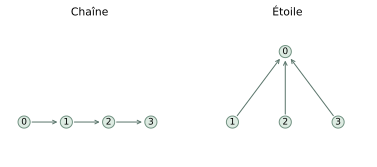
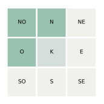
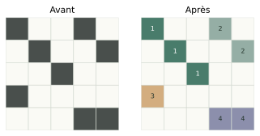

# École polytechnique · PSI et PT · Informatique 2004 · Corrigé brut

*Corrigé rédigé par IA, non officiel. Signalez toute erreur.*

**Rédaction** · GPT-6.2 Astra Ultra · vitesse non renseignée · 25 novembre 2026

**Coloriage.** Le langage choisi est Python. Les indices des personnes, des lignes et des colonnes commencent à zéro. La taille maximale du tableau des couleurs provisoires est la constante globale C de l’énoncé.

## I · Cercles d’amis

### Question 1 · Décrire les représentants de zéro ou une amitié

Pour $s=0$, chaque cercle est un singleton. La seule possibilité est $E[k]=k$ pour tout $k$. Pour une seule relation entre $i\ne j$, les autres entrées gardent cette valeur. Il reste deux possibilités. On peut prendre $E[i]=i$ et $E[j]=i$, ou $E[j]=j$ et $E[i]=j$. Mettre simultanément $E[i]=j$ et $E[j]=i$ créerait un cycle de longueur deux. Si $i=j$, la relation ne change pas les singletons.

### Question 2 · Trouver la racine d’un cercle

```python
def representant(E, i):
    while E[i] != i:
        i = E[i]
    return i
```

La propriété de représentation garantit la convergence. Avant le point fixe aucun indice ne se répète, sinon la suite serait prise dans un cycle. Il y a au plus $n-1$ déplacements dans un tableau de taille $n$. Le temps est $O(n)$ et l’espace auxiliaire constant.

### Question 3 · Tester une amitié indirecte

```python
def sontAmis(E, i, j):
    return representant(E, i) == representant(E, j)
```

Chaque cercle possède exactement un représentant. Son égalité caractérise donc l’appartenance au même cercle, y compris si $i=j$. Le temps est $O(n)$.

### Question 4 · Fusionner les cercles

```python
def ajout(E, i, j):
    ri = representant(E, i)
    rj = representant(E, j)
    if ri != rj:
        E[ri] = rj
```

Si les racines sont distinctes, les deux arbres étaient disjoints. Le lien ajouté fait aboutir tout l’ancien arbre de $i$ en $r_j$, sans créer de cycle. Si elles coïncident déjà, le tableau représente la relation recherchée. Les deux recherches coûtent au plus $O(n)$ et une seule case peut changer.

### Question 5 · Mesurer l’effet du choix de la racine

À partir de $n$ singletons, ajoutons successivement les relations $(0,1),(1,2),\ldots,(n-2,n-1)$. Accrocher chaque ancien représentant au nouveau singleton produit la chaîne $0\to1\to\cdots\to n-1$. Chercher le représentant de 0 demande $n-1$ déplacements. À l’inverse, rattacher chaque singleton à la première racine donne une étoile et au plus un déplacement par recherche.

Une règle applicable sans connaître la suite des ajouts est d’attacher le plus petit arbre au plus grand, en gardant la taille à chaque racine. Chaque fois que la profondeur d’un sommet augmente, la taille de son nouveau cercle est au moins doublée. Sa profondeur reste donc au plus $\lfloor\log_2 n\rfloor$. On peut aussi raccourcir les chemins en dirigeant vers la racine les sommets visités.



## II · Coloriage d’objets

### Question 6 · Lire les voisins déjà visités

```python
def couleurNO(T, i, j):
    return T[i - 1][j - 1] if i > 0 and j > 0 else 0

def couleurN(T, i, j):
    return T[i - 1][j] if i > 0 else 0

def couleurO(T, i, j):
    return T[i][j - 1] if j > 0 else 0
```

Une condition sur la colonne est nécessaire pour le voisin ouest, et une sur la ligne pour le voisin nord. Elles évitent que les indices négatifs de Python ne désignent l’autre bord.

### Question 7 · Marquer les composantes et enregistrer les équivalences

```python
def marquage(T):
    global nc, E
    nc = 0
    E = list(range(C))
    R = len(T)
    for i in range(R):
        for j in range(R):
            if T[i][j] == 0:
                continue
            no = couleurNO(T, i, j)
            nord = couleurN(T, i, j)
            ouest = couleurO(T, i, j)
            if no != 0:
                couleur = no
            elif nord == 0 and ouest == 0:
                nc += 1
                couleur = nc
            elif nord == 0:
                couleur = ouest
            elif ouest == 0 or nord == ouest:
                couleur = nord
            else:
                ajout(E, nord - 1, ouest - 1)
                couleur = nord
            T[i][j] = couleur
```

Les étiquettes provisoires sont les entiers de 1 à `nc`. Leur entrée dans la forêt est l’indice `couleur - 1`, ce qui permet d’utiliser exactement $C$ cases, comme demandé. Une étiquette provisoire égale à 1 ne gêne pas le traitement, car seuls les pixels antérieurs sont utilisés comme voisins. Une couleur peut être partagée ou fusionnée à travers le nord-ouest, le nord, ou l’ouest. Le nord-est est exclu par la convention du sujet.

À chaque insertion, une nouvelle couleur désigne un objet jusque-là non rencontré, ou bien le pixel prolonge et éventuellement relie les objets qui le touchent. L’invariant porte sur les équivalences des étiquettes, et autorise plusieurs numéros provisoires pour un même objet. Il y a $R^2$ pixels et au plus une fusion par pixel. Avec la forêt simple des questions 2 et 4, la borne est $O(C+R^2(1+C))$, en comptant l’initialisation de $E$.



### Question 8 · Attribuer un numéro définitif à chaque objet

```python
def diffusion(T):
    numero = [0] * nc
    objets = 0
    for v in range(nc):
        u = v
        while numero[u] == 0 and E[u] != u:
            u = E[u]
        if numero[u] == 0:
            objets += 1
            numero[u] = objets
        couleur = numero[u]
        u = v
        while numero[u] == 0:
            numero[u] = couleur
            u = E[u]
    for ligne in T:
        for j in range(len(ligne)):
            if ligne[j] != 0:
                ligne[j] = numero[ligne[j] - 1]

def colorier(T):
    marquage(T)
    diffusion(T)
```

Pour une étiquette encore inconnue, la première boucle remonte jusqu’à une racine ou une étiquette déjà numérotée. La seconde affecte définitivement le même numéro à tous les sommets jusque-là inconnus du chemin. Chaque sommet non numéroté est ainsi traversé au plus deux fois avant d’être mémorisé. Les racines reçoivent les numéros successifs $1,\ldots,p$ et les pixels de fond restent à zéro.

La préparation prend $O(\mathrm{nc})$ et le coloriage final $O(R^2)$, soit $O(C+R^2)$ pour `diffusion`. La totalité de `colorier` est majorée par $O(C+R^2(1+C))$ avec les fusions simples. Une image blanche conserve uniquement des zéros et ne crée aucun objet.


