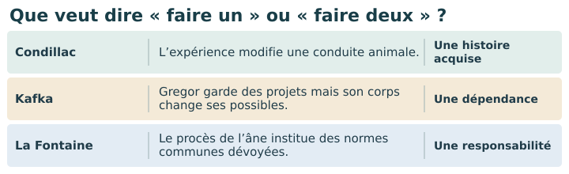

# Banque PT — Français A 2005 · Corrigé brut

*Corrigé rédigé par IA, non officiel. Signalez toute erreur.*

**Rédaction** · GPT-6.2 Astra Ultra · vitesse non renseignée

**Révision (tour 1)** · GPT-6.2 Astra Ultra · vitesse non renseignée

[Énoncé officiel](https://www.banquept.fr/IMG/pdf/francais_a_2005.pdf) · [Rapport du jury](https://www.banquept.fr/documents/ecrit/rapport/2005/rapport_fra_a_ecrit_2005.pdf) · [Programme officiel](https://www.education.gouv.fr/bo/2004/23/MENS0400963A.htm) · [Grille de la session](https://www.banquept.fr/documents/livret/2005/Livret_Rose_2005_1_2.pdf#page=12)

Épreuve de quatre heures sur « L’animal et l’homme ». Étienne Bonnot de Condillac, Traité des animaux · Jean de La Fontaine, Fables, livres VII à XI · Franz Kafka, La Métamorphose (traduction de Bernard Lortholary).

## Sujet

Vercors, Zoo ou l’assassin philanthrope (1963).

Un des personnages de la pièce de VERCORS, Zoo ou l’assassin philanthrope (1963), déclare : « L’animal fait « un » avec la nature, l’homme fait « deux » avec elle ! Il s’en est arraché, il s’est... dénaturé ! »

L’étude que vous avez faite des œuvres au programme (et d’autres textes sur le thème L’Animal et l’Homme) vous permet-elle de partager cette assertion ?

## Dissertation

Un matin, Gregor Samsa constate que la forme de son corps a changé. Sa première inquiétude porte pourtant sur l’heure de son train et sur ce que son employeur pensera de son absence. Si l’animal ne faisait vraiment qu’un avec la nature, comme le dit le personnage de Vercors, pourquoi le lecteur rencontre-t-il, sous cette forme animale, tant de soucis professionnels et familiaux ? L’homme, affirme Vercors, fait « deux » avec la nature parce qu’il s’en est « arraché ». Le mot peut désigner un pouvoir de prendre ses distances ou la perte de quelque chose qui appartenait à une condition première. Il invite ainsi à demander quel rapport un vivant entretient avec ce qui lui est donné et par quels signes on peut reconnaître que ce rapport se transforme.

La distinction éclaire d’abord ce que l’activité humaine a de singulier. Gregor ne se contente pas de rechercher une nourriture ou un abri. Il tient des comptes, se figure l’avenir des siens, envisage de consacrer à la formation musicale de sa sœur une partie de ce qu’il gagne. Il a pris à sa charge des dettes qu’il n’a pas lui-même contractées. Sa vie a donc pour horizon un ensemble de significations et d’engagements qui ne se trouvent pas tout faits dans ses besoins vitaux. C’est en ce sens qu’un homme fait deux avec la nature. Il peut rapporter ce qu’il fait maintenant à une fin qu’il a choisie ou que d’autres ont fixée avant lui. La persistance de ces préoccupations dans un corps bouleversé les fait ressortir avec une netteté particulière.

Il faut cependant interroger la première moitié de la proposition. Qu’entend-on par « faire un » ? Ce serait une chose de dire que la bête reçoit ses facultés de la nature, une autre de soutenir que tout son comportement est réglé d’avance. Le Traité des animaux de Condillac se sépare précisément des théories qui rendent compte des conduites animales comme du fonctionnement d’une machine. Une sensation importe au vivant parce qu’elle est liée à un besoin. L’expérience apprend à remarquer ce qui annonce une satisfaction ou une peine. L’habitude peut ensuite rendre rapide un ajustement qui a eu son histoire. La conduite n’est donc pas une simple réponse identique à un milieu immuable. L’animal a une manière de connaître son environnement, de retenir et d’adapter ce qu’il a appris. Vu de près, le « un » contient déjà bien des différences.

La Fontaine fait éprouver au lecteur ce qu’une telle discussion engage. Dans le Discours à Madame de La Sablière, les réponses ingénieuses que les animaux apportent à des difficultés singulières troublent l’homme assuré d’avoir affaire à des automates. L’exemple des rats et de l’œuf vaut par la relation entre le problème rencontré et la conduite effectivement observée. Les deux rats transportent ensemble ce que chacun aurait peine à emporter seul. Le trait décisif est la répartition des rôles, qui donne à leur conduite l’apparence d’une invention concertée. De quel droit déclarerait-il dépourvus de toute invention les êtres dont la réponse lui échappait ? On comprend alors pourquoi un parcours consacré à l’animal conduit à mettre en question la suffisance de certains discours humains sur la nature. Le privilège de nommer une différence ne donne pas nécessairement celui de bien connaître les deux termes qu’elle oppose.

Inversement, l’effort de l’homme pour s’arracher à la nécessité ne fait pas de lui un être sans corps. Chez Kafka, les aliments que la sœur de Gregor lui présente prennent pour lui une saveur différente de celle qu’il leur connaissait. Son goût le surprend. La manière qu’il a de se déplacer et les endroits où il se sent à l’abri se modifient aussi. Ce rapport à l’espace et à la nourriture ne fait pas purement et simplement disparaître la personne qui se souvient de sa vie familiale. Il l’oblige à éprouver tout ce qui dépendait, dans cette vie, de la forme familière d’un geste ou de la possibilité de se faire entendre. On ne fait deux avec la nature qu’à l’intérieur d’une existence qu’on continue de lui devoir. Le changement d’une condition physique atteint jusqu’à la possibilité de se présenter aux autres comme le même homme.

La coupure que propose Vercors pourrait donc se situer ailleurs. Un vivant humain est susceptible de poser en question cette dépendance même, de soumettre ses besoins, ses habitudes et ses règles de groupe à une appréciation publique. Les Animaux malades de la peste font comparaître une société devant son propre malheur. On veut y établir une faute et en délibérer. Ces bêtes parlent ici au nom des hommes, mais le résultat est troublant. Le langage qui devrait permettre de faire justice donne à la puissance du lion l’apparence de l’innocence et à une légère faute de l’âne le poids d’un crime. Ce sont des conventions, des discours intéressés et un semblant de procès qui produisent le verdict. La distance à l’égard de l’ordre naturel rend possible l’examen du juste. Elle rend possible aussi la fabrication d’une injustice proprement sociale. Il n’y a donc pas de supériorité morale garantie dans le fait de s’être « dénaturé ».

Montaigne, dans l’Apologie de Raimond Sebond, s’interroge sur le jeu qu’il partage avec sa chatte. Il n’est pas certain de savoir lequel des deux y est le divertissement de l’autre. La scène vaut comme expérience de pensée. Se demander ce que voit le partenaire, c’est exercer une distance réflexive dont l’homme se reconnaît capable. Mais cette distance lui sert précisément à suspendre son assurance que la bête, elle, se confond sans reste avec la nature. La possibilité de revenir sur ses propres catégories pourrait ainsi être une définition plus exigeante de notre singularité que le privilège de tracer une fois pour toutes la frontière des espèces.

L’assertion de Vercors fait donc saisir ce que l’existence humaine comporte de reprise et de responsabilité. Elle perd cependant en précision si elle suppose l’animal privé de toute histoire ou l’homme dispensé de toute condition naturelle. Les œuvres permettent de tenir ensemble trois faits, la capacité animale d’apprendre, la vulnérabilité corporelle de l’homme et le pouvoir humain de demander ce qu’il doit faire de sa puissance. Ce dernier pouvoir se vérifie au mieux dans l’examen de la séparation elle-même et dans les conséquences qu’on accepte d’en tirer pour les autres vivants.

