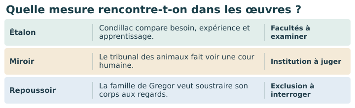

# Banque PT — Français B 2005 · Corrigé guidé

*Corrigé rédigé par IA, non officiel. Signalez toute erreur.*

**Rédaction** · GPT-6.2 Astra Ultra · vitesse non renseignée

**Révision (tour 1)** · GPT-6.2 Astra Ultra · vitesse non renseignée

[Énoncé officiel](https://www.banquept.fr/IMG/pdf/francais_b_2005.pdf) · [Rapport du jury](https://www.banquept.fr/documents/ecrit/rapport/2005/rapport_fra_ecrit_2005.pdf) · [Programme officiel](https://www.education.gouv.fr/bo/2004/23/MENS0400963A.htm) · [Grille de la session](https://www.banquept.fr/documents/livret/2005/Livret_Rose_2005_1_2.pdf#page=12)

Épreuve de quatre heures sur « L’animal et l’homme ». Étienne Bonnot de Condillac, Traité des animaux · Jean de La Fontaine, Fables, livres VII à XI · Franz Kafka, La Métamorphose (traduction de Bernard Lortholary).

## Sujet

Michel Suffran, « Hypothèse fragile », dans Si les lions pouvaient parler, essai sur la condition animale, sous la direction de Boris Cyrulnik, Gallimard, 1998. Partie « La Honte des origines ».

Du début de l’extrait, « Sous une forme nettement moins optimiste », page 1, à « le regarder en face », page 4. Les questions suivent sur la même page.

Résumez ce texte en 250 mots (plus ou moins 10%). Vous indiquerez le nombre de mots utilisés. (8 points)

## Préparer le résumé

La fiction initiale pose un problème de reconnaissance et ne doit pas occuper tout le résumé. Passez ensuite de l’individu à l’espèce, puis des origines à la responsabilité humaine. La figure finale du monstre ramène la comparaison avec l’animal à une question que l’homme doit soutenir à son propre sujet. Les unités jointes par apostrophe ou trait d’union sont comptées séparément.

## Résumé

Dans Les Animaux dénaturés, Vercors imagine des êtres inclassables. Les tropis présentent des caractères que nous attribuons tantôt aux singes, tantôt aux hommes. Les tenir pour des bêtes arrangerait ceux qui souhaitent les exploiter. Le procès provoqué par Templemore oblige à décider si leur vie bénéficie de la protection accordée aux humains. Leur admission au bénéfice du doute révèle que nous fixons les conditions de notre reconnaissance.

Ne serions-nous pas tous candidats à cette humanité ? Si un individu devient homme, peut-être notre espèce le devient-elle. Pour Teilhard, la spiritualisation se poursuit dans le mouvement de l’univers, selon une essence qui dépasse les individus. Bergson conçoit une évolution créatrice.

Pourquoi appeler bestial ce que nous avons honte de reconnaître comme nôtre ? Certaines atrocités sont le propre des hommes. Rejeter sur le corps un mal dont on voudrait préserver l’âme, ou attribuer nos actes à des instincts inconscients, sont deux moyens opposés de se soustraire à sa responsabilité. L’homme seul peut atteindre de tels extrêmes de grandeur et de bassesse.

Notre singularité résiderait dans la question indéfiniment reprise de ce que nous sommes. Les animaux fournissent une comparaison nécessaire, que nous cherchions auprès d’eux une ressemblance ou une différence. La figure redoutée du récit de Joseph d’Arbaud révèle ainsi une origine que le gardian peine à reconnaître. Même si le langage du péché et de la grâce nous devient étranger, le choix demeure. Le monstre que nous refusons de regarder marche à nos côtés.

*250 mots.*

« La spécificité animale demeure, qu’on la récuse ou qu’on l’admette, le seul étalon de notre mesure humaine, miroir ou repoussoir tour à tour ». Peut-on, selon vous, reconnaître dans les textes du programme une telle recherche d’un « étalon » de la mesure humaine ?

## Préparer la dissertation

**Pourquoi un étalon n’est-il pas directement un modèle moral ?**

Un étalon est d’abord un terme de comparaison. Précisez la propriété mesurée et le critère utilisé avant de demander ce qu’un homme devrait imiter ou refuser.

**En quel sens le miroir peut-il se retourner ?**

Dans la fable du procès, la société animale ressemble à une cour. Dans le Discours à Madame de La Sablière, l’intelligence observée chez certaines bêtes amène le lecteur à revoir l’idée qu’il se faisait des hommes.

**Que faut-il faire du mot « seul » ?**

Songez à ce qui fait reconnaître Gregor à travers la musique, le souvenir et le lien entre frère et sœur. Demandez si la comparaison entre espèces permet vraiment de rendre compte de ces relations.

## Dissertation

Comment regarder les métamorphoses de Gregor Samsa sans se demander à quel moment un homme cesse d’être reconnu comme tel ? Une fois la question posée, il devient cependant difficile de dire qui fournit la mesure. Est-ce l’animalité du corps de Gregor qui permet de juger ce qu’il reste en lui d’humain ? Ou est-ce la conduite des hommes réunis dans l’appartement qui fait comprendre ce que peut signifier traiter quelqu’un en animal ? Michel Suffran propose de voir dans la spécificité animale le seul « étalon » de notre mesure, miroir ou repoussoir. Les trois images méritent d’être distinguées. L’étalon permettrait une comparaison réglée, le miroir rendrait des traits reconnaissables, le repoussoir ferait ressortir les nôtres par contraste. Les œuvres emploient-elles ces trois instruments pour la même enquête et avec la même confiance ?

Le point de départ de Condillac donne un sens précis à l’idée d’étalon. Pour examiner ce que nous sommes, il est éclairant de comparer des êtres qui possèdent comme nous des sens et qui se trouvent devant des besoins différents. Si nous refusions toute sensation aux bêtes, il deviendrait difficile de donner une explication cohérente de ce qu’elles apprennent et de la manière dont elles varient leur conduite selon les circonstances. Inversement, si nous leur prêtions par simple sympathie tout ce dont nous sommes capables, l’enquête serait décidée d’avance. Le Traité des animaux procède par rapprochements et par différences. L’animal donne ainsi des points de comparaison à partir desquels on peut se demander quelle part de notre intelligence se développe par l’attention, la mémoire et l’habitude. La comparaison ne prend sens qu’à condition de déterminer ce que l’on compare.

La Fontaine donne la même question au lecteur sous une forme plus mobile. Dans Les Animaux malades de la peste, des sujets viennent confesser leurs fautes devant un roi. Ils ont griffes, dents ou sabots, mais aussi titres, rangs et intérêts. L’âne, qui ne sait pas parer d’une raison d’État le peu d’herbe qu’il a broutée, est traité comme le plus coupable. Le lecteur n’a pas besoin d’imaginer qu’une société de lions et d’ânes se tiendrait réellement un jour en tribunal. La distribution des espèces rend immédiatement perceptible une inégalité entre les justiciables. Le miroir est éclairant parce qu’il décale les rangs de la cour dans un autre monde. Ce qu’il rend visible à travers les animaux est la manière dont des hommes font parler la loi en faveur des puissants.

Mais ce miroir a précisément pour condition de ne pas tenir les comportements d’une espèce pour une norme à suivre. Serait-il juste que le lion ait raison puisqu’il est le plus fort ? Ce serait confondre la cause de son ascendant et une justification de la sentence. La fable tire son efficacité de ce que le lecteur sait les distinguer. Elle peut rendre les hommes méconnaissables dans d’autres bêtes si besoin est. Dans le Discours à Madame de La Sablière, les précautions d’animaux aux prises avec une difficulté donnent à penser des formes d’intelligence que le philosophe attaché à une théorie mécanique pouvait n’avoir pas remarquées. La direction de la comparaison se renverse. Il ne s’agit plus de découvrir le courtisan dans l’animal. Il s’agit d’apprendre à observer l’animal assez longtemps pour que l’idée que l’homme se fait de sa supériorité ait à changer.

La fonction de repoussoir se laisse particulièrement bien saisir dans La Métamorphose. La famille Samsa identifie d’abord la nécessité de soigner Gregor, mais se préoccupe vite de le tenir hors de vue. Sa porte joue le rôle d’une frontière entre la vie commune et ce qu’elle ne veut plus reconnaître. Les signes de sa présence sont perçus à travers l’effroi ou le dégoût. Pendant ce temps le lecteur continue à le suivre dans son souci pour les siens, sa gêne et sa sensibilité à la musique de sa sœur. La forme animale donne-t-elle la mesure de ce qu’il est ? Elle mesure surtout la distance entre ce que ses proches sont capables d’apercevoir et ce que le récit nous permet d’entendre. La faire servir de repoussoir constitue une décision sociale dont Gregor subit les conséquences. Kafka nous demande d’examiner cette décision plutôt que de l’approuver.

Reste le mot « seul ». L’étalon animal pourrait-il fournir une réponse à toute question sur l’homme ? Condillac doit tenir compte des différences que créent chez nous les signes, la vie sociale et la transmission des découvertes. Même si de premières opérations s’enracinent dans des expériences sensibles comparables, la comparaison entre une espèce et une autre ne suffit pas à expliquer l’histoire de ce que des générations se communiquent. La Fontaine fait intervenir à son tour un critère qui n’est pas une espèce animale, la justice des hommes entre eux. L’âne nous émeut parce que le traitement d’un être vulnérable a pour nous une valeur qui ne se déduit ni de ses sabots ni de la force du lion. Un étalon règle une question déterminée. La diversité des questions que les œuvres posent rend douteuse l’idée d’une mesure unique.

Chez Kafka enfin, ce pourrait être la musique qui donne l’indice le plus décisif de cette insuffisance. Écoutant Grete jouer, Gregor s’approche. Il voudrait lui faire savoir qu’il songeait à l’envoyer au conservatoire. Ce souvenir d’un avenir qu’il avait préparé pour elle accompagne une perception que les autres ne peuvent plus partager avec lui. Les locataires auxquels la famille veut plaire paraissent apprécier bien autrement cette soirée. On pourrait croire que le violon permet de classer tout le monde d’après un trait enfin caractéristique. Ce serait encore manquer la singularité de la scène. Ce qui compte n’est pas seulement que Gregor réagisse à des sons, mais le souvenir d’un projet entre un frère et une sœur et le désir qui demeure d’y faire place. Aucune catégorie animale ne donne à elle seule la mesure d’une pareille relation.

Suffran a donc raison de faire de la confrontation avec l’animal une épreuve persistante de nos jugements. Le traité corrige des conceptions sur les facultés, la fable éclaire les institutions et la fiction de Kafka éprouve les conditions d’une reconnaissance. Cependant ces œuvres montrent aussi ce que nous apportons à la comparaison et comment nous pouvons la fausser. L’animal peut être notre miroir ou le repoussoir que nous fabriquons. Il nous aide à chercher notre mesure lorsque nous acceptons de soumettre à l’examen l’usage que nous faisons de lui.

