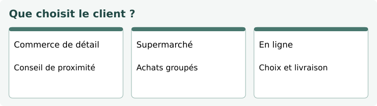
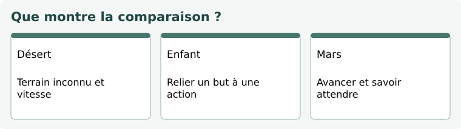
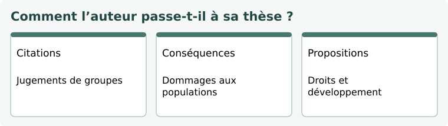
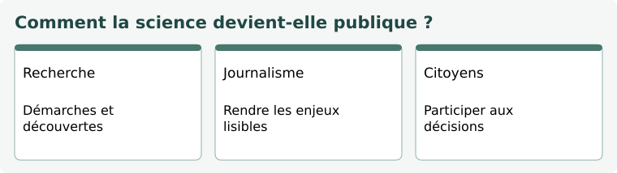
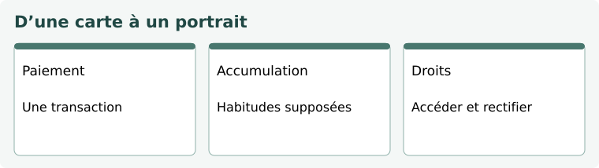

# Banque PT — Langue vivante A 2005 · Corrigé brut

*Corrigé rédigé par IA, non officiel.*

**Rédaction** · GPT-6.2 Astra Ultra · vitesse non renseignée

L’épreuve dure trois heures. Chaque candidat traite la langue choisie à l’inscription. La version française vaut 10 points. La question a demande 80 à 100 mots pour 4 points. La question b demande 200 à 250 mots pour 6 points.

[Sujet](https://www.banquept.fr/IMG/pdf/lv_a_2005.pdf) · [Index des rapports](https://www.banquept.fr/article153.html) · [Grille du livret](https://www.banquept.fr/documents/livret/2005/Livret_Rose_2005_1_2.pdf)

## Allemand

*Amazon in Deutschland*

### Version française

De « An einem Dienstag » à « vor allem als Kunden », en incluant l’incise « sagt Schröder ».

Un mardi d’octobre, le fondateur d’Amazon, Jeff Bezos, est en visite au centre d’expédition allemand du groupe, à Bad Hersfeld. Invité surprise, il répond aux questions des salariés. Par ses formules percutantes, Jeff Bezos façonne la culture de son entreprise. Sa parole a du poids. Presque tous les employés d’Amazon connaissent ses maximes, qu’ils préparent des colis à Bad Hersfeld ou qu’ils conçoivent des logiciels au siège de Seattle, dans le nord-ouest des États-Unis. Parmi les préceptes de l’entrepreneur figure aussi cette ambition. « Nous voulons devenir l’entreprise au monde la plus attentive à ses clients. »

Dans la ville thermale de Bad Hersfeld, des panneaux de signalisation spécialement prévus à cet effet indiquent le chemin d’Amazon.de. L’entreprise a choisi cette petite ville pour sa situation au centre de l’Allemagne. « D’ici, en trois heures et demie, on peut aller n’importe où dans la République fédérale », explique Paul Niewerth, responsable de la logistique chez Amazon. De nombreuses entreprises de secteurs voisins s’y sont installées, dont Libri, un grossiste en livres.

Le commerçant qui devrait redouter le plus cette gigantesque machine à vendre est Thomas Schröder, le libraire. Âgé de 42 ans, il tient la librairie Oertel, vénérable maison fondée en 1897, dans un bâtiment à colombages de la zone piétonne de Bad Hersfeld, pour ainsi dire nez à nez avec le géant Amazon. « Même s’il m’arrive de me retrouver dans les embouteillages au moment de la relève chez Amazon, je vois avant tout dans les salariés d’Amazon des clients », dit Schröder.

### Question a

*Welche Produkte sind oder wären Sie bereit auf Internet zu kaufen und welche nicht? Sagen Sie auch warum.*

Bücher, deren Titel ich bereits kenne, würde ich im Internet bestellen, besonders wenn die Buchhandlung in meiner Nähe sie nicht vorrätig hat. Auch eine Fahrkarte kaufe ich gern online, weil ich verschiedene Verbindungen in Ruhe vergleichen kann. Bei Schuhen möchte ich dagegen vor dem Kauf prüfen, ob sie wirklich passen. Obst und Gemüse suche ich ebenfalls lieber selbst aus. Dabei spielt neben der Qualität auch der Weg eine Rolle: Wenn ein Laden um die Ecke liegt, brauche ich weder eine Lieferung noch zusätzliche Verpackung.

**84 mots**

### Question b

*Wie wird Ihrer Meinung nach das Gleichgewicht zwischen Einzelhandel, Supermärkten und Internethandel im Jahr 2050 aussehen?*

Im Jahr 2050 werden dieselben Kunden wahrscheinlich je nach Anlass ganz unterschiedliche Wege wählen. Wer nach der Arbeit Lebensmittel für mehrere Tage braucht, wird den Supermarkt schätzen, weil dort vieles an einem Ort erhältlich ist. Eine Person ohne Auto könnte denselben Einkauf im Netz zusammenstellen und gemeinsam mit den Bestellungen ihrer Nachbarn liefern lassen. Der Gegensatz zwischen Supermarkt und Internethandel verliert an Bedeutung, wenn ein Unternehmen beide Dienste anbietet.

Für kleine Geschäfte wird entscheidend sein, ob sie etwas anbieten, das über die Übergabe einer Ware hinausgeht. Ein Buchhändler kann eine Lesung organisieren und einer Kundin einen Roman empfehlen, den sie nicht gesucht hätte. Eine Werkstatt kann zeigen, wie sich ein beschädigter Gegenstand reparieren lässt. Beide können im Internet mitteilen, was sie vorrätig haben. Das Netz wäre für sie zugleich Konkurrenz und Werkzeug.

Das Gleichgewicht hängt aber auch von politischen Entscheidungen ab. Wenn die Kosten für Lieferverkehr, Rücksendungen und Verpackung im Preis sichtbar werden, erscheint die scheinbar kostenlose Lieferung in einem anderen Licht. Ebenso beeinflussen Mieten und öffentliche Verkehrsmittel, ob Menschen das Stadtzentrum erreichen. Ich erwarte daher keinen einzigen Sieger. In einer gut versorgten Stadt des Jahres 2050 könnten schnelle digitale Bestellung, persönliche Beratung und ein bezahlbarer Einkauf nebeneinander bestehen, auch für Menschen ohne Smartphone.

**204 mots**

## Anglais

*Who’s Driving?*

### Version française

De « Thirteen vehicles lined up » à « wheels caught on fire ».

En mars dernier, treize véhicules se sont alignés au départ d’une course à travers le désert des Mojaves, avec en jeu la coquette somme d’un million de dollars. Pour gagner, il fallait parcourir les 142 miles (223 kilomètres) du trajet en moins de dix heures. Les équipes et les spectateurs savaient qu’il pourrait très bien n’y avoir aucun vainqueur, car ces véhicules étaient dépourvus d’un élément essentiel, le conducteur.

La DARPA, l’agence américaine chargée des projets de recherche avancée pour la défense, avait parrainé cette course dans le cadre d’un programme de développement de véhicules robotisés pour les futurs champs de bataille. Mais le Grand Défi, comme on l’avait appelé, a surtout fait la démonstration spectaculaire de la difficulté qu’il y a à lancer à vive allure une voiture ou un buggy sur un terrain inconnu sans guidage humain. Sur un véhicule, le frein s’est bloqué dans la zone de départ. Un autre a commencé par foncer dans un mur. Un troisième a pris peur devant des buissons au bord de la route après avoir parcouru 1,2 mile (1,9 kilomètre).

L’un s’est retourné. Un autre est parti dans une direction complètement erronée et a dû être immobilisé à distance. Un autre encore a parcouru un peu plus d’un mile avant de traverser une clôture. Un concurrent a réussi à parcourir six miles (neuf kilomètres), mais est resté coincé sur un rocher. Quant au « vainqueur », si l’on peut dire, il a parcouru 7,4 miles (11,9 kilomètres) avant de heurter un talus, et ses roues avant ont pris feu.

### Question a

*Compare the performances of machines and natural biological systems.*

The desert race shows how difficult machines find it to interpret unfamiliar surroundings quickly. A vehicle may carry sophisticated instruments and still fail to recognise an ordinary obstacle in time. Ants move through a changing environment with an ease that engineers find difficult to imitate. A small child can connect a desired result with a sequence of actions, such as climbing to reach a biscuit. Machines can nevertheless perform valuable tasks under different conditions. The Mars rovers travelled slowly and could wait for human advice when they encountered uncertainty.

**89 mots**

### Question b

*Could autonomous vehicles be useful to mankind and how? Discuss.*

Autonomous vehicles could be useful where the route and the purpose of a journey are clearly defined. A small shuttle connecting a railway station with a hospital, for instance, could give people who cannot drive a dependable way to reach an appointment. The value would lie in the service it provides. Passengers would still need a simple way to ask for help if the shuttle stopped or if someone required assistance getting aboard.

Exploration offers a different example. A vehicle on another planet cannot receive an immediate answer to every question from Earth. Being able to stop safely and make a few routine decisions gives scientists more freedom to study what the vehicle finds. Here a slow machine that waits when it is uncertain may be more useful than a much faster one that makes an irreversible mistake.

I would be cautious about extending these successes to every street. A crowded crossing involves people who communicate through glances, gestures and expectations that can change in a second. Before introducing an autonomous service, its operator should demonstrate that it works in the conditions passengers actually face and explain who will take responsibility for failures. Used where they meet a real need, these vehicles could widen access to transport and knowledge while leaving human judgement available when the situation demands it.

**219 mots**

## Arabe

*هل المجابهة بين الإسلام والغرب محتومة؟*

### Version française

De « كما كانت الأجيال المتأثرة » à « اعرف عدوك ». La version couvre les trois premiers paragraphes de la page 6.

Tout comme les générations influencées par le marxisme et les principes socialistes à l’époque de la guerre froide accablaient les États-Unis et l’Occident des qualificatifs les plus abominables (colonialisme, impérialisme, capitalisme vorace, etc.), les générations islamistes, salafistes, fondamentalistes ou radicales, ont aujourd’hui pris le même chemin. À leurs yeux, les États-Unis sont le « grand Satan », l’« allié d’Israël », celui qui « exploite les richesses des Arabes et des musulmans », l’« ennemi du retour de l’islam » et le « danger qui menace les principes religieux et moraux et les cultures nationales dans le monde ». Les militants de gauche et les nationalistes, même s’ils ont d’autres raisons d’être hostiles aux États-Unis, partagent avec eux tout ou partie de ces jugements sans appel.

Tout en reconnaissant que les États-Unis, par leur parti pris constant et leur soutien sans réserve à Israël, ont mérité d’être blâmés par tous les Arabes et les musulmans, sinon de susciter leur hostilité (comment justifier leur occupation de l’Irak et la manière dont ils renoncent à défendre le peuple palestinien ?), nous estimons que ce sentiment de révolte ou d’hostilité à leur égard, dans le monde arabe et musulman, ne doit pas devenir le sentiment unique ou dominant de la psychologie arabo-égyptienne, ni transformer en arme certains musulmans, qui s’en servent aujourd’hui les uns contre les autres. Il ne doit pas non plus servir de prétexte pour porter des coups à l’aveugle aux États-Unis et aux pays occidentaux, ainsi qu’aux régimes arabes et musulmans. De tels coups font mal, certes. Mais le tort qu’ils font et le danger qu’ils représentent sont, par leur ampleur et leur gravité, encore plus grands, en définitive, pour les États et les peuples arabes et musulmans, sur les plans politique, économique et international.

Faire sauter les oléoducs en Irak, et ainsi priver le peuple irakien de la principale ressource nécessaire à la reconstruction de l’État et de ses institutions, tuer les policiers irakiens chargés de maintenir la sécurité, faire sauter les hôtels en Égypte, privant le pays du tiers de son revenu national, celui du tourisme, et d’autres actes analogues ne changeront rien aux stratégies des grandes puissances. En revanche, ils suscitent un esprit d’hostilité profonde envers les Arabes et les musulmans, sans compter les graves dommages matériels et moraux qu’ils infligent aux États et aux peuples arabes et musulmans.

Pour que les musulmans et les Arabes retrouvent la place régionale ou mondiale qu’ils occupaient il y a six siècles, il leur faut une renaissance économique et sociale, dont la voie est la science et le développement, et non le recours à l’épée et à la dynamite contre les États et les civilisations dominantes. Ce qui est plus grave encore, c’est que beaucoup, chez les fondamentalistes extrémistes, islamistes aussi bien qu’américains, ignorent ou feignent d’ignorer les réalités et les faits du monde et lancent des slogans et avancent des arguments fondés sur des interprétations, pour justifier leurs positions et leurs actes. Comme on le disait autrefois, « Connais ton ennemi. »

### Question a

*بينوا الفكرة الأساسية للنص.*

يرفض الكاتب أن يتحول الاعتراض على سياسات الولايات المتحدة إلى حكم شامل على الغرب أو إلى عداء يضر بالناس الذين يزعم أصحابه الدفاع عنهم. وهو يعرض شعارات تيارات مختلفة، ثم يسأل عن نتائج العنف على حياة السكان واقتصاد بلدانهم وعن مدى فهم كل طرف للطرف الآخر. ويدعو إلى الجمع بين التمسك بالحقوق واحترام الإنسان، وإلى تحسين التعليم والتنمية وتغيير السياسات بالوسائل المدنية. فالمواجهة في نظره ليست قدرا محتوما، ولا يقتضي التعاون بين الشعوب أن يتخلى أحد عن هويته أو عن حقه في النقد.

**83 mots**

### Question b

*هل إقرار العدالة مرهون بممارسة الإرهاب؟*

لا أرى أن إقرار العدالة مرهون بممارسة الإرهاب. فالعدالة تبدأ بالاعتراف بأن لكل إنسان حقا في أن يسمع قوله وأن يعامل وفق قاعدة معلومة. أما إخافة الناس لمجرد انتمائهم إلى جماعة ما فتلغي هذا المبدأ، لأنها تجعل الشخص يدفع ثمن فعل لم يرتكبه. وقد يؤدي الخوف إلى صمت مؤقت، لكنه لا يجعل القرار الصادر عن الأقوى قرارا عادلا في نظر من وقع عليهم الضرر.

قد يعترض أحد بأن أصحاب الحقوق لا يجدون دائما محكمة مستقلة أو مسؤولا يستمع إليهم. وهذه صعوبة حقيقية، ولا يكفي أن نطلب منهم الانتظار. لكن هناك فرقا بين الصمت والعمل المدني. تستطيع جمعية مثلا أن تجمع شهادات أسر تضررت من قرار إداري وأن تعرضها على الرأي العام، ثم تطالب بمراجعة القرار وبحق المتضررين في الاعتراض. وتستطيع الصحافة أن تتابع ما وعدت به السلطة، فيعرف الناس هل تحقق الإصلاح أم بقي كلاما. تحتاج هذه الطرق إلى صبر وحماية، وقد تفشل، لكنها تترك مجالا لتصحيح الخطأ والمحاسبة.

وفي المقابل تتحمل الدولة مسؤولية أساسية عن فتح أبواب القضاء وحماية من يتكلم. فإذا أتيحت للمواطن وسيلة مفهومة للمطالبة بحقه، أمكنه أن يرى في المؤسسة مكانا للإنصاف. وأقيس نجاح أي حركة تطالب بالعدالة بقدرتها على صون حقوق المختلفين معها كما تصون حقوق أنصارها، وعلى جعل الحياة أكثر أمنا وكرامة للجميع بعد انتهاء النزاع.

**202 mots**

## Espagnol

*Divulgando Ciencia*

### Version française

De « Más que las guerras » à « la más fantástica aventura intelectual de nuestro tiempo ».

Plus que les guerres, le terrorisme et le mal en général, c’est la science qui caractérise notre époque, tant par ses aspects positifs, et ils sont nombreux, que par ses aspects négatifs, dont il existe aussi quelques exemples, surtout dans ses applications. Sans la science, il n’y a pas d’avenir, avertissait il y a plus d’un demi-siècle le prix Nobel guatémaltèque Miguel Ángel Asturias. Nous savons aujourd’hui que sans la science, il n’y a pas non plus de présent. Si nous faisions abstraction du savoir scientifique et technique, de ses conséquences et même des problèmes qu’il pose, le présent serait autre et, à mon avis, bien pire.

La science est à la lettre une information qui touche à des questions de vie et de mort, étroitement mêlée à tous les aspects de la culture et de l’amélioration du niveau de vie. Or les médias informent très mal le public dans ce domaine. À une époque où tant de découvertes scientifiques soulèvent des débats passionnés et troublants, la société est très peu éclairée à leur sujet.

La communication de la science au grand public est l’autre force qui, avec la science elle-même, façonne le monde actuel. Dévoiler les mystères de l’Univers, enrichir les connaissances, améliorer la qualité de vie, voilà quelques-uns des objectifs du chercheur. Il appartiendra au journaliste spécialisé en sciences et techniques de mettre ces objectifs en lumière pour que le public les comprenne mieux, se rapproche du travail scientifique et participe d’une manière ou d’une autre à ce qui constitue la plus fantastique aventure intellectuelle de notre temps.

### Question a

*Apoyándose en el texto, analice Usted la relación que establece el autor entre Ciencia y Periodismo.*

Para Calvo Hernando, la investigación transforma nuestra vida, pero el público necesita mediadores que le permitan comprender esas transformaciones. El periodista científico debe explicar tanto el trabajo del investigador como sus consecuencias y sus dudas. También puede comunicar el placer de descubrir algo, sin reducir una noticia a un espectáculo. Esta labor tiene una dimensión democrática: quien entiende mejor los problemas puede opinar sobre ellos y participar en decisiones que de otro modo quedarían reservadas a especialistas y políticos. El autor lamenta que los medios aún informen mal en este terreno.

**91 mots**

### Question b

*¿Comparte Usted el punto de vista de M. Calvo Hernando, que empieza este artículo afirmando que «más que las guerras, el terrorismo y el mal en general, la ciencia es lo que caracteriza a nuestro tiempo»? Justifique su parecer.*

Comparto la idea de que la ciencia caracteriza nuestra época si por caracterizar entendemos transformar la vida diaria de manera duradera. Una persona puede olvidarse del laboratorio al abrir un grifo, consultar un pronóstico o recibir un diagnóstico. Sin embargo, detrás de esos gestos hay conocimientos compartidos, instrumentos que se han probado y generaciones que han aprendido a corregir errores. La discreción de sus efectos no les resta importancia.

Me cuesta más establecer una competición entre la ciencia y la guerra. Para una familia que ha tenido que dejar su casa, el acontecimiento decisivo de su tiempo puede ser un conflicto. Decirle que se equivoca porque en otro lugar se ha producido un gran avance confundiría dos escalas de experiencia. Además, las decisiones políticas influyen en qué investigaciones se financian y en quién llega a beneficiarse de sus resultados. Un descubrimiento valioso no se convierte automáticamente en un bien común.

A mi juicio, el interés de la frase está en cambiar lo que consideramos noticia. Si los medios solo muestran una catástrofe el día en que ocurre, pasan por alto años de observaciones que podrían ayudar a comprenderla o prevenir otra semejante. Un buen periodismo puede dar cabida a ambas historias y preguntar por la responsabilidad humana en cada una. Así el lector comprende mejor su tiempo sin verse obligado a elegir una sola palabra para definirlo.

**227 mots**

## Italien

*Ecco la «plastic identity»*

### Version française

Deuxième et troisième paragraphes de la page 10, de « È un cervello elettronico » à « per località ».

C’est un cerveau électronique. Pas à pas, dès le moment où il sort de chez lui. Il le suivra dans ses déplacements, dans ses faits et gestes. Pas à pas, le grand cerveau électronique esquissera son portrait, le modifiera, en rassemblera les éléments, le gardera indéfiniment en mémoire. Pour lui, monsieur Rossi est une identité faite d’une longue suite de nombres. L’homme et son code vivent ensemble, ce sont les deux faces d’une même personne. « Plastic identity », c’est le nom que les Américains ont donné à cette ombre des temps modernes.

Ce qui raconte au grand cerveau électronique la vie de cet homme, c’est sa carte de crédit. Rossi ignore qu’en glissant dans la fente du petit appareil posé sur le comptoir du magasin, le morceau de plastique engendre un flux de données qui emprunte les câbles en fibre optique jusqu’au grand cerveau. Chaque fois, ce geste révèle quelque chose sur lui. C’est un autoportrait involontaire, mais extrêmement fidèle. À des centaines de kilomètres de là, le grand cerveau le surveille. Il contrôle ses achats et les classe par montant, par type de marchandise et par lieu.

### Question a

*Cosa pensa di questa «plastic identity»? Pensa che sia un servizio buono?*

Una carta che permette di pagare senza portare molto denaro e di segnalare operazioni insolite può offrire un servizio utile. Il problema comincia quando da ogni acquisto si ricava un ritratto stabile del cliente. Il signor Rossi non vede quel ritratto e non sa quali conclusioni ne tragga la società che lo conserva. Accetterei il servizio più volentieri se potessi conoscere le informazioni raccolte, correggere un errore e ottenere la cancellazione di ciò che non serve più. La comodità da sola non basta a giustificare ogni uso dei dati.

**89 mots**

### Question b

*C’è ancora una possibilità di vita privata con la «plastic identity», dove si trova la libertà individuale? È proprio un progresse?*

Penso che una vita privata sia ancora possibile, ma che non si possa affidarla soltanto alla prudenza del singolo cliente. Per pagare un acquisto è necessario comunicare un importo e autorizzare il trasferimento del denaro. Da ciò non deriva il diritto di ricostruire per anni le preferenze di una persona o di vendere ad altri il suo profilo. La libertà individuale comprende anche la possibilità di cambiare abitudini senza dover giustificare ogni scelta.

Immaginiamo che una cliente compri spesso un biglietto per la stessa città. Il sistema potrebbe interpretare quei viaggi come vacanze, mentre lei va ad assistere un parente. Nessun elenco di pagamenti racconta da solo il significato di quei gesti. Se una decisione importante si fonda su un’interpretazione simile, la persona interessata dovrebbe poter incontrare qualcuno che la ascolti e riveda il giudizio.

Chiamerei progresso una carta che restituisce tempo e sicurezza a chi la usa, con limiti chiari alla conservazione delle informazioni. Servono regole comprensibili, controlli indipendenti e un mezzo di pagamento alternativo per chi lo desidera. Altrimenti il consenso rischia di essere soltanto una firma obbligatoria per partecipare alla vita quotidiana. La tecnologia descritta nell’articolo può svolgere un compito utile, purché la persona continui ad avere diritti sul racconto che viene costruito con i suoi dati.

**210 mots**

