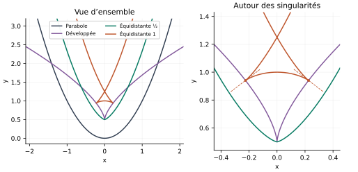
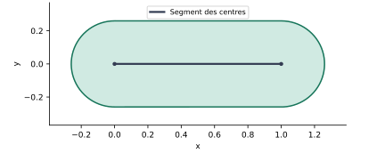
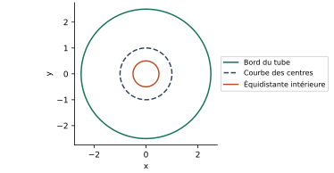
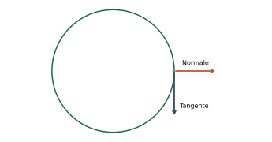
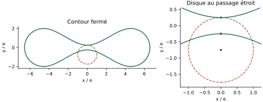

# Banque PT — Mathématiques A 2005 · Corrigé brut

*Corrigé rédigé par IA, non officiel. Signalez toute erreur.*

**Rédaction** · GPT-6.2 Astra Ultra · vitesse non renseignée

On oriente le plan dans le sens direct. Pour une courbe régulière, la rotation de la tangente unitaire de $+\pi/2$ donne la normale $n$. Ce choix fixe tous les signes des équidistantes et de la courbure. La grille d’admissibilité attribue à Maths A un coefficient 6 pour l’École polytechnique et 3 pour l’ENS Cachan. [Sujet officiel](https://www.banquept.fr/IMG/pdf/math_a_2005.pdf) · [Rapport du jury](https://www.banquept.fr/documents/ecrit/rapport/2005/rapport_math_a_ecrit_2005.pdf) · [Grille des coefficients](https://www.banquept.fr/documents/livret/2005/Livret_Rose_2005_1_2.pdf#page=12)

## Partie I · Courbes équidistantes

### I.1.a · Paramétrer la parabole

Prenons $c(t)=(t,t^2)$ pour $t\in\mathbb R$. On parcourt toute la parabole, $x(t)\to+\infty$ lorsque $t\to+\infty$, et le vecteur vitesse $(1,2t)$ ne s’annule jamais.

### I.1.b · Deux équidistantes

Avec $d=\sqrt{1+4t^2}$, $\tau=(1,2t)/d$, $n=(-2t,1)/d$. Par définition $c_e=c+en$. On obtient
$$
c_{1/2}(t)=\left(t-\frac{t}{d},\,t^2+\frac{1}{2d}\right),
\qquad
c_1(t)=\left(t-\frac{2t}{d},\,t^2+\frac{1}{d}\right).
$$

### I.1.c · Développée

La courbure algébrique est $\gamma=\det(c',c'')/\|c'\|^3=2/d^3$. Le rayon algébrique vaut $d^3/2$ et le lieu des centres de courbure est donc
$$
\widetilde c(t)=c(t)+(d^3/2)n(t)=(-4t^3,\,1/2+3t^2).
$$

### I.1.d · Branches, tangentes et tracé commun

Les quatre courbes sont symétriques autour de l’axe vertical. La parabole est régulière, de tangente horizontale au sommet, et va vers le haut des deux côtés. La développée vérifie $y=1/2+3(|x|/4)^{2/3}$. À son point singulier $(0,1/2)$, le déplacement dominant est vertical ($3t^2$ en ordonnée contre $-4t^3$ en abscisse). C’est un rebroussement de tangente $x=0$. À l’infini, $y\to+\infty$, $y/|x|\to0$ et les deux branches ont une direction horizontale.

Pour les équidistantes, $c'_e(t)=(1-2e/d^3)(1,2t)$. Aux points réguliers la pente vaut $2t$. Pour $e=1/2$, le seul arrêt est en $t=0$. Le développement donne $x=2t^3+O(t^5)$ et $y=1/2+3t^4+O(t^6)$, donc la tangente est horizontale et la courbe traverse l’axe vertical. Pour $e=1$, les arrêts sont $t_0=\pm\sqrt{2^{2/3}-1}/2$. Le facteur $b=1-2/d^3$ y a un zéro simple. La première direction non nulle est celle de $c''_1(t_0)=b'(t_0)(1,2t_0)$, donc chaque tangente passe par $c_1(t_0)$ avec pente $2t_0$. Comme $\det(c''_1,c'''_1)(t_0)=4b'(t_0)^2\ne0$, ces deux points sont des rebroussements. Les paramètres $\pm\sqrt3/2$ donnent en outre le point double $(0,5/4)$ avec pentes $\pm\sqrt3$.

Pour les deux valeurs de $e$, à l’infini on a $x=t-e\,\operatorname{sgn}(t)+O(t^{-2})$ et $y=t^2+O(1/|t|)$. Ainsi $y-(|x|+e)^2\to0$ sur les deux branches, de direction verticale. Le premier panneau ci-dessous montre les branches et le second détaille le voisinage des singularités.

### I.2.a · Formules de Frenet

En abscisse curviligne, $c'(s)=\tau(s)$ et $\tau'(s)=\gamma(s)n(s)$ par définition de la courbure algébrique. En appliquant la rotation de $+\pi/2$ à cette dernière identité, $n'(s)=-\gamma(s)\tau(s)$.

### I.2.b · Vitesse de l’équidistante

$c_e'=c'+en'=(1-e\gamma)\tau$. La fonction $\kappa$ demandée est donc la courbure algébrique $\gamma$.

### I.2.c · Longueur de l’équidistante

La longueur du parcours paramétré, avec $\ell=\lambda(c)$, vaut
$$
f(e)=\lambda(c_e)=\int_0^\ell |1-e\gamma(s)|\,ds.
$$
Cette formule reste valable si la vitesse s’annule en certains points. Sur un intervalle non compact, l’intégrale de longueur s’interprète par passage à la limite, éventuellement avec valeur infinie.

### I.2.d · Dérivée de la longueur

Si $|\gamma|\le M$ et $M>0$, alors $|e|<1/M$ garantit $1-e\gamma(s)>0$ pour tout $s$. La formule précédente devient affine, $f(e)=\ell-e\int_0^\ell\gamma(s)\,ds$. Elle est dérivable sur ce voisinage et $f'(0)=-\int_0^\ell\gamma(s)\,ds$. Si $M=0$, la longueur est constante et la même conclusion vaut.

## Partie II · Boule centrée sur une courbe

### II.1 · Distance au carré

Pour $f(u)=\|c(u)-p\|^2$, les coordonnées de $c$ sont $C^1$, donc leur somme de carrés l’est aussi. La dérivée est $f'(u)=2(c(u)-p)\cdot c'(u)$, avec la dérivée unilatérale aux extrémités.

### II.2 · Plus proche point

La fonction $f$ est minorée par zéro et continue sur le segment compact $[a,b]$, donc atteint son minimum en un $t_0$. Puisque $p\in B(c(t),e)$, on a $0\le f(t_0)\le f(t)<e^2$.

### II.3.a · Minimum intérieur

Si $a<t_0<b$, la dérivabilité et la condition nécessaire d’extremum intérieur donnent $f'(t_0)=0$.

### II.3.b · Orthogonalité

Par II.1, $(c(t_0)-p)\cdot c'(t_0)=0$. Comme $c'(t_0)=\|c'(t_0)\|\tau(t_0)$ et que la vitesse est non nulle, $(c(t_0)-p)\cdot\tau(t_0)=0$.

### II.3.c · Représentation normale

L’orthogonal de $\tau(t_0)$ dans le plan est la droite engendrée par $n(t_0)$. On a donc $p=c(t_0)+rn(t_0)$ avec $r=(p-c(t_0))\cdot n(t_0)$. La normale étant unitaire, $|r|=\sqrt{f(t_0)}<e$ par II.2.

### II.4 · Extrémité stationnaire

Si $t_0=a$ avec $f'(a)=0$, ou bien $t_0=b$ avec $f'(b)=0$, la formule de dérivation à l’extrémité donne encore l’orthogonalité. La décomposition normale et la majoration stricte de II.3.c s’appliquent.

### II.5.a · Signe de la dérivée à gauche du parcours

Si le minimum est en $a$, alors $(f(a+h)-f(a))/h\ge0$ pour $h>0$ assez petit. D’où $f'(a)\ge0$, et même $f'(a)>0$ sous l’hypothèse $f'(a)\ne0$.

### II.5.b · Distance strictement positive

Si $p=c(a)$, II.1 donnerait $f'(a)=0$. Cela contredit l’hypothèse. Ainsi $p\ne c(a)$.

### II.5.c · Direction vers le point

Pour $w_a=(p-c(a))/\|p-c(a)\|$, la formule de II.1 donne
$$
w_a\cdot\tau(a)=-\frac{f'(a)}{2\|p-c(a)\|\|c'(a)\|}<0.
$$

### II.5.d · Demi-disque initial

Posons $r=\|p-c(a)\|$ et $u=w_a$. On a $\|u\|=1$, $0<r<e$ par II.2 et II.5.b, $u\cdot\tau(a)<0$ et $p=c(a)+ru$.

### II.6 · Demi-disque final

Au minimum $b$, $h<0$ donne $(f(b+h)-f(b))/h\le0$, donc $f'(b)<0$ sous l’hypothèse de dérivée non nulle. En particulier $p\ne c(b)$. Posons $r=\|p-c(b)\|$, $u=(p-c(b))/r$. Alors $0<r<e$, $\|u\|=1$, $p=c(b)+ru$ et $u\cdot\tau(b)=-f'(b)/(2r\|c'(b)\|)>0$.

## Partie III · Voisinage tubulaire

### III.1.a · Tube autour d’un cercle

Si $d=\|p-O\|$, la distance au cercle de rayon $R>0$ est $|d-R|$ par l’inégalité triangulaire et la projection radiale (pour $p=O$, chaque point du cercle convient). Ainsi $U_e$ est défini par $|d-R|<e$. Si $0<e<R$, c’est la couronne ouverte $R-e<d<R+e$, dont les deux cercles extrêmes forment le bord. Si $e=R$, on obtient le disque ouvert $d<2R$ privé de son centre, de bord $\{O\}\cup\{d=2R\}$. Si $e>R$, on obtient le disque ouvert $d<R+e$, de bord son seul cercle extérieur.

### III.1.b · Tube autour d’un segment

Pour $p=(x,y)$, la distance au segment est $\sqrt{x^2+y^2}$ si $x<0$, $|y|$ si $0\le x\le1$, et $\sqrt{(x-1)^2+y^2}$ si $x>1$. Le tube est l’ensemble des points où cette distance est strictement inférieure à $e$. Son bord comprend les deux segments $y=\pm e$, $0\le x\le1$, le demi-cercle gauche de centre $(0,0)$ et le demi-cercle droit de centre $(1,0)$, tous deux de rayon $e$.

### III.2 · Appartenance au tube

Par définition $x\in\bigcup_{t\in[a,b]} B(c(t),e)$ si et seulement si l’une des boules contient $x$, c’est-à-dire s’il existe $t\in[a,b]$ tel que $\|x-c(t)\|<e$.

### III.3 · Extraction d’un même type

À chaque $p_k\in U_e$, II.2–II.6 associent l’une des représentations suivantes. Le premier type est $c(t_k)+r_kn(t_k)$ avec $|r_k|<e$ (H1). Le deuxième est $c(a)+r_ku_k$, où $0<r_k<e$, $\|u_k\|=1$, $u_k\cdot\tau(a)<0$ (H2). Le troisième est la représentation en $b$ avec $u_k\cdot\tau(b)>0$ (H3). S’il existe plusieurs choix, en fixer un par indice. Au moins une classe contient une infinité d’indices, que l’on énumère en ordre strictement croissant $\varphi(k)$. La sous-suite ainsi définie a le même type à chaque rang et converge vers $p$ comme toute sous-suite de la suite initiale.

### III.4.a · Extraction simultanée

Sous (H1), $t_k\in[a,b]$. Par Bolzano-Weierstrass, il existe une extraction $\psi$ telle que $t_{\psi(k)}$ converge. Les $r_{\psi(k)}$ sont bornés par $e$ en valeur absolue. Une seconde extraction $\eta$ les fait converger. Alors $\varphi=\psi\circ\eta$ est strictement croissante et les deux suites extraites convergent.

### III.4.b · Limite de la représentation normale

Les intervalles fermés contenant les termes contiennent leurs limites, soit $t\in[a,b]$ et $r\in[-e,e]$. La vitesse ne s’annulant pas, $\tau=c'/\|c'\|$ et sa rotation $n$ sont continues. À la limite dans (H1), $p=c(t)+rn(t)$.

### III.4.c · Rayon limite

Si $|r|<e$, alors $\|p-c(t)\|=|r|<e$. Par III.2, $p\in U_e$, contradiction. Puisque $|r|\le e$, on conclut $|r|=e$.

### III.5 · Limite au premier bout

Sous (H2), extraire une sous-suite sur laquelle $r_k\to r\in[0,e]$ et $u_k\to u$ par compacité du cercle unité et du segment fermé des rayons. Alors $\|u\|=1$, $u\cdot\tau(a)\le0$ et $p=c(a)+ru$. Si $r<e$, $p$ est dans la boule ouverte de centre $c(a)$, impossible. Donc $p=c(a)+eu$.

### III.6 · Limite au dernier bout

Sous (H3), la compacité permet encore de faire converger conjointement $r_k$ et $u_k$ vers $r\in[0,e]$ et un vecteur unitaire $u$. Cette fois $u\cdot\tau(b)\ge0$, et $p=c(b)+ru$. La condition $p\notin B(c(b),e)$ impose $r=e$. On obtient le demi-cercle final fermé.

### III.7 · Inclusion du bord

Pour chaque $p\in\partial U_e$, la définition fournit une suite intérieure qui tend vers lui. Par III.3 on en extrait une sous-suite de type fixé. Sous (H1), III.4 donne $p=c(t)\pm en(t)$, donc $p$ appartient à l’une des deux équidistantes. Sous (H2), III.5 donne le demi-cercle de centre $c(a)$ du côté opposé à $\tau(a)$. Sous (H3), III.6 donne celui de centre $c(b)$ du côté opposé à $-\tau(b)$. Ces trois possibilités établissent l’inclusion demandée, points de jonction compris.

### III.8 · Une inclusion stricte

Prenons comme courbe un cercle parcouru une fois, $R=1$, et comme rayon de tube $e=3/2$. Par III.1.a, le tube est le disque ouvert de rayon $5/2$. L’équidistante obtenue en reportant la normale vers l’intérieur traverse le centre dans le déplacement normal et dessine un cercle de rayon $1/2$. Tout ce petit cercle est strictement intérieur au tube, alors qu’il appartient à la réunion de III.7. L’inclusion est stricte.

## Partie IV · Condition nécessaire

### IV.1 · Orientation d’une courbe fermée

Un cercle parcouru dans le sens horaire convient. Pour $C(s)=(R\cos(s/R),-R\sin(s/R))$, $0\le s\le2\pi R$, la vitesse est unitaire et la normale tournée de $+\pi/2$ vaut $C(s)/R$, radiale et dirigée vers l’extérieur. Au point de droite la tangente pointe vers le bas.

### IV.2.a · Développement en longueur d’arc

Posons $\gamma_0=\gamma(s_0)$, $m_0=C(s_0)$, $\tau_0=C'(s_0)$ et $n_0=n(s_0)$. Par régularité $C^2$ et les formules de Frenet,
$$
C(s_0+h)=m_0+h\tau_0+\tfrac12 h^2\gamma_0n_0+o(h^2).
$$

### IV.2.b · Coordonnées de Frenet

Les coordonnées de $C(s_0+h)-m_0$ sont $\xi(h)=h+o(h^2)$ et $\eta(h)=\gamma_0 h^2/2+o(h^2)$. Le rayon de courbure algébrique est $1/\gamma_0$ lorsque $\gamma_0\ne0$.

### IV.2.c · Cercle tangent du côté extérieur

Le centre $\Omega=m_0+an_0$ a pour coordonnées $(0,a)$. On peut choisir $g_a(x,y)=x^2+(y-a)^2-a^2=x^2+y^2-2ay$. L’équation du cercle est $g_a(x,y)=0$ et $g_a<0$ dans son disque ouvert.

### IV.2.d · Ordre du contact

Par IV.2.b, $\xi(h)^2=h^2+o(h^2)$, $\eta(h)^2=o(h^2)$ et $-2a\eta(h)=-a\gamma_0h^2+o(h^2)$. Donc $\varphi(h)=g_a(\xi(h),\eta(h))=(1-a\gamma_0)h^2+o(h^2)$.

### IV.2.e · Position relative au voisinage du contact

Comme $\xi'(0)=1$, la courbe est localement le graphe $y=\gamma_0 x^2/2+o(x^2)$. Sur le cercle, la branche passant par l’origine a pour équation $y=a-\sqrt{a^2-x^2}=x^2/(2a)+o(x^2)$. La différence a pour terme dominant $(1/a-\gamma_0)x^2/2$ dès que $a\gamma_0\ne1$, ce qu’assure $a\ne R_0$ (rayon de courbure). Son signe est alors fixe pour $x$ petit et non nul. Les points voisins du cercle restent donc d’un même côté de la courbe.

### IV.3 · Courbure nécessaire au bord d’un tube

Supposons $C=\partial U_e(c)$. La courbe des centres est l’image d’un segment compact. Pour chaque $m\in C$, la distance de $m$ à cette image vaut $e$ : elle est au moins $e$ car $m\notin U_e$ et au plus $e$ par passage à la limite depuis le tube. Un centre $z$ réalise cette distance. Ainsi $B(z,e)\subset U_e$ et $m$ touche son cercle. La courbe simple fermée délimite un intérieur et un extérieur. Le tube est borné et a pour seul bord $C$, donc il remplit l’intérieur (son intersection avec chaque composante du complément de $C$ y est ouverte et fermée).

Tous les points de $C$ sont hors du disque. La fonction $s\mapsto\|C(s)-z\|^2$ a un minimum en $s_0$ avec $C(s_0)=m$. Le centre appartient à la normale en $m$ et se situe du côté intérieur puisque son disque tangent est intérieur. Donc $z=m-en_0$. Dans le repère de IV.2, le disque a pour intérieur $x^2+y^2+2ey<0$. Sur la courbe on a ainsi
$$
0\le\xi(h)^2+\eta(h)^2+2e\eta(h)=(1+e\gamma_0)h^2+o(h^2).
$$
Diviser par $h^2$ et passer à la limite donne $\gamma(s_0)\ge-1/e$. Ce calcul vaut aussi pour $\gamma_0=0$. La continuité de la courbure étend la conclusion aux extrémités du paramétrage.

### IV.4 · Un étranglement malgré la borne de courbure

Fixons $R=2e$, $\delta=e/4$ et $d=\sqrt{6R(R-\delta)}$. Pour $|x|\le d$, prenons les deux graphes $y=\pm f(x)$, où
$$
q=|x|/d,\qquad f(x)=\delta+(R-\delta)(3q^2-2q^3).
$$
Fermons la courbe à droite et à gauche par les demi-cercles extérieurs de rayon $R$ et de centres $(\pm d,0)$. Le tracé est simple puisque $f\ge\delta>0$. Aux raccords, $f=R$, $f'=0$ et $f''=-1/R$, comme pour le graphe supérieur du cercle. Le graphe inférieur a les signes inverses. En $x=0$, le terme $|x|^3$ est de classe $C^2$. Le contour admet donc un paramétrage régulier $C^2$ par longueur d’arc, orienté dans le sens horaire.

Sur les graphes, $|f''|\le6(R-\delta)/d^2=1/R$, donc $|\gamma|=|f''|/(1+f'^2)^{3/2}\le1/R$. Sur les demi-cercles $|\gamma|=1/R$. La condition demandée est satisfaite partout. Pourtant, au point supérieur du passage étroit $m=(0,\delta)$, un disque intérieur tangent de rayon $e$ aurait nécessairement pour centre $(0,\delta-e)$. Le point inférieur $(0,-\delta)$, également sur le bord, en est à distance $|e-2\delta|=e/2<e$. Un tel disque contiendrait un point du bord, contradiction. Comme IV.3 exige l’existence de ce disque à tout point d’un bord de tube, notre courbe ne peut être un tel bord.

