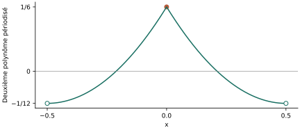
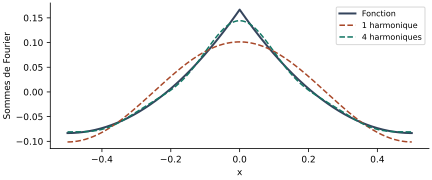

# Banque PT — Mathématiques C 2005 · Corrigé guidé

*Corrigé rédigé par IA, non officiel. Signalez toute erreur.*

**Rédaction** · GPT-6.2 Astra Ultra · vitesse non renseignée

Les coefficients du produit de deux séries entières donnent les polynômes de Bernoulli. Leur prolongement périodique fait apparaître les valeurs paires de la fonction zêta. La grille d’admissibilité attribue à Maths C un coefficient 6 pour l’École polytechnique et 3 pour l’ENS Cachan. [Sujet officiel](https://www.banquept.fr/IMG/pdf/math_c_2005.pdf) · [Rapport du jury](https://www.banquept.fr/documents/ecrit/rapport/2005/rapport_math_c_ecrit_2005.pdf) · [Grille des coefficients](https://www.banquept.fr/documents/livret/2005/Livret_Rose_2005_1_2.pdf#page=12)

Le rapport attire l’attention sur le domaine complexe des fonctions, l’exception d’indice un aux extrémités et la justification des intégrations et dérivations terme à terme. On adopte pour le coefficient constant de Fourier la convention où il est égal à la moyenne.

## Préambule

### P.1 · Trois produits de sommes partielles

> [!INDICATION]
> Distribuer les termes puis les regrouper selon leur degré total.

Avec $S_n=\sum_{m=0}^ns_mz^m$ et $T_n=\sum_{m=0}^nt_mz^m$, on obtient $S_0T_0=s_0t_0$ et $S_1T_1=s_0t_0+(s_0t_1+s_1t_0)z+s_1t_1z^2$. Pour l’indice deux,
$$
S_2T_2=s_0t_0+(s_0t_1+s_1t_0)z+(s_0t_2+s_1t_1+s_2t_0)z^2+(s_1t_2+s_2t_1)z^3+s_2t_2z^4.
$$

### P.2 · Coefficients du produit de Cauchy

> [!INDICATION]
> Pour les degrés de zéro à n, toutes les paires d’indices utiles sont présentes.

Pour $0\le k\le n$, le coefficient de $z^k$ est $u_k=\sum_{m=0}^ks_mt_{k-m}$. La différence $S_nT_n-\sum_{k=0}^n u_kz^k$ ne contient que des puissances de $n+1$ à $2n$. Elle s’écrit $z^nR(z)$ avec $R(0)=0$, $\deg R\le n$ ou $R=0$ ; le degré exact est $n$ si $n\ge1$ et $s_nt_n\ne0$. Pour $n=0$, le reste est nul. Sur le disque commun de convergence des deux séries, le produit de Cauchy représente leur produit.

## Partie I · Nombres de Bernoulli

### I.1.a · Domaines complexes

> [!INDICATION]
> Rechercher tous les zéros complexes du dénominateur.

Les expressions $f(z)=(e^z-1)/z$ et $g(z)=z/(e^z-1)$ sont définies respectivement sur $\mathbb C\setminus\{0\}$ et $\mathbb C\setminus 2\pi i\mathbb Z$, car $e^z=1$ exactement lorsque $z=2\pi i k$ pour $k\in\mathbb Z$.

### I.1.b · Limite à l’origine

> [!INDICATION]
> Reconnaître un taux d’accroissement de l’exponentielle.

La dérivée complexe de l’exponentielle en zéro vaut 1, donc $(e^z-1)/z\to1$. Le prolongement continu vérifie $f(0)=1$.

### I.1.c · Rayon de la série de f

> [!INDICATION]
> Décaler d’un rang la série entière de l’exponentielle.

Après division par $z$, $f(z)=\sum_{n=0}^\infty z^n/(n+1)!$ pour tout $z$, avec la même valeur en zéro. Le rapport des valeurs absolues de deux termes successifs vaut $|z|/(n+2)\to0$ pour tout $z$. Le rayon est infini.

### I.2.a · Existence et unicité des polynômes

> [!INDICATION]
> Écrire la fonction génératrice comme produit par une exponentielle.

Sur $D=\{|z|<2\pi\}$, avec la valeur prolongée en zéro, $h_x(z)=g(z)e^{xz}$. Les deux séries convergent absolument sur $D$ et leur produit donne $h_x(z)=\sum_{n\ge0}B_n(x)z^n/n!$. À chaque rang, le coefficient est une somme finie de puissances de $x$, donc un polynôme. L’unicité des coefficients de la série entière pour chaque $x$ assure l’unicité de ces polynômes.

### I.2.b · Expression explicite

> [!INDICATION]
> Repérer la contribution provenant du terme de degré j de la série de g.

Le produit donne $B_n(x)/n!=\sum_{j=0}^n(\beta_j/j!)x^{n-j}/(n-j)!$, soit
$$
B_n(x)=\sum_{j=0}^n\binom nj\beta_jx^{n-j}.
$$

### I.2.c · Valeur en zéro

> [!INDICATION]
> Isoler le terme constant du polynôme en x.

Seul le terme $j=n$ subsiste en $x=0$, donc $B_n(0)=\beta_n$ à tout rang, zéro compris.

### I.2.d · Premier nombre

> [!INDICATION]
> La série de g commence par sa valeur prolongée en zéro.

Comme $f(z)g(z)=1$ près de zéro en dehors de l’origine, $\beta_0=g(0)=1/f(0)=1$. Ainsi $\beta_0=f(0)=1$.

### I.3.a · Symétrie de réflexion

> [!INDICATION]
> Multiplier numérateur et dénominateur de la formule en −z par l’exponentielle de z.

On a $h_x(-z)=(-z)e^{-xz}/(e^{-z}-1)=ze^{(1-x)z}/(e^z-1)=h_{1-x}(z)$, identité valable en zéro par continuité. L’unicité des coefficients donne $B_n(1-x)=(-1)^nB_n(x)$.

### I.3.b · Décalage d’une unité

> [!INDICATION]
> Soustraire les deux fonctions génératrices avant de développer.

$h_{x+1}(z)-h_x(z)=ze^{xz}$. En identifiant le coefficient de $z^n$ pour $n\ge1$, on obtient $B_n(x+1)-B_n(x)=nx^{n-1}$. Pour $n=1$ la différence est constante égale à 1, donc $B_1(1)=B_1(0)+1$. Pour $n\ge2$, $B_n(1)=B_n(0)$ ; $B_0$ est constant.

### I.4.a · Orthogonalité sur le cercle

> [!INDICATION]
> Traiter séparément la fréquence nulle.

Si $n=m$, l’intégrande vaut 1 et l’intégrale vaut $2\pi$. Sinon sa primitive est $e^{i(n-m)\theta}/(i(n-m))$ et les valeurs aux extrémités coïncident. Donc l’intégrale vaut $2\pi\delta_{mn}$.

### I.4.b · Extraction d’un coefficient

> [!INDICATION]
> Intégrer la série sur un cercle strictement intérieur au disque.

Pour $0<r<2\pi$, la série de $h_x$ converge absolument et uniformément sur $|z|=r$. Après multiplication par $e^{-in\theta}$, on peut intégrer terme à terme sur $[0,2\pi]$. En utilisant I.4.a, seul subsiste l’indice $n$, d’où
$$
\int_0^{2\pi}h_x(re^{i\theta})e^{-in\theta}\,d\theta=2\pi r^nB_n(x)/n!.
$$

### I.4.c · Dérivée en x

> [!INDICATION]
> La variable x n’intervient que dans le facteur exponentiel.

$\partial_x h_x(z)=zg(z)e^{xz}=zh_x(z)$, en particulier zéro pour $z=0$.

### I.4.d · Dérivée d’un polynôme de Bernoulli

> [!INDICATION]
> Pour dériver sous l’intégrale, travailler sur un compact en x et en angle.

Le membre de droite de la formule de I.4.b, proportionnel à $B_n(x)$, est dérivable car polynomial. Dans l’intégrande, $h_x(re^{i\theta})$ et sa dérivée en $x$ sont continues sur tout rectangle compact en $(x,\theta)$, le dénominateur n’ayant pas de zéro sur ce cercle. Le théorème de dérivation sous le signe intégral s’applique aux parties réelle et imaginaire. La dérivée multiplie l’intégrande par $re^{i\theta}$. I.4.b à l’indice $n-1$ donne $2\pi r^n B'_n(x)/n!=2\pi r^n B_{n-1}(x)/(n-1)!$, donc $B'_n=n B_{n-1}$ pour $n\ge1$.

### I.5 · Moyenne nulle

> [!INDICATION]
> Intégrer la relation de dérivation au rang supérieur.

Pour $n\ge1$, $\int_0^1 B_n(x)\,dx=(B_{n+1}(1)-B_{n+1}(0))/(n+1)=0$, car $n+1\ge2$.

### I.6 · Annulation aux indices impairs supérieurs à un

> [!INDICATION]
> Comparer les deux valeurs aux extrémités par deux identités distinctes.

Pour $n\ge1$, $B_{2n+1}(1)=B_{2n+1}(0)$ par décalage, tandis que la réflexion donne $B_{2n+1}(1)=-B_{2n+1}(0)$. Leur valeur commune est donc $\beta_{2n+1}=0$.

### I.7.a · Rationalité par récurrence

> [!INDICATION]
> Dans la somme en x égal à un, retrancher le terme constant et isoler le nombre d’indice le plus élevé qui subsiste.

Pour $n\ge2$, $B_n(1)=B_n(0)=\beta_n$. Par I.2.b, cela donne $\sum_{k=1}^n\binom nk\beta_{n-k}=0$. Le terme $k=1$ est $n\beta_{n-1}$. On exprime donc $\beta_{n-1}$ comme une combinaison rationnelle de $\beta_0,\ldots,\beta_{n-2}$. La récurrence part de $\beta_0=1$ et prouve la rationalité à tout rang.

### I.7.b · Trois premiers nombres non constants

> [!INDICATION]
> Utiliser la relation précédente aux indices deux et trois.

Pour $n=2$, $2\beta_1+\beta_0=0$, donc $\beta_1=-1/2$. Pour $n=3$, $3\beta_2+3\beta_1+\beta_0=0$, donc $\beta_2=1/6$. Enfin I.6 donne $\beta_3=0$.

### I.7.c · Deux polynômes explicites

> [!INDICATION]
> Remplacer les nombres dans la somme binomiale.

La formule I.2.b donne $B_1(x)=x+\beta_1=x-1/2$ et $B_2(x)=x^2+2\beta_1x+\beta_2=x^2-x+1/6$.

## Partie II · Fonction zêta

### II.1.a · Régularité par morceaux

> [!INDICATION]
> Vérifier les limites de la fonction et de sa dérivée des deux côtés des entiers.

Sur chaque $]j,j+1[$, $\widetilde B_n(x)=B_n(x-j)$ est polynomiale et se prolonge avec sa dérivée aux extrémités de ce morceau. Tout segment borné rencontre un nombre fini de morceaux. La fonction est donc $C^1$ par morceaux, même pour $n=1$ où elle saute en chaque entier.

### II.1.b · Graphe du deuxième polynôme périodisé

> [!INDICATION]
> Sur la moitié négative de l’intervalle, ramener x dans la période de base.

Pour $-1/2<x<0$, on a $B_2(x+1)=x^2+x+1/6$. Pour $0\le x<1/2$, c’est $x^2-x+1/6$. Ainsi $\widetilde B_2(x)=x^2-|x|+1/6$, paire, de sommet anguleux en $(0,1/6)$, avec limite $-1/12$ aux deux extrémités exclues.

### II.2.a · Série de Fourier réelle

> [!INDICATION]
> Vérifier que la valeur fixée aux points de saut est celle que donne la convergence de Dirichlet.

Pour $F=\widetilde B_n$, la convention employée est $a_0=\int_0^1 F(x)\,dx$, $a_k=2\int_0^1 F(x)\cos(2\pi kx)\,dx$ et $b_k=2\int_0^1 F(x)\sin(2\pi kx)\,dx$ pour $k\ge1$. La fonction est 1-périodique, $C^1$ par morceaux et prend aux entiers la demi-somme de ses limites latérales. Par le théorème de Dirichlet, $F(x)=a_0+\sum_{k\ge1}(a_k\cos(2\pi kx)+b_k\sin(2\pi kx))$ en tout point.

### II.2.b · Moyenne de la première fonction

> [!INDICATION]
> Les valeurs isolées aux entiers ne changent pas une intégrale.

$a_0(\widetilde B_1)=\int_0^1(x-1/2)\,dx=0$. Plus généralement I.5 donne $a_0(\widetilde B_n)=0$ à chaque rang $n\ge1$.

### II.2.c · Coefficients aux deux premiers rangs

> [!INDICATION]
> Pour les intégrations par parties, garder le saut du premier polynôme entre 0 et 1.

Écrivons $\omega=2\pi k$. La symétrie en $1/2$ donne $a_k(\widetilde B_1)=0$ et $b_k(\widetilde B_2)=0$. Par parties,
$b_k(\widetilde B_1)=2[-B_1(x)\cos(\omega x)/\omega]_0^1+(2/\omega)\int_0^1\cos(\omega x)\,dx=-2/\omega$. Pour $B_2$, les sinus s’annulent aux bornes, donc $a_k(\widetilde B_2)=-(2/\omega)\int_0^1 2B_1(x)\sin(\omega x)\,dx=4/\omega^2$.

### II.2.d · Récurrence entre sinus et cosinus

> [!INDICATION]
> Le polynôme d’indice n+1 a des valeurs égales aux extrémités.

Pour $n\ge1$, $B_{n+1}'=(n+1)B_n$. Par parties dans les deux coefficients, les termes de bord s’annulent : les sinus sont nuls et $B_{n+1}(1)=B_{n+1}(0)$. Avec $\omega=2\pi k$,
$$
a_k(\widetilde B_{n+1})=-\frac{n+1}{\omega}b_k(\widetilde B_n),\qquad
b_k(\widetilde B_{n+1})=\frac{n+1}{\omega}a_k(\widetilde B_n).
$$

### II.2.e · Coefficients annulés par parité

> [!INDICATION]
> Dans les intégrales, remplacer x par un moins x.

La réflexion de I.3.a change le signe des polynômes impairs. Le cosinus de $\omega(1-x)$ est inchangé et le sinus change de signe. Ainsi $a_k(\widetilde B_{2n+1})=0$ et $b_k(\widetilde B_{2n})=0$ aux indices considérés.

### II.2.f · Coefficients non nuls

> [!INDICATION]
> Effectuer deux pas de récurrence pour obtenir directement les rangs pairs.

II.2.d donne $a_k(\widetilde B_{2n+2})=-(2n+2)(2n+1)a_k(\widetilde B_{2n})/\omega^2$. Avec $a_k(\widetilde B_2)=4/\omega^2$, la récurrence fournit, pour $n\ge1$,
$$
a_k(\widetilde B_{2n})=\frac{2(-1)^{n+1}(2n)!}{\omega^{2n}},\qquad
b_k(\widetilde B_{2n+1})=\frac{2(-1)^{n+1}(2n+1)!}{\omega^{2n+1}}.
$$
La seconde formule s’obtient en multipliant la première par $(2n+1)/\omega$.

### II.2.g · Développements complets

> [!INDICATION]
> Combiner la moyenne nulle avec les coefficients précédents.

Pour tout $x\in\mathbb R$ et $n\ge1$, II.2.a et II.2.e–f donnent
$$
\widetilde B_{2n}(x)=2(-1)^{n+1}(2n)!\sum_{k=1}^\infty\frac{\cos(2k\pi x)}{(2k\pi)^{2n}},
$$
$$
\widetilde B_{2n+1}(x)=2(-1)^{n+1}(2n+1)!\sum_{k=1}^\infty\frac{\sin(2k\pi x)}{(2k\pi)^{2n+1}}.
$$
Les exposants garantissent ici même la convergence absolue et uniforme.

### II.3.a · Domaine de convergence réel

> [!INDICATION]
> Distinguer les termes qui ne tendent pas vers zéro et les puissances positives.

Si $x\le0$, $k^{-x}$ ne tend pas vers zéro. Si $x>0$, la fonction $t^{-x}$ est positive décroissante sur $[1,\infty[$. Le critère intégral ramène la convergence à celle de $\int_1^\infty t^{-x}\,dt$, qui a lieu exactement pour $x>1$. Le domaine réel de la série définissant $\zeta(x)$ est donc $]1,\infty[$.

### II.3.b · Valeurs paires

> [!INDICATION]
> Évaluer la série de cosinus à l’origine.

Comme $\widetilde B_{2n}(0)=B_{2n}(0)=\beta_{2n}$, la formule de II.2.g donne $\beta_{2n}=2(-1)^{n+1}(2n)!\zeta(2n)/(2\pi)^{2n}$. Ainsi
$$
\zeta(2n)=\frac{(-1)^{n+1}(2\pi)^{2n}\beta_{2n}}{2(2n)!},\qquad n\ge1.
$$

### II.3.c · Somme des inverses des carrés

> [!INDICATION]
> Insérer la valeur du deuxième nombre de Bernoulli.

Pour $n=1$, $\beta_2=1/6$ et la formule devient $\sum_{k=1}^\infty1/k^2=(2\pi)^2/(2\cdot2!\cdot6)=\pi^2/6$.
