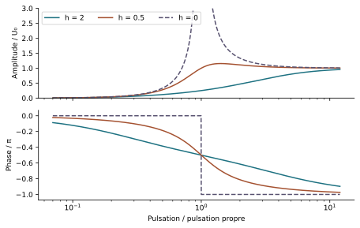
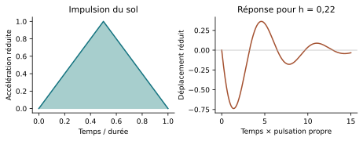
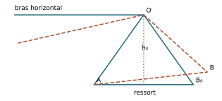

# Banque PT — Physique A 2005 · Corrigé brut

*Corrigé rédigé par IA, non officiel. Signalez toute erreur.*

**Rédaction** · GPT-6.2 Astra Ultra · vitesse non renseignée

**Révision** · GPT-6.2 Astra Ultra · vitesse non renseignée

Un sismomètre enregistre le déplacement de sa masse relativement au châssis. Ce mouvement dépend de la fréquence du sol, du réglage du ressort et de la charge électrique de la bobine. Coefficients d’admissibilité : 6 pour l’École polytechnique, 3 pour l’ENS Cachan. [Sujet officiel](https://www.banquept.fr/IMG/pdf/phys_a_2005.pdf) · [Rapport du jury](https://www.banquept.fr/documents/ecrit/rapport/2005/rapport_phys_a_ecrit_2005.pdf) · [Grille des coefficients](https://www.banquept.fr/documents/livret/2005/Livret_Rose_2005_1_2.pdf#page=12)

## 1.I — Principe de la dynamique

### 1.I.1 · Référentiel galiléen

Pour un point de masse constante, la somme des forces réelles vaut $m\vec a_{\mathcal R}$ dans tout référentiel galiléen $\mathcal R$.

### 1.I.2 · Référentiel mobile

Dans $\mathcal R'$, $m\vec a_{\rm rel}=\sum\vec F-m\vec a_{\rm entr}-2m\vec\Omega\times\vec v_{\rm rel}$. Pour une origine $O'$, $\vec a_{\rm entr}=\vec a_{O'}+\dot{\vec\Omega}\times\overrightarrow{O'M}+\vec\Omega\times(\vec\Omega\times\overrightarrow{O'M})$.

### 1.I.3 · Pendule dans un véhicule

Le poids apparent y vaut $m(\vec g-\vec a_v)$. La tension l’équilibre et le fil s’aligne sur cette verticale apparente. La masse est déportée à l’opposé de l’accélération horizontale, d’un angle $\theta=\arctan(|a_v|/g)$ avec la verticale.

## 1.II — Comportement élastique

### 1.II.1 · Traction d’un ressort

La force sur l’extrémité mobile est $-k(l-l_0)\vec u$ pour un ressort linéaire. Son module en traction est $k(l-l_0)$.

### 1.II.2 · Prétension et longueur apparente

**2.1.** Spires décollées, le module est $F=F_0+k(l-l_0)$. **2.2.** La proportionnalité $F=kl$ exige $F_0=kl_0$. **2.3.** La droite extrapolée s’annule en $l=0$ ; la longueur apparente au repos est nulle, alors que le ressort réel possède la longueur $l_0$ à spires jointives.

### 1.II.3 · Ajout d’un fil

**3.1.** Le module vaut $F_1+k(l-l_1-l_0)$, d’où $l_1=F_1/k-l_0=(F_1-F_0)/k>0$ pour retrouver $F=kl$. **3.2.** Le fil translate l’origine des longueurs et règle à zéro la longueur apparente de l’ensemble, tout en conservant la raideur.

### 1.II.4 · Translation du sol

La translation verticale donne $\vec\Omega=0$, donc le terme de Coriolis est nul quelle que soit la vitesse relative. La force d’inertie de translation subsiste.

## 1.III — Sismomètre pendule

### 1.III.1 · Frottement visqueux

Le modèle linéaire exerce sur la masse $\vec F_d=-D\vec v_{\rm rel}$, où la vitesse est relative au châssis et $D>0$. La puissance dissipée vaut $D v_{\rm rel}^2$.

### 1.III.2 · Équation dans le châssis

**2.1.** Avec l’axe descendant, $u$ déplace le châssis et $\xi$ la masse dans celui-ci. À l’équilibre le ressort compense $Mg$. L’écart obéit à $M\ddot\xi=-k\xi-D\dot\xi-M\ddot u$, soit $\ddot\xi+2\eta\dot\xi+\omega_s^2\xi=-\ddot u$, $\eta=D/(2M)$ et $\omega_s^2=k/M$.

**2.2.** À très haute fréquence $\ddot\xi$ domine à gauche. En régime forcé $\xi\simeq-u$ : la masse reste quasiment fixe dans le référentiel terrestre. **2.3.** À très basse fréquence le rappel domine, $\xi\simeq-\ddot u/\omega_s^2$. Le déplacement relatif mesure alors l’accélération du sol.

### 1.III.3 · Réponse harmonique et résonance

**3.1.** Avec $u=\Re(U_0e^{i\omega t})$, $x=\omega/\omega_s$ et $h=\eta/\omega_s$, on trouve $\underline\xi=U_0H(x)e^{i\omega t}$, $H=x^2/(1-x^2+2ihx)$. Donc $X=U_0x^2/\sqrt{(1-x^2)^2+4h^2x^2}$ et $\Phi=-\operatorname{atan2}(2hx,1-x^2)$.

**3.2.** Pour $x\to0$, $X\sim U_0x^2$ et $\Phi\to0$. Pour $x\to\infty$, $X\to U_0$ et $\Phi\to-\pi$. À $x=1$ et $h>0$, $X/U_0=1/(2h)$ et $\Phi=-\pi/2$.

**3.3 (p. 5).** En posant $x'=1/x$, $Y=U_0^2/X^2=x'^4+(4h^2-2)x'^2+1$. Le minimum intérieur exige $x'^2=1-2h^2>0$. Un maximum de réponse existe à $x_{\rm pic}=1/\sqrt{1-2h^2}$ pour $0<h<1/\sqrt2$. Au seuil et au-delà, le gain croît jusqu’à 1.

**3.4 (p. 5).** Pour $h=2$, pas de pic. Pour $h=0,5$, le maximum vaut $2/\sqrt3$ à $x=\sqrt2$. Pour $h=0$, le gain $x^2/|1-x^2|$ diverge au voisinage de 1 et la phase passe de 0 à $-\pi$. À résonance exacte, il n’y a pas de régime sinusoïdal établi borné.

### 1.III.4 · Sensibilité aux lentes accélérations

**4.1.** $\sigma=|\Delta\xi/\Delta a|=1/\omega_s^2=T_s^2/(4\pi^2)$. **4.2.** Un milligal vaut $10^{-3}$ cm/s², soit $10^{-5}$ m/s². Avec $T_s=60$ s, $|\Delta\xi|\simeq9,12\times10^{-4}$ m, soit $0,91$ mm.

### 1.III.5 · Secousse de durée très courte

L’impulsion d’accélération a une aire $I=a_0t_0/2$. À partir du repos, $\xi$ reste continue et $\dot\xi$ saute à $-I$. Pour $0<h<1$, le pendule répond ensuite par une oscillation libre amortie qui part de zéro avec une pente négative, d’enveloppe exponentielle. Si $h=0$, elle persiste.

## 1.IV — Pendule à longue période

### 1.IV.1 · Équilibre du pendule de Lacoste

**1.1.** La distance horizontale de $C$ à la verticale $AB$ vaut $l\sin\theta=h'_1\sin\phi$. **1.2.** Le moment du ressort de tension $kl$ a pour module $kl h_2\sin\theta=kh_2h'_1\sin\phi$. Celui du poids est opposé, de module $Mgh_1\sin\phi$. Le facteur géométrique est commun.

**1.3.** La compensation pour tout angle exige $Mgh_1=kh_2h'_1$. C’est un équilibre indifférent. Une position singulière strictement verticale annule les deux bras de levier indépendamment de ce réglage.

### 1.IV.2 · Limites du réglage

En théorie, raideur résiduelle nulle et période infinie. En pratique, prétension et géométrie imparfaites, élasticité du pivot, variation de la raideur avec la température et masse des pièces mobiles modifient l’équilibre. Frottements et dérives en compliquent la mesure. Une petite raideur positive rétablit une période finie ; augmenter celle-ci augmente la sensibilité en basse fréquence comme $T_s^2$.

## 2.I — Bras du Geotech SL210

### 2.I.1 · Moments sur l’axe du bras

L’axe vertical est ici ascendant. Dans le châssis, la force d’inertie est $-M\ddot z\,\vec e_z$. Sur l’axe sortant, son moment vaut $ML_0\ddot z\cos\phi$, celui du poids $MgL_0\cos\phi$ et celui du ressort $-Fh$. Le frottement donne $-\Delta\dot\phi$. Ainsi $J\ddot\phi+\Delta\dot\phi+\Theta(\phi)=ML_0\ddot z\cos\phi$, avec $J$ moment d’inertie du mobile sur l’axe, $\Delta$ coefficient de frottement visqueux angulaire et $\Theta=Fh-MgL_0\cos\phi$ opposé au moment statique total.

### 2.I.2 · Géométrie et rappel non linéaire

**2.1.** À l’équilibre $\phi=0$, $MgL_0=k(\xi_0-l_1)h_0$. **2.2.** La rotation augmente l’ouverture du triangle, $\alpha=\gamma+\phi$. **2.3.** La demi-base est $a\sin(\alpha/2)$, d’où $\xi=2a\sin(\alpha/2)$. À $\alpha=\pi/3$ le triangle est équilatéral et $\xi=a$. **2.4.** $h=a\cos(\alpha/2)=\sqrt{a^2-\xi^2/4}$.

**2.5.** En multipliant le bras de levier par la tension, on obtient
$$\Theta(\phi)=ka^2\sin(\gamma+\phi)-kal_1\cos[(\gamma+\phi)/2]-MgL_0\cos\phi.$$
**2.6.** La constante se simplifie par l’équilibre. Le coefficient d’ordre un est $K=ka^2\cos\gamma+(kal_1/2)\sin(\gamma/2)$. Le terme quadratique se réduit, après le même remplacement de $MgL_0$, à $-(3kal_1/8)\cos(\gamma/2)\,\phi^2$. Ainsi $\Theta=K\phi-(3kal_1/8)\cos(\gamma/2)\phi^2+O(\phi^3)$.

**2.7.** Les couples de rappel en $\phi$ et $-\phi$ doivent être opposés. L’annulation du terme pair exige $l_1=0$ pour ce montage non dégénéré. Il faut donc une longueur apparente au repos nulle, $F=k\xi$. **2.8.** Alors $\Theta=ka^2[\sin(\gamma+\phi)-\sin\gamma\cos\phi]=ka^2\cos\gamma\sin\phi$. Au premier ordre $\Theta\simeq U\phi$, $U=ka^2\cos\gamma$.

### 2.I.3 · Stabilité et période propre

**3.1.** Pour $\gamma=\pi/2-\varepsilon$, $U\simeq ka^2\varepsilon$. Si $\varepsilon>0$ l’équilibre est stable, avec de lentes oscillations en l’absence de frottement. À zéro le rappel disparaît. Pour $\varepsilon<0$ l’équilibre est instable. **3.2 (p. 10).** $T_0=2\pi\sqrt{J/U}$ croît en $\varepsilon^{-1/2}$ du côté stable, ce qui améliore la sensibilité aux accélérations lentes.

**3.3 (p. 10).** À géométrie $\gamma$ donnée et à l’équilibre, la pente devient $K=U+(kal_1/2)\sin(\gamma/2)$. Un $l_1>0$ augmente la raideur et réduit la période $2\pi\sqrt{J/K}$ ; il introduit aussi la dissymétrie trouvée précédemment.

## 2.II — Enregistrement électrique

### 2.II.1 · Bobine et amortissement

**1.1.** La longueur totale de fil active $l_b$ inclut toutes les spires. Le champ radial donne le coefficient de conversion $G=Bl_b$. Pour le sens du courant de la figure 9, la f.é.m. vaut $-GL\dot\phi$. Ainsi $i=-GL\dot\phi/(R+\rho)$. **1.2.** Le couple de Laplace $GLi$ ajoute un amortissement. Au premier ordre,
$$J\ddot\phi+\left(\Delta+{G^2L^2\over R+\rho}\right)\dot\phi+U\phi=ML_0\ddot z.$$
**1.3 (p. 11).** La bobine descend quand $\phi$ augmente, donc $s=-L\sin\phi\simeq-L\phi$. Avec $\lambda=J/(ML_0)$,
$$\ddot s+2\Omega_0\beta\dot s+\Omega_0^2s=-{L\over\lambda}\ddot z,\qquad\Omega_0=\sqrt{U/J}.$$
Ici $\beta=\beta_m+\beta_e$, $\beta_m=\Delta/(2J\Omega_0)$ et $\beta_e=G^2L^2/[2J\Omega_0(R+\rho)]$.

### 2.II.2 · Tension et réponse en fréquence

**2.1.** Remplacer $R$ par $R'=RR_e/(R+R_e)$ partout où intervient la charge. Poser $R_T=R'+\rho$ et $K_v=A_0R'G/R_T$. Comme $i=G\dot s/R_T$, la sortie vaut $v=K_v\dot s$.

**2.2.** Dériver l’équation de $s$ et multiplier par $K_v$ :
$$\ddot v+2\Omega_0\beta\dot v+\Omega_0^2v=-K_v(L/\lambda)z^{(3)}.$$
**2.3.** À la pulsation $\omega$, $\underline v/\underline z=iK_v(L/\lambda)\omega^3/(\Omega_0^2-\omega^2+2i\Omega_0\beta\omega)$. Le rapport des amplitudes vaut $|K_v|(L/\lambda)\omega^3/\sqrt{(\Omega_0^2-\omega^2)^2+(2\Omega_0\beta\omega)^2}$. Pour un gain positif, la phase est $\pi/2-\operatorname{atan2}(2\Omega_0\beta\omega,\Omega_0^2-\omega^2)$, à $2\pi$ près. **2.4.** $R_C=\beta_eR_T=G^2L^2/(2J\Omega_0)$.

### 2.II.3 · Étalonnage par décroissance libre

**3.1.** $R_C=(\beta-\beta_m)R_T$ et $G=\sqrt{2J\Omega_0 R_C}/L$, où $\Omega_0=2\pi/T_0$. **3.2.** Les longueurs en mètres donnent $J=M L_0\lambda=2(0,195)(0,205)=0,07995$ kg m². Alors $G\simeq3,58\sqrt{(\beta-\beta_m)R_T/T_0}$ en T m pour $R_T$ en ohms et $T_0$ en secondes.

**3.3 (p. 12).** En circuit ouvert $\beta_e=0$, et sans séisme $\ddot s+2\beta_m\Omega_0\dot s+\Omega_0^2s=0$. Pour $\beta_m<1$ la pulsation amortie est $\Omega_0\sqrt{1-\beta_m^2}$, donc $T_0=T'_0\sqrt{1-\beta_m^2}$. **3.4.** Les amplitudes sont sous l’enveloppe $\exp(-\beta_m\Omega_0t)$, d’où $\delta=\ln(a_n/a_{n+1})=2\pi\beta_m/\sqrt{1-\beta_m^2}$ et $\beta_m=\delta/\sqrt{4\pi^2+\delta^2}$.

**3.5.** Fermer sur la résistance équivalente prescrite et relever deux maxima de même signe dans le régime pseudo-périodique. Le même calcul avec leur décrément $\delta_c$ donne $\beta=\delta_c/\sqrt{4\pi^2+\delta_c^2}$. Sur $N$ périodes, utiliser $\delta_c=N^{-1}\ln(a_n/a_{n+N})$. Avec des extrema alternés de signes contraires on ne compte qu’une demi-période ; le choix de deux crêtes positives évite cette ambiguïté.
