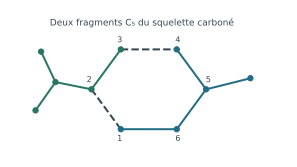
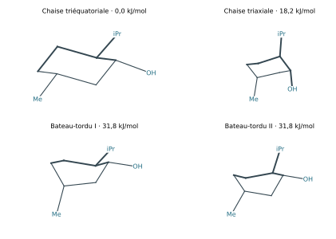
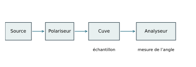
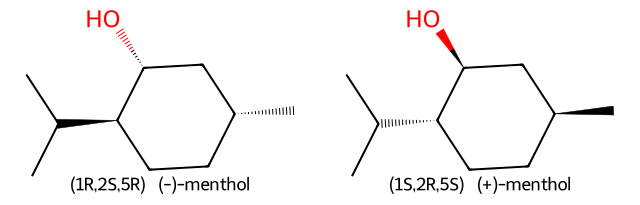
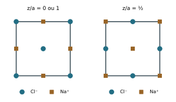
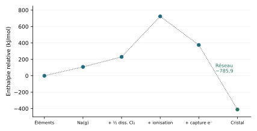

# ENS de Lyon — Second concours, Chimie 2005 · Corrigé brut

*Corrigé rédigé par IA, non officiel.*

**Rédaction (tour 1)** · GPT-6.2 Astra Ultra · vitesse non renseignée

Ces éditions traitent 43 des 46 questions ou sous-questions terminales. Toute la partie B est couverte, notamment les deux approches de l’énergie de réseau et les deux interprétations géométriques du rayon de site octaédrique. En A, les questions A.15, A.19 et A.20 sur la réalisation et le dimensionnement de la voie de synthèse restent hors couverture. Les configurations et le spectre IR ont été lus sur le scan. Les énergies de conformères ajoutées pour A.3 sont des estimations de modèle, explicitement distinguées des données de l’épreuve.

## A.1. Structure du menthol

### Question A.1 — Formule du menthol

Le cycle compte six carbones. Le méthyle en ajoute un, le groupe isopropyle trois. Une molécule saturée à un cycle et dix carbones a pour formule **$\mathrm{C_{10}H_{20}O}$**. Avec les masses de l’annexe, $M=10\times12+20\times1+16=\mathbf{156\,g\,mol^{-1}}$.

### Question A.2 — Deux unités isopréniques

L’isoprène est $\mathrm{CH_2=C(CH_3){-}CH=CH_2}$. Le menthol est un monoterpène à deux unités carbonées C5. En numérotant C1 au carbone porteur de OH et C2 au carbone porteur d’isopropyle, un découpage cohérent regroupe **C2 et C3 avec les trois carbones de l’isopropyle**. L’autre fragment réunit **C4, C5, C6, C1 et le méthyle de C5**. Les liaisons cycliques entre fragments sont C1–C2 et C3–C4. Ce découpage suit le squelette carboné, indépendamment des liaisons doubles de l’isoprène libre.

### Question A.3 — Conformations du cycle

Les groupes OH de C1 et Me de C5 sont sur la même face. Le groupe isopropyle de C2 est sur l’autre. La chaise de plus basse énergie place **les trois substituants équatoriaux**. Son inversion les rend tous axiaux et introduit plusieurs interactions 1,3-diaxiales. Le cycle peut aussi se tordre vers des formes bateau-tordu. Deux exemples sont figurés avec les deux chaises. Le classement numérique de ces quatre géométries est porté sur la figure, les énergies croissantes indiquant la stabilité décroissante dans le modèle choisi. Les formes non chaises présentent notamment des contraintes de torsion. Aucune énergie expérimentale ni orientation des groupes latéraux n’est imposée par le sujet. Un bateau idéal présente en outre des éclipsages et des interactions de « mât de pavillon ».

### Question A.4 — Rotation du plan de polarisation

Le signe $(-)$ désigne un composé **lévogyre** dans les conditions de mesure. La lumière passe du polariseur à la cuve puis à l’analyseur. On règle d’abord l’appareil avec le blanc, puis on mesure l’angle de rotation de l’analyseur nécessaire pour retrouver la même extinction après introduction de la substance. Suivant la convention de la polarimétrie, la rotation est négative. Le résultat dépend notamment de la longueur d’onde, de la température, du milieu, de la longueur de cuve et de la concentration.

### Question A.5 — Centres et nombre de configurations

Dans le cycle, **C1, C2 et C5** voient chacun quatre substituants distincts. Il y a trois centres stéréogènes et aucune symétrie interne ne réduit le total. On dénombre **$2^3=8$ stéréoisomères de configuration**, soit quatre couples d’énantiomères.

### Question A.6 — Image miroir et perception

L’énantiomère est le **(+)-menthol**, $(1S,2R,5S)$, image miroir du composé imprimé. Sur le même hexagone plan, inverser chacune des trois liaisons en coin vers OH, isopropyle et méthyle. En milieu achiral les deux molécules ont les mêmes énergies et la même stabilité. Leurs interactions avec des récepteurs sensoriels chiraux sont diastéréoisomères. Les affinités et les réponses sensorielles peuvent donc différer.

### Question A.7 — Configurations du menthol naturel

En C1, OH précède la branche C2, puis C6, puis H. En C2, la branche C1 ($[\mathrm{O,C,H}]$) précède le carbone de l’isopropyle ($[\mathrm{C,C,H}]$), qui précède C3 ($[\mathrm{C,H,H}]$), puis H. En C5, la direction C6 atteint en premier le carbone portant O, et précède la direction C4, puis Me et H. La lecture des coins du dessin donne **$(1R,2S,5R)$**, soit le (−)-menthol.

### Question A.8 — Dédoublement d’un racémique

Une chromatographie sur une **phase stationnaire chirale** établit avec les deux énantiomères des interactions différentes. On recueille séparément les fractions et on identifie celle du (−)-menthol par comparaison à une référence, par exemple à l’aide du signe de la rotation dans les mêmes conditions. Dans un milieu entièrement achiral, une méthode fondée sur leurs seuls points d’ébullition ne les distingue pas.

## A.2. Identification du citronellal et de l’isopulégol

### Question A.9 — Entraînement à la vapeur et hydrodistillation

Pour deux liquides peu miscibles, la pression totale de vapeur est, en première approximation, la somme des pressions de vapeur de chaque phase. L’ébullition peut donc se produire à une température inférieure au point d’ébullition du composé organique pur. L’eau et le composé volatil passent ensemble en vapeur. Dans l’entraînement à la vapeur, une vapeur d’eau produite séparément traverse la matière végétale. En hydrodistillation, la matière est au contact de l’eau qui produit la vapeur dans le même récipient.

### Question A.10 — Conditions sur le composé volatil

Le citronellal doit être peu miscible à l’eau, posséder une pression de vapeur appréciable dans le domaine considéré et rester chimiquement suffisamment stable en présence de l’eau. La faible miscibilité permet l’addition des pressions partielles et favorise la séparation après condensation.

### Question A.11 — Formule à partir des pourcentages

Une mole contient $154{,}3\times0{,}778\simeq120\,\mathrm g$ de C, soit dix atomes de C par molécule. La masse d’oxygène est $154{,}3\times0{,}104\simeq16\,\mathrm g$, soit un O. Le reste correspond à environ dix-huit hydrogènes. La formule est **$\mathrm{C_{10}H_{18}O}$**, avec deux degrés d’insaturation.

### Question A.12 — Ce qu’indiquent les tests

La décoloration du dibrome est compatible avec une double liaison C=C. Une réponse à la 2,4-DNPH correspond à la formation d’une hydrazone colorée et indique un carbonyle d’aldéhyde ou de cétone. La liqueur de Fehling donne une réponse positive avec formation d’oxyde cuivreux rouge brique dans le cas de cet aldéhyde. Les deux insaturations du citronellal sont donc **une liaison C=C et un carbonyle aldéhydique**.

### Question A.13 — Reconstituer le citronellal

Le diacide est l’**acide 3-méthylhexanedioïque**, $\mathrm{HOOC{-}CH_2{-}CH(CH_3){-}CH_2{-}CH_2{-}COOH}$. Le fragment propanone impose que l’autre carbone de l’ancienne double liaison porte deux méthyles. En rétablissant cette liaison et l’aldéhyde d’origine, on trouve $\mathrm{OHC{-}CH_2{-}CH(CH_3){-}CH_2{-}CH_2{-}CH=C(CH_3)_2}$, le **3,7-diméthyloct-6-énal**.

### Question A.14 — Stéréoisomérie du citronellal

L’un des carbones de l’alcène porte deux méthyles identiques, ce qui exclut l’isomérie E/Z. Seul C3 est stéréogène. Il y a donc **deux énantiomères**. Pour dessiner le (3R), mettre H en arrière et disposer dans le sens horaire $\mathrm{{-}CH_2CHO}$, $\mathrm{{-}CH_2CH_2CH=C(CH_3)_2}$, puis $\mathrm{{-}CH_3}$. Les deux branches commencent par $\mathrm{CH_2}$, mais l’oxygène du côté aldéhyde tranche la comparaison CIP.

*Question A.15 hors couverture.*

### Question A.16 — Isopulégols issus d’un seul énantiomère

La cyclisation crée deux centres stéréogènes tandis que le centre préexistant conserve son arrangement. Il peut donc se former **quatre isopulégols au total**, dont le produit 4 et trois autres diastéréoisomères de 4. Ces diastéréoisomères peuvent avoir des rétentions différentes sur une phase achirale. Une séparation chromatographique et une identification des fractions fournissent un mode de résolution.

### Question A.17 — Lecture du spectre infrarouge

L’abscisse est le **nombre d’onde**, en $\mathrm{cm^{-1}}$, décroissant vers la droite. L’ordonnée est la **transmittance**, ici de 0 à 100 %. Une absorption apparaît comme un creux. Le large creux vers $3400\,\mathrm{cm^{-1}}$ correspond au OH associé de l’alcool. Les C–H aliphatiques contribuent près de $2850$–$2960\,\mathrm{cm^{-1}}$ et le creux vers $1640\,\mathrm{cm^{-1}}$ est compatible avec C=C. La région vers $900\,\mathrm{cm^{-1}}$ convient à un méthylène terminal, et aucune forte bande de carbonyle n’est attendue.

### Question A.18 — Distinguer le précurseur et l’alcool

Le citronellal possède une forte bande C=O d’aldéhyde vers $1720$–$1740\,\mathrm{cm^{-1}}$, souvent accompagnée de faibles signaux C–H aldéhydiques. Il ne présente pas la large bande OH de l’isopulégol. Les deux molécules contiennent un alcène, de substitution différente.

*Question A.19 hors couverture.*

*Question A.20 hors couverture.*

## B.1. Aluminium et espèces dissoutes

### Question B.1 — Métaux et minerais

Un métal se caractérise, à l’état massif, par des électrons partiellement délocalisés et une bonne conduction électrique ; le cuivre, l’aluminium et le fer en sont des exemples. Dans de nombreux environnements terrestres, la combinaison avec O ou S abaisse l’énergie libre. L’alumine $\mathrm{Al_2O_3}$, l’hématite $\mathrm{Fe_2O_3}$ et la galène $\mathrm{PbS}$ illustrent ces minerais. Des métaux moins facilement oxydés, comme l’or, se rencontrent aussi à l’état natif.

### Question B.2 — Configuration de l’aluminium

$\mathrm{Al}$ a pour configuration $1s^2\,2s^2\,2p^6\,3s^2\,3p^1$. La perte formelle des trois électrons de la couche externe laisse la configuration du néon. Le degré d’oxydation usuel est ainsi **+III** dans de nombreux composés.

### Question B.3.a — Aluminium dans l’alumine

L’oxygène oxyde a le degré $-\mathrm{II}$. Pour $\mathrm{Al_2O_3}$, $2x+3(-2)=0$, donc $x=+3$. Ce résultat concorde avec la configuration électronique.

### Question B.3.b — Formule, Lewis et solide réel

Une écriture ionique de Lewis regroupe deux $\mathrm{Al^{3+}}$ et trois $\mathrm{O^{2-}}$, chaque oxyde ayant quatre doublets. Pour un motif moléculaire formel, $\mathrm{O{=}Al{-}O{-}Al{=}O}$ respecte la stœchiométrie avec des Al déficients en électrons, deux doublets libres sur chaque O et des charges formelles nulles. Dans le **corindon solide**, la structure est un réseau tridimensionnel. Chaque Al a six voisins O dans un octaèdre déformé et chaque O quatre voisins Al, approximativement tétraédriques. Le bilan des liaisons $2\times6=3\times4$ vérifie ces coordinences. Un dessin de molécule isolée ne suffit donc pas à représenter le cristal.

### Question B.4 — Couleur des corindons

Des ions à l’état de traces substitués à l’aluminium introduisent des absorptions dans le visible. Le chrome(III) est responsable du rouge du rubis. Dans de nombreux saphirs bleus, des impuretés de fer et de titane permettent un transfert de charge sélectif. La lumière transmise ou diffusée a la couleur complémentaire des bandes absorbées.

### Question B.5 — Phases séparées dans le traitement de la bauxite

Dans le modèle du procédé, l’aluminium amphotère passe dans la phase liquide sous forme d’aluminate. La boue rouge éliminée contient notamment les oxydes de fer et d’autres résidus insolubles. La silice peut rester dans les résidus ou passer partiellement en solution sous forme de silicates. La précipitation récupère l’aluminium sous forme hydratée, séparée par filtration des espèces restées dissoutes, notamment du sodium et des silicates solubles. L’équilibre précis des silicates dépend du minerai et du procédé.

### Question B.6 — Lire le diagramme de distribution

En milieu acide, Al³⁺ est majoritaire, donc **A représente $x_1$**. En milieu basique, l’aluminate $\mathrm{[Al(OH)_4]^-}$ prédomine, donc **B représente $x_3$**. La courbe en cloche **C représente $x_2$**, fraction de $\mathrm{[Al(OH)]^{2+}}$. Ces fractions portent sur l’aluminium dissous en présence d’hydroxyde solide. Leur somme vaut un.

### Question B.7 — Amphotérie et précipitation

Quand le pH monte, l’aluminium hydrolysé peut former le précipité $\mathrm{Al(OH)_3(s)}$. À pH plus élevé, le précipité se redissout en aluminate, $\mathrm{Al(OH)_3(s)+OH^-\rightleftharpoons [Al(OH)_4]^-}$. La récupération maximale correspond au minimum de la solubilité totale, dans la région de transition autour de pH 6 sur le dessin. Les seules fractions normalisées ne donnent pas directement la quantité absolue précipitée. Dans le modèle à trois espèces, $s=A/[\mathrm{OH^-}]^3+B/[\mathrm{OH^-}]^2+C[\mathrm{OH^-}]$ et son minimum vérifie $x_3=3x_1+2x_2$.

## B.2. Structure de la halite

### Question B.8.a — Maille cubique faces centrées

Les huit sommets et les six centres de face du cube sont occupés. L’appartenance est $8/8+6/2=\mathbf4$ atomes par maille conventionnelle. Chaque atome a **12 plus proches voisins**. Sur les trois coupes de la figure de B.9, ne conserver que les disques du sous-réseau des chlorures pour obtenir cette maille CFC.

### Question B.8.b — Relation de contact en CFC

La diagonale d’une face mesure $a\sqrt2$ et relie deux sommets en passant par le centre de face. Elle représente quatre rayons, d’où **$a=2\sqrt2\,R$**.

### Question B.8.c — Compacité du réseau CFC

$C=4(4\pi R^3/3)/a^3=\pi/(3\sqrt2)\simeq\mathbf{0{,}740}$. C’est l’une des structures compactes pour des sphères identiques.

### Question B.9 — Structure halite

Placer les chlorures aux sommets et centres de face. Placer les sodiums au centre du cube et aux milieux des douze arêtes. On compte quatre chlorures et $1+12/4=4$ sodiums, soit **huit ions ou quatre unités NaCl** par maille. Chaque ion a six voisins de signe opposé dans une géométrie octaédrique. Les deux sous-réseaux CFC sont décalés de $a/2$ le long d’une arête.

### Question B.10 — Taille du site octaédrique

Pour des anions rigides en empilement compact en contact, $a=2\sqrt2 R_-$ et le rayon disponible au centre d’un site octaédrique est $a/2-R_-=(\sqrt2-1)R_-$. Un cation peut se loger **sans dilater** cet empilement si $R_+\leq(\sqrt2-1)R_-$. Dans l’autre lecture, où le cation doit toucher ses six voisins et où ceux-ci ne peuvent se chevaucher, la condition de non-recouvrement donne **$R_+/R_-\geq\sqrt2-1\simeq0{,}414$**. Le modèle usuel des rapports de rayons situe la coordinence six entre environ 0,414 et 0,732. L’égalité correspond au contact simultané cation–anion et anion–anion.

### Question B.11 — Distance interionique

Dans le modèle de contact, $r_0=R_++R_-=a/2$. Par ailleurs $\rho=4M/(N_Aa^3)$, donc $r_0=\frac12[4M/(N_A\rho)]^{1/3}$. Avec $M=58{,}5\,\mathrm{g\,mol^{-1}}$, $\rho=2{,}2\,\mathrm{g\,cm^{-3}}$ et $N_A=6{,}0\times10^{23}\,\mathrm{mol^{-1}}$, $a\simeq562\,\mathrm{pm}$ et **$r_0\simeq281\,\mathrm{pm}$**.

### Question B.12 — Compacité de NaCl

Comme $R_+=97{,}0\,\mathrm{pm}$, on déduit $R_-\simeq184\,\mathrm{pm}$. Les quatre cations et quatre anions donnent $C=[4(4\pi/3)(R_+^3+R_-^3)]/a^3\simeq\mathbf{0{,}674}$. Ce remplissage est inférieur à celui d’un CFC compact de sphères égales. Les positions d’un sous-réseau CFC n’impliquent pas que ses anions soient tangents dans le cristal réel.

## B.3. Énergie de réseau

### Question B.13.a — Formation standard du solide

La réaction standard de formation d’une mole de sel est $\mathrm{Na(s)+\tfrac12Cl_2(g)\to NaCl(s)}$. La réaction de **formation du réseau** part, elle, des ions gazeux isolés, $\mathrm{Na^+(g)+Cl^-(g)\to NaCl(s)}$. Les deux grandeurs sont reliées par le cycle de Born–Haber.

### Question B.13.b — Cycle de Born–Haber

En notant $A_E$ l’énergie positive libérée à la capture d’un électron par Cl, la loi de Hess donne $\Delta_fH^\circ=\Delta_{\rm sub}H^\circ(\mathrm{Na})+\tfrac12D(\mathrm{Cl_2})+I_1(\mathrm{Na})-A_E(\mathrm{Cl})+R_0$. On isole donc **$R_0=\Delta_fH^\circ-\Delta_{\rm sub}H^\circ-\tfrac12D-I_1+A_E$** dans la convention de formation du réseau. Le problème demande le calcul à 0 K en assimilant les données fournies à celles du cycle. Des corrections thermiques seraient nécessaires pour une conversion exacte de température.

### Question B.13.c — Énergie du réseau par le cycle

Les valeurs de l’annexe donnent $R_0=-411{,}1-107{,}8-122{,}0-494{,}0+349{,}0=\mathbf{-785{,}9\,\mathrm{kJ\,mol^{-1}}}$. La dissociation du cristal en ions gazeux aurait la valeur opposée. La donnée d’atomisation de Na sur le scan vaut bien $+107{,}8\,\mathrm{kJ\,mol^{-1}}$.

### Question B.14.a — Énergie d’une paire d’ions

Si $z_+$ et $z_-$ désignent les valeurs absolues des nombres de charge, l’énergie électrostatique d’une paire opposée à distance $r$ vaut **$E_0=-z_+z_-e^2/(4\pi\varepsilon_0r)$**. Son signe négatif traduit la baisse d’énergie lors du rapprochement.

### Question B.14.b — Somme sur le réseau

L’énergie coulombienne molaire s’écrit $E_C=N_A A E_0$. $N_A$ compte les unités de formule par mole. Le nombre de Madelung $A$ est la somme géométrique sans dimension qui tient compte de toutes les attractions et répulsions des autres ions, dans la géométrie du réseau, avec le comptage approprié des paires. Pour la structure NaCl, le sujet prend $A=1{,}7$.

### Question B.15.a — Attraction et répulsion

Posons $K=N_AAz_+z_-e^2/(4\pi\varepsilon_0)>0$. Dans la convention molaire du sujet, $E(r)=E_C+E_R=-K/r+B/r^n$. Le premier terme est attractif, le second est positif et augmente rapidement aux courtes distances.

### Question B.15.b — Position du minimum

$E'(r)=K/r^2-nB/r^{n+1}$. La condition $E'(r_0)=0$ impose **$B=Kr_0^{n-1}/n$**. Pour $n>1$, $E''(r_0)=(n-1)K/r_0^3>0$, ce qui confirme le minimum.

### Question B.15.c — Relation de Born–Landé

L’évaluation à l’équilibre donne $E(r_0)=-(K/r_0)(1-1/n)$. Pour NaCl, $z_+=z_-=1$, donc **$E(r_0)=-[N_AAe^2/(4\pi\varepsilon_0 r_0)](1-1/n)$**.

### Question B.16 — Exposant de Born

Na⁺ possède dix électrons, comme Ne, et Cl⁻ dix-huit, comme Ar. Les exposants de la table sont 7 et 9. La moyenne demandée est **$n=(7+9)/2=8$**.

### Question B.17 — Comparer les évaluations énergétiques

Avec $r_0=2{,}81\times10^{-10}\,\mathrm m$, $n=8$ et les constantes imprimées, Born–Landé fournit **$E\simeq-7{,}27\times10^2\,\mathrm{kJ\,mol^{-1}}$**. La valeur de Born–Haber est voisine de $-786\,\mathrm{kJ\,mol^{-1}}$, soit un écart d’environ $59\,\mathrm{kJ\,mol^{-1}}$ (7,5 %). Le cycle fondé sur des grandeurs thermochimiques est généralement plus précis. Le modèle de Born–Landé utilise des charges ponctuelles, une répulsion empirique et des constantes sensiblement arrondies.

### Question B.18 — Comparaison avec le chlorure de calcium

Le cation calcium porte deux charges positives. L’attraction coulombienne avec les chlorures est plus forte pour des distances comparables. Une unité de formule de $\mathrm{CaCl_2}$ comprend deux anions. On attend donc une **énergie de formation du réseau plus négative en valeur molaire** pour $\mathrm{CaCl_2}$ que pour NaCl. La structure et les distances interioniques interviennent aussi dans la valeur quantitative.
