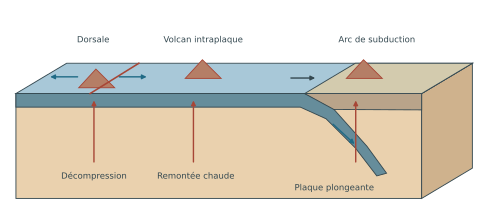
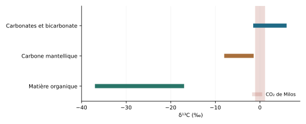
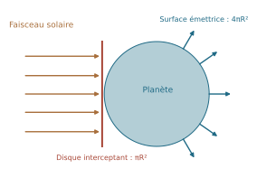
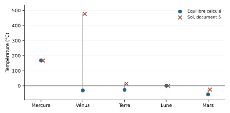

# ENS de Lyon — Second concours, Géosciences 2005 · Corrigé brut

*Corrigé rédigé par IA, non officiel.*

**Rédaction (tour 1)** · GPT-6.2 Astra Ultra · vitesse non renseignée

Les 43 consignes sont traitées sur les sept pages du sujet. Les deux questions imprimées 4.4.2 portent ici les repères 4.4.2a (albédo terrestre) et 4.4.2b (puissance incidente d’une planète). Le calcul du volume de magma précise la densité supposée. L’archive 2005 ne rattache pas de rapport écrit à cette épreuve.

## 1. Volcanisme terrestre et planétaire

### Question 1.1 — Lire la carte du volcanisme mondial

Le volcanisme basaltique sous-marin dessine de longues lignes dans l’axe des océans, le long des dorsales. Le volcanisme basaltique aérien groupé suit notamment le rift est-africain et certaines rides ou zones d’extension émergées. Des édifices basaltiques isolés s’égrènent à l’intérieur de plaques, par exemple Hawaï dans le Pacifique et La Réunion dans l’océan Indien. Le volcanisme andésitique se concentre en arcs, particulièrement autour du Pacifique (Andes, Japon, arcs du Pacifique occidental) et aux Antilles. Ces alignements expriment la subduction. L’Islande illustre la superposition possible d’une dorsale et d’une anomalie mantellique chaude.

### Question 1.2 — Construire un bloc-diagramme géodynamique

Sur le bloc, les deux flancs d’une dorsale s’écartent et la péridotite chaude monte sous l’axe. Une remontée localisée de manteau chaud alimente un édifice intraplaque. Plus loin, une plaque océanique plonge sous une autre plaque et l’arc se place au-dessus du coin de manteau. Un rift émergé est l’équivalent continental d’une extension avec amincissement et remontée du manteau. Les positions et les profondeurs du dessin sont schématiques.

### Question 1.3 — Relier contexte et fusion partielle

À la dorsale et sous un rift, l’ascension du manteau s’accompagne d’une baisse de pression assez rapide pour provoquer la fusion partielle par décompression. Sous un point chaud, une anomalie positive de température et la décompression favorisent la fusion. Dans un arc, la déshydratation de la plaque subduite apporte de l’eau au coin mantellique. L’eau abaisse le solidus de la péridotite, qui fond partiellement. Cristallisation fractionnée, mélange et assimilation peuvent ensuite modifier le magma lors de son séjour dans la croûte.

### Question 1.4 — Comparer les éléments majeurs

Les basaltes de dorsale sont typiquement tholéiitiques, proches de 45–52 % de SiO₂, riches en Fe, Mg et Ca relativement aux laves plus différenciées. Les basaltes intraplaques et de rift peuvent être alcalins (Na₂O + K₂O plus élevés à teneur en silice comparable) ou tholéiitiques. Les arcs fournissent des basaltes et une série souvent calco-alcaline comprenant andésites, dacites et rhyolites. L’andésite contient typiquement 57–63 % de SiO₂, les dacites davantage et les rhyolites plus de 69 % environ. La différenciation fait généralement augmenter la silice et diminuer MgO et CaO dans les liquides résiduels. Les champs de composition se recouvrent entre contextes.

### Question 1.5 — Nommer les gaz volcaniques

La vapeur d’eau est généralement dominante, accompagnée de CO₂ et de composés soufrés, notamment SO₂, parfois H₂S selon les conditions. Des quantités moindres de HCl, HF et d’autres gaz sont présentes. Les proportions dépendent du magma, de la pression de dégazage et des interactions avec le système hydrothermal.

### Question 1.6 — Distinguer les styles éruptifs

Une éruption effusive produit principalement coulées ou dômes. Les éruptions explosives fragmentent le magma à des degrés variés, des projections stromboliennes aux colonnes pliniennes et aux courants de densité pyroclastiques. Un contact avec l’eau externe peut donner un dynamisme phréatomagmatique, ou une explosion phréatique de vapeur sans nouvelle lave émise. La composition, la température et la cristallinité règlent la viscosité. Teneur en volatils et aptitude du magma à les laisser s’échapper contrôlent la surpression et la fragmentation. Un même volcan peut changer de style.

### Question 1.7 — Recenser les témoins extraterrestres

Io, satellite de Jupiter, possède un volcanisme silicaté actif directement observé. Les mers basaltiques de la Lune, les grands boucliers de Mars comme Olympus Mons, les plaines volcaniques de Mercure et les édifices de Vénus témoignent d’épisodes volcaniques. Vénus présente aussi des indices d’activité récente. Sur des satellites glacés, certaines manifestations relèvent du cryovolcanisme au sens large, comme les panaches d’Encelade. Les jets observés sur Triton peuvent également être liés à des phénomènes superficiels de sublimation. Leur origine n’est donc pas nécessairement celle d’un volcan silicaté.

### Question 1.8 — Relier source d’énergie et nature du matériau

Dans les planètes rocheuses, chaleur d’accrétion et de différenciation, radioactivité et refroidissement de l’intérieur entretiennent ou ont entretenu une fusion partielle du manteau. La faible taille de la Lune ou de Mercure a facilité leur refroidissement. Sur Mars, des remontées mantelliques sous une lithosphère peu mobile peuvent construire d’immenses boucliers. Io dissipe une partie de l’énergie des déformations de marée entretenues par sa résonance orbitale. Dans certains satellites glacés, le chauffage interne ou les marées mobilisent de l’eau et d’autres volatils. La lithologie et les sources de chaleur diffèrent suivant l’astre.

## 2. Flux géothermique

### Question 2.1 — Interpréter la distribution de flux

Les flux faibles, souvent 20–40 mW/m² sur cette carte, caractérisent les vieux boucliers canadien, africain ou antarctique et la plate-forme russe. La lithosphère y est froide et épaisse. Aux dorsales, particulièrement dans le Pacifique Est, le flux dépasse localement 100 mW/m². Du matériau chaud monte sous l’axe et la lithosphère jeune perd beaucoup de chaleur. Les régions de magmatisme actif ou d’extension donnent aussi des anomalies. Une marge de subduction peut juxtaposer avant-arc froid et secteur d’arc ou d’arrière-arc plus chaud. Le document mondial ne résout pas tous ces contrastes locaux.

### Question 2.2 — Identifier les sources de chaleur profonde

La chaleur héritée de l’accrétion, des impacts et de la différenciation se dissipe lentement. La désintégration de radioéléments à longue période (U, Th, K) produit encore de la chaleur dans les enveloppes silicatées. La cristallisation de la graine libère chaleur latente et énergie gravitationnelle de différenciation dans le noyau. Les mouvements de convection transportent ces énergies internes vers la surface.

### Question 2.3 — Calculer l’énergie thermique annuelle

Avec $R_T=6,37\times10^6$ m, la surface terrestre est $4\pi R_T^2=5,10\times10^{14}$ m². La puissance vaut $0,082\times5,10\times10^{14}=4,18\times10^{13}$ W, soit 41,8 TW. En multipliant par $3,156\times10^7$ s, on obtient **$1,32\times10^{21}$ J par an**.

### Question 2.4 — Relier la dissipation à des phénomènes observables

Le flux diffus, le volcanisme et l’hydrothermalisme témoignent de la perte de chaleur. La convection mantellique, la tectonique des plaques, la formation des reliefs et la sismicité associée manifestent la conversion d’une partie de l’énergie interne en mouvements et en déformation. Dans le noyau externe, la convection contribue à la dynamo qui entretient le champ magnétique terrestre.

## 3. Milos et le transport de chaleur

### Question 3.1 — Intégrer le flux de CO₂ de Milos

Le dégazage vaut $6,3\times10^7\times35=2,205\times10^9$ kg/an, soit **2,21 millions de tonnes par an**.

### Question 3.2 — Extrapoler le dégazage sur 3,18 Ma

Le bilan cumulé serait $(2,205\times10^9)(3,18\times10^6)=7,012\times10^{15}$ kg de CO₂, soit environ $7,01\times10^{12}$ t. Ce nombre dépend entièrement de l’extrapolation du débit actuel sur plusieurs millions d’années.

### Question 3.3 — Calculer la masse du magma parent

Si tout le CO₂ dissous est libéré, la masse de magma nécessaire est $7,012\times10^{12}/0,005=1,40\times10^{15}$ t. C’est un minimum sous cette hypothèse, car un dégazage incomplet augmenterait la masse nécessaire.

### Question 3.4 — Déduire un volume de magma

En conservant $\rho_m$ en t/m³, $V=(1,40\times10^{15})/\rho_m$ m³. Pour illustrer, avec un magma de masse volumique **2,7 t/m³**, $V\simeq5,19\times10^{14}$ m³, soit **$5,19\times10^5$ km³**. Une valeur de 2,5 t/m³ donnerait environ $5,61\times10^5$ km³, du même ordre.

### Question 3.5 — Tester la dimension verticale d’une chambre

Avec le volume estimé à 2,7 t/m³ et une empreinte de 35 km², $H=5,19\times10^5/35\simeq1,48\times10^4$ km. Cette épaisseur équivalente dépasse même le diamètre terrestre. Elle signale immédiatement une difficulté dans le modèle d’une chambre locale unique.

### Question 3.6 — Interpréter l’invraisemblance du modèle

Une chambre locale unique de 35 km² ne peut stocker simultanément le volume calculé. Une contribution magmatique demeure possible avec un système alimenté et renouvelé, une aire drainée plus vaste, un dégazage moyen différent du flux actuel et/ou une source de carbone supplémentaire. Le volume cumulé sur 3,18 Ma et le volume instantané d’une chambre sont deux grandeurs distinctes.

### Question 3.7.1 — Lire une anomalie de vitesse sismique

Une anomalie positive, bleue, indique des vitesses plus grandes que la référence. Dans le manteau, une portion de plaque océanique froide et rigide constitue une interprétation fréquente. Une anomalie négative, rouge, traduit des vitesses plus faibles, souvent associées à une température supérieure, à l’hydratation ou à un peu de fusion. Composition, phases minérales et résolution tomographique contribuent aussi au contraste.

### Question 3.7.2 — Interpréter la coupe égéenne

L’anomalie rapide s’enfonce en direction du nord sous la mer Égée. Elle s’interprète comme le panneau de lithosphère africaine subduit sous le domaine égéen. L’alignement des foyers sismiques dans sa partie supérieure et l’arc volcanique dont fait partie Milos confortent ce modèle. Au-dessus du panneau, le manteau plus chaud et hydraté contribue au magmatisme.

### Question 3.8 — Relier éclogites, schistes bleus et marbres

Les schistes bleus et les éclogites enregistrent la haute pression atteinte lors de l’enfouissement en subduction, à température relativement faible pour la profondeur, surtout pour les schistes bleus. Les marbres proviennent de roches carbonatées recristallisées lors du métamorphisme. Leur voisinage avec ces roches de haute pression est compatible avec l’entrée de sédiments carbonatés ou de séries de marge dans la subduction, puis avec leur exhumation. Pris seul, un marbre ne signe pas une subduction.

### Question 3.9 — Identifier les réservoirs de carbone possibles

L’intervalle mesuré recoupe les domaines proches de zéro des **carbonates marins et du bicarbonate marin**. La matière organique et le carbone réduit des roches sont beaucoup plus négatifs. Le réservoir mantellique est également plus négatif sur la figure, et le domaine du CO₂ atmosphérique et marin s’arrête plus bas que l’essentiel de la plage observée. Les données appuient une contribution dominante de carbone carbonaté. Une signature proche de zéro ne permet pas à elle seule d’exclure un mélange.

### Question 3.10 — Proposer l’origine du CO₂ profond

Des roches carbonatées entraînées dans le système de subduction peuvent participer à des réactions métamorphiques de décarbonatation au contact de silicates. Un bilan minéralogique illustratif est calcite + quartz → wollastonite + CO₂. Les carbonates, ou le carbone dissous dans les fluides issus de la plaque, alimentent ainsi un transfert profond. La migration ascendante des fluides et les circulations hydrothermales expliquent un dégazage régional sans exiger que tout le carbone provienne d’une chambre isolée sous les 35 km². Le trajet exact demeure une interprétation de la tomographie et de la géochimie.

### Question 3.11 — Calculer la chaleur transportée annuellement

$2,205\times10^9$ kg/an correspondent à $2,205\times10^{12}$ g/an. La chaleur sensible transportée selon l’énoncé est $2,205\times10^{12}\times1,13=2,492\times10^{12}$ kJ/an, soit **$2,49\times10^{15}$ J/an** pour un refroidissement de 1 000 °C.

### Question 3.12 — Ramener le transport à un flux local

La puissance correspondante est environ $2,49\times10^{15}/3,156\times10^7=7,9\times10^7$ W. Répartie sur $35\times10^6$ m², elle donne **2,26 W/m²**. Ce flux est environ $2,26/0,082=27,5$ fois supérieur au flux géothermique global moyen.

### Question 3.13 — Comparer au gradient mesuré

Le gradient local de 8–10 °C par 100 m vaut 80–100 K/km, nettement plus élevé qu’un gradient continental ordinaire. Il est qualitativement compatible avec une remontée importante de chaleur dans la zone hydrothermale. Pour une conductivité illustrative de 2,5 W/(m·K), il donnerait un flux **conducteur** de 0,20–0,25 W/m². Ce flux reste inférieur à 2,26 W/m². Une égalité quantitative n’est pas attendue entre la conduction locale et l’estimation du transport advectif par les fluides, laquelle suppose de plus une perte complète de la chaleur sur l’aire retenue.

## 4. Corps noir et bilan thermique

### Question 4.1 — Équilibrer le seul flux géothermique

Le corps noir émet $\sigma T^4$. Avec le seul flux interne, $T=\left(\frac{0,082}{5,67\times10^{-8}}\right)^{1/4}$. On trouve **34,7 K**, soit environ **−238 °C**. Le chauffage solaire est donc essentiel à la température de surface réelle.

### Question 4.2.1 — Calculer la luminosité solaire

Avec $R_\odot=6,96\times10^8$ m et $T_\odot=5\,800$ K, $L_\odot=4\pi R_\odot^2\sigma T_\odot^4\simeq3,91\times10^{26}$ W. Il s’agit d’une puissance. En une durée $\Delta t$, l’énergie rayonnée est $L_\odot\Delta t$.

### Question 4.2.2 — Expliquer la dilution géométrique

En propagation libre et isotrope, toute sphère centrée sur le Soleil est traversée par la même puissance $L_\odot$. Comme l’aire est $4\pi r^2$, le flux par unité de surface perpendiculaire aux rayons est $L_\odot/(4\pi r^2)$, d’où la loi en $1/r^2$.

### Question 4.2.3 — Calculer le flux à l’orbite terrestre

À $D=1,496\times10^{11}$ m, $C_s=L_\odot/(4\pi D^2)=\sigma T_\odot^4(R_\odot/D)^2\simeq1,39\times10^3$ W/m². C’est la puissance reçue perpendiculairement aux rayons au sommet de l’atmosphère.

### Question 4.2.4 — Comparer à la constante fournie

L’écart entre 1 389 et 1 367 W/m² est environ 22 W/m², soit **1,6 %**. Les paramètres arrondis et l’approximation de corps noir rendent ce résultat satisfaisant. On adopte pour la suite la valeur fournie de 1 367 W/m².

### Question 4.2.5 — Calculer la puissance interceptée

La puissance totale reçue est $P_{\rm inc}=C_s\pi R_T^2\simeq1\,367\pi(6,37\times10^6)^2=1,74\times10^{17}$ W. Chaque seconde, la Terre intercepte ainsi environ $1,74\times10^{17}$ J.

### Question 4.2.6 — Moyenner sur toute la surface terrestre

La puissance incidente moyenne par mètre carré est $C_s\pi R_T^2/(4\pi R_T^2)=C_s/4=341,75$ W/m². Le facteur quatre représente la géométrie de l’éclairement moyen.

### Question 4.2.7 — Calculer une première température radiative

Avec $\sigma T^4=C_s/4$, on trouve $T\simeq278,6$ K, soit **5,5 °C**. Ce résultat est un peu inférieur aux 14 °C de la température moyenne terrestre au sol indiquée dans le document 5. Ce calcul très simplifié combine absorption totale et absence d’atmosphère radiativement active.

### Question 4.3.1 — Reconnaître les surfaces réfléchissantes

La neige fraîche et la glace claire ont un albédo élevé par rapport au sol sombre ou à l’océan. Les sommets des nuages épais renvoient également une fraction importante du rayonnement solaire. Ce sont deux grandes contributions à l’albédo planétaire.

### Question 4.4.2a — Appliquer l’albédo terrestre, première occurrence imprimée de 4.4.2

La puissance moyenne absorbée vaut $(1-0,39)\times1\,367/4=208,5$ W/m². L’équilibre radiatif donne $T=(208,5/\sigma)^{1/4}\simeq246,3$ K, soit **−26,9 °C**. C’est la température effective d’émission du modèle. L’atmosphère terrestre rend la surface plus chaude que cette température.

### Question 4.4.1 — Généraliser la constante solaire

À la distance $d$ du Soleil, $C_s(d)=L_\odot/(4\pi d^2)=C_s(D_T)(D_T/d)^2$, où $D_T$ est la distance moyenne Terre–Soleil. On suppose une source isotrope et une absorption interplanétaire négligeable.

### Question 4.4.2b — Calculer la puissance incidente d’une planète, seconde occurrence de 4.4.2

Pour une planète de rayon $R_p$, la puissance incidente est $P_{\rm inc}(d)=\pi R_p^2 C_s(d)$. La moyenne sur la planète est $C_s(d)/4$. Cette expression porte sur l’enveloppe éclairée. Une atmosphère réelle peut absorber ou diffuser la lumière avant qu’elle n’atteigne le sol.

### Question 4.4.3 — Introduire la fraction réfléchie

La puissance solaire absorbée par la planète est $P_{\rm abs}=(1-A)\pi R_p^2 C_s(d)$. Par unité de surface planétaire, le flux absorbé moyen est $(1-A)C_s(d)/4$.

### Question 4.4.4 — Écrire la température d’équilibre générale

Pour une émissivité infrarouge unitaire et une émission caractérisée par une température uniforme, $4\pi R_p^2\sigma T_{\rm eq}^4=(1-A)\pi R_p^2 C_s(d)$. Ainsi $T_{\rm eq}=[(1-A)C_s(d)/(4\sigma)]^{1/4}=T_\odot\sqrt{R_\odot/(2d)}(1-A)^{1/4}$ si l’on emploie le modèle solaire. Le rayon planétaire se simplifie.

### Question 4.4.5 — Calculer les cinq températures

Avec $C_s(D_T)=1\,367$ W/m² et les distances et albédos du sujet, on obtient les résultats suivants.

| Astre | Distance (millions de km) | Albédo | $T_{\rm eq}$ (K) | $T_{\rm eq}$ (°C) |
| --- | ---: | ---: | ---: | ---: |
| Mercure | 57,9 | 0,055 | 441,5 | 168,4 |
| Vénus | 108,2 | 0,70 | 242,4 | −30,7 |
| Terre | 149,6 | 0,39 | 246,3 | −26,9 |
| Lune | 149,6 | 0,07 | 273,7 | 0,5 |
| Mars | 227,7 | 0,16 | 216,2 | −56,9 |

Par exemple, pour Mars, $C_s=1\,367(149,6/227,7)^2\simeq590$ W/m² et le flux moyen absorbé est environ 124 W/m².

### Question 4.4.6 — Comparer aux températures au sol du tableau

Pour Mercure le document indique 167 °C, à environ −1 °C du calcul. Pour la Lune, 0 °C est à moins d’un degré de 0,5 °C. La surface de Vénus est à 477 °C, environ **508 °C au-dessus** du modèle. La Terre est à 14 °C, environ **41 °C au-dessus**. Mars figure à **−25 °C dans le tableau imprimé**, soit environ **32 °C au-dessus** de la valeur calculée. Les différences se rapportent aux valeurs du sujet.

### Question 4.4.7 — Interpréter succès et limites du modèle

Mercure et la Lune ont une atmosphère négligeable. Les moyennes fournies sont proches du calcul radiatif, même si leurs températures locales de jour et de nuit diffèrent fortement. Sur Vénus, l’atmosphère très massive riche en CO₂ est opaque dans une grande partie de l’infrarouge. Le rayonnement vers l’espace provient de couches bien plus froides que le sol. L’effet de serre est aussi important sur Terre, avec notamment la vapeur d’eau, le CO₂ et les nuages. Mars possède une atmosphère ténue et un effet de serre plus modeste. L’écart martien obtenu avec la température et la pression imprimées ne peut pas être attribué quantitativement à la seule composition atmosphérique par ce modèle. Albédo, définition de la moyenne, contrastes de surface et chaleur stockée jouent aussi. Un corps aux températures hétérogènes rayonne selon la moyenne de $T^4$, distincte de la quatrième puissance de sa température moyenne.
