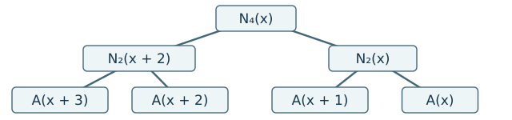
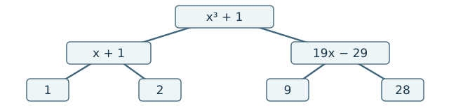

# ENS de Lyon · Second concours · Informatique 2005 — corrigé brut

*Corrigé rédigé par IA, non officiel. Signalez toute erreur.*

**Rédaction** · GPT-6.2 Astra Ultra · vitesse non renseignée · 25 novembre 2026

**Révision** · GPT-6.2 Astra Ultra · vitesse non renseignée · 26 novembre 2026

On compte les opérations dans le corps des complexes. Les entiers de boucle sont des indices. Ici n est une puissance de quatre et le logarithme est en base deux.

## Partie 1. Premiers algorithmes

### Question 1 · Factorielle et translation

**1.** Ici $v_n=\prod_{j=0}^{n-1}(j+1)=n!$, avec $v_0=1$.

**2.** Allouer $F[0..n-1]$, poser $F[0]=1$, puis $F[j]=jF[j-1]$ pour $1\le j<n$. Après le passage $j$, le préfixe contient les factorielles demandées. Le coût est de $n-1$ multiplications.

**3.** Calculer les puissances $H_0=1$, $H_{j+1}=\alpha H_j$. Multiplier par MulPoly les polynômes de coefficients $U_{n-1-j}=F[j]a_j$ et $V_j=H_j/F[j]$. Pour $W=UV$, renvoyer $W_{n-1-j}/F[j]$ comme coefficient de degré $j$. En effet, ce quotient vaut $\sum_{i=j}^{n-1}\binom{i}{j}a_i\alpha^{i-j}$ par convolution. Factorielles et puissances coûtent chacune au plus $n$ opérations, les deux tables d’entrée et la normalisation finale chacune au plus $n$. Total au plus $M(n)+5n$.

### Question 2 · Matrice constante

**1.** $v_n=A_0^nv_0$.

**2.** Un produit scalaire de longueur $m$ prend $m$ produits et $m-1$ sommes. Le produit matrice-vecteur en effectue $m$, soit $2m^2-m$ opérations. Le produit matrice-matrice en effectue $m^2$, soit $2m^3-m^2$.

**3.** Partir de $P=A_0$. Effectuer $\log_2 n$ mises au carré $P\gets PP$, puis renvoyer $Pv_0$. Après $r$ tours, $P=A_0^{2^r}$, et $n=4^q$ est une puissance de deux. Le coût exact est $(2m^3-m^2)\log_2 n+2m^2-m$. Le coefficient de $m^3\log_2 n$ vaut 2.

### Question 3 · Itération directe

**1.** Pour chaque entrée $(r,s)$ calculer $\alpha(A_1)_{rs}+(A_0)_{rs}$. Ce procédé effectue exactement $2m^2$ opérations.

**2.** Poser $w=v_0$. Pour $j=0,\ldots,n-1$, calculer $B=A(j)$ par 3.1 et remplacer $w$ par $Bw$. L’invariant est $w=v_j$ en début de tour. Ce choix coûte $(4m^2-m)n$, de constante dominante 4.

**3.** À dimension fixée, le rapport des échelles de temps est proportionnel à $n/\log_2 n$. Pour $n=2^{14}$, cette quantité vaut $16384/14\simeq1170$, soit une échelle de $10^3$, à un facteur dépendant de $m$ près. Le carré répété s’applique ici au cas constant de la question 2.

## Partie 2. Produits par blocs

### Question 4 · Construire le produit ordonné

**1.** Former chaque entrée de $PQ$ comme somme de $m$ appels à MulPoly. Chaque somme de deux produits coûte au plus $2d-1$ additions. On a $M(d)\ge 2d-1$ puisque les $2d-1$ coefficients génériques de sortie sont distincts et doivent être produits. Le total est au plus $m^3M(d)+m^2(m-1)(2d-1)<2m^3M(d)$.

**2.** Chaque facteur a degré au plus 1 et le degré d’un produit est au plus la somme des degrés. Donc $\deg N_i\le i$, avec la convention $\deg 0=-\infty$.

**3.** Le coefficient de $x$ est toujours $A_1$. Initialiser $C=A_0$ et remplacer $C$ par $C+A_1$ à chaque décalage. Le terme constant du décalage $j$ est alors $A_0+jA_1$. Coût total $(i-1)m^2$ additions.

**4.** Ranger les facteurs dans l’ordre d’action et remplacer chaque paire voisine $L,R$ par $RL$. Au niveau où chaque enfant couvre $s$ indices, il reste $i/(2s)$ couples. Les enfants ont degré au plus $s$. Pour conserver la borne en $M(s)$, séparer le terme de degré $s$ de chaque polynôme. Le produit des parties basses utilise MulPoly, les produits croisés par des scalaires coûtent $O(s)$ par couple d’entrées. Chaque nœud coûte donc $O(m^3M(s))$. Comme $M(s)\le (s/i)M(i)$ pour les tailles dyadiques, chaque niveau coûte $O(m^3M(i))$. Les $\log_2 i$ niveaux et les translations initiales donnent la borne demandée pour $i\ge2$. Pour $i=1$, renvoyer $A$.

### Question 5 · Réutiliser la moitié du produit

**1.** Extraire, pour chacune des $m^2$ positions, son polynôme scalaire. Le translater par 1.3 puis replacer les coefficients. Coût $m^2(M(n)+5n)=O(m^2M(n))$.

**2.** Calculer une seule fois $B=N_s$ pour $i=2s$, puis former $N_{2s}(x)=B(x+s)B(x)$. La première matrice regroupe les indices $s$ à $2s-1$, la seconde les indices 0 à $s-1$. Le cas initial est $N_1=A$. La translation d’un polynôme de degré $s$ se ramène à la translation de sa partie basse et à l’ajout de $b_s(x+s)^s$, dont les coefficients se forment en $O(s)$ par le binôme. Avec 4.4, l’étape coûte $O(m^3M(s))$. Sur la branche récursive unique, $\sum_{h=1}^{\log_2 i} M(i/2^h)\le M(i)$. Le coût est $O(m^3M(i))$.

Au premier dédoublement, on obtient $N_2(x)=A(x+1)A(x)$. Par exemple $A(x)=\bigl(\begin{smallmatrix}1&x\\1&0\end{smallmatrix}\bigr)$ donne $A(1)A(0)=\bigl(\begin{smallmatrix}2&0\\1&0\end{smallmatrix}\bigr)$, alors que $A(0)A(1)=\bigl(\begin{smallmatrix}1&1\\1&1\end{smallmatrix}\bigr)$. L’ordre des blocs est donc nécessaire même à deux pas.

### Question 6 · Appliquer les blocs

**1.** Avec $k=n/i$, on a $v_n=N_i((k-1)i)\cdots N_i(i)N_i(0)v_0$ en regroupant les facteurs adjacents.

**2.** Construire $N_i$, évaluer chacune de ses entrées aux $k$ points $0,i,\ldots,(k-1)i$, puis appliquer les $k$ matrices au vecteur dans cet ordre croissant. Après $t$ applications, le vecteur est $v_{ti}$. Pour $i=1$, chaque bloc redevient un facteur de 3.2.

**3.** Le coût est $O(m^3M(i)+m^2E(i+1,k)+km^2)$, en comptant aussi les $O(k)$ opérations éventuelles de préparation des points. L’argument $i+1$ tient compte du degré $i$ possible.

**4.** Prendre $i=k=2^q=\sqrt n$. Pour chaque entrée, évaluer les termes de degré $<i$ par EvalPoly aux $i$ points. Ajouter le terme de degré $i$ en utilisant les puissances $t^i$ des points, calculées une seule fois en $O(i\log i)$ par carrés. On obtient $O(m^3\sqrt n\log n+m^2\sqrt n\log^2 n)$ opérations pour $n\ge4$. À dimension fixée, ce coût est $o(n)$.

## Partie 3. Évaluation en plusieurs points

### Question 7 · Horner

**1.** Initialiser $u=a_{n-1}$, puis pour $j=n-2,\ldots,0$ remplacer $u$ par $\alpha_1u+a_j$. Après le traitement de $j$, $u=\sum_{t=j}^{n-1}a_t\alpha_1^{t-j}$. Il faut $2(n-1)$ opérations, de coefficient dominant 2.

**2.** Répéter donne $E(n,p)\le 2p(n-1)$. Pour un seul point, le coût est linéaire en la taille des données et optimal en ordre pour un point générique. Pour $p=n$, cette méthode coûte $O(n^2)$ et ne tire aucun profit des points traités ensemble.

### Question 8 · Arbre des produits et des restes

**1.** Poser $s=n/2$ (pour $n\ge2$). Placer aux feuilles les $s$ facteurs moniques $x-\alpha_j$ et multiplier les voisins deux à deux jusqu’à la racine. Si un enfant a degré $t$, séparer son terme de tête comme en 4.4. À ce niveau il y a $s/(2t)$ produits, coûtant chacun $O(M(t))$. Le niveau coûte $O(M(s))$ par l’hypothèse dyadique, d’où $O(M(n/2)\log n)$ pour $b$.

**2.** Comme $b=x^s+b_0$ avec $\deg b_0<s$ et $\deg q<s$, les $s$ coefficients bas de $bq$ sont ceux de $b_0q$. Calculer ce produit en $M(s)$ opérations, puis $r_j=a_j-[x^j](b_0q)$ pour $0\le j<s$, en $s$ soustractions. Les autres coefficients de $r$ sont nuls.

**3.** Construire une seule fois l’arbre sur les $n$ points. À la racine placer $a$. À chaque nœud de taille $2s$, réduire le reste parent modulo le produit de chacun des deux enfants, en calculant le quotient admis puis le reste par 8.2. En feuille, lire le reste constant. L’invariant est la congruence au polynôme $a$ modulo le produit du nœud, par divisibilité des produits le long d’une branche. En particulier, en feuille on lit $a(\alpha_j)$, même si certains points coïncident.

**4.** Chaque division vers un enfant de taille $s$ coûte $O(M(s))$. Il y en a $n/s$ à ce niveau, donc $O(M(n))$ par niveau. Construction et descente ont chacune $\log_2 n$ niveaux, d’où $E(n,n)=O(M(n)\log n)$. Pour $n=1$, renvoyer le terme constant.
