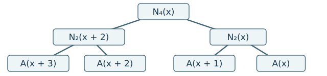
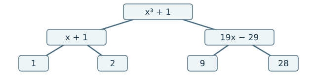

# ENS de Lyon · Second concours · Informatique 2005 — corrigé guidé

*Corrigé rédigé par IA, non officiel. Signalez toute erreur.*

**Rédaction** · GPT-6.2 Astra Ultra · vitesse non renseignée · 25 novembre 2026

**Révision** · GPT-6.2 Astra Ultra · vitesse non renseignée · 26 novembre 2026

Comment calculer le dernier terme d’une récurrence sans en produire tous les termes intermédiaires ? Les questions 1 à 5 construisent une matrice qui avance de plusieurs pas. Les questions 6 à 8 expliquent comment l’utiliser à plusieurs dates.

## Partie 1. Premiers algorithmes

### Question 1 · Factorielle et translation

**1–2.** Écrire les premiers termes $1,1,2,6$. À l’étape $j$, le facteur est $A(j-1)=j$. Une table initialisée à $F_0=1$ et complétée par $F_j=jF_{j-1}$ donne donc $F_j=v_j=j!$, par récurrence. Arrêter à $n-1$ après exactement $n-1$ produits.

**3.** Pour retrouver le coefficient d’indice $j$, Taylor demande $a^{(j)}(\alpha)/j!$. Le décalage d’indice vient du renversement de la première liste. Former les suites $U_{n-1-i}=i!a_i$ et $V_i=\alpha^i/i!$. Dans le coefficient $n-1-j$ du produit, une entrée $U_{n-1-i}$ rencontre $V_{i-j}$. Leur produit vaut $i!a_i\alpha^{i-j}/(i-j)!$. La somme est la dérivée cherchée. Diviser ce coefficient par $j!$ pour obtenir la réponse. Construire les puissances par multiplications successives, même pour $\alpha=0$ en fixant la puissance d’ordre zéro à 1. Les cinq parcours linéaires (factorielles, puissances, préparation de chaque liste, division finale) encadrent un seul appel à MulPoly, d’où $M(n)+5n$ au plus.

### Question 2 · Matrice constante

**1.** Pour une matrice constante, chaque étape applique la même transformation. Les $n$ étapes donnent $A_0^nv_0$.

**2.** Compter d’abord le coût d’une seule sortie. Pour une ligne et une colonne, on forme $m$ produits que l’on additionne avec $m-1$ additions. Il y a $m$ sorties pour $Pv$ et $m^2$ pour $PQ$. On obtient respectivement $m(2m-1)<2m^2$ et $m^2(2m-1)<2m^3$.

**3.** Chaque carré double l’exposant déjà représenté. Commencer à l’exposant 1 et former $A_0^2,A_0^4,\ldots,A_0^n$. Cela nécessite exactement $\log_2 n$ produits de matrices, suivis d’un seul produit par le vecteur initial. Le coût est $(2m^3-m^2)\log_2 n+(2m^2-m)$, avec constante dominante 2. Si $n=1$, la dernière multiplication suffit.

### Question 3 · Itération directe

**1–2.** Sur une entrée de $A(j)$, compter un produit et une somme. Pour une étape entière, les $m^2$ entrées consomment $2m^2$ opérations, puis le produit par $v_j$ en consomme $2m^2-m$. En prenant $w=v_0$ puis $w\gets (jA_1+A_0)w$ pour $j$ croissant de 0 à $n-1$, on obtient successivement $v_1,\ldots,v_n$. Le coût pour cette implémentation est $n(4m^2-m)$, avec coefficient 4 devant $nm^2$.

**3.** Comparer les boucles pour un même $m$ fixé dans le cas où $A$ est constante. La seconde méthode de la question 2 n’effectue que 14 carrés, la méthode générale effectue 16 384 pas. La dépendance en $n$ donne un facteur de l’ordre du millier, multiplié par une constante liée aux tailles et aux opérations de chaque pas.

## Partie 2. Produits par blocs

### Question 4 · Construire le produit ordonné

**1.** Pour la case $(r,t)$, les entrées à multiplier sont $P_{rs}$ et $Q_{st}$ pour $s=1,\dots,m$. Chacun de ces $m$ produits demande $M(d)$ opérations. Une addition entre deux résultats de degré au plus $2d-2$ demande $2d-1$ additions au plus. Ce nombre est inférieur ou égal à $M(d)$, car chaque coefficient générique du produit doit apparaître en sortie d’une opération arithmétique. Les $m^2$ cases coûtent donc au plus $m^2(2m-1)M(d)$.

**2–3.** Dans un produit de $i$ facteurs affines, chaque terme développé contient au plus $i$ puissances de $x$. Le degré peut baisser lorsque des coefficients se compensent. Pour construire les facteurs, retenir que $A(x+j)=A_1x+C_j$. Partir de $C_0=A_0$ et ajouter $A_1$ à chacune des $i-1$ étapes. Au total, $(i-1)m^2$ additions suffisent.

**4.** Dessiner l’arbre du produit pour quatre indices, puis doubler sa largeur. À hauteur $h$, une matrice enfant regroupe $s=2^h$ facteurs. Il faut multiplier le bloc tardif à gauche du bloc précoce. Les entrées ont au plus $s+1$ coefficients. Écrire $u=u_{<s}+u_sx^s$ et de même pour $v$. Un seul produit coûte $M(s)$, et les autres termes se calculent avec $O(s)$ opérations. On peut donc employer $O(m^3M(s))$ par nœud. Multiplier par $i/(2s)$ nœuds et utiliser $M(s)/s\le M(i)/i$ donne $O(m^3M(i))$ par hauteur. Additionner les $\log_2 i$ hauteurs et le coût de 4.3 donne $O(m^3M(i)\log i)$ dès $i\ge2$.

### Question 5 · Réutiliser la moitié du produit

**1.** Une translation agit sur la variable commune à toutes les entrées. Appliquer la convolution de la question 1.3 à chaque suite de $n$ coefficients, puis reconstituer les matrices. Le coût $O(m^2M(n))$ vient des $m^2$ suites.

**2.** Pour $i=4$, écrire séparément les facteurs qui utilisent $x,x+1$ et ceux qui utilisent $x+2,x+3$.



Le second groupe est une copie translatée du premier. Pour $i=2s$, construire récursivement $B=N_s$ en s’arrêtant à $N_1=A$, puis renvoyer $B(x+s)B(x)$. On ne demande qu’un enfant à la récursion. Attention au coefficient de degré $s$. Pour la translation, traiter les $s$ termes bas par 5.1 et ajouter le terme haut via les $s+1$ coefficients du binôme $(x+s)^s$, obtenus par quotients successifs en $O(s)$. Pour le produit, reprendre la séparation de 4.4. Ainsi les coûts arithmétiques sont majorés, à constante près, par $m^3[M(i/2)+M(i/4)+\cdots+M(1)]$. L’hypothèse de division par deux majore cette somme par $m^3M(i)$.

Au premier dédoublement, on obtient $N_2(x)=A(x+1)A(x)$. Par exemple $A(x)=\bigl(\begin{smallmatrix}1&x\\1&0\end{smallmatrix}\bigr)$ donne $A(1)A(0)=\bigl(\begin{smallmatrix}2&0\\1&0\end{smallmatrix}\bigr)$, alors que $A(0)A(1)=\bigl(\begin{smallmatrix}1&1\\1&1\end{smallmatrix}\bigr)$. L’ordre des blocs est donc nécessaire même à deux pas.

### Question 6 · Appliquer les blocs

**1–2.** Le premier bloc agit sur $v_0$ et donne $v_i$. Le deuxième commence à la date $i$, puis le $t$-ième à $(t-1)i$. L’algorithme ci-dessous expose l’ordre des applications.

```text
B ← produit par doublement de la question 5
T ← évaluations des entrées de B aux dates 0, i, ..., (k−1)i
w ← v₀
pour j de 0 à k−1 :
    w ← T[j] w
renvoyer w
```

À la fin du tour $j$, $w=v_{(j+1)i}$. Le produit écrit de gauche à droite est donc $N_i((k-1)i)\cdots N_i(0)v_0$. En choisissant $i=1$, on retrouve l’itération de 3.2.

**3.** Séparer le temps de préparation $O(m^3M(i))$, le temps des $m^2$ évaluations multipoints $m^2E(i+1,k)$ et celui des applications $O(km^2)$. Un degré maximal $i$ correspond à $i+1$ coefficients.

**4.** Pour employer l’hypothèse sur $E(i,i)$, choisir autant de blocs que de pas par bloc. C’est possible car $n=4^q$. Traiter à part le coefficient de degré $i$, en préparant la puissance $i$ de chacun des $i$ arguments par $\log_2 i$ carrés. Les parties basses coûtent $O(m^2M(i)\log i)$ et les termes hauts $O(i\log i+m^2i)$. Avec la préparation, cela donne $O(m^3\sqrt n\log n+m^2\sqrt n\log^2 n)$. Pour $m$ fixé, diviser par $n$ donne une quantité qui tend vers zéro.

## Partie 3. Évaluation en plusieurs points

### Question 7 · Horner

**1.** En degré deux, lire le calcul comme $(a_2\alpha_1+a_1)\alpha_1+a_0$. En degré $n-1$, partir du coefficient le plus haut, descendre une case à chaque étape et répéter « multiplier par le point, ajouter le coefficient ». Après $n-1$ tours la valeur cherchée est atteinte. Le compte est exactement $n-1$ produits et $n-1$ sommes, donc la constante est 2.

**2.** Pour $p$ points on peut recommencer $p$ fois, soit $2p(n-1)$ opérations. Pour un point générique, $n$ coefficients indépendants participent au résultat, ce qui nécessite au moins $n-1$ combinaisons binaires. En revanche, le calcul indépendant de $n$ valeurs conduit à un temps quadratique. On peut mutualiser le travail par les divisions de la question suivante.

### Question 8 · Arbre des produits et des restes

**1.** Associer à tout groupe de points le polynôme qui est le produit de leurs facteurs linéaires. L’union de deux groupes voisins se traduit par un produit de polynômes. Pour $s=n/2$ feuilles, au niveau qui réunit deux groupes de taille $t$ il faut $s/(2t)$ produits. Leur coût unitaire $O(M(t))$ s’obtient en traitant séparément les termes moniques de degré $t$. Puisque $M(t)/t\le M(s)/s$, chaque niveau coûte $O(M(s))$. Remonter les niveaux donne la borne de l’énoncé.

**2.** Le quotient $q$ a au plus $s$ coefficients car $\deg a<2s$. Pourquoi éviter un produit de longueur $s+1$ ? La partie $x^sq$ de $bq$ n’affecte aucune des $s$ premières cases. Multiplier $(b-x^s)$ par $q$, garder les $s$ premières cases, les soustraire aux cases de $a$. Cela suffit pour obtenir la totalité du reste car son degré est inférieur à $s$. Coût $M(s)+s$.

**3.** Faire maintenant descendre des restes dans le même arbre. Par exemple, modulo $x(x-1)$, on peut remplacer $x^3+1$ par $x+1$. Aux deux points concernés ces expressions prennent les mêmes valeurs.



Préparer l’arbre complet sur les $n$ points. Pour chaque enfant, diviser le reste reçu par le produit de cet enfant. Le quotient est fourni en $O(M(s))$ et 8.2 donne le reste. Recommencer dans chacun des deux enfants. En effet, le polynôme de chaque enfant divise celui du parent, et deux polynômes congrus modulo $x-\alpha_j$ ont même valeur en $\alpha_j$. Une feuille rend cette valeur, indexée par la position initiale du point.

**4.** À une hauteur donnée, les groupes partagent les $n$ feuilles. Il y a donc $n/s$ divisions de taille $s$, coûtant ensemble $O((n/s)M(s))=O(M(n))$. L’arbre des produits a le même coût par niveau et se construit une seule fois. Les deux parcours donnent $O(M(n)\log n)$ en tout. La feuille unique, pour $n=1$, lit directement $a_0$.
