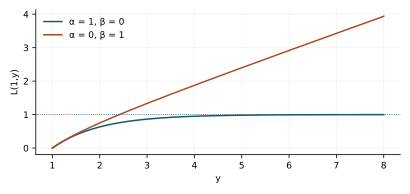

# ENS Ulm et Lyon — Mathématiques du second concours 2005 · Corrigé brut

*Corrigé rédigé par IA, non officiel. Signalez toute erreur.*

**Rédaction** · GPT-6.2 Astra Ultra · vitesse non renseignée

**Révision** · GPT-6.2 Astra Ultra · vitesse non renseignée

Le sujet étudie une équation intégrale sur la demi-droite. Les itérations donnent une solution bornée, puis les intégrales exponentielles déterminent le développement asymptotique de cette solution et de sa dérivée.

## I. Résolution d’une équation intégrale

### Question I.1

Écrivons $k=\sup_{1\le x\le t}|K(x,t)|$. Pour $t\ge x$, le module de l’intégrande est au plus $k\|h\|/t^2$, de sorte que l’intégrale des modules est au plus $k\|h\|/x$ dès que l’intégrande est mesurable. Dans le cadre de l’intégrale impropre usuelle, la continuité de $K$ sur $\Theta$ assure son intégrabilité sur chaque segment et la convergence absolue à l’infini.

Dans la partie I, le sujet suppose seulement que $K$ est borné. Prendre $K(x,t)=\mathbf1_{\mathbb Q}(t)$ et $h=1$ empêche l’intégrabilité au sens de Riemann sur tout segment non trivial. Pour l’intégrale de Lebesgue, l’indicatrice d’un ensemble non mesurable contenu dans $[1,2]$ empêche même la mesurabilité pour $x=1$. Pour la suite de I on peut prendre $K$ continu borné, hypothèse satisfaite par le noyau de IV.

### Question I.2

Supposons $K$ continu borné, et fixons $x_0\ge1$. Pour $R>x_0+1$ et $x$ proche de $x_0$, les deux intégrales au-delà de $R$ sont majorées en module par $k\|h\|/R$. Sur la partie comprise entre $x$ et $x_0$, la contribution est au plus $k\|h\|\,|x-x_0|$. Enfin, pour $\max(x,x_0)\le t\le R$, la continuité uniforme de $K$ sur le triangle compact $1\le s\le t\le R$ donne $K(x,t)-K(x_0,t)\to0$ uniformément en $t$. L’intégrale de cette différence pondérée par $h(t)/t^2$ tend donc vers zéro. En choisissant d’abord $R$ grand puis $x$ proche de $x_0$, on obtient $Th(x)\to Th(x_0)$. La linéarité vient de l’intégrale, et $\|Th\|\le k\|h\|$ donne la continuité de l’opérateur pour la norme uniforme.

Même un noyau mesurable borné ne suffit pas à la conclusion imprimée. Avec $K(x,t)=\mathbf1_{\mathbb Q}(x)$ et $h=1$, on obtient $Th(x)=\mathbf1_{\mathbb Q}(x)/x$, discontinue en tout point.

### Question I.3

Pour $n=1$ c’est I.1. Si $|T^nh(t)|\le\|h\|k^n/(n!t^n)$, alors
$$|T^{n+1}h(x)|\le \frac{\|h\|k^{n+1}}{n!}\int_x^\infty t^{-n-2}\,dt=\frac{\|h\|k^{n+1}}{(n+1)!x^{n+1}}.$$
La récurrence est établie avec $k=\|K\|_\infty$. Le supremum sur $x\ge1$ est majoré par $\|h\|k^n/n!$, terme d’une série convergente. La série de fonctions converge normalement.

### Question I.4

La limite uniforme $g=\sum_{n\ge0}T^nh$ est continue bornée, et la série de ses normes converge. Par continuité de $T$, $Tg=\sum_{n\ge1}T^nh=g-h$. Si $u$ est la différence de deux solutions dans $\mathcal B$, alors $u=Tu=T^nu$ et $\|u\|\le\|u\|k^n/n!$. Le coefficient tend vers zéro, donc $u=0$.

## II. Calcul sur les développements asymptotiques

### Question II.1

On a $a_0=\lim f(x)$ et, pour $m\ge1$, $a_m=\lim_{x\to\infty}x^m(f(x)-\sum_{k<m}a_kx^{-k})$. Chaque coefficient est déterminé par les précédents. La fonction $e^{-x}$ est partout positive et $x^me^{-x}\to0$ à tout ordre, donc tous ses coefficients sont nuls.

### Question II.2

Si $a_k,b_k$ sont les coefficients, ceux de la somme sont $a_k+b_k$, et ceux du produit sont $c_k=\sum_{j=0}^k a_jb_{k-j}$. En effet, à l’ordre $N$, on additionne ou multiplie les deux polynômes tronqués. Les termes du produit de degré supérieur à $N$ en $1/x$ sont $O(x^{-N-1})$ et les restes $o(x^{-N})$ multipliés par des facteurs bornés restent $o(x^{-N})$. Ceci vaut pour tout $N$.

### Question II.3

Si $1/f$ a un développement, les limites finies de $f$ et $1/f$ vérifient $a_0\lim(1/f)=1$, d’où $a_0\ne0$. Réciproquement, posons $b_0=1/a_0$ et $b_n=-a_0^{-1}\sum_{j=1}^n a_j b_{n-j}$. À tout ordre $N$, $f(x)\sum_{k=0}^Nb_kx^{-k}=1+o(x^{-N})$. Comme $f$ reste en module au-dessus de $|a_0|/2$ à l’infini, la division donne le reste requis pour $1/f$, qui est continue sur tout l’intervalle.

### Question II.4

Au voisinage de zéro, Taylor–Young à l’ordre $N$ donne $g(u)=\sum_{k=0}^Ng^{(k)}(0)u^k/k!+o(u^N)$. Pour $u=1/t$, on obtient exactement le développement demandé avec $a_k=g^{(k)}(0)/k!$. La continuité au point $t=1$ vient de celle de $g$ en $1$.

### Question II.5

Toute fonction de $\mathcal A$ a une limite finie à l’infini et est continue sur chaque compact. Elle est donc bornée sur $[1,\infty[$. La fonction $\sin x$ appartient à $\mathcal B$ et a pour valeurs $1$ et $-1$ le long de deux suites tendant vers l’infini. Elle ne possède pas de coefficient d’ordre zéro.

## III. Intégrales exponentielles et puissances complexes

### Question III.1

Pour $x>0$, on prend $x^\beta=\exp(\beta\log x)$. La dérivée de $j_\beta(x)=e^{\alpha x}x^\beta$ vaut $\alpha j_\beta(x)+\beta j_{\beta-1}(x)$. L’intégration sur $[1,x]$ donne $\alpha J_\beta(x)=j_\beta(x)-j_\beta(1)-\beta J_{\beta-1}(x)$.

### Question III.2

Notons $a=\Re\alpha>0$ et $b=\Re\beta$. Le quotient en module $|J_{\beta-1}/j_\beta|$ est majoré par $\int_1^x e^{at}t^{b-1}\,dt/(e^{ax}x^b)$. Numérateur et dénominateur tendent vers l’infini. Le rapport de leurs dérivées est $1/(ax+b)\to0$ et le dénominateur est finalement croissant. Le quotient tend donc vers zéro. En divisant III.1 par $j_\beta(x)$, dont le module tend vers l’infini, on obtient $J_\beta(x)/j_\beta(x)\to1/\alpha$.

### Question III.3

Écrivons $U_\gamma=J_\gamma/j_\gamma$. Alors $U_\gamma=1/\alpha-\gamma U_{\gamma-1}/(\alpha x)-e^\alpha/(\alpha j_\gamma(x))$. Le dernier terme est $o(x^{-m})$ pour tout $m$. Après $N$ substitutions, utiliser $U_{\beta-N}=1/\alpha+o(1)$ par III.2. On obtient à tout ordre
$$U_\beta(x)=\sum_{r=0}^N\frac{(-1)^r\beta(\beta-1)\cdots(\beta-r+1)}{\alpha^{r+1}x^r}+o(x^{-N}),$$
avec produit vide égal à $1$.

### Question III.4

Le module de $e^{-\alpha t}t^{-\beta}$ vaut $e^{-at}t^{-b}$. Pour $t$ assez grand, il est majoré par $e^{-at/2}$, et sur les segments il est continu. L’intégrale de $1$ à l’infini converge absolument.

### Question III.5

La primitive de l’exponentielle est $-e^{-\alpha t}/\alpha$. En intégrant sur $[x,R]$ puis en faisant $R\to\infty$, le terme au bord supérieur s’annule, et l’on obtient $\alpha I_\beta(x)=j_\beta(x)^{-1}-\beta I_{\beta+1}(x)$.

### Question III.6

Posons $V_\gamma=j_\gamma I_\gamma$. Il est borné pour tout $\gamma$. En effet, après $t=x+u$, l’intégrande normalisé a pour module $e^{-au}(1+u/x)^{-\Re\gamma}\le e^{-au}(1+u)^{|\Re\gamma|}$ pour $x\ge1$. La relation devient $V_\gamma=1/\alpha-\gamma V_{\gamma+1}/(\alpha x)$. À l’ordre $N$, $N+1$ substitutions donnent
$$V_\beta(x)=\sum_{r=0}^N\frac{(-1)^r\beta(\beta+1)\cdots(\beta+r-1)}{\alpha^{r+1}x^r}+O(x^{-N-1}).$$
Les facteurs successifs sont ici croissants parce que l’indice de l’intégrale de queue augmente.

### Question III.7

Supposons $\alpha\ne0$, $\Re\alpha=0$, $b=\Re\beta>0$. Une intégration par parties sur $[1,x]$ pour $J_{\beta-1}$ le majore en module par une constante fois $1+x^{b-1}+\int_1^xt^{b-2}\,dt$. Cette expression est $o(x^b)$, y compris pour $b=1$ où intervient $\log x$. Comme $|j_\beta(x)|=x^b$, les deux limites de III.2 suivent de III.1.

Pour l’intégrale de queue, si $\Re\gamma=c>0$, le terme $e^{-\alpha R}R^{-\gamma}$ tend vers zéro et $\int_x^\infty|t^{-\gamma-1}|dt=x^{-c}/c$. L’intégration par parties de III.5 prouve simultanément la convergence de $I_\gamma$ et l’estimation $|I_\gamma(x)|\le(1+|\gamma|/c)x^{-c}/|\alpha|$. Ainsi $V_\gamma$ est borné pour tous les indices $\beta+r$, et la récurrence de III.6 donne la même expansion à tout ordre.

## IV. Développement de la solution et de sa dérivée

### Question IV.1

La fonction est $j_\beta(x)/j_\beta(y)$, continue sur $1\le x\le y$. Si $u=y-x$ et $a=\Re\alpha>0$, son module vaut $e^{-au}(y/x)^{-b}$ avec $b=\Re\beta$. Or $1\le y/x\le1+u$, donc le module est majoré par $e^{-au}(1+u)^{|b|}$, fonction bornée sur $[0,\infty[$.

### Question IV.2

On a $L(x,y)=[J_\beta(y)-J_\beta(x)]/j_\beta(y)$. Le numérateur est continu en $(x,y)$, le dénominateur est continu et ne s’annule pas. La continuité vaut aussi sur la diagonale, où $L(x,x)=0$.

### Question IV.3

On a $L(1,y)=J_\beta(y)/j_\beta(y)=U_\beta(y)$. Sa limite en $+\infty$ vaut $1/\alpha$, et il est continu sur les segments. Cette fonction est donc bornée.

### Question IV.4

On déduit de IV.2 l’identité $L(x,y)=U_\beta(y)-[j_\beta(x)/j_\beta(y)]U_\beta(x)$. Les deux valeurs de $U_\beta$ sont uniformément bornées par IV.3 et le quotient l’est par IV.1. Ainsi $M=\sup_\Theta|L|<\infty$.

### Question IV.5

Posons $H_n(x)=\int_x^\infty L(x,y)y^{-n}\,dy$ pour $n\ge2$. Elle tend vers zéro, car $|H_n(x)|\le Mx^{1-n}/(n-1)$. On a $\partial_x L=-j_\beta(x)/j_\beta(y)$, uniformément bornée par IV.1, et $L(x,x)=0$. La dérivation sous le signe intégral est permise par domination par une constante fois $y^{-n}$, localement en $x$. Elle donne
$$H_n'(x)=-j_\beta(x) I_{\beta+n}(x)=-x^{-n}V_{\beta+n}(x).$$
Si $c_r(\gamma)$ désigne le coefficient de $x^{-r}$ dans III.6, l’intégration de $x$ à l’infini fournit les termes $c_r(\beta+n)x^{-(n+r-1)}/(n+r-1)$. Après le terme $r=N$, le reste intégré est $O(x^{-n-N})$. Ces approximations arbitrairement précises donnent $H_n\in\mathcal A$.

### Question IV.6

Comme $F\in\mathcal A\subset\mathcal B$, le noyau $K(x,y)=-F(y)L(x,y)$ est continu borné. L’équation est $g-Tg=1$. La question I.4 donne une unique solution dans $\mathcal B$, à savoir $\sum_{m\ge0}T^m1$.

### Question IV.7

IV.6 donne $|g(x)-1|\le M\|F\|\|g\|/x$, donc $g=1+o(1)$. Supposons trouvé son développement à l’ordre $N$. Le produit $Fg$ possède alors un polynôme $\sum_{r=0}^N d_ry^{-r}$ et un reste $R_N(y)=o(y^{-N})$. L’équation devient
$$g(x)=1-\sum_{r=0}^N d_r H_{r+2}(x)-\int_x^\infty L(x,y)R_N(y)y^{-2}\,dy.$$
La dernière intégrale est majorée en module par $M\sup_{y\ge x}|y^NR_N(y)|\, x^{-N-1}/(N+1)=o(x^{-N-1})$. Les $H_{r+2}$ ont un développement à l’ordre $N+1$ par IV.5. On obtient celui de $g$ à l’ordre suivant. L’unicité des coefficients rend ces développements compatibles.

### Question IV.8

La borne mobile ne donne aucun terme, puisque $L(x,x)=0$. La dérivée partielle de $L$ a été calculée en IV.5 et $Fg$ est bornée. La domination par une constante fois $y^{-2}$ autorise la dérivation de IV.6 et assure la continuité de la dérivée, à droite en $1$. Par conséquent
$$g'(x)=j_\beta(x)\int_x^\infty \frac{F(y)g(y)}{y^2j_\beta(y)}\,dy=e^{\alpha x}x^\beta\int_x^\infty F(y)g(y)e^{-\alpha y}y^{-\beta-2}\,dy.$$

### Question IV.9

Pour le monôme $d_ry^{-r}$ de $Fg$, la contribution est $d_rx^{-r-2}V_{\beta+r+2}(x)$, qui appartient à $\mathcal A$. Pour un développement de $Fg$ à l’ordre $N$, la contribution du reste $o(y^{-N})$ est $o(x^{-N-1})$ en utilisant IV.1 et le même calcul que pour IV.7. On obtient ainsi un développement de $g'$ à tout ordre. Pour lire le premier coefficient, prenons $N=1$. Comme $g\to1$, on a $d_0=f_0=\lim F$. Le terme associé à $d_1$ est $O(x^{-3})$, le reste est $o(x^{-2})$ et $V_{\beta+2}\to1/\alpha$. Ainsi $g'(x)=f_0/(\alpha x^2)+o(x^{-2})$.

### Question IV.10

Pour $\Re\alpha=0$, $\alpha\ne0$, $\Re\beta>0$, on a $|j_\beta(x)/j_\beta(y)|=(x/y)^{\Re\beta}\le1$. Par III.7, $U_\beta(y)\to1/\alpha$, donc la formule de IV.4 borne toujours $L$. Les indices $\beta+n$ utilisés ensuite ont tous une partie réelle positive, ce qui assure par III.7 les développements des $V_{\beta+n}$. Les majorations intégrables de IV.5–9, l’équation de Volterra et ses deux conclusions asymptotiques s’appliquent donc.

L’énoncé de IV.10 omet la condition $\alpha\ne0$ de III.7. Pour $\alpha=0$ et $\beta=1$, $L(x,y)=(y^2-x^2)/(2y)$ et $L(1,y)$ croît comme $y/2$. En outre $H_2(x)$ diverge par comparaison à $1/(2y)$ à l’infini. Ainsi les conclusions imprimées ne peuvent toutes valoir dans ce cas.

