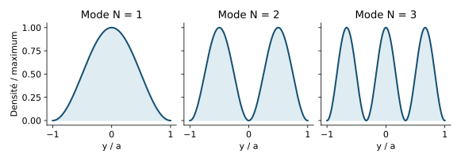
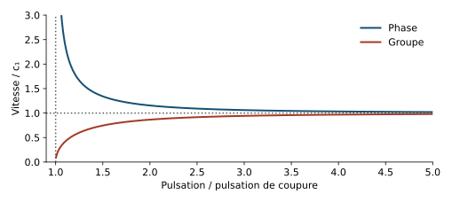
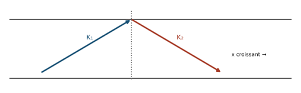
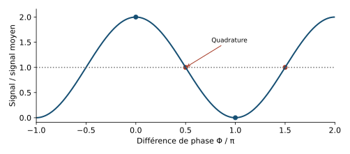

# ENS de Lyon, second concours 2005 — Physique · Corrigé brut

*Corrigé rédigé par IA, non officiel. Signalez toute erreur.*

**Lecture du rapport du jury** · GPT-6.2 Astra Ultra · vitesse non renseignée

**Rédaction** · GPT-6.2 Astra Ultra · vitesse non renseignée

## 1 — Propagation entre deux plans réfléchissants

### Question 1.1 — Longueur d’onde et unité de l’intensité

La fréquence $f=\omega/(2\pi)$ est celle qu’impose la source. Une période temporelle correspond dans le milieu à une distance $c_1/f$. Ainsi $\lambda_1=\lambda_0/n_1=2\pi c/(n_1\omega)$. La densité adoptée par l’énoncé est $I=\frac12 n_1^2\varepsilon_0|E|^2$. La loi de Coulomb donne $[\varepsilon_0]=\mathrm{C^2/(N\,m^2)}$, et la force sur une charge donne $[E]=\mathrm{N/C}$. Leur produit $[\varepsilon_0 E^2]=\mathrm{N/m^2}=\mathrm{J/m^3}$ est bien une énergie volumique. Une puissance par unité de surface ferait intervenir une vitesse supplémentaire.

### Question 1.2 — Relation de dispersion

Sur le champ proposé, $\partial_x^2$ et $\partial_y^2$ multiplient respectivement le champ par $-k_x^2$ et $-k_y^2$. La dérivée en $z$ est nulle et $\partial_t^2 E=-\omega^2 E$. L’équation de propagation donne donc $k_x^2+k_y^2=\omega^2/c_1^2=k_1^2$, avec $k_1=2\pi/\lambda_1$.

### Question 1.3 — Nœuds, ventres et énergie moyenne

Le champ électrique tangentiel doit s’annuler sur chaque conducteur parfait. En $y=-a$ le sinus est déjà nul. En $y=a$ il faut $\sin(2ak_y)=0$, donc $k_y=N\pi/(2a)$. Les entiers $N=1,2,\ldots$ suffisent, car un signe s’absorbe dans l’amplitude et $N=0$ donne le champ nul avec cette polarisation. En posant $u=(y+a)/(2a)$, le profil est $I=I_{\max}\sin^2(N\pi u)$, avec $I_{\max}=n_1^2\varepsilon_0 E_0^2/2$. Les $N+1$ nœuds ont $u=j/N$ et les $N$ ventres ont $u=(j+1/2)/N$ entre eux. La figure donne les trois graphes demandés. Le champ est stationnaire suivant $Oy$ et progressif suivant $Ox$.
L’invariance en $z$ ramène la moyenne sur la section à une intégrale en $y$. Pour tout entier $N\ge1$, $\int_0^1\sin^2(N\pi u)\,du=1/2$, d’où $\langle I\rangle=n_1^2\varepsilon_0 E_0^2/4$ indépendamment de $x_0$.

### Question 1.4 — Coupure et évanescence

En substituant la valeur de $k_y$, on trouve
$$k_x^2=\frac{\omega^2-N^2\omega_c^2}{c_1^2},\qquad \omega_c=\frac{\pi c_1}{2a},\qquad k_x=k_1\sqrt{1-\left(\frac{N\omega_c}{\omega}\right)^2}.$$
La racine positive correspond à la progression vers $x>0$. Sous la coupure du mode $N$, $k_x=i\kappa$ avec $\kappa=\sqrt{N^2\omega_c^2-\omega^2}/c_1$ et le champ décroît en $e^{-\kappa x}$. Pour $\omega<\omega_c$, tous ces modes sont évanescents. Un mode transporte une onde le long du guide pour $\omega>N\omega_c$, soit $\lambda_0<4a n_1/N$. À l’égalité, $k_x=0$.

### Question 1.5 — Vitesse de phase et transport

Pour $N=1$, $c_x=\omega/k_x=c_1/\sqrt{1-(\omega_c/\omega)^2}$. Elle décroît de $+\infty$, lorsque $\omega$ s’approche de $\omega_c$ par valeurs supérieures, vers $c_1$ à haute fréquence. Au seuil exact, la phase est uniforme selon $x$ et l’on ne peut suivre une crête se propageant à vitesse finie dans cette direction. Très au-dessus du seuil, la composante transverse représente une faible fraction du nombre d’onde.
Dans le modèle sans dispersion matérielle, la relation $\omega^2=c_1^2 k_x^2+\omega_c^2$ donne la vitesse de groupe $v_g=d\omega/dk_x=c_1^2/c_x$. Elle tend vers zéro au seuil et reste inférieure ou égale à $c_1$. Une vitesse de phase supérieure à $c$ décrit le déplacement d’une phase donnée, sans transport d’information à cette vitesse.

### Question 1.6 — Fenêtre unimodale

Il faut dépasser le premier seuil et rester sous le deuxième, soit $\omega_c<\omega<2\omega_c$. On peut inclure l’extrémité haute si l’on compte uniquement les modes qui transportent de l’énergie le long du guide, puisque le mode 2 est exactement à sa coupure. Avec $d=2a$, cela donne $\lambda_0/(2n_1)<d<\lambda_0/n_1$ (même convention au bord supérieur). Pour $\lambda_0=550\,\mathrm{nm}$ et un indice voisin de 1,5, l’intervalle est environ 0,18 à 0,37 micromètre. L’ordre de grandeur est quelques $10^{-7}\,\mathrm m$ pour ce guide plan.
Un seul mode évite les décalages d’arrivée entre modes qui élargissent une impulsion après une longue propagation. Il reste de la dispersion chromatique. La fabrication et l’alignement de petits cœurs demandent une grande précision et le couplage doit adapter la taille du faisceau au mode. La condition numérique obtenue pour deux plaques métalliques ne se transpose pas directement au diamètre d’une fibre diélectrique à faible contraste.

### Question 1.7 — Les deux ondes planes

Posons $A=k_y(y+a)$ et $B=k_x x-\omega t$. Comme $\cos B=\cos(-B)$, le champ réel peut s’écrire
$$E=\frac{E_0}{2}\left[\sin(k_x x+k_y y-\omega t+k_y a)-\sin(k_x x-k_y y-\omega t-k_y a)\right].$$
Les deux vecteurs d’onde sont $(k_x,k_y,0)$ et $(k_x,-k_y,0)$, de même norme $k_1$. Dans le plan de la figure ils pointent vers la droite et sont symétriques par rapport à $Ox$. Une réflexion sur un plan $y=\pm a$ conserve la composante parallèle $k_x$ et inverse la composante normale $k_y$. L’angle de réflexion égale donc l’angle d’incidence. La superposition assure aussi le nœud du champ tangentiel à la surface.

### Question 1.8 — Interférences et direction des rayons

Les deux ondes cohérentes interfèrent. Aux ventres, leurs champs instantanés s’ajoutent en phase et l’intensité est maximale. Aux nœuds ils se compensent. L’angle $\alpha$ est pris avec l’axe du guide, d’où $k_x=(n_1\omega/c)\cos\alpha$ et $k_y=(n_1\omega/c)\sin\alpha$ pour le rayon montant. La quantification du mode fixe donc aussi $\sin\alpha=N\lambda_0/(4an_1)$.

## 2 — Fibre optique à saut d’indice

### Question 2.1 — Réflexion totale du rayon méridien

Au dioptre cœur-gaine, l’angle par rapport à la normale est $i=\pi/2-\alpha$. La réflexion totale demande $\sin i>n_2/n_1$, soit $\cos\alpha>n_2/n_1$. Le rayon reste guidé pour $0\le\alpha<\alpha_m$ où $\cos\alpha_m=n_2/n_1$. Si $\alpha>\alpha_m$, une partie de l’énergie est transmise à la gaine à chaque rencontre. À la limite, le rayon réfracté est tangent au dioptre. Avec $\Delta=(n_1-n_2)/n_1$, on a $\cos\alpha_m=1-\Delta$ et $\sin\alpha_m=\sqrt{2\Delta-\Delta^2}\simeq\sqrt{2\Delta}$.

### Question 2.2 — Ouverture numérique

L’angle intérieur maximal est $\alpha_m=\arccos(1{,}466/1{,}470)=4{,}23^\circ$. La réfraction sur la face d’entrée, de normale $Ox$, donne $n_0\sin\alpha_0=n_1\sin\alpha$. L’ouverture maximale est donc
$$A_{\max}=\sqrt{n_1^2-n_2^2}=0{,}1084.$$
Dans l’air, cela correspond à un demi-angle d’entrée $\alpha_{0,\max}=6{,}22^\circ$. L’ouverture numérique est sans dimension.

### Question 2.3 — Phase accumulée

Puisque $n_2/n_1<\cos\alpha\le1$, on a $c/n_1\le c_x=c/(n_1\cos\alpha)<c/n_2$. Le déphasage spatial, mesuré dans le sens de propagation avec la convention complexe de l’énoncé, vaut
$$\phi=k_x X=\frac{\omega X}{c_x}=\frac{2\pi n_1X\cos\alpha}{\lambda_0}\simeq\frac{2\pi n_1 X}{\lambda_0}.$$
La dernière égalité approchée est celle qui servira pour le capteur. Elle assimile l’indice effectif à l’indice du cœur.

### Question 2.4 — Effet de la température

À fréquence laser constante, différencions le produit $n_1X$ dans la phase approchée. Les deux variations contribuent avec le même signe :
$$\delta\phi=\frac{2\pi}{\lambda_0}(X\,\delta n_1+n_1\,\delta X)=CX\,\delta T,\qquad C=\frac{2\pi n_1}{\lambda_0}(\beta_T+\gamma_T).$$
Avec $\lambda_0=1{,}55\times10^{-6}\,\mathrm m$, $\beta_T=5{,}5\times10^{-7}\,\mathrm{K}^{-1}$ et $\gamma_T=0{,}76\times10^{-5}\,\mathrm{K}^{-1}$, on obtient $C=48{,}6\,\mathrm{rad\,m^{-1}\,K^{-1}}$. L’effet thermo-optique est ici près de quatorze fois plus fort que celui de la dilatation.

## 3 — Capteurs interférométriques

### Question 3.1 — Franges à la détection

Soit $a$ l’amplitude complexe commune en module à l’arrivée. Les phases étant $\phi_1$ et $\phi_2$, l’intensité détectée est proportionnelle à $|a e^{i\phi_1}+a e^{i\phi_2}|^2=2|a|^2(1+\cos\Phi)$ avec $\Phi=\phi_2-\phi_1$. En notant $I_m$ la moyenne sur une période de phase, on a $I_d=I_m(1+\cos\Phi)$. La courbe a la période $2\pi$, passe par $2I_m$ en zéro, s’annule en $\pi$ et traverse sa moyenne en $\pi/2$ et $3\pi/2$. Les deux retours gardent une différence de phase stable pendant l’intégration supposée.

### Question 3.2 — Thermomètre différentiel

Le signal traverse chaque longueur deux fois. À la température de référence $T_1$, en choisissant la différence « bras 2 moins bras 1 », il vient $\Phi_0=2k_x(X_2-X_1)\simeq4\pi n_1(X_2-X_1)/\lambda_0$ modulo $2\pi$, à phase fixe des coupleur et miroirs près. Si seul le bras 2 chauffe, sa phase d’aller-retour augmente de $2CX_2\delta T$. Ainsi
$$I_d=I_m[1+\cos(\Phi_0+2CX_2\delta T)].$$
Au voisinage de $\delta T=0$, la pente est $-2I_mCX_2\sin\Phi_0$. Sa valeur absolue est maximale pour $\Phi_0=\pi/2+m\pi$. Un réglage fin de la différence des longueurs permet d’atteindre cette quadrature tout en gardant $X_1\simeq X_2$.

### Question 3.3 — Longueur sensible

En quadrature, le signal de départ vaut $I_m$. La variation relative en valeur absolue est $|\sin(2CX_2\delta T)|$. La plus petite longueur positive donnant 1 % pour $\delta T=10^{-2}\,\mathrm K$ satisfait
$$X_2=\frac{\arcsin(0{,}01)}{2C\,10^{-2}}=1{,}03\times10^{-2}\,\mathrm m,\qquad X_1\simeq X_2.$$
L’approximation linéaire donne déjà 1,03 cm. La fibre est légère, isolante, insensible au captage électromagnétique sur le trajet et permet de déporter la source et la lecture sans placer de fils électriques au point sensible. Une résistance peut demander la compensation de ses fils et s’auto-échauffer. Un thermocouple exige une température de référence connue. En contrepartie la mesure interférométrique exige un point de fonctionnement stable et répond aussi aux déformations.

### Question 3.4 — Décalage Doppler dans le référentiel extérieur

Un point du coupleur se déplace à la vitesse tangentielle $v=r\Omega$. La phase d’une onde locale s’écrit $ks-\omega_{\mathrm{ext}}t$. Vue au point mobile $s=vt$, elle oscille à $\omega_{\mathrm{ext}}-kv$, qui doit être la pulsation propre $\omega$ de la source au premier ordre en $v/c$. Ainsi les deux ondes ont des pulsations extérieures $\omega\pm\delta\omega$, avec
$$\delta\omega=k_x r\Omega=\frac{\omega r\Omega}{c_x}\simeq\frac{n_1\omega r\Omega}{c}.$$
Le signe positif correspond à l’onde lancée dans le sens du mouvement local. Le détecteur solidaire du coupleur reçoit les retours à la même fréquence propre et peut comparer leurs phases.

### Question 3.5 — Déphasage de Sagnac

Comme l’autorise l’énoncé, évaluons l’effet pour $n_1=1$. Le temps de parcours non perturbé des $p$ tours est $t_0=2\pi rp/c$, et la différence des deux décalages Doppler vaut $2\omega r\Omega/c$. Au premier ordre,
$$\Phi=2\frac{\omega r\Omega}{c}t_0=\frac{4\pi p r^2\omega\Omega}{c^2}=\frac{8\pi p S\Omega}{\lambda_0 c},\qquad S=\pi r^2.$$
On retrouve ce résultat par les temps de rencontre avec le coupleur mobile. Dans le modèle sous vide $t_\pm=2\pi rp/(c\mp r\Omega)$ et $\omega(t_+-t_-)$ donne la même phase au premier ordre. La direction choisie pour la différence fixe son signe. Une mesure de phase donne donc $\Omega=\lambda_0 c\Phi/(8\pi pS)$. Le signal en cosinus sur une seule sortie donne plusieurs phases possibles. Un biais en quadrature et le suivi d’une branche autour de zéro permettent de retrouver le sens et les petites variations de rotation.

### Question 3.6 — Application au gyromètre

Convertissons $1^\circ/\mathrm s$ en $\pi/180\,\mathrm{rad/s}$. Avec $S=\pi(0{,}20)^2\,\mathrm{m^2}$, $p=100$ et $\lambda_0=1{,}55\,\mu\mathrm m$, on obtient $|\Phi|=1{,}19\times10^{-2}\,\mathrm{rad}$, soit $0{,}680^\circ$ ou $1{,}89\times10^{-3}$ interfrange. Sur la frange brillante du montage symétrique, la perte relative rapportée à $2I_m$ vaut $(1-\cos\Phi)/2\simeq\Phi^2/4=3{,}52\times10^{-5}$, soit 35 parties par million. La détection directe demande une bonne stabilité.
En quadrature le changement relatif rapporté à $I_m$ atteint $|\sin\Phi|\simeq1{,}19\,\%$. Une lecture interférométrique convenablement réglée peut donc détecter la rotation proposée. La résolution instrumentale exacte dépend du bruit et de la stabilité, qui ne sont pas chiffrés.
