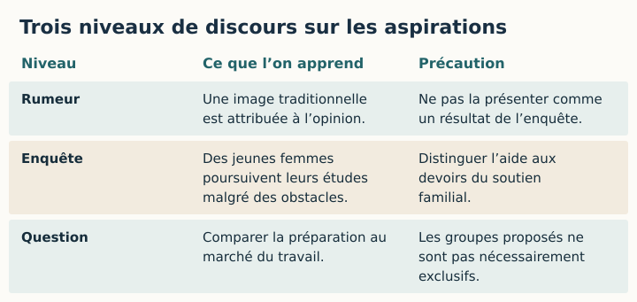

# ENS Rennes · D1 · Allemand 2005 — Corrigé brut

*Corrigé rédigé par IA, non officiel. Signalez toute erreur.*

**Rédaction** · GPT-6.2 Astra Ultra · vitesse non renseignée

Écrit de l’ENS de Cachan, conservé dans les archives D1 de Rennes. « Karriere statt Kinder, Kopftuch, Koran », Spiegel Online, 14 décembre 2004.

## Version française

**Faire carrière plutôt que de s'en tenir aux enfants, au foulard et au Coran**

L'image est solidement ancrée dans bien des esprits. De jeunes Turques parcourraient les rues de Berlin-Kreuzberg, de Cologne ou de Hambourg, entièrement voilées, et ne se montreraient qu'en groupe, entre compatriotes. À en croire les on-dit, elles vivraient dans des familles élargies et régleraient leur existence sur quelques principes tout trouvés, les enfants, le foulard et le Coran. Que cette image doive souvent plus aux préjugés qu'à la réalité, c'est ce que démontre une étude présentée mardi à Berlin. Il en ressort que les jeunes femmes issues de l'immigration sont modernes, ouvertes et désireuses de faire des études et une carrière.

Ces jeunes femmes voudraient fonder une famille et exercer un métier. Mais 48 % des rapatriées d'origine allemande interrogées, 47 % des femmes originaires de l'ex-Yougoslavie et 39 % des migrantes des autres groupes étudiés n'auraient personne pour les aider à faire leurs devoirs. L'attachement à la famille serait pourtant l'un des principaux soutiens de leurs aspirations scolaires. Selon l'étude, ces jeunes filles et ces jeunes femmes tiennent à obtenir de bonnes notes et de bons diplômes de fin d'études, bien qu'elles soient généralement issues de milieux peu familiers du système éducatif.

En cela, indique l'étude, leur comportement se distinguerait nettement de celui que l'on attribue aux classes défavorisées. L'enquête parle même de « promotion par les études ». Malgré des revers tels qu'un ou plusieurs redoublements et malgré des expériences d'exclusion, ces jeunes femmes poursuivraient obstinément leur parcours scolaire. Par leur motivation et leur capacité à s'imposer, elles seraient même porteuses d'espoir pour les migrants eux-mêmes, mais aussi « pour le système de formation et le marché du travail allemands, qui exigent des individus toujours plus d'initiative personnelle, de capacité à supporter la frustration et, tout particulièrement, de mobilité ».

## Expression en allemand

Évaluer en allemand, en 100 mots, l’affirmation selon laquelle les jeunes migrantes seraient mieux préparées au marché du travail que les jeunes Allemands.

Die Studie zeigt, dass viele junge Migrantinnen trotz schwieriger Bedingungen zielstrebig lernen. Wer sich ohne Hilfe bei den Hausaufgaben durchsetzen muss, kann Selbstständigkeit entwickeln, die später im Beruf nützlich ist. Daraus folgt aber nicht, dass jede Migrantin besser vorbereitet wäre als jeder deutsche Jugendliche. Manche jungen Menschen gehören ohnehin beiden Gruppen an. Außerdem hängen berufliche Chancen von Schulabschlüssen, Sprachkenntnissen, Kontakten und den Entscheidungen der Arbeitgeber ab. Motivation allein beseitigt keine Benachteiligung. Ich würde deshalb weniger nach der angeblich stärkeren Gruppe fragen und eher untersuchen, welche Unterstützung allen Jugendlichen hilft, ihre Fähigkeiten zu zeigen und den gewünschten Beruf tatsächlich zu ergreifen.

*100 mots, comptés par espaces.*

[Feuillet original, p. 7](https://www.ens-rennes.fr/medias/fichier/2005-sujets-d1_1423060647728-pdf#page=7)
