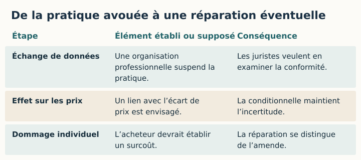

# ENS Rennes · D1 · Anglais 2005 — Corrigé brut

*Corrigé rédigé par IA, non officiel. Signalez toute erreur.*

**Rédaction** · GPT-6.2 Astra Ultra · vitesse non renseignée

Écrit de l’ENS de Cachan, conservé dans les archives D1 de Rennes. « Car makers confess: we’ve colluded on sales for 20 years », adapté du Sunday Telegraph, 23 janvier 2005.

## Version française

**Les constructeurs automobiles reconnaissent s'être concertés sur les ventes pendant vingt ans**

L'industrie automobile britannique a reconnu que tous les constructeurs pourraient avoir échangé illégalement des renseignements sur les ventes pendant plus de vingt ans.

La semaine dernière, les avocats mandatés par la Society of Motor Manufacturers and Traders (SMMT), l'organisation professionnelle du secteur, ont ordonné l'arrêt immédiat de cette pratique, par laquelle tous les constructeurs échangeaient des informations.

Ils estiment que, s'il s'avérait que ces échanges de données aussi sensibles, introduits dans les années 1980, enfreignent les règles britanniques et européennes de la concurrence destinées à combattre les ententes, l'association comme les constructeurs seraient passibles de lourdes amendes.

L'association craint que, si le partage des prévisions de ventes est illégal, on puisse établir un lien entre cette pratique et l'écart de longue date entre les prix des voitures en Grande-Bretagne et dans le reste de l'Europe. Le secteur pourrait alors s'exposer à des demandes d'indemnisation émanant de toute personne ayant acheté une voiture au cours des deux décennies écoulées.

Paul Everitt, responsable de la stratégie de l'association, a déclaré : « Nous choisissons la prudence en attendant d'avoir déterminé si nous respectons la loi. »

Ces inquiétudes font suite à une décision récente de la Commission européenne de confier à chaque État la responsabilité de veiller au respect du droit de la concurrence par les entreprises. Il incombe désormais, à leur tour, aux secteurs d'activité britanniques de se contrôler eux-mêmes.

## Expression en anglais

Expliquer pourquoi les clients demanderaient une indemnisation et évaluer leurs chances de l’obtenir. Répondre en anglais en 100 mots.

Customers might argue that exchanging sales forecasts weakened competition, allowing manufacturers to charge more in Britain than they could have charged independently. Buyers would then seek repayment of the extra amount they paid. However, stopping the exchange does not establish that it was unlawful or that every purchaser suffered a loss. Prices may reflect differences in equipment, taxes or distribution costs. A successful claim would require evidence linking the practice to a measurable overcharge during the relevant period. I would expect compensation to be possible if such evidence emerged, but proving each buyer's loss after two decades could be difficult.

*100 mots, comptés par espaces.*

[Feuillet original, p. 8](https://www.ens-rennes.fr/medias/fichier/2005-sujets-d1_1423060647728-pdf#page=8)
