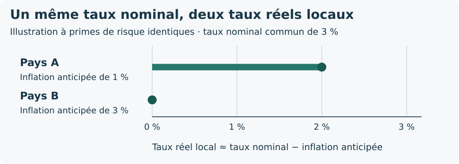

# ENS de Cachan D1 — Composition d’ordre économique 2005 · Corrigé brut

*Corrigé rédigé par IA, non officiel. Signalez toute erreur.*

**Rédaction** · GPT-6.2 Astra Ultra · vitesse non renseignée

## La mise en place de l’Union économique et monétaire a-t-elle conduit à la disparition des politiques économiques nationales ?

### Introduction

En février 2001, le Conseil de l’Union européenne recommande à l’Irlande de corriger l’orientation expansionniste de son budget. Le pays dégage pourtant un excédent. Ce qui inquiète ses partenaires est l’effet d’une impulsion supplémentaire sur une économie déjà en forte expansion. Cet épisode révèle deux faits. Le budget irlandais reste à la disposition d’autorités nationales, mais la manière dont celles-ci l’utilisent concerne désormais leurs partenaires monétaires.

L’Union économique et monétaire (UEM), préparée par le traité de Maastricht, entre dans sa troisième phase en janvier 1999. Onze États adoptent alors l’euro comme unité monétaire et la Grèce les rejoint en 2001. La mise en circulation des billets et pièces en 2002 rend visible un transfert de pouvoir déjà réalisé. Au printemps 2005, il faut donc distinguer les douze pays de la zone euro des autres membres de l’Union européenne. Les politiques économiques nationales désignent les décisions des autorités d’un pays sur la conjoncture, la répartition et les capacités productives. Leur disparition supposerait que ces autorités n’aient plus d’instruments ou que les instruments conservés soient sans effet. L’UEM a effectivement retiré aux participants la décision monétaire unilatérale et encadré leur budget. Cette redistribution des responsabilités rend cependant les instruments nationaux particulièrement précieux lorsque les situations divergent.

### I. L’UEM a supprimé deux instruments nationaux et soumis le budget à une discipline commune

#### A. Un seul taux directeur et des parités irrévocables mettent fin à la stabilisation monétaire pays par pays

Avant l’euro, une banque centrale nationale pouvait juridiquement modifier ses taux et le gouvernement pouvait rechercher une modification de la parité. L’autonomie effective était déjà limitée dans le Système monétaire européen. Défendre un change vis-à-vis du mark alors que les capitaux peuvent circuler oblige à tenir compte des conditions monétaires allemandes. La logique de Mundell et Fleming rend compte de cette contrainte. Avec des changes fixes crédibles et une forte mobilité des capitaux, une baisse autonome et durable des taux suscite des sorties de capitaux et des pressions sur la parité. L’euro rend le choix irrévocable entre participants. Il réduit le risque de change dans leurs échanges et fait passer la décision de taux à l’Eurosystème, qui rassemble la BCE et les banques centrales nationales des pays participants. Les gouverneurs siègent au Conseil des gouverneurs et participent à une décision commune en indépendance à l’égard des gouvernements.

Le traité donne au Système européen de banques centrales comme objectif principal la stabilité des prix. Le Conseil des gouverneurs détermine sa politique pour l’ensemble de la zone et vise à moyen terme, selon sa clarification de 2003, une inflation inférieure à 2 % mais proche de ce niveau. Un État frappé par une chute de ses exportations ne peut demander un taux directeur valable pour lui seul, ni dévaluer sa monnaie vis-à-vis de ses voisins de la zone. Les effets du taux commun peuvent même diverger. Supposons, à titre illustratif, un taux nominal identique de 3 % et des primes de risque identiques. Avec une inflation anticipée de 1 % dans le pays A et de 3 % dans le pays B, le taux réel approché vaut respectivement 2 % et 0 %. Si B connaît déjà une expansion, le crédit réel moins coûteux peut l’amplifier. La monnaie unique supprime un instrument national, pas l’hétérogénéité qui motivait son emploi.

#### B. L’interdépendance des budgets justifie des règles communes qui restreignent la liberté d’action

Lorsque plusieurs États partagent la monnaie, une relance nationale n’a plus à défendre une parité propre, mais ses conséquences dépassent la frontière. Une partie des commandes s’adresse aux entreprises voisines. À l’inverse, des déficits durablement élevés peuvent peser sur la confiance, accentuer les tensions sur l’épargne disponible ou compliquer la politique monétaire commune si la demande totale dépasse les capacités de production. Chaque gouvernement est tenté de retenir le bénéfice national immédiat et de sous-estimer les coûts transférés à ses partenaires. L’interdiction du financement monétaire direct des pouvoirs publics et la procédure concernant les déficits excessifs cherchent à contenir ces effets. La BCE indépendante ne se voit pas assigner la couverture du coût d’emprunt d’un Trésor national.

Le traité et son protocole retiennent des valeurs de référence de 3 % du PIB pour le déficit public et de 60 % pour la dette. L’appréciation tient notamment compte des conditions prévues en cas de dépassement exceptionnel et temporaire du déficit, ou d’une dette qui diminue suffisamment et s’approche du seuil à un rythme satisfaisant. Le Pacte de stabilité et de croissance adopté en 1997 comprend une surveillance préventive des trajectoires et un volet correctif. Passer le seuil de déficit ne déclenche pas mécaniquement une amende. Il faut une appréciation et des décisions selon la procédure applicable. En mars 2005, le Conseil européen approuve une réforme destinée notamment à mieux tenir compte des situations nationales et du cycle tout en préservant les références du traité. Au printemps, cet accord politique ne doit pas être confondu avec les modifications réglementaires postérieures. Le rapprochement des politiques porte sur leurs conséquences d’ensemble. Il laisse ouverte la question de l’impôt à modifier ou du service public à financer.

### II. Les États gardent des instruments efficaces, dont l’usage dépend davantage de la conjoncture et des choix de leurs partenaires

#### A. Le budget national amortit les chocs locaux et permet des arbitrages distributifs distincts

Si la demande d’automobiles chute dans un pays où les usines se concentrent, les recettes d’impôts et de cotisations y baissent, tandis que les prestations de chômage peuvent augmenter. Ces stabilisateurs automatiques soutiennent le revenu disponible sans décision nouvelle. Ils agissent là où le chômage s’accroît, même si l’inflation de la zone ne justifie aucune détente monétaire. L’analyse des zones monétaires optimales associée à Robert Mundell suggère que la mobilité du travail et la flexibilité des prix relatifs peuvent aussi faciliter l’ajustement. Or un salarié ne change pas immédiatement de langue, de logement et de qualification. Un budget national disposant de marges pendant la récession reste alors un instrument d’assurance. Le budget communautaire et ses transferts structurels n’offrent pas l’équivalent d’un vaste régime fédéral d’indemnisation conjoncturelle.

Une relance nationale peut aussi augmenter la production à court terme. Considérons une petite économie avec capacités inutilisées, prix et taux d’intérêt constants, exportations et investissement inchangés. Le revenu est $Y=C+I+G+X-M$, la consommation supplémentaire vaut $c(1-t)\Delta Y$ et les importations supplémentaires $m\Delta Y$. Une hausse de la commande publique portant initialement sur la production intérieure entraîne ainsi $\Delta Y=\Delta G/[1-c(1-t)+m]$. Avec une propension à consommer $c=0{,}8$, un taux marginal d’imposition $t=0{,}25$ et une propension à importer $m=0{,}2$, chaque euro de revenu initial crée 0,40 euro de nouvelle demande intérieure. L’augmentation totale de production atteint environ 1,67 euro pour un euro de commande initiale. Ce calcul illustre un mécanisme. Une hausse des taux, des importations plus fortes ou la saturation des capacités réduiraient son effet réel. Par ailleurs, même avec un solde donné, remplacer une dépense par une autre ou redistribuer un prélèvement entre ménages produit des effets différents sur la consommation, l’emploi et les inégalités.

#### B. La coordination et les réformes structurelles donnent une nouvelle portée aux décisions nationales

Un pays qui soutient seul la demande dans une récession générale paie le coût budgétaire initial et fournit une partie des débouchés à ses voisins. Chacun peut alors attendre la relance des autres, de sorte que la demande de la zone reste insuffisante. Une concertation entre budgets nationaux permet d’internaliser les retombées lorsque l’appareil productif est sous-employé. Si, au contraire, l’Irlande connaît en 2001 une expansion plus vive que ses partenaires, une politique budgétaire plus restrictive peut y modérer la demande sans pénaliser l’ensemble de la zone par une hausse des taux. C’est précisément pourquoi l’article 99 du traité instituant la Communauté européenne qualifie les politiques économiques de « question d’intérêt commun » et organise leur coordination au Conseil. La recommandation adressée à l’Irlande suppose que ses autorités puissent agir. Elle ne désigne pas à leur place une ligne précise d’impôt ou de dépense.

L’ajustement peut enfin porter sur la productivité, les qualifications et la répartition des ressources. Un gouvernement conserve la capacité d’investir dans la formation, l’infrastructure ou la recherche, de réorganiser les prélèvements sur le travail et de choisir des mécanismes de protection sociale, sous réserve des règles communes applicables. Former les travailleurs d’un bassin industriel aux métiers demandés facilite leur réemploi. Améliorer la productivité réduit le coût unitaire du travail à salaire donné et peut rétablir une compétitivité perdue. Ces politiques prennent du temps et posent des arbitrages nationaux entre rendement futur, distribution présente et coût budgétaire. Une baisse des salaires partout dans la zone ne saurait rendre tous les pays plus compétitifs les uns par rapport aux autres. Si elle déprime la consommation, elle peut même réduire les débouchés. La stratégie de Lisbonne engagée en 2000 illustre cette articulation entre objectifs communs d’emploi ou de compétitivité et choix nationaux de mise en œuvre. Une politique structurelle nationale demeure possible, tandis que son efficacité dépend des réponses des partenaires et du contexte macroéconomique.

### Conclusion

En 2005, les membres de la zone euro ont abandonné la décision nationale de taux directeur et de change entre eux. Leurs budgets doivent répondre à des obligations de surveillance et de discipline. Il reste pourtant des choix substantiels sur la composition du budget, la redistribution, la stabilisation des revenus et les capacités productives. Le cas irlandais le montrait dès 2001 : une orientation budgétaire nationale peut être assez puissante pour justifier une recommandation commune. L’UEM a changé l’échelle de certaines décisions et les conditions d’efficacité des autres. Elle a accru, dans le traitement des chocs asymétriques, la valeur des instruments que les États conservent.

[Sujet de la session](https://www.ens-rennes.fr/medias/fichier/2005-sujets-d1_1423060647728-pdf#page=5) · [Traité instituant la Communauté européenne, version consolidée de 2002](https://eur-lex.europa.eu/legal-content/FR/TXT/?uri=CELEX%3A12002E%2FTXT) · [Recommandation du Conseil à l’Irlande, 12 février 2001](https://eur-lex.europa.eu/legal-content/FR/TXT/?uri=CELEX%3A32001H0191) · [Conclusions du Conseil européen des 22 et 23 mars 2005](https://www.consilium.europa.eu/uedocs/cms_data/docs/pressdata/fr/ec/84331.pdf)
