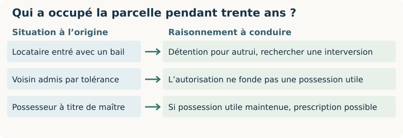

# ENS de Cachan D1 — Droit civil 2005 · Corrigé guidé

*Corrigé rédigé par IA, non officiel. Signalez toute erreur.*

**Rédaction** · GPT-6.2 Astra Ultra · vitesse non renseignée

## Propriété et prescription

### Introduction

> [!INDICATION]
> Comparer deux champs laissés sans culture depuis trente et un ans. Le premier n’a intéressé personne. Le second a été exploité publiquement comme sien par le voisin. Quel fait différencie les deux hypothèses du point de vue du titre de propriété ?

Un propriétaire laisse une parcelle en friche pendant trente ans. Le voisin peut-il s’en dire propriétaire le lendemain du trentième anniversaire ? Le seul écoulement du temps ne lui donne aucun titre. Mais si le voisin a, pendant toute cette période, possédé publiquement et paisiblement le fonds comme le sien, sa prétention peut prospérer, même si sa famille n’a jamais acheté le terrain. L’article 2219 du Code civil, dans sa rédaction de 2005, appelle prescription « un moyen d’acquérir ou de se libérer par un certain laps de temps, et sous les conditions déterminées par la loi ». Les deux verbes désignent des mécanismes différents.

La propriété confère la maîtrise juridique d’une chose. La possession désigne, au contraire, l’exercice effectif d’un droit, que celui qui agit en soit ou non titulaire. Dès lors, le temps éteint-il la maîtrise du propriétaire inactif ou consacre-t-il la maîtrise effectivement exercée par un tiers ? La propriété résiste au simple non-usage. C’est la possession qualifiée d’un autre qui, sous des conditions variables selon le bien et les titres en présence, peut faire prévaloir un nouveau droit sur le premier.

### I. La durée protège la stabilité de la propriété sans prononcer sa déchéance pour simple inactivité

#### A. La permanence du droit distingue la revendication de la poursuite d’une créance

Le propriétaire est libre en principe de choisir l’usage de sa chose. Cette liberté comprend celle de ne pas s’en servir. Le décès du titulaire ouvre une transmission successorale et ne rend pas la chose librement appropriable par le premier occupant. De même, un propriétaire qui n’a pas visité son terrain pendant plusieurs décennies conserve son droit tant qu’aucun événement juridique n’en a transféré ou supprimé l’objet. L’action en revendication permet à celui qui se dit propriétaire de réclamer sa chose. En matière immobilière, la jurisprudence protège le droit de propriété et cette action contre l’extinction par le seul non-usage, malgré la formulation générale de l’ancien article 2262 sur la prescription trentenaire des actions réelles et personnelles. Si le défendeur ne démontre aucun fait d’acquisition, la simple ancienneté de l’abstention du demandeur ne lui livre pas le fonds.

Les demandes accessoires doivent être qualifiées séparément. L’action d’un bailleur en paiement des loyers obéit à l’ancien article 2277 sur la prescription de cinq ans. Un bailleur peut donc perdre le droit d’obtenir le paiement judiciaire de certaines échéances anciennes tout en demeurant propriétaire de l’immeuble. Des droits réels limités connaissent également des règles propres. Une servitude peut s’éteindre par trente ans de non-usage (art. 706) et l’usufruit par un non-usage de même durée (art. 617). L’extinction libère alors le fonds servant ou rend au nu-propriétaire la plénitude des utilités de la chose. Il serait trompeur de déduire de ces délais une règle générale de péremption de la propriété elle-même.

#### B. Seule une possession utile prépare l’acquisition contre le titulaire du droit

> [!INDICATION]
> Souligner le mot « propriétaire » dans l’article 2229 ancien. Il décrit la qualité en laquelle il faut posséder. Il ne signifie pas que celui qui invoque la prescription doit prouver dès le départ le titre qu’il entend précisément acquérir.

Selon l’article 2229 ancien, la possession doit être « continue et non interrompue, paisible, publique, non équivoque, et à titre de propriétaire ». Des actes matériels compatibles avec la nature du bien, clôturer un pré, le mettre en culture, en récolter le produit, peuvent rendre visible la prétention à la maîtrise du fonds. La continuité s’apprécie compte tenu des usages normaux. On n’exige pas une récolte en plein hiver. Des actes violents ne fondent une possession utile qu’une fois la violence cessée. Des actes clandestins ou qui s’expliqueraient tout aussi bien par une permission peuvent échouer à manifester la prétention de posséder pour soi. Un paiement d’impôt constitue un indice à confronter à ces faits, sans suffire à établir à lui seul la possession utile.

Le locataire détient pour autrui. Les actes qu’il accomplit en exécution de son bail ne changent pas de sens parce qu’ils se renouvellent pendant trente années. Il ne peut prescrire contre son bailleur sans interversion de titre. Celle-ci peut résulter d’une cause venant d’un tiers ou d’une contradiction opposée au droit du propriétaire, dans les conditions de l’article 2238 ancien. Une simple résolution intérieure de se comporter désormais en maître n’en fournit pas la preuve. Pareillement, les actes de simple tolérance ne fondent ni possession ni prescription (art. 2232). L’arrangement par lequel un voisin permet de déposer du bois sur son terrain ne lui fait donc pas courir le même risque qu’une prise de possession contradictoire et publique de la parcelle.

### II. L’acquisition par le temps répartit différemment la protection selon la chose et l’apparence de titre

#### A. Pour les immeubles, le délai réalise un arbitrage entre le propriétaire et le possesseur

La possession utile maintenue trente ans permet au possesseur d’un immeuble de se prévaloir de la prescription sans justifier de titre et sans que sa mauvaise foi lui soit opposable (ancien art. 2262). Le mécanisme peut donc bénéficier à celui qui savait ne pas posséder d’acte d’achat. Il fournit aussi une preuve décisive à celui qui, persuadé d’avoir régulièrement acquis, ne parvient pas à reconstituer toute la chaîne des mutations. En stabilisant la situation, le temps évite de devoir établir pour chaque auteur que son propre auteur était déjà propriétaire. Sous les conditions de la jonction des possessions, l’ayant cause peut ajouter à la sienne la possession de son auteur (art. 2235). L’effet de l’usucapion, lorsqu’elle est acquise et invoquée, rattache la qualité de propriétaire au début de la possession utile. Le juge ne peut suppléer d’office le moyen tiré de la prescription (art. 2223).

Le délai abrégé de 2005 obéit à d’autres exigences. Celui qui a acquis un immeuble de bonne foi et par juste titre bénéficie de dix ans si le véritable propriétaire habite dans le ressort de la cour d’appel où l’immeuble est situé, de vingt ans s’il est domicilié hors de ce ressort (art. 2265, sous réserve de la règle de calcul en cas de changement de domicile). Le juste titre doit être un acte qui aurait réellement transféré la propriété si son auteur avait été propriétaire. Une vente émanant de l’apparent propriétaire peut convenir, un bail ne le peut pas. La bonne foi est la croyance, lors de l’acquisition, que l’auteur pouvait transférer le droit. Elle est présumée. Le possesseur qui ne remplit pas les conditions de l’abrègement peut encore établir une possession trentenaire.

> [!INDICATION]
> Un acheteur entre en possession en 1994 sur le fondement d’une vente valable passée par une personne qu’il croit propriétaire. En 2005, onze ans se sont écoulés. Si le véritable propriétaire a toujours habité dans le même ressort, le délai de dix ans peut être atteint. Hors du ressort pendant toute la période, le délai de vingt ans manque encore. Dans les deux cas il reste à vérifier la qualité et la continuité de la possession.

La durée doit en effet avoir couru utilement. La dépossession pendant plus d’un an interrompt naturellement la prescription (art. 2243). Une citation en justice signifiée à celui que l’on veut empêcher de prescrire peut produire une interruption civile (art. 2244). La reconnaissance du droit du propriétaire par le possesseur interrompt également le délai (art. 2248). Il faut distinguer cette perte du temps déjà couru et une cause de suspension, telle celle prévue en faveur des mineurs non émancipés sous les réserves de l’article 2252. L’aptitude du bien à être prescrit doit elle-même être vérifiée. L’article 2226 écarte la prescription des choses hors du commerce. L’imprescriptibilité du domaine public protège les biens qui en relèvent. L’occupation prolongée d’une portion d’une voie publique n’aboutit donc pas comme celle d’une parcelle privée ordinaire.

#### B. Le droit mobilier privilégie la sécurité de la circulation sous réserve de la perte et du vol

L’ancien article 2279 affirme qu’« en fait de meubles, la possession vaut titre ». Pour les meubles corporels individualisés auxquels il s’applique, il peut dispenser d’avoir à prouver, titre par titre, la chaîne de propriété. Il peut même attribuer immédiatement la propriété à celui qui, de bonne foi, reçoit en possession du non-propriétaire un bien que son propriétaire lui avait volontairement confié. Par exemple, A prête une montre à B. B la vend et la remet à C, qui le croit propriétaire et entre en possession utile. La protection de C sécurise l’échange et laisse à A son recours contre B. Le simple fait que B ait tenu la montre dans ses mains à titre d’emprunteur ne lui permettait pas, à lui, d’invoquer la même règle. La possession vaut ici titre sans exiger dix ou trente années d’attente.

La solution change si la montre a été volée à A ou perdue par lui. Le propriétaire peut la revendiquer pendant trois ans à compter du jour de la perte ou du vol entre les mains du tiers qui la détient, sauf le recours de celui-ci contre celui dont il la tient (art. 2279, al. 2). Si le possesseur actuel a acheté la chose dans une foire, dans un marché, dans une vente publique ou chez un marchand vendant des choses pareilles, le propriétaire originaire ne peut se la faire rendre qu’en remboursant le prix d’achat (art. 2280). Il faut donc connaître la manière dont A s’est dessaisi et les circonstances de l’acquisition par C. Un même objet, détenu depuis le même nombre de jours, peut être revendiqué dans un cas et rester acquis dans l’autre.

### Conclusion

Le temps n’a d’effet sur la propriété qu’à la mesure d’un fait juridiquement qualifié. Un champ délaissé demeure à son maître. Un champ possédé utilement pendant le délai requis peut être acquis par le possesseur. Un meuble confié puis acquis de bonne foi par un tiers peut même changer de propriétaire immédiatement. Les règles de 2005 font ainsi dépendre la stabilité recherchée de la nature du bien, de la qualité de la possession et des moyens dont le titulaire avait disposé pour défendre son droit.

> [!INDICATION]
> À la relecture, dater et nommer chaque délai. Pour le meuble perdu, trois ans depuis la perte. Pour l’immeuble acquis par juste titre, dix ou vingt ans en droit de 2005 selon la localisation du véritable propriétaire. Pour le possesseur sans juste titre, rechercher trente ans de possession utile. Les chiffres ne sont pas interchangeables.

[Sujet de la session](https://www.ens-rennes.fr/medias/fichier/2005-sujets-d1_1423060647728-pdf) · [Code civil en avril 2005](https://www.legifrance.gouv.fr/codes/texte_lc/LEGITEXT000006070721/2005-04-01/)
