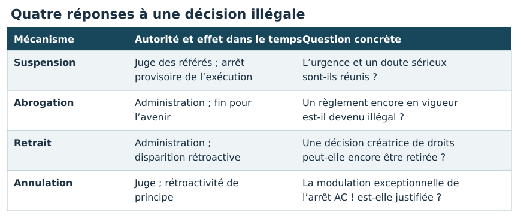

# ENS de Cachan D1 — Droit public 2005 · Corrigé guidé

*Corrigé rédigé par IA, non officiel. Signalez toute erreur.*

**Rédaction** · GPT-6.2 Astra Ultra · vitesse non renseignée

## L’acte administratif unilatéral illégal

### Introduction

Un maire interdit par arrêté toute réunion sur la place du marché durant un mois. Un agent public est titularisé par une décision dont l’auteur n’était pas compétent. Les deux décisions peuvent être illégales. Le premier acte restreint une liberté pour un nombre indéterminé de personnes, le second bénéficie à un agent qui a pu organiser sa vie en fonction de sa nomination. À quelles conditions les intéressés ou l’administration peuvent-ils faire cesser leurs effets ?

L’acte administratif unilatéral procède d’une décision prise sans que le consentement de son destinataire soit nécessaire. L’adjectif « illégal » désigne ici la méconnaissance d’une norme supérieure applicable, qu’elle provienne de la loi ou d’une autre source. Le droit du printemps 2005 combine deux exigences. L’action administrative doit être exécutoire sans attendre une autorisation systématique du juge. La soumission au droit doit néanmoins pouvoir être obtenue. D’où la nécessité de qualifier le vice et de distinguer, selon l’auteur du remède et le temps écoulé, les conséquences que le droit lui attache.

> [!INDICATION]
> Pour chacun des deux exemples, identifier qui gagne à ce que la décision disparaisse et qui s’est fié à sa stabilité. Ces intérêts différents expliquent qu’une même illégalité n’appelle pas toujours la même réponse.

### I. L’illégalité affecte la conformité de l’acte sans effacer d’elle-même son autorité

#### A. Le vice s’identifie par rapport aux règles qui gouvernent la décision

L’acte réglementaire pose une règle générale et impersonnelle. La décision individuelle règle la situation d’un ou de plusieurs destinataires déterminés. Un acte exprès comme une décision née du silence dans les conditions fixées par les textes peuvent encourir l’illégalité. La décision qui fait grief se distingue du simple avis préparatoire. Même l’acte présenté comme une circulaire peut donner prise au recours lorsqu’il contient des dispositions impératives à caractère général (Conseil d’État, 18 décembre 2002, *Mme Duvignères*). La forme sous laquelle est présentée la prescription ne dispense donc pas d’en examiner la portée.

L’examen externe porte sur l’autorité compétente pour la matière, le territoire et la date, ainsi que sur la procédure et la forme prescrites. L’arrêté d’un adjoint qui n’a reçu aucune délégation peut être entaché d’incompétence. L’omission d’une consultation obligatoire ou l’absence de motivation lorsqu’un texte l’impose soulève une question différente. L’examen interne porte sur le contenu, les motifs et le but. Le juge peut contrôler l’existence des faits (*Camino*, 14 janvier 1916), leur qualification juridique (*Gomel*, 4 avril 1914), une erreur de droit ou un détournement de pouvoir. Pour une interdiction de réunion, la réalité du risque de trouble et la possibilité de le prévenir par une mesure moins restrictive comptent toutes deux (*Benjamin*, 19 mai 1933). Un maire compétent et bien informé peut encore adopter une mesure illégale par sa portée excessive.

> [!INDICATION]
> Envisager deux hypothèses séparées. Si la place est paisible, la matérialité du risque est en cause. Si un trouble limité est établi mais peut être contenu par quelques agents, l’interdiction générale demeure susceptible d’être disproportionnée.

#### B. L’acte produit en principe ses effets jusqu’à sa suspension ou sa disparition

Le Conseil d’État tient le caractère exécutoire des décisions administratives pour une règle fondamentale du droit public (*Huglo*, 2 juillet 1982). Sous les conditions de publicité ou de notification applicables, la décision s’impose sans jugement préalable. L’illégalité ordinaire ne fait pas disparaître l’acte au moment où un administré la constate. Le caractère exécutoire doit être distingué du recours à la force matérielle, dont les conditions sont beaucoup plus strictes. L’inexistence juridique reste exceptionnelle et suppose un vice d’une gravité particulière ; le simple dépassement de compétence ne suffit pas normalement à l’établir.

Une personne qui justifie d’un intérêt à agir peut demander l’annulation d’une décision faisant grief par le recours pour excès de pouvoir. Ce recours est en principe ouvert même sans texte (*Dame Lamotte*, 17 février 1950). Il faut en principe agir dans les deux mois de la publicité ou de la notification adéquate, sous réserve des règles particulières et des conditions d’opposabilité du délai. Le recours n’est pas suspensif. L’article L. 521-1 du Code de justice administrative permet toutefois, sur demande, de suspendre l’exécution d’une décision contestée au fond si l’urgence le justifie et si un moyen crée, en l’état de l’instruction, un doute sérieux sur sa légalité. Un organisateur de réunion n’a ainsi pas nécessairement à attendre un jugement rendu après la date prévue pour obtenir une protection provisoire.

### II. La correction de l’illégalité ménage la légalité, les droits constitués et les effets déjà produits

#### A. L’administration doit ou peut revenir sur son acte selon sa nature et selon le délai

Abroger fait cesser l’acte pour l’avenir. Retirer le fait disparaître rétroactivement. Une personne peut demander l’abrogation d’un règlement illégal. Dans *Compagnie Alitalia* (3 février 1989), le Conseil d’État juge que l’autorité saisie est tenue d’y faire droit, que l’illégalité ait existé à l’origine ou qu’elle résulte d’un changement des circonstances de fait ou de droit. Un règlement de circulation devenu disproportionné à la suite de la disparition du danger ne peut donc être maintenu sur la seule constatation qu’il était légal à l’origine. Le refus d’abroger peut être déféré au juge. Un règlement encore applicable peut aussi, en 2005, voir sa légalité discutée par voie d’exception lors du recours contre une mesure prise pour son application. Le juge écarte alors la règle illégale pour trancher le litige.

Le bénéficiaire d’une décision individuelle créatrice de droits jouit d’une protection différente. Selon l’arrêt *Ternon* (26 octobre 2001), sous réserve de dispositions législatives ou réglementaires contraires et hors le cas où il est satisfait à une demande du bénéficiaire, l’administration peut retirer une décision individuelle explicite créatrice de droits, si elle est illégale, dans les quatre mois suivant sa prise. Le point de départ est la prise de décision ; il ne dépend pas de la date à laquelle le service découvre le vice. Une titularisation irrégulière remontant à un an ne peut normalement plus être retirée par ce mécanisme. La fraude fait obstacle à la constitution de droits acquis. Les décisions implicites d’acceptation relèvent, en 2005, des règles particulières de l’article 23 de la loi du 12 avril 2000, qui distinguent notamment la publicité aux tiers, l’absence de telles mesures et l’existence d’un recours contentieux. Appliquer sans distinction le délai de *Ternon* à tout acte illégal ferait disparaître ces protections et ces régimes spéciaux.

> [!INDICATION]
> Sur une ligne du temps, placer la signature d’une titularisation explicite irrégulière au 1er février et sa découverte au mois d’août. Dater les quatre mois à partir de la prise de l’acte, puis rechercher séparément une éventuelle fraude ou un texte spécial.

#### B. Le juge peut annuler, ordonner les suites nécessaires ou réparer un dommage

Le recours direct accueilli conduit en principe à la disparition rétroactive de l’acte avec effet à l’égard de tous. Ainsi, la carrière d’un agent illicitement évincé doit être reconstituée dans les conditions illustrées par *Rodière* (26 décembre 1925). Le juge peut prescrire, dans les conditions prévues par le Code de justice administrative, une mesure d’exécution déterminée ou un réexamen. L’annulation d’un refus pour défaut de procédure ne commande pas nécessairement la délivrance de l’autorisation demandée. Une nouvelle décision prise régulièrement sur un fondement légal reste possible.

La rétroactivité de l’annulation connaît une exception étroitement encadrée depuis *Association AC !* (11 mai 2004). Lorsque les conséquences de la rétroactivité seraient « manifestement excessives », le juge peut, après débat contradictoire et mise en balance des intérêts et du droit au recours, tenir certains effets passés pour définitifs ou différer l’annulation. Dans cette affaire, il fallait mesurer les effets que la remise en cause d’arrêtés d’agrément produirait sur les allocataires et cotisants du régime d’assurance chômage. La simple commodité administrative ne justifie pas un tel aménagement. L’illégalité peut enfin constituer une faute engageant la responsabilité de la personne publique (*Driancourt*, 26 janvier 1973). L’indemnisation exige alors un préjudice direct et certain et un lien de causalité. Elle répond à une demande distincte de l’annulation et n’est pas automatique.

> [!INDICATION]
> Pour l’organisateur empêché de tenir sa réunion, distinguer trois demandes : suspendre à temps, obtenir l’annulation, puis réclamer les dépenses perdues. L’urgence, la légalité et le préjudice sont trois objets de démonstration différents.

### Conclusion

L’acte administratif unilatéral illégal conserve en principe une force exécutoire qui rend indispensable l’existence de recours effectifs. La solution concrète dépend du vice allégué, de la nature de l’acte, des droits créés et du moment où la contestation intervient. Le règlement illégal doit cesser d’orienter les décisions futures tandis que le retrait d’un avantage individuel déjà accordé rencontre des limites temporelles. Le juge assure cette conciliation en pouvant suspendre, annuler et, exceptionnellement, aménager les effets de son jugement.

[Sujet de la session](https://www.ens-rennes.fr/medias/fichier/2005-sujets-d1_1423060647728-pdf#page=3) · [Conseil d’État, Compagnie Alitalia, 1989](https://conseil-etat.fr/fr/arianeweb/CE/decision/1989-02-03/74052) · [Conseil d’État, Ternon, 2001](https://www.conseil-etat.fr/fr/arianeweb/CE/decision/2001-10-26/197018) · [Conseil d’État, Association AC !, 2004](https://www.conseil-etat.fr/fr/arianeweb/CE/decision/2004-05-11/255886)
