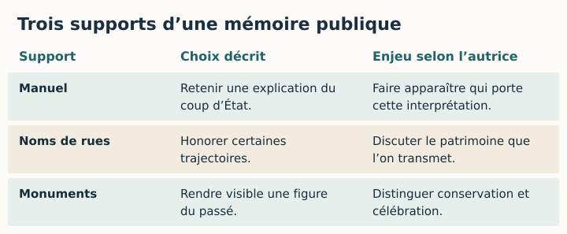

# ENS Rennes · D1 · Espagnol 2005 — Corrigé brut

*Corrigé rédigé par IA, non officiel. Signalez toute erreur.*

**Rédaction** · GPT-6.2 Astra Ultra · vitesse non renseignée

Écrit de l’ENS de Cachan, conservé dans les archives D1 de Rennes. Carmen Molinero, « Memoria y democracia », El País, 7 novembre 2004.

## Version française

Enfin, la situation a changé. Aujourd'hui, la société demande à connaître l'ampleur de la répression et à voir les victimes reconnues sur le plan moral. La société espagnole exige que, dans l'espace public, on ne puisse plus manipuler l'histoire comme on le fait encore aujourd'hui, près de trente ans après la disparition de la dictature, dans certains manuels. Tel est le cas de l'ouvrage sur la géographie et l'histoire de l'Espagne que doivent étudier les soldats et les marins qui aspirent à un emploi permanent dans les forces armées. Il reprend l'argumentation franquiste selon laquelle le coup d'État de 1936 aurait été une réponse au chaos engendré par l'incurie du gouvernement républicain, incapable de maîtriser « les masses ouvrières, organisées autour de groupes révolutionnaires ».

La société espagnole demande que les noms de rues et les monuments remplissent la fonction pédagogique qui leur revient en tant que lieux de mémoire, et qu'ils cessent d'exalter les figures de la dictature comme si elles appartenaient au patrimoine commun. Favoriser la vie en commun n'implique en aucune façon de pratiquer un relativisme éthique selon lequel toutes les idéologies seraient bonnes parce que de nombreux individus y ont cru. Du point de vue d'une conscience démocratique, il est impossible de mettre sur le même plan la Division bleue et les exilés espagnols engagés dans la division Leclerc.

## Expression en espagnol

Commenter en espagnol, en 100 mots, la sélection des faits qui construit la mémoire publique et les buts assignés à cette sélection.

Estoy de acuerdo con Carmen Molinero. Una calle lleva un nombre y no otro porque alguien decidió qué trayectoria merecía un homenaje público. Sin embargo, seleccionar no debería significar imponer una versión definitiva del pasado. Un ayuntamiento puede explicar por qué retira un nombre franquista, conservar los documentos sobre la decisión anterior y escuchar a las familias silenciadas. Así distingue entre estudiar una dictadura y seguir honrando a sus dirigentes. También conviene revisar los manuales, pues una explicación repetida en clase adquiere autoridad. La finalidad democrática de la memoria consiste en abrir esas decisiones al debate y permitir su revisión.

*100 mots, comptés par espaces.*

[Feuillet original, p. 9](https://www.ens-rennes.fr/medias/fichier/2005-sujets-d1_1423060647728-pdf#page=9)
