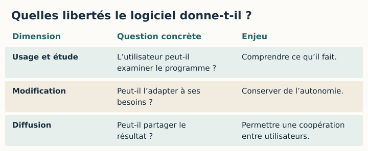

# ENS Rennes · D1 · Italien 2005 — Corrigé guidé

*Corrigé rédigé par IA, non officiel. Signalez toute erreur.*

**Rédaction** · GPT-6.2 Astra Ultra · vitesse non renseignée

Écrit de l’ENS de Cachan, conservé dans les archives D1 de Rennes. Francesca Reboli, « Abbasso i net venduti », L’Espresso, 23 avril 2003.

## Version française

**À bas les vendus du Net**

La commercialisation des logiciels libres déplaît aux irréductibles du Net, qui organisent la résistance en ligne.

Il se promène les cheveux longs et hirsutes, en pulls informes et en jeans élimés. Il vit des maigres revenus du logiciel libre et des dons de ses partisans, mais il est parvenu à faire bouger le marché du logiciel propriétaire, qui pèse des milliards. Depuis 1983, Richard Stallman, cinquante ans, fondateur de la Free Software Foundation, dont le siège se trouve à Boston, parcourt le monde pour prêcher la bonne parole du code libre, autrement dit des logiciels que chacun peut utiliser, modifier, copier et diffuser.

Récemment, il a encore porté ce message à Rome, où il a donné deux conférences, à l'université La Sapienza et au Sénat. Peu de considérations techniques et beaucoup de récriminations politiques ont marqué les interventions de Stallman. Il a vertement critiqué Linux et les autres logiciels open source, dans lesquels il voit la dérive consumériste du mouvement du logiciel libre. « Avec le nom de Linux, inventé par Linus Torvalds, on efface les mérites et la culture libertaire du projet GNU », dit Stallman sans s'embarrasser de nuances. Il accuse Torvalds et ses partisans de se vendre aux grandes entreprises de l'informatique et de finir par faire le jeu des monopoles. C'est précisément ce que Stallman essaie de combattre depuis vingt ans. Sur le plan idéologique, la notion de logiciel libre se situe en dehors du « communisme informatique » et relève d'une culture de la liberté dont le premier objectif est de combattre ceux qui monopolisent le marché du logiciel. « C'est une question économique, sociale, et une question de droits politiques pour les citoyens. Le mot anglais *free* signifie qu'on est libre d'utiliser, d'étudier, d'améliorer et de distribuer le logiciel à autrui, sans que cela implique la gratuité. Nous voulons une mondialisation dans laquelle les gens puissent collaborer sur un pied d'égalité, sans hiérarchie et sans domination de quiconque. »

## Expression en italien

Discuter en italien, en 100 mots, de la place et du rôle de la morale dans les nouvelles technologies.

La morale entra nelle nuove tecnologie già nel momento in cui si decide chi potrà usare, controllare o modificare uno strumento. Una scuola che acquista un programma dovrebbe sapere se gli studenti potranno continuare a leggere i propri documenti cambiando fornitore. La libertà difesa da Stallman diventa allora una questione concreta di autonomia. Tuttavia un codice accessibile non garantisce da solo un uso giusto: anche un programma libero può raccogliere dati inutili o escludere persone disabili. Per questo occorrono responsabilità precise, spiegazioni comprensibili e possibilità di scelta. La tecnica offre alternative, mentre la discussione morale aiuta a valutarne le conseguenze.

*100 mots, comptés par espaces.*

## Comment construire la réponse

**Traduire le titre dans son registre.** *I venduti* signifie « les vendus », ceux que l'on accuse de s'être laissés acheter. *I duri della Rete* sont les irréductibles du Net. La journaliste présente les accusations qui suivent comme les positions de Stallman.

**Garder la distinction conceptuelle.** *Libero* concerne ce que l'utilisateur a le droit de faire. *Gratuito* concerne ce qu'il paie. Le passage énumère des libertés d'utilisation, d'étude, d'amélioration et de redistribution. Il oppose également dans le discours de Stallman deux cultures qu'il serait trompeur de déclarer identiques en traduisant.

**Conduire l'argument.** L'exemple de l'école relie la morale aux conséquences futures d'un choix technique. La distinction entre un droit d'accès au code et les usages réels des données permet ensuite de prendre de la distance à l'égard du seul débat sur les licences.

[Feuillet original, p. 10](https://www.ens-rennes.fr/medias/fichier/2005-sujets-d1_1423060647728-pdf#page=10)
