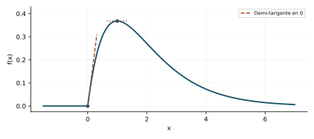

# ENS de Cachan D1 — Mathématiques appliquées et statistiques 2005 · Corrigé guidé

*Corrigé rédigé par IA, non officiel. Signalez toute erreur.*

**Rédaction** · GPT-6.2 Astra Ultra · vitesse non renseignée

**Révision** · GPT-6.2 Astra Ultra · vitesse non renseignée

Le cahier C1583 comporte quatre exercices sans calculatrice. Ils portent sur une fonction définie par morceaux, une somme binomiale, une répartition de pertes et la linéarité de la moyenne.

## Exercice 1. Fonction à seuil

### Question 1.1

> [!INDICATION]
> Remplacer la fonction indicatrice par sa valeur sur chaque demi-droite.

#### Solution

Le cahier donne $f(x)=xe^{-x}\sigma(x)$, avec $\sigma=0$ à gauche de 0 et $\sigma=1$ à partir de 0. Ainsi $f(x)=0$ pour $x<0$ et $f(x)=xe^{-x}$ pour $x\ge0$. Le paramètre $a$ mentionné dans la phrase suivante n’intervient dans aucune des formules imprimées.

### Question 1.2

> [!INDICATION]
> Vérifier le seul raccord entre les deux expressions.

#### Solution

Sur chaque demi-droite ouverte, la continuité découle de l’expression donnée. En zéro, les deux limites sont nulles, car $xe^{-x}\to0$ à droite. Elles égalent $f(0)=0$. La fonction est donc continue sur $\mathbb R$.

### Question 1.3

> [!INDICATION]
> Comparer les quotients différentiels latéraux au raccord.

#### Solution

Pour $x<0$, $f'(x)=0$. Pour $x>0$, le produit donne $f'(x)=(1-x)e^{-x}$. En zéro, $[f(h)-f(0)]/h$ vaut 0 pour $h<0$ et $e^{-h}\to1$ pour $h>0$. Les dérivées latérales sont 0 et 1, donc $f$ n’est pas dérivable en zéro.

### Question 1.4

> [!INDICATION]
> Chercher le changement de signe de la dérivée sur les réels positifs.

#### Solution

La fonction est constante de valeur 0 sur $]-\infty,0]$, puis strictement croissante de 0 à $f(1)=1/e$ sur $[0,1]$ et strictement décroissante sur $[1,+\infty[$. Sa limite à droite est 0 car l’exponentielle domine $x$. Son maximum est $1/e$, atteint seulement en 1.

| Intervalle de $x$ | Signe de la dérivée à l’intérieur | Variation de $f$ |
|---|---|---|
| $]-\infty,0]$ | $0$ | constante, égale à $0$ |
| $[0,1]$ | positif | de $0$ à $1/e$ |
| $[1,+\infty[$ | négatif | de $1/e$ vers $0$ |

Au raccord $0$, la fonction est continue et possède deux demi-tangentes. En $1$, sa dérivée s’annule.

### Question 1.5

> [!INDICATION]
> Placer le point anguleux, le maximum et l’asymptote.

#### Solution

À gauche de 0, la courbe coïncide avec l’axe horizontal. En $(0,0)$, ses demi-tangentes ont pour équations $y=0$ et $y=x$. Au sommet $(1,1/e)$ la tangente est horizontale. À droite, la courbe reste au-dessus de son asymptote $y=0$.

## Exercice 2. Somme binomiale alternée

### Question 2.1

> [!INDICATION]
> Absorber le facteur k dans le coefficient binomial.

#### Solution

Les termes commencent par $\binom n1-2\binom n2+3\binom n3$ et s’achèvent par $(-1)^{n-1}n\binom nn$. Utilisons $k\binom nk=n\binom{n-1}{k-1}$. Pour $n\ge2$,
$$\sum_{k=1}^n(-1)^{k-1}k\binom nk=n\sum_{j=0}^{n-1}(-1)^j\binom{n-1}j=n(1-1)^{n-1}=0.$$
Pour $n=1$, le seul terme vaut 1. Si $n=0$ est autorisé, la somme vide vaut 0.

## Exercice 3. Répartition des produits défectueux

### Question 3

> [!INDICATION]
> Pondérer les taux de défaut par la part de chaque fournisseur, puis conditionner sur le défaut.

#### Solution

Soit $D$ le défaut. Les probabilités conjointes $P(F_i\cap D)$ valent $0{,}30\times0{,}01=0{,}003$, $0{,}20\times0{,}025=0{,}005$ et $0{,}50\times0{,}03=0{,}015$. Leur somme vaut $0{,}023$. D’après Bayes, les parts des trois fournisseurs parmi les produits défectueux sont $3/23$, $5/23$ et $15/23$. Si la valeur moyenne d’un article défectueux est commune aux trois origines, la répartition proportionnelle de la perte de 6300 euros est la suivante.

| Fournisseur | Part exacte en euros | Au centime, total conservé |
|---|---:|---:|
| F1 | $18900/23$ | 821,74 € |
| F2 | $31500/23$ | 1 369,56 € |
| F3 | $94500/23$ | 4 108,70 € |

Les deux centimes au-delà des montants tronqués vont aux plus grands restes. Si la valeur moyenne d’un article défectueux du fournisseur $i$ est $v_i$, les pertes attendues des trois origines sont proportionnelles à $3v_1$, $5v_2$ et $15v_3$. Ainsi, la part du premier fournisseur vaudrait $6300\times 3v_1/(3v_1+5v_2+15v_3)$ euros. Le calcul du tableau correspond à des valeurs moyennes identiques.

## Exercice 4. Moyenne d’une variable multipliée par une constante

### Question 4

> [!INDICATION]
> Conserver la probabilité de chaque issue lorsque sa valeur est multipliée par k.

#### Solution

Pour une variable discrète intégrable prenant les valeurs $x_i$ avec probabilités $p_i$, la variable $kX$ prend les valeurs $kx_i$ avec les mêmes probabilités. Ainsi $M(kX)=\sum_i(kx_i)p_i=k\sum_i x_ip_i=kM(X)$. Pour une loi quelconque, la même démonstration s’écrit $M(kX)=\int kX\,dP=k\int X\,dP$, l’intégrabilité assurant la finitude des deux moyennes. Le signe de $k$ ne change pas la formule.
