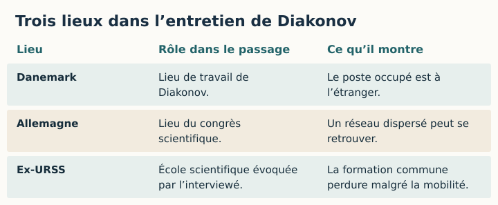

# ENS Rennes · D1 · Russe 2005 — Corrigé guidé

*Corrigé rédigé par IA, non officiel. Signalez toute erreur.*

**Rédaction** · GPT-6.2 Astra Ultra · vitesse non renseignée

Écrit de l’ENS de Cachan, conservé dans les archives D1 de Rennes. Nina Geïde (Нина Гейдэ), « Наука — интернациональна », Эмигрантъ, février 2005 ; entretien avec Dmitri Diakonov.

## Version française

**Compatriotes. La science est internationale**

Un scientifique russe qui travaille à l'étranger, voilà un sujet nouveau de la vie contemporaine. Nous en parlons aujourd'hui, ainsi que de bien d'autres questions, avec un savant russe qui vit et travaille actuellement au Danemark, Dmitri Igorevitch Diakonov, docteur en sciences physiques et mathématiques, professeur à NORDITA, l'Institut de physique des pays nordiques.

— J'aimerais vous poser une question sans doute assez classique, mais qui garde son importance au regard des transformations complexes que connaissent aujourd'hui la Russie et le monde. Vous considérez-vous toujours comme un scientifique russe, ou bien cette notion s'efface-t-elle peu à peu sous l'effet du processus historique lui-même ?

— Je me considère, bien sûr, comme un scientifique russe. L'école scientifique russe, ou, plus exactement, l'école scientifique de l'ancienne Union soviétique, existe toujours. En physique théorique, elle est très forte. En voici un exemple. Je viens de rentrer d'un congrès scientifique en Allemagne, consacré à la rencontre de deux disciplines, la physique de la matière condensée et celle des particules élémentaires. Le congrès réunissait des savants de différents pays du monde, notamment de Russie et de l'ancienne Union soviétique.

Beaucoup d'entre eux se sont depuis longtemps dispersés dans différents instituts de recherche et universités du monde, où ils occupent des postes de premier plan. Et, vous savez, j'ai constaté que c'étaient précisément ces personnes qui donnaient le ton à tout le congrès. Ce sont des professionnels de tout premier ordre. Il m'a été très facile de parler avec eux. Nous partageons des goûts et des valeurs scientifiques qui ne s'effacent pas avec le temps. On comprenait d'emblée que nous avions tous pris notre envol du même nid.

## Expression en russe

Présenter en russe, en 100 mots, le phénomène de la « fuite des cerveaux » russes et discuter la possibilité de l’arrêter.

Под утечкой умов обычно понимают отъезд квалифицированных специалистов туда, где им предлагают лучшие условия для работы. После распада Советского Союза многие российские исследователи искали устойчивое финансирование, оборудование и возможность свободно выбирать тему. Запретами остановить такой отъезд трудно и несправедливо. Гораздо полезнее создавать открытые конкурсы, поддерживать молодые лаборатории и обеспечивать достойную оплату труда. При этом работа за границей не обязательно означает потерю всех связей. Как показывает пример Дьяконова, общая научная школа сохраняется благодаря совместным исследованиям и конференциям. Поэтому успех политики я оценивал бы по тому, могут ли учёные возвращаться, сотрудничать и самостоятельно выбирать место работы, а не только по числу уехавших.

*100 mots, comptés par espaces.*

## Comment construire la réponse

**Lire l'entretien à deux voix.** La question porte sur l'identité ressentie du chercheur. Celui-ci distingue l'adjectif « russe » de la réalité historique de l'école soviétique. Il l'illustre par une réunion en Allemagne, alors que son propre lieu de travail est au Danemark.

**Respecter la terminologie.** *Физика конденсированного состояния* est la physique de la matière condensée, *физика элементарных частиц* celle des particules élémentaires. *Задавать тон* signifie « donner le ton ». Le « même nid » reprend en image la formation scientifique commune.

**Répondre aux deux volets.** Expliquer l'expression « fuite des cerveaux » puis discuter ce que pourrait signifier « l'arrêter ». Les mesures qui rendent une carrière envisageable dans le pays se distinguent d'une interdiction de mobilité et de la possibilité d'entretenir depuis l'étranger des collaborations scientifiques.

[Feuillet original, p. 11](https://www.ens-rennes.fr/medias/fichier/2005-sujets-d1_1423060647728-pdf#page=11)
